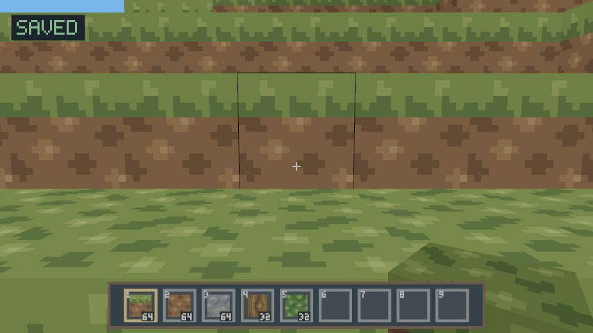
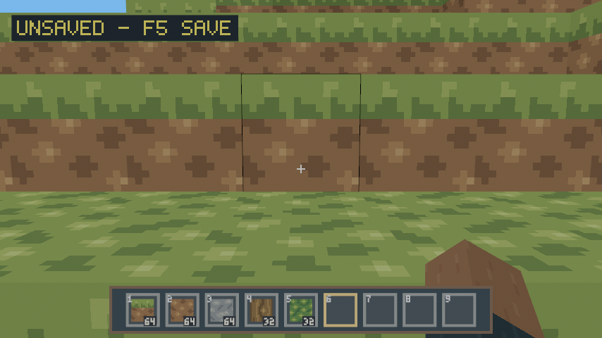
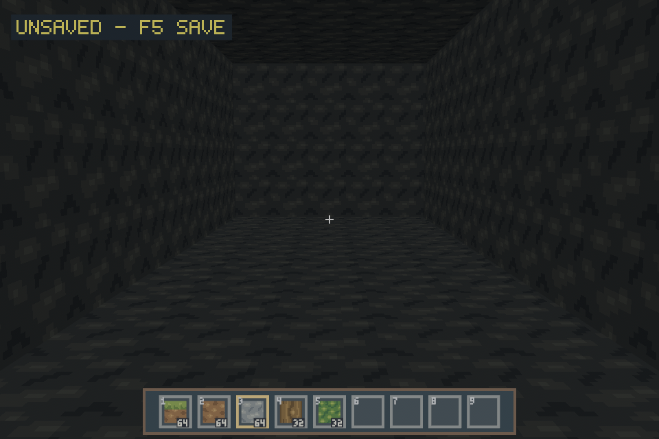
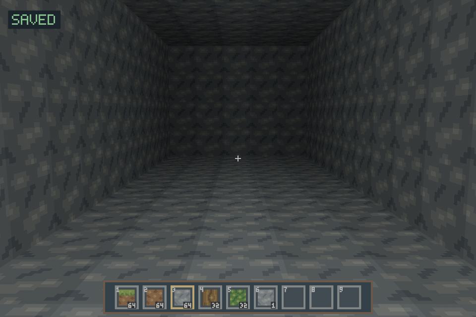
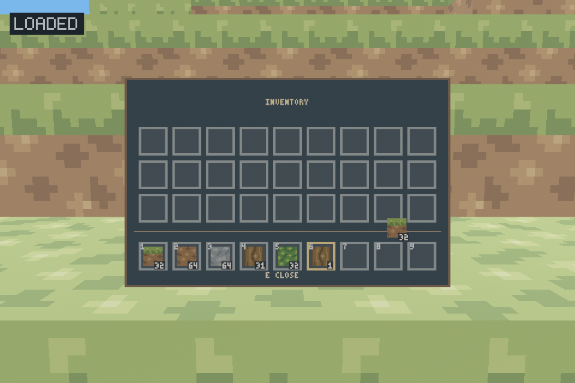
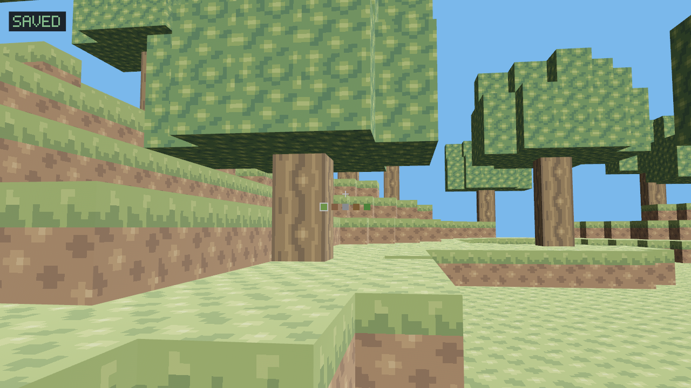

# RustCraft

**RustCraft** is a public, experimental Minecraft-inspired voxel sandbox written in Rust. The current v0.1 prototype displays a finite, procedurally generated block world with a first-person **walking player**, gravity, jumping, voxel collision and editable blocks. The long-term goal is a Classic-style editable world, followed by survival and original sandbox mechanics.

RustCraft is an independent project, not a Minecraft source port, and is not affiliated with or endorsed by Mojang or Microsoft.

## Current prototype

- Deterministic seeded terrain, rolling hills/valleys, a walkable cave network with surface entrance, and blocky trees.
- 16³ chunks streamed in a **65,536×65,536×48** new-world rollout with local generation and regional saves; configurable load radius, bounded background generation/meshing and cache eviction.
- Seven original 16×16 pixel textures for grass, dirt, stone, bark, end-grain and opaque leaves, using one shared nearest-filtered atlas.
- Derived 0–15 voxel skylight: dark roofs/caves, gradual entrance falloff and background updates after edits.
- At most one surface mesh per rendered chunk; faces shared by solid blocks are removed, including at chunk boundaries.
- Mouse look, responsive yaw-relative WASD walking, Ctrl sprint, Shift crouch with safe ledges, grounded jumping and safe respawn.
- Fixed 60-Hz engine-independent AABB physics, wall sliding and interpolated camera movement.
- Precise five-block targeting, visible target outline and inventory-backed click-to-break/place.
- Original first-person right hand, textured selected block and subtle movement/action animation.
- Persistent nine-slot hotbar and 27-slot inventory, stacks up to 64, original pixel UI and atlas icons.
- Engine-independent raycasts and validated edits; authoritative blocks change immediately and connected dirty meshes update together off-thread.
- Versioned legacy snapshots / new-world identity and edit overlays, F5 saving, 30-second dirty-only autosave and final save on normal window close.
- Checksummed files, recoverable replacement with a previous-generation backup and an exclusive world lock.
- Coordinate, collision, targeting, mutation and rendering regression tests.

This is **v0.1 / slice 13**. **World edits, inventory and selected hotbar slot survive restart.** Further coordinate expansion, crafting and richer world generation remain future work. Walking is the default and there is no debug-flight mode. One-block terraces require jumping; automatic step-up is not implemented. See [roadmap](docs/ROADMAP.md) and [architecture](docs/ARCHITECTURE.md).

## First-person hand

A single rectangular arm cuboid appears for empty slots; selected blocks appear
on their own, with the original atlas's correct faces. Proportions and motion are
visually calibrated against Java1.21.1's wide standard arm. Walking/sprint,
crouch, jump/landing and click gestures animate only the viewmodel; targeting
and physics stay unchanged. Menus/free cursor hide and reset it. One overlay
view prevents wall occlusion and keeps the existing UI in front; six retained
meshes share the original atlas. See [rendering/resources](docs/VIEWMODEL.md)
and [validation](docs/VALIDATION.md).





## Main and pause menus

RustCraft starts at its original pixel title screen. **Spielen** loads the single
world (or creates one on first play); opening the title alone does not touch saves.
Escape closes inventory first, then opens Pause. Resume, return to title and quit
support mouse and arrow keys/Enter. Returning to title saves asynchronously,
waits for workers and releases the world lock; the same world can be reopened in
the same process. A save failure retains changes and offers retry.
See [menu architecture, screenshots and Void Fish / Windows instructions](docs/MENUS.md).

## Voxel skylight

Open vertical sky supplies level15; solid blocks, including leaves, occlude it.
Scattered light loses one per step. Roofs and caves are darker; mining openings
lets light enter and sealing them removes it again. A small cave brightness floor
keeps textures recognizable. Flat face shading retains the retro look; there is
no AO, day/night cycle, torch/block light or modern shadow-map effect yet.





Lighting is derived from actual blocks in a bounded full-height neighborhood,
computed with meshing on a worker. Unknown regional data never becomes luminous
Air. Cached exact light samples avoid rebuilding unchanged meshes; old complete
meshes remain until a coherent replacement is ready. World/player save formats
and frozen generators are unchanged. See [lighting contract](docs/LIGHTING.md)
and [CPU, RAM, mesh and frame measurements](docs/VALIDATION.md). Lighting adds
CPU work and 42.1% terrain vertex/index payload; the unlit material removes the
old global light washout. Native GPU performance still needs acceptance.

## Inventory and hotbar

Nine hotbar slots remain visible at the bottom. E opens three additional rows of
nine slots. Original pixel frames and numerals reuse our own terrain atlas for
icons; no external UI/font images are required. New player inventories start with
64 each of grass/dirt/stone and 32 each of wood/leaves. Mining collects blocks;
placing consumes the selected stack. A full inventory rejects mining without
changing the block. This slice has no dropped items or crafting.



See [inventory controls, architecture and recovery limits](docs/INVENTORY.md).

## Original retro textures

Grass has separate turf tops, grassy dirt sides and dirt undersides. Upright logs
use bark on walls and end-grain on both ends. Stone and opaque leaves have their
own tiles. The seven authored 16×16 grids use restrained earth/foliage palettes;
no external texture pack or Minecraft image was used. Art, editable source and
standard-library generator are **MIT OR Apache-2.0**: [asset provenance](assets/terrain/README.md).



A single embedded 128×64 sRGB atlas/material serves all chunks, with eight texels
of extruded padding per tile, nearest sampling and one mip. Chunk meshes retain
face culling and async updates; UVs retain their original layout and derived
RGBA light modulation uses a 48-byte terrain vertex. Inventory icons share that image. Intentional distant pixel shimmer is
a consequence of nearest LOD0 sampling. See [texture contract](docs/TEXTURES.md)
and [measurements/limits](docs/VALIDATION.md).

## Build and run on Linux

Install [rustup](https://rustup.rs/) and a C/C++ toolchain. The repository selects **Rust 1.99.1** (including rustfmt and Clippy) through `rust-toolchain.toml`; Cargo installs it when needed. Bevy is pinned to **0.20.0**, and `Cargo.lock` records the dependency graph.

On Void Linux **glibc** x86-64:

```sh
sudo xbps-install -S base-devel pkgconf libX11-devel libxcursor-devel \
  libXi-devel libXrandr-devel wayland-devel libxkbcommon-devel
# For a supported AMD GPU:
sudo xbps-install -S vulkan-loader mesa-vulkan-radeon
```

On Debian/Ubuntu:

```sh
sudo apt-get update
sudo apt-get install -y build-essential pkg-config libx11-dev libxcursor-dev \
  libxi-dev libxrandr-dev libxkbcommon-dev libwayland-dev libvulkan-dev
```

Use a working X11 or Wayland desktop session and a supported graphics driver. The Linux package names can vary by distribution. See [platform details](docs/PLATFORMS.md), including Windows prerequisites and experimental targets.

From the repository root:

```sh
cargo run --locked -p rustcraft
```

The first Bevy build can take several minutes. To limit CPU and memory consumption, use `CARGO_BUILD_JOBS=4 cargo run --locked -p rustcraft`. The original atlas is embedded; no external asset folder, image decoder, Python runtime, service, credentials or environment file is required. Closing the window exits the application.

In the prepared Codex cloud machine, first run `. /workspace/.rustcraft-env/activate.sh` in each shell. A cloud build alone does not establish native graphical compatibility.

## Controls

| Input | Action |
| --- | --- |
| First left click after release | Capture/hide the mouse and resume; does not break/place anything |
| Left click while captured | Break the targeted block (one block per click) |
| Right click while captured | Place the selected block on the target face |
| 1–9 / mouse wheel | Select hotbar slot; wheel wraps, up selects previous |
| E | Open/close inventory; free cursor and pause gameplay while open |
| Inventory left / right click | Pick/place/merge/swap / take rounded-up half or place one |
| Shift + inventory left click | Transfer between main inventory and hotbar, merging first |
| Escape | Close inventory first; otherwise open/close Pause |
| Window focus loss | Release mouse and pause; explicitly resume after returning |
| Mouse | Look around; pitch is clamped |
| W / A / S / D | Walk relative to horizontal view direction |
| Space | Jump; hold to jump again after each landing |
| Left Ctrl / double-tap W | Sprint; Ctrl held, or second W held after two presses within 250 ms |
| Left Shift | Sneak/crouch and guard supported ledges (hold) |
| R while captured | Respawn on safe ground near the starting area and reset view/velocity |
| F5 while focused | Save world and inventory, including with inventory open or mouse released |

The 0.6×1.8-block player spawns on or just above safe solid ground, with eyes 1.62 blocks above the feet. Walking accelerates toward 5.0 blocks/s; sprinting toward 8.0 and sneaking toward 1.8 blocks/s. Continuous sprint-jumps gain a bounded run-up bonus up to 9.2 blocks/s. Sprinting smoothly widens the current base FOV by 9%. Shift lowers the body to 1.5 blocks and the eye to 1.32; standing requires headroom. Sneak guards supported ledges, but jumping or removing support still permits falling. See [movement tuning and limits](docs/MOVEMENT.md). Falling below Y=-32 automatically respawns the player. Escape or focus loss pauses the local simulation, including gravity; click again to continue. Inventory/focus/capture/respawn resets double-W detection, and a jump key held across such transitions must be released before it can jump again.

The center crosshair aims at blocks within five blocks of the displayed eye. A black outline marks the current target; the hotbar frames the selected slot and shows actual counts. Empty clicks and empty selected slots do nothing. Placement cannot replace solid blocks or intersect the current/displayed player body. Simultaneous buttons prioritize breaking. Closing inventory returns a held stack only if it all fits; otherwise NO ROOM keeps it open. Outside clicks never discard items. Normal application close saves a held stack and restores it with inventory open next time.

New regional worlds permit edits within **X/Z [-32768,32768), Y [-16,32)**. Legacy v3 worlds retain **X/Z [-64,64)**; v1/v2 snapshots retain **X/Z [-32,32)** with the same Y bounds. Outside the corresponding box, edits are rejected. Pending chunks temporarily block collision/rays and reject edits until ready; they are never treated as a hole in the floor. R preserves edits/inventory and finds clear sky-exposed ground near the starting area, avoiding tree tops and unsupported columns. Loading uses the same search; player position and velocity are not saved.

Movement speed is independent of diagonal input. Mouse sensitivity does not depend on frame time. The window title also lists the essential controls.

## New worlds and seeds

`RUSTCRAFT_WORLD_SEED` accepts a decimal unsigned 64-bit integer (0 through 18446744073709551615). The deterministic default is **2026**. New regional worlds use **generator version 3**, saved as part of their identity. Generators v1/v2 remain frozen for existing identities; existing worlds never select a new generator. It is read **only when no primary or backup exists**; changing it never changes a loaded world. Invalid seeds stop creation with a clear error. To explore another seed, use a different, preferably fresh absolute `RUSTCRAFT_DATA_DIR`; never delete your real save to switch seeds.

Terrain uses coherent height variation with grass/dirt/stone layers. Caves connect across chunks and have a stair-stepped surface entrance near x=-10, z=20, descending toward the east/west tunnel near z=-10. Trees use supported 4–5-block trunks and simple crowns. Wood and leaves are both **solid and opaque**; there is no leaf decay, transparency, water, biomes, ore distribution or emitted block light. The outer terrain is a finite cut-off edge; falling below the world respawns you safely. The historical demo remains a library test fixture.

New v4 worlds save **seed + generator version + world identity** in a manifest and all edits in regional overlays, including explicit Air. Unmodified chunks reproduce locally from that identity. Loaded chunks and clean region maps are disposable caches; unsaved region maps remain pinned in RAM until successfully saved. v1/v2 saves remain full snapshots with no seed metadata and never gain generated terrain. The [generation contract](docs/WORLDGEN.md) explains deterministic arithmetic, limits and future extension.

## Streaming and compatibility

A fresh data directory creates a **v4 regional world** with generator v3 and
X/Z [-32768,32768), Y [-16,32). There is no map-sized startup allocation.
`RUSTCRAFT_LOAD_RADIUS=1`, `2` (default) or `3` selects a radius independently of
world extent: at most 75 chunks by default, 147 at radius 3. Distant voxel data,
meshes, GPU assets and clean regional overlays unload. Spawn is not pinned.

One background terrain worker loads regional edits, locally generates new columns
and builds meshes. Cached edits use coalesced connected dirty batches; nearby
changes precede new loading, and motion favors forward work within near rings.
Current local dependency tokens prevent stale/partial seam publication without
rejecting unrelated work. Physics sees edits immediately; presentation may lag
by a worker job. Pending/failed chunks are safe solid barriers and reject edits.

Physics and targeting keep f64 world coordinates. A floating render origin keeps
meshes, camera and bitmap feedback precise at distant positions. The title reports
world position, resident/pending/dirty work, seed/version and radius. R/void reloads
an evicted origin and waits before finding clear ground from actual saved edits.

**Existing v1/v2 worlds remain finite 64×64 full snapshots; existing v3 worlds
remain 128×128 with generator v2.** They keep their exact blocks, removals and
saved identities. No automatic migration/expansion exists. A fresh directory is
required for the larger mode. `RUSTCRAFT_START_CHUNK=x,z` optionally starts a v4
session in a distant chunk; it is ignored for historical modes. R still returns
to origin, and player position is not persisted.

## Saving, loading and recovery

Data locations stay platform-specific: Linux uses an absolute XDG_DATA_HOME under
`rustcraft`, otherwise `$HOME/.local/share/rustcraft`; Windows uses LOCALAPPDATA
under `RustCraft`, falling back to APPDATA. Override either with an **absolute
RUSTCRAFT_DATA_DIR directory**. The actual `world.rcw` path is logged at startup.

F5, 30-second real-time autosave and normal-close saving remain available. New
worlds save their identity even before edits. Four dirty regions request an early
pressure save. At eight dirty regions, changes in another clean region are
rejected until saving succeeds; dirty data is retained while its graphics unload.
The panel shows yellow `SAVING...`, green `SAVED`, red `SAVE ERROR - F5 RETRY` or
`LOAD ERROR - F5 RETRY`. A final-save error keeps the window open for retry.

For v4, `world.rcw` is a fixed **64-byte identity manifest**, not the whole world.
Only dirty 64×64×48 region overlays are saved under sharded `regions/` paths.
They include explicit Air and validate identity, coordinates, sizes and checksums.
Each changed region uses synced temporary/backup/rename replacement with one
`.rcw.bak` previous generation. Saving is atomic **per file**, not one transaction
across all regions. Partial failures retain every dirty in-memory region for
retry; identical retries preserve the older backup. The unchanged manifest does
not rotate on each save. See [the full byte/failure contract](docs/SAVE_FORMAT.md).

Back up the **entire data directory with the game closed**. Copying only the v4
manifest does not back up regional changes. Never delete a live `world.lock`;
the OS lock prevents cooperating instances overwriting a world. Unknown/corrupt
files are preserved, never automatically replaced with generated terrain or a
backup. Region errors stop spawn loading or leave a visible safe pending frontier.

Slice 9 adds checksummed `player.rcp`, immutable `player-world.rcid` and a temporary
`session.pending` redo journal without changing world formats v1–v4. A save worker
captures world edits and inventory together, syncs the intent before changing
world files, then commits player state. Known valid pending saves complete before
gameplay on restart. Corrupt, foreign or missing initialized player data stops
loading rather than granting new items. See [format](docs/SAVE_FORMAT.md).

For recovery, close all instances and preserve the complete damaged directory,
then restore a **complete consistent directory backup**, including every region,
player file, identity and pending journal. Per-file `.bak` files are not a whole
world rollback; never restore an old player alone or remove a pending journal to
dismiss an error. Do not run older clients against inventory-enabled directories;
test those against separate copies. Forced termination can lose changes newer
than the captured save; this is save-level redo, not a per-click journal or an
absolute power-loss guarantee. [Initialization and recovery limits](docs/INVENTORY.md#recovery-limits)
describe the deliberately conservative failure behavior.

## Safe Void Linux test with Fish

Use a fresh directory and keep this shell/path for restarts:

```fish
git fetch origin
git switch feat/slice-10-voxel-lighting
set test_dir (mktemp -d /tmp/rustcraft-slice10.XXXXXX)
env RUSTCRAFT_DATA_DIR="$test_dir" RUSTCRAFT_WORLD_SEED=42 RUSTCRAFT_LOAD_RADIUS=2 cargo run --locked -p rustcraft
```

After normal close, reuse that same directory at a distant position:

```fish
env RUSTCRAFT_DATA_DIR="$test_dir" RUSTCRAFT_START_CHUNK="1000,-1000" RUSTCRAFT_LOAD_RADIUS=2 cargo run --locked -p rustcraft
```

Explore a cave (entrance near X=-10/Z=20), compare open sky with tree canopies
and a closed roof, then mine/replace roof blocks. Check gradual falloff and
lighting across chunk seams. E/inventory, hotbar and save feedback remain bright.

Before restarting, try E, left/right/Shift-click transfers, 1–9 and the wheel.
Save with F5, wait for SAVED, then close normally. Check the same stacks and
selected slot after restart, including a deliberately held stack. These explicit
paths do not touch normal saves; do not substitute your existing save directory.

The distant command starts near X=16008, Z=-15992 on clear actual ground. Break/place across
chunk and region seams, travel away and return before saving, then F5 and wait for
`SAVED`. Close and repeat the same distant-start command to check restoration.
R returns to origin; repeat with `-1000,1000` and a different **fresh directory**
for another seed. Existing saves ignore seed overrides. These explicit test paths
do not touch normal saves. See [native acceptance](docs/PLATFORMS.md#slice-10-lighting-test-fish).

## Development checks

```sh
cargo fmt --all -- --check
cargo clippy --locked --workspace --all-targets -- -D warnings
cargo test --locked --workspace
cargo build --locked --workspace
```

Run only the engine-independent voxel and physics tests with `cargo test --locked -p voxel_core`. Client tests exercise actual Bevy scene/input/fixed schedules without initializing a GPU or window, including frame-rate comparisons at 30/60/144 FPS. They do not substitute for real input/rendering checks.

The [validation report](docs/VALIDATION.md) records the executed checks and remaining platform coverage.

[Manual acceptance checks](docs/PLATFORMS.md#slice-10-lighting-test-fish) cover save/restart, inventory, the visible scene, pointer capture/release, focus changes and platform behavior. CI checks Linux and Windows compilation, formatting, Clippy and unit tests; it does not establish GUI compatibility on Void or Windows.

## Licensing and development policy

Project-authored source code and documentation are **MIT OR Apache-2.0**; see [LICENSE-MIT](LICENSE-MIT) and [LICENSE-APACHE](LICENSE-APACHE). Third-party dependencies and artwork keep their own licenses. See [dependency and asset inventory](docs/THIRD_PARTY.md).

The source repository is public; keep `main` stable. Develop features on topic branches and submit pull requests for review. Publishing packaged game releases is a separate decision. No proprietary game source, textures, sounds or logos are included.
