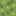
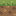
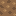
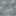
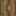
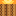

# Original RustCraft terrain art

**Author/origin:** original RustCraft project artwork, authored for Slice 8 in
Codex-assisted development. The editable pixel grids and palettes were designed
for this repository. No reference/input images, texture packs, extracted game
files or external artwork were used. The art is not a copy or edit of Minecraft
textures. The motifs are our own clustered turf, pebbled clay, fractured stone,
fibrous bark with a knot, squared growth rings and opaque overlapping leaves.

**License: MIT OR Apache-2.0**, at the recipient's option, for **all** files in
this directory (including JSON, RGBA and PNG artwork), and for the generator.
See [LICENSE-MIT](../../LICENSE-MIT) and [LICENSE-APACHE](../../LICENSE-APACHE).
Retain the applicable project license/notice when redistributing. These assets
may accompany the public source and later game distributions under those terms.
They have no separate noncommercial, game-only or texture-pack restrictions.

| Slot | Tile | Applied to | Preview (native 16×16) |
| --- | --- | --- | --- |
| 0 | grass_top | Grass +Y |  |
| 1 | grass_side | Grass ±X/±Z |  |
| 2 | dirt | Dirt all faces; Grass -Y |  |
| 3 | stone | Stone all faces |  |
| 4 | bark | Wood ±X/±Z, grain upright |  |
| 5 | end_grain | Wood ±Y |  |
| 6 | leaves | Leaves all faces, **opaque** |  |
| 7 | torch | Torch wooden shaft / glowing tip |  |

## Editing and reproduction

Edit `source.json`: each tile has sixteen top-to-bottom rows of sixteen palette
symbols. Palettes are explicit sRGB hex colors; pixels have alpha 255. There is
no random seed, downloaded source, per-pixel random noise or procedural work at
runtime. Material structure is drawn in the grids. Different tile palettes share
warm earth/wood and restrained yellow-green foliage hues, with a cooler stone.

From any working directory, using Python 3's **standard library only**:

```sh
python3 tools/generate_textures.py
python3 tools/generate_textures.py --check
```

Those example paths assume the repository root; an absolute script path works
from any directory. PNG encoding uses RGBA8 and stored zlib blocks (no external
image tools or platform-dependent optimized compression). The script overwrites
only its named generated artifacts, never source.json. `--check` writes nothing.

`atlas.png` is the inspectable atlas; `atlas.rgba` contains the exact same 128×64
row-major RGBA8 pixels without a header. The seven individual PNGs are previews.
All outputs are committed. The client embeds RGBA bytes and uploads once: it
needs no runtime PNG decoder, asset-server path, Python or working-directory
lookup. Dimensions/slots are also specified in `voxel_core::texture` and pinned
by Rust tests; layout changes must update both contracts deliberately.

Each slot is 32×32: a native 16×16 tile starts at offset (8,8), with eight texels
of extruded edge color on all sides/corners. The unused eighth slot is magenta
for debugging, never assigned. UVs cover full tile edges, so all 16 pixels have
equal width. Nearest min/mag/mipmap, LOD0 only, clamp addressing, one mip and no
anisotropy prevent cross-tile filtering. The tradeoff is intentional distant
pixel shimmer; proper per-tile mipmaps/texture arrays are future work. No alpha
cutouts, blended leaves, normal maps or dynamic-lighting changes are included.

Slice20 adds an independently authored amber/gold tip and wood-grain tile in the
previously unused slot7, under the same original-art license and source policy.
No old tile changes; all eight slots have opaque pixels and extruded gutters.
