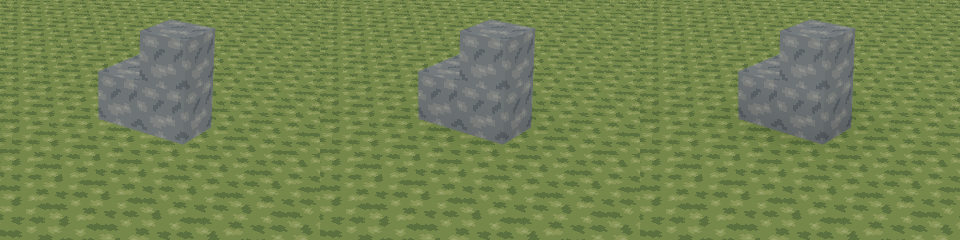
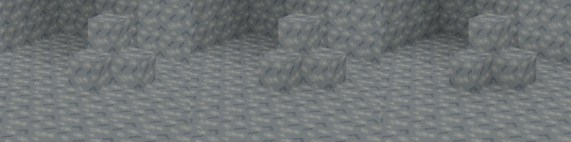
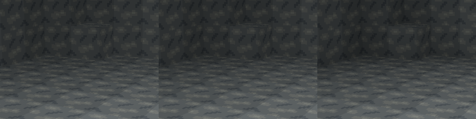
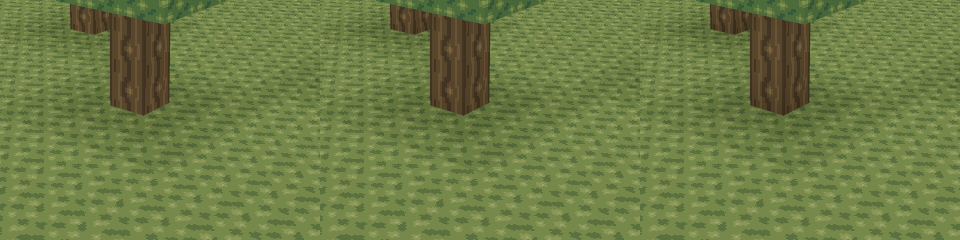

# Slice 17 — Voxel ambient occlusion

Based on merged Slice 16, `ed0c3e48f2f8fcddf7e500d6b4062f8356d4c32e`.
AO is derived presentation data in `voxel_core::mesh`, independent of Bevy.
No dependency, block, generator, world/player format, input setting or texture
artwork changes. The existing shared terrain material consumes vertex COLOR;
there are no additional passes, per-block draws or material instances.

## Sampling and brightness

For each visible unit face of a solid block at `p`, start at `p + normal`.
At each vertex, sample the two tangent side cells toward that vertex and their
diagonal, all in that outside layer. All current solid blocks, including Leaves,
are opaque. If both sides are solid, occlusion is 3 regardless of the diagonal;
otherwise it is the number of solid samples (0–3). Same-layer neighboring floor
blocks do not darken an unobstructed flat top or outline every block.

A fixed 18³ occupancy halo includes all 26 neighboring chunks. It queries each
chunk once and now supplies **both visibility and AO**, replacing repeated
neighbor-chunk/local-coordinate checks. A cell index is computed once per solid
block. Face sample offsets are precomputed. The visibility mask stores each
four-corner tuple as four two-bit counts: each optional merge key occupies three
bytes on this toolchain, reducing the fixed 6×16×256 mask from 147,456 to 73,728
bytes. Halo storage remains 5,832 bytes. The shader/56-byte vertex format is unchanged.

### Intensity revision

The owner accepted the original implementation's functionality on native Void
Linux (Radeon RX 9060 XT 16 GB, Core i3-13100, 32 GB RAM), but reported almost no
perceptible visual improvement. Approximately 27% overall CPU use was reported;
that is not a mesh-worker, frame-time or GPU measurement. Desktop protocol and
build mode were not specified. The revised implementation still needs native
visual acceptance.

| Occlusion | Original, sky 15 | Original, sky 0 | Revised, sky 15 | Revised, sky 0 |
| --- | ---: | ---: | ---: | ---: |
| 0 | 1.000 | 1.000 | 1.000 | 1.000 |
| 1 | 0.920 | 0.972 | 0.860 | 0.910 |
| 2 | 0.840 | 0.944 | 0.720 | 0.820 |
| 3 | 0.760 | 0.916 | 0.580 | 0.730 |

The original factor was `1 - ao * .08 * (.35 + .65 * sky / 15)`.
The revised factor is `1 - ao * (.09 + (.14 - .09) * sky / 15)`.
`SKY_STEP` and `DARK_STEP` in `mesh/ao.rs` centralize the two strength parameters;
no user setting is added. RGB multiplies the same `face_color`; alpha stays 1.
The exact 0–15 gameplay light, propagation, directional factors and cave floor
remain unchanged. AO zero retains the original color exactly.

A first gallery trial used .11/.07 steps (open-sky strength +37.5%). Contact
shading was still restrained at the original viewing distance. After inspecting
the same four scenes with .14/.09, the latter was selected: wall/floor contacts,
placed-block bases, room recesses and trunk/leaf junctions read more clearly,
while unoccluded surfaces and the cave interior away from contacts retain their
existing brightness. This deliberately exceeds the initial 25–40% suggestion
in sunlight (+75% step strength); darkness uses a separate .09 step, rather than
a blind global percentage. The darkest contact retains 73% of the unoccluded cave-base
RGB, so the change concentrates on corners instead of blackening the entire room.
This is a software-rendered visual judgment, not a claim of native owner acceptance.

A process-wide, lazily initialized 6,144-byte table caches the exact formula for
six directions × 16 skylight levels × four AO counts. It avoids repeated powers,
face-factor selection and modulation arithmetic during quad emission. It has
no world state, heap allocation or invalidation lifecycle; tests compare all
384 entries with the formula and check the documented endpoints.

## Greedy compatibility and triangulation

Merge keys retain tile, exact skylight and all four AO counts, now packed into
one byte. Orientation/slice are implicit. Constant fields keep a direct key
comparison. **Nonconstant affine fields may now merge too.**

In face corner order, a unit face is affine iff `a0 + a2 == a1 + a3`. Map its
corners into positive plane u/v directions and derive integer slopes `du, dv`.
A candidate at offset `(x,y)` is compatible only if its tile/skylight match and
each of its four counts equals the seed's corresponding count plus `du*x + dv*y`.
Width then height grow in the existing deterministic order. Emit the field's
actual outer-corner values, including both rectangle extents.

**Why this is exact:** the sum condition makes either unit-face triangulation
the same affine field. Every included face matches that one field at every
vertex. For equal skylight/direction, RGB is affine in the AO count, so the
large quad has the same color at every point, including internal unit boundaries
and either triangle diagonal. Integer comparisons introduce no approximate
merge threshold; tests allow only floating arithmetic roundoff in resulting RGB.

Matching corner tuples alone is still insufficient. A gradient may be extruded
perpendicular to itself, but repeating that tuple *along* its slope would reset
the field and is rejected. Non-affine/saddle faces stay unit quads. More general
piecewise-affine combinations are not attempted. Exact skylight discontinuities
still prevent merging even when AO alone would allow it.

Non-affine units connect the darker opposite pair: flip diagonal 0–2 to 1–3 when
`ao[0] + ao[2] < ao[1] + ao[3]`. Affine fields tie mathematically and work with
either diagonal. Outward CCW winding, normals, visibility, original corner order,
atlas origins and block-repeat UVs are unchanged. No new pass, material instance,
texture or renderer feature is introduced. A quad still costs 248 payload bytes.

## Chunk seams, edits and workers

`BlockChange::affected_chunks` now covers the one-cell Chebyshev neighborhood
of an edited block. An interior edit forces one geometry/AO chunk; a face, edge
or corner edit forces at most two, four or eight, respectively. This is not an
unconditional 27-chunk rebuild. Euclidean coordinate splitting and checked
offsets handle signed seams. The existing full-height skylight candidate set
is unchanged and still skips meshes whose exact samples are unchanged.

The AO footprint feeds both `DirtyChunks` geometry forcing and streamed local
revision tokens. This is essential: changing dark Air to solid can leave every
cached light sample identical while changing a diagonal chunk's AO. Those
chunks must still remesh. Existing one-worker coalescing, connected atomic
publication, stale-result rejection, retained handles and eviction rules remain.
Legacy workers retain their existing complete-world revision check.

The existing worker snapshot/light-source halo already includes a full square
of neighboring columns, full height and diagonal region overlays. It therefore
supplies all AO dependencies without expanding region I/O or generation bounds.
Absent legacy data is Air; pending in-volume streamed data is opaque. Production
workers resolve missing sources from generation plus captured authoritative
edits before meshing; failed regional reads retain old visuals/safe barriers.
Outside the finite world is known Air under the existing contract. Unrepresentable
coordinate offsets are ignored. Streaming/reloading computes AO from current
authority, never from an old mesh or a pristine generator in place of edits.

## Profiling and performance

The original stage profile was collected **before** changing the mesher in a
disposable, release-optimized core copy. Four `Instant` boundaries separate halo
construction, fixed-mask initialization, visibility/AO fill, and merge/emission.
Timers/counters never enter the game source. In that initial 27-chunk workload,
about 64% of instrumented mesher time was visibility/AO, 27% merge/emission,
6% halo and 3% mask initialization. This identified duplicate visibility lookups
as the first target, rather than replacing the halo speculatively.

Final matched stage profiles, mean µs per chunk (not per batch):

| Stage, seeded streaming | Original 17 | Revised 17 |
| --- | ---: | ---: |
| Halo | 5.94 | 6.16 |
| Mask initialization | 3.17 | 1.13 |
| Visibility / AO | 63.09 | 31.01 |
| Merge / emission | 26.40 | 21.69 |

These instrumented phase means include timer overhead and cloud scheduling noise;
the uninstrumented medians below are the performance comparison. Halo code was
retained: the larger improvements came from reusing it for visibility, one index
per block, compact mask entries, exact affine merging with a constant-field fast
path, and the fixed color lookup table. The original/revised
[stage CSVs](performance/slice17-revision/profile-original.csv) /
[stage CSVs](performance/slice17-revision/profile-revised.csv) include all scenes.

```sh
python3 tools/profile_meshing.py --revision e4c2bf4 --output /tmp/ao-profile-original
python3 tools/profile_meshing.py --revision WORKTREE --output /tmp/ao-profile-revised
python3 tools/benchmark_meshing.py --baseline ed0c3e4 --original e4c2bf4 --output /tmp/ao-three-way
```

Use new output directories. Profiling and baseline packages build independently,
so cached same-name Cargo artifacts cannot substitute another revision's binary.
The benchmark uses the existing identical fixtures and timing loops for all
three versions. Rust 1.99.1, Debian 13 x86-64, AMD EPYC 9V74 / three exposed CPUs,
release optimization, no renderer or other tests running. Generation and shared
skylight solving are excluded. Each CPU entry is the median of five samples,
each averaging 100 batches including buffer creation/destruction. These are
CPU-only wall-clock mesh timings, not GPU timestamps or frame measurements.

Raw [Slice 16](performance/slice17-revision/before.csv),
[original 17](performance/slice17-revision/original.csv),
[revised 17](performance/slice17-revision/after.csv), and exact
[baseline](performance/slice17-revision/baseline.txt) /
[original](performance/slice17-revision/original.txt) revisions.
Historical first-implementation numbers remain in [slice17](performance/slice17/after.csv);
compare the fresh matched run below rather than different cloud sessions.

| Scene | CPU µs 16 | CPU µs original 17 | CPU µs revised 17 | Revision vs original | Revision vs 16 |
| --- | ---: | ---: | ---: | ---: | ---: |
| solid | 93.52 | 143.13 | 70.06 | -51.1% | -25.1% |
| flat | 31.42 | 42.08 | 23.89 | -43.2% | -24.0% |
| mixed | 42.90 | 83.40 | 51.12 | -38.7% | +19.2% |
| cave | 44.35 | 78.05 | 45.06 | -42.3% | +1.6% |
| trees | 20.61 | 37.40 | 31.29 | -16.3% | +51.8% |
| edits | 67.26 | 115.83 | 80.54 | -30.5% | +19.7% |
| stream | 1637.28 | 2528.32 | 1496.75 | -40.8% | -8.6% |

Geometry and buffers are **Slice 16 → original 17 → revised 17**. Each quad has
four vertices, two triangles and 248 payload bytes; stride stays 56 bytes.

| Scene | Quads | Vertices | Payload bytes | Vector capacity bytes |
| --- | ---: | ---: | ---: | ---: |
| solid | 34 → 34 → 34 | 136 → 136 → 136 | 8432 → 8432 → 8432 | 15872 → 15872 → 15872 |
| flat | 1 → 1 → 1 | 4 → 4 → 4 | 248 → 248 → 248 | 248 → 248 → 248 |
| mixed | 148 → 456 → 448 | 592 → 1824 → 1792 | 36704 → 113088 → 111104 | 63488 → 126976 → 126976 |
| cave | 13 → 155 → 79 | 52 → 620 → 316 | 3224 → 38440 → 19592 | 3968 → 63488 → 31744 |
| trees | 68 → 116 → 116 | 272 → 464 → 464 | 16864 → 28768 → 28768 | 31744 → 31744 → 31744 |
| edits | 271 → 421 → 397 | 1084 → 1684 → 1588 | 67208 → 104408 → 98456 | 126976 → 126976 → 126976 |
| stream | 4176 → 6236 → 5909 | 16704 → 24944 → 23636 | 1035648 → 1546528 → 1465432 | 1406408 → 2233736 → 2233736 |

The 27-chunk phase improves **40.8%** versus original AO, and is **8.6% faster**
than Slice 16 in this run. Geometry/payload falls 5.2% versus original AO;
allocated vector capacity stays unchanged for that workload because geometric
vector growth does not shrink at every quad reduction. Caves drop 155 → 79 quads
(-49.0%) and halve vector capacity. Edits drop 421 → 397 quads (-5.7%).

Regressions remain versus no AO: trees +51.8% CPU, mixed +19.2%, repeated edits
+19.7%, caves +1.6%. Extra occupancy sampling, more emitted vertices and exact
field checks still cost work; non-affine corners and flat-skylight discontinuities
cannot safely merge under this rule. Tree geometry stays 116 quads. No target
number justified weakening these checks. Halo/mask scratch is fixed and smaller,
the color table is process-wide constant data, and output/cache residency remains
radius-bounded; unchanged terrain does no per-frame AO work.

The edits fixture changes a cell repeatedly and recomputes light outside its
timed mesh pass; its geometry columns describe the initial edited state. Stream
meshes 27 seeded chunks per batch; it excludes I/O, generation, propagation and
end-to-end queue/install latency. Existing real client tests exercise repeated
worker edits, stale rejection, streaming/eviction and unchanged-light AO. No new
matched end-to-end or frame/GPU timing was measured for this revision. Payload/
capacity exclude allocator metadata, Bevy retained copies, driver/VRAM and RSS.
No native FPS improvement is claimed.

## Automated and graphical validation

On 2026-10-24, Rust 1.99.1 / Bevy 0.20.0, Debian 13 x86-64:

- `cargo fmt --all -- --check` — passed.
- `cargo clippy --locked --workspace --all-targets -- -D warnings` — passed.
- `cargo test --locked --workspace` — passed: 148 client + 165 core tests;
  zero doctests. Example texture-module tests are also checked by all-target Clippy.
- `cargo build --locked --workspace` — passed.
- `python3 tools/generate_textures.py --check` — passed; artwork unchanged.
- `cargo build --locked -p rustcraft --example ao_gallery` — passed.
- Matched release meshing benchmarks — completed; raw results linked above.

The rectangle oracle compares exact unit-face coverage, no duplicates, tile
origins, repeat lengths, normals and both triangle windings against separately
queried world occupancy. It evaluates emitted triangle interpolation at every
unit corner, including internal rectangle boundaries. All merged rectangles
must be affine; every included unit face must match the same field. Five interior
points per unit face additionally compare against independently triangulated
reference colors. This checks both triangle regions and internal boundaries.
Fixtures include isolated/flat/solid/hollow/irregular shapes, mixed materials,
inside/outside corners, all eight occupancy combinations, six orientations,
signed X/Y/Z seams, finite boundaries, pending neighbors, diagonal dependencies,
constant and nonconstant affine fields, rejected repeated gradients, both diagonals,
and AO/skylight attenuation. All 256 packed corner patterns, six orientations,
field translations and rectangle sizes 1–4 are exhaustively checked; changing
any one candidate corner must reject the merge. Placement/removal cycles restore
identical meshes.

A real client streaming regression creates a sealed pocket crossing X/Y/Z=0.
A diagonal occupancy edit changes vertex colors while the target's entire exact
light cache remains equal. It verifies forced remeshing, rapid repeated edits,
stale worker rejection, no regeneration of cached columns, eviction and reload
against fresh authoritative meshes. Existing save, inventory, physics, worldgen,
radius/resource-lifetime and skylight suites continue passing.

### Matched three-way screenshots

The unchanged `client/examples/ao_gallery.rs` uses the production terrain material,
embedded shader, atlas, skylight, geometry and fixed cameras. It never opens saves.
A is exact merged Slice 16 (`ed0c3e4`), B is original Slice 17 (`e4c2bf4`), C is
this revision. A/B retain their verified original captures; C was freshly rendered
with identical inputs. All are 960×640, Xvfb X11 / Mesa 25.0.7 llvmpipe Vulkan.
Every new frame was nonblack and stable across successive captures, without
shader errors. This is **software rendering, not native GPU performance evidence**.

| Scene | A: No AO | B: Original AO | C: Revised AO |
| --- | --- | --- | --- |
| Flat / placed blocks | [A](images/slice17-flat-before.png) | [B](images/slice17-flat-after.png) | [C](images/slice17-flat-revised.png) |
| Stone structure | [A](images/slice17-structure-before.png) | [B](images/slice17-structure-after.png) | [C](images/slice17-structure-revised.png) |
| Enclosed room | [A](images/slice17-room-before.png) | [B](images/slice17-room-after.png) | [C](images/slice17-room-revised.png) |
| Trees / terrain | [A](images/slice17-trees-before.png) | [B](images/slice17-trees-after.png) | [C](images/slice17-trees-revised.png) |

Contact crops below are **A / B / C, left to right**, at original pixel scale.
They use identical 320×240 regions with no color adjustment or difference
amplification: flat (360,260), structure (310,250), room (250,250), trees (350,320).






Inspected contact separation, stone/grass/bark/leaf pixels, readable room corners,
flat uniform shading and signed X/Z seams in all four scenes. Revised shading is
clearer without a global cave-brightness change or block outlines on open flat
surfaces. No stretched large-quad gradient or persistent seam was observed in
these fixed views. These observations are bounded; native driver rasterization
and rapid interactive edits still need acceptance. Edits, unchanged skylight,
stale-result rejection and reload are exercised in real client-schedule tests.

Reproduce a current fixture in a desktop session:

```sh
cargo run --locked -p rustcraft --example ao_gallery -- structure
# Other arguments: flat, room, trees.
```

## Native Void Linux revision acceptance (pending)

Original Slice 17 functionality was accepted by the owner as described above.
Repeat the checklist for this revised intensity and mesher on Void glibc x86-64
with normal supported drivers, separately on X11 and Wayland. Cloud software rendering does not replace these checks. In Fish:

```fish
git fetch origin
git switch feat/slice-17-ambient-occlusion
set ao_test_dir (mktemp -d /tmp/rustcraft-slice17.XXXXXX)
env RUSTCRAFT_DATA_DIR="$ao_test_dir" RUSTCRAFT_WORLD_SEED=42 RUSTCRAFT_LOAD_RADIUS=2 cargo run --locked -p rustcraft
# Keep the same isolated directory for save/restart checks.
```

- [ ] Inspect flat grass, placed blocks, stone wall/floor intersections, roof
  undersides, cave corners and tree bases; textures remain sharp and caves readable.
- [ ] Inspect all six face orientations at X/Z 0, ±16, ±64 and Y 0/16. Place and
  remove blocks at chunk edges/corners; diagonally neighboring shading must update.
- [ ] Rapidly alternate edits while crossing seams; no holes, duplicate faces,
  stretched gradients, stale AO or persistent seams after workers settle.
- [ ] Travel out of radius and back, change radius 1–3, then inspect distant signed
  coordinates; resources remain bounded and edited terrain returns correctly.
- [ ] Check mouse capture, inventory counts, normal movement/collision, menus,
  F5/autosave, normal close and restart using the same isolated directory.
- [ ] Compare matched scenes on physical GPU; record driver/backend, resolution,
  build mode, radius, worker latency, memory and frame percentiles. No FPS gain
  is claimed by the CPU meshing measurements.

Use complete closed-directory copies for historical-save testing; never test
recovery on the only real save. See [PLATFORMS](PLATFORMS.md) for prerequisites.

## Windows acceptance considerations (pending)

Windows 10/11 x86-64 uses the same engine-neutral integer occupancy/coordinates,
embedded shader and assets, and the existing Bevy/wgpu backend selection. No
Vulkan-only requirement, path change or native dependency was introduced.
Compile/test through the existing Windows CI and repeat the visual/edit/streaming
checks on a supported native GPU; CI itself is not graphical acceptance.

```powershell
$env:RUSTCRAFT_DATA_DIR = Join-Path $env:TEMP ("rustcraft-slice17-" + [guid]::NewGuid())
$env:RUSTCRAFT_WORLD_SEED = "42"
cargo run --locked -p rustcraft
# Retain RUSTCRAFT_DATA_DIR to check save/restart.
```

The revised intensity/merging on native Void GPU, Wayland, Windows rendering/
input/DPI and long-session VRAM endurance remain unverified here. The algorithm intentionally retains flat
skylight discontinuities and greedy T-junctions from Slice 16; it does not add
smooth skylight, directional shadows, emitted light or a day/night cycle.
