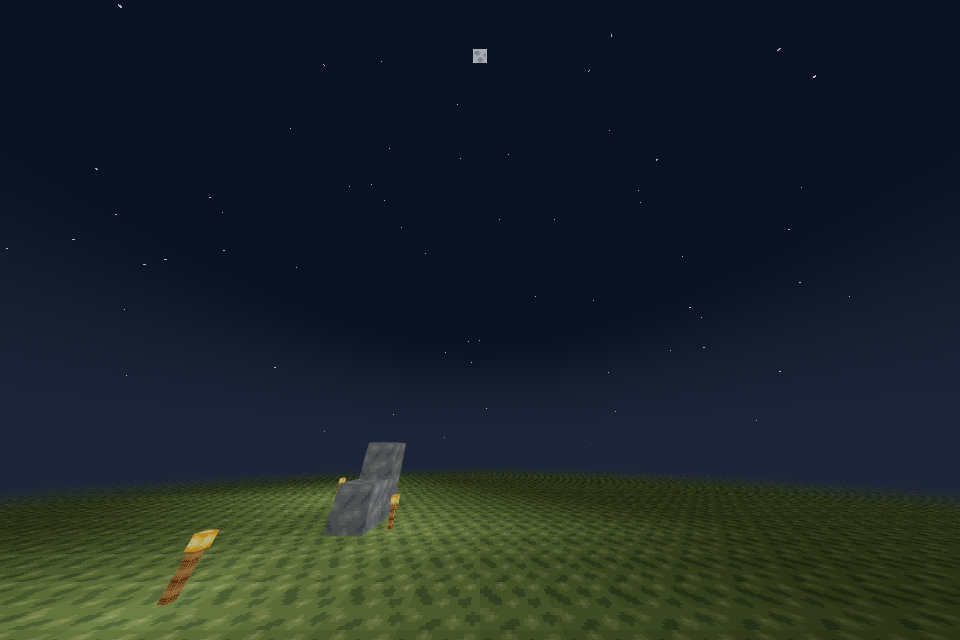
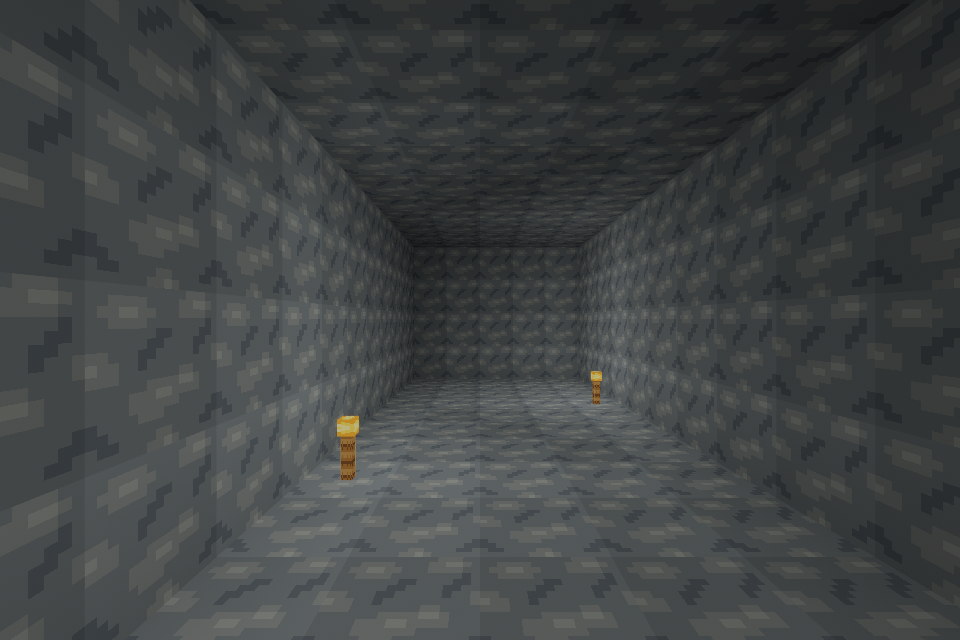

# Slice 21 — persistent day/night

`voxel_core::time::WorldTime` is the authoritative clock, owned by each `World`.
A day contains **24,000 logical units**, subdivided into **72,000 integer steps**.
The client's existing fixed 60-Hz simulation advances one step per tick: exactly
**20 minutes** per day. New worlds and historical players without time start at
elapsed day **0**, time **1000** (morning). Midnight is 18000, sunrise 0, noon
6000 and sunset 12000. Day counts are elapsed complete cycles, independent of the
morning starting offset. No OS date, wall-clock catch-up or rendered-frame count
enters the simulation. The u64 day counter saturates safely at its last tick.

Inventory keeps time running. Pause, pause Options, saving/closing and focus loss
freeze the same fixed simulation gate as physics. Fixed ticks consumed while
paused do nothing; resuming does not catch up the paused interval. Long render
stalls retain Bevy's existing bounded fixed-step policy. Loading or switching
worlds installs that world's saved clock. Floating-origin shifts, radius changes,
resident-column eviction and terrain-worker results never replace the clock.
F3 shows elapsed day, logical time and the exact daylight factor in addition to
its previous diagnostics. The overlay retains its bounded 5-Hz refresh.

## Persistence

The existing **coordinated player/session transaction** owns time, including
fractional logical units. `player.rcp` version **2** is 192 bytes: the previous
inventory/binding/root fingerprint fields followed by day u64, fixed step u32
and reserved-zero u32. All integers are little-endian and covered by the existing
CRC. The step must be below 72000. Unknown versions, incorrect lengths, invalid
reserved values, corrupt checksums and foreign bindings fail closed. See the
[byte contract](SAVE_FORMAT.md).

The reader also accepts the exact 176-byte player v1 and supplies morning in
memory. Reading an existing player v1 does not write it. Its next explicit,
autosave or final session save writes v2 through the journal. World root versions
1–4, generators, IDs, regional overlays and identity files remain unchanged;
time alone never rewrites/expands/regenerates a world root or region. Existing
first-time inventory initialization remains the pre-Slice21 behavior. Older
clients do not understand player v2; use them only with separate backups.

F5, the existing 30-second real-time autosave and normal Save and Quit capture
world edits, inventory and time together. Time dirtiness has its own saved value:
it never advances a block/mesh revision or marks a region dirty. A save completing
behind the running clock marks only its captured time saved; later ticks still
need the next save. The status label continues to report edits and recent save
results, rather than flashing Dirty for every clock tick. Save failures retain
the clock and dirty state and block final exit. Existing pending journals with
player v1 replay as morning; v2 journals replay the exact captured clock before
gameplay, including interruptions after journal, world or player commit. The
world-only `SaveStore::save` API rejects an advanced clock so it cannot silently
lose session time. Back up the **whole closed world bundle**, as before.

## Lighting and sky

Voxel light propagation remains the Slice20 integer computation: independent
0–15 sky and block channels, packed into the same exact 18³-byte chunk cache.
Neither channel depends on the current hour. No lighting volume, loaded-column
scan, dirty batch, remesh, asset creation or stale-result rejection is triggered
by the passage of time.

The existing 56-byte terrain vertex retains COLOR as four floats:

| Component | Terrain meaning |
| --- | --- |
| R | Static sky brightness with directional face shading and AO |
| G | Static block brightness with directional face shading and AO |
| B | Geometric sky exposure, integer level / 15, for fog |
| A | Opacity, 1 |

The terrain shader uses `max(R * daylight, G)`. Daylight smoothly ranges from
0.10 at night to 1 in daytime using solar elevation. The existing cave readability
floor remains in the block channel; sealed cave surfaces and torch light do not
brighten with sunrise. Noon's maximum of the two AO-modulated channels equals the
previous AO modulation of their maximum. Greedy keys now compare **both** light
levels, tile and compatible AO field, preserving hidden torch gradients that
become visible at night. AO occupancy, affine compatibility, winding, original
textures, nearest filtering and atlas repetition are preserved. This can split
more quads around torches even at noon; it happens only during normal meshing.
The separate held-torch helper still returns ordinary RGB for StandardMaterial,
preserving the accepted item pose and bright tip. Terrain flame tips keep their
full block contribution at night.

One shared **80-byte** atmosphere uniform replaces the previous 48-byte uniform
on the retained terrain material and the retained sky material. It contains the
sky colors, fog limits, solar direction/daylight and celestial parameters. Each
render update performs bounded math and updates at most those two existing
assets; unchanged/paused parameters produce no writes. There are no new lights,
textures, sky entities or meshes per tick. The sky still uses one clip-space
triangle with depth testing and no depth writes, prepass or shadows. Hand/UI
materials stay outside terrain fog.

The square sun rises at **east +X**, reaches +Y at noon and sets at west −X.
The square moon follows the opposite direction. The visual-polish follow-up
increases both original projected side lengths by **18%** (sun half-size
0.042→0.04956, moon 0.034→0.04012). Their world-space centers do
not depend on camera position/yaw or render origin; their quads face the view.
A body below the horizon disappears. Stable sparse hashed **world directions**
produce original stars, faded out through twilight and near the horizon; there
is no time-varying random seed. Dawn/dusk blend a warm horizon into the blue
morning/day sky; night uses dark blue zenith/horizon colors. Terrain fog samples
the same gradient, gated by static sky exposure rather than torch brightness.
A sealed torch-lit cave therefore never gains blue daytime fog. This is a
stylized ambient cycle, without celestial shadow maps, seasons, weather or moon
phases. All graphics and shader code are original MIT OR Apache-2.0; no new
assets, crates, Bevy features or lockfile changes are needed.

## Production-renderer comparisons

The development-only `day_night_gallery` example uses the **production terrain,
sky, atlas and shared atmosphere shaders**, with fixed time and no save access.
The capture helper waits at least 10 seconds and 120 frames for asynchronous
pipeline creation. No gameplay time command was added.

All exterior images use the same geometry, three torches at (4,1,3), (7,1,5),
(11,1,1), camera position (0,2.8,8), target (10,9.8,8), radius2, 960×640,
Reinhard tonemapping and vertical FOV120°. The deliberately wide diagnostic view
keeps the east horizon and overhead bodies in the same frame. Sunset's sun is
behind this east-facing camera; its warm sky remains visible. The second night
image is time18500, 25 real seconds after midnight, retaining every setting and
emitter. The cave pair uses camera (8,2.8,−7) toward (8,2.8,−18), FOV 78°,
torches at (6,1,−12) and (10,1,−16), and otherwise identical settings. No image
has been brightened, composited or retouched. The interior pair is pixel-identical,
as expected where fixed block light dominates the small remaining sky component.

| Image | Logical time |
| --- | --- |
| [Sunrise](images/slice21/slice21-sunrise.png) | 0 |
| [Morning](images/slice21/slice21-morning.png) | 1000 |
| [Noon / overhead sun](images/slice21/slice21-noon.png) | 6000 |
| [Sunset](images/slice21/slice21-sunset.png) | 12000 |
| [Midnight / moon and stars](images/slice21/slice21-midnight.png) | 18000 |
| [Night / several torches](images/slice21/slice21-night-torches.png) | 18500 |
| [Cave / day](images/slice21/slice21-cave-day.png) | 6000 |
| [Same cave / night](images/slice21/slice21-cave-night.png) | 18000 |





These are X11/Xvfb Linux images using Mesa25.0.7 llvmpipe LLVM19.1.7 Vulkan CPU.
They verify real shader output, **not native Radeon/Windows performance**.

## Reproduction and native acceptance

Build/run normally with `cargo run --locked -p rustcraft`. The example is separate:

```sh
cargo build --locked -p rustcraft --example day_night_gallery
cargo run --locked -p rustcraft --example day_night_gallery -- plains 2 --time=18000
cargo run --locked -p rustcraft --example day_night_gallery -- cave 2 --time=6000
# Continuous normal-speed time, in the development example only:
cargo run --locked -p rustcraft --example day_night_gallery -- plains 2 --time=11500 --advance-time
python3 tools/capture_day_night.py --output work/day-night-captures
# Linux measurement harness, using a display; /proc RSS sampled every10ms:
python3 tools/benchmark_day_night.py --output work/day-night-measurements
```

The benchmark reconstructs accepted Slice20 `ab36403` sources offline from Git,
uses the identical gallery geometry/camera/settings with its original shaders,
and gives both versions a 5-second / 120-frame warmup. Its baseline clock adapter
is inert because Slice20 has no cycle. Bevy dependencies are shared, while the
baseline core artifacts remain isolated. CPU terrain benchmarks use release
builds; renderer runs use debug builds. See [measurements](performance/slice21/README.md).

For an isolated native Void Linux **Fish** test:

```fish
git fetch origin
git switch feat/slice-21-day-night-cycle
git pull --ff-only
set -lx RUSTCRAFT_DATA_DIR (mktemp -d /tmp/rustcraft-slice21.XXXXXX)
cargo run --locked -p rustcraft
# Keep the same shell/path after normal Save and Quit:
cargo run --locked -p rustcraft
```

Create a test world and enable F3. Record its clock, wait a few seconds and check
about 20 logical units/second. Open inventory and confirm continued time and
physics. Open Pause/Options and leave them open; verify the clock and world are
frozen. Test focus loss and explicit resume, with no catch-up jump. F5, wait,
quit normally and reopen: the clock should continue from the final saved value,
not morning. Repeat with a second world and switch back. Change radius1→3→1 and
travel across chunk seams; check consistent time, stable terrain, repeated
break/place lighting, wall/standing torches and support removal. Check F3, hand,
hotbar, UI nearest filtering and AO at day and night. Use the gallery to inspect
sunrise, noon, sunset, stars, camera rotation/translation and the matched cave
without adding gameplay shortcuts. Run a normal 20-minute cycle for transitions.

- [ ] Native Void X11 / Radeon: full cycle, focus/capture, menus, saves and edits
- [ ] Native Void Wayland: same checks and origin/radius transitions
- [ ] Native Windows10/11 physical GPU: same checks, paths and final-save recovery

Headless Ubuntu/Windows CI and software-rendered cloud X11 do not replace these
physical desktop checks. No Slice22 gameplay or release publication is included.

## Sun/moon visual polish before merge

The owner reports the Slice21 baseline working correctly on **Void Linux with an
AMD RX 9060 XT at approximately 240 FPS, VSync disabled**, with stable gameplay and
excellent performance. This is an owner-reported native result preceding this
visual-only follow-up; no specific compositor/backend was reported.

The moon now uses an original 16×16 pixel-art map with four restrained off-white,
gray and blue-gray shades. Asymmetric stepped crater rims/basins are authored in
`client/src/atmosphere.wesl`: sixteen u32 rows, two bits/pixel, plus a four-color
scene-linear palette. The adjacent unpacked row comments are the editable art
source. This is original RustCraft work, MIT OR Apache-2.0; no Minecraft pixels,
images or source were copied. Integer floor/clamp/bit-shift lookup selects one
color per cell. It adds no image, sampler, material, bind group, uniform bytes or
per-frame CPU allocations. Only visible moon fragments perform the lookup; the
CPU update path and the 80-byte shared uniform retain their previous layout.

Coverage and art UVs share the existing square projection. Both bodies fade
only below the world horizon before the existing visibility cutoff, avoiding a
last-strip pop where the finite terrain edge exposes sky below it. This does not alter celestial centers, trajectories,
orientation, time, sky/fog palettes, star positions, lighting or terrain work.
The projected 18% side increase is independent of resolution/aspect ratio; a
regression test covers six viewports, three FOVs and representative cycle times.
The pixel pattern has no interpolation, mipmaps, noise or per-fragment loops.

The gallery retains every existing default/argument and adds optional diagnostic
`--size=WIDTHxHEIGHT` and `--focus=sun|moon`. Focus uses FOV 78° and points the
camera at the requested body once at setup; it is not a gameplay control or an
animated tracking camera. A nonparallel up vector handles the noon/midnight
zenith without a singular look-at matrix. Example commands:

```sh
cargo run --locked -p rustcraft --example day_night_gallery -- plains 2 --time=6000 --focus=sun --size=1280x720
cargo run --locked -p rustcraft --example day_night_gallery -- plains 2 --time=18000 --focus=moon --size=1280x720
cargo run --locked -p rustcraft --example day_night_gallery -- plains 2 --time=12000 --focus=sun --size=1280x720
```

Focused production-renderer references use the same original fixture, camera
position, FOV 78° and Reinhard exposure. Noon and midnight look straight up;
the sunset view faces west. The three moon resolutions retain the same angular
size and crisp point-sampled craters; 960×720 also checks 4:3 against 16:9. The
updated eight-image comparison above keeps its original matched cameras/settings.

- [Noon sun,1280×720](images/slice21/slice21-polish-noon.png)
- [Textured midnight moon,1280×720](images/slice21/slice21-polish-moon.png)
- [Textured moon,960×720 /4:3](images/slice21/slice21-polish-moon-4-3.png)
- [Textured moon,640×480](images/slice21/slice21-polish-moon-small.png)
- [Sunset on the horizon](images/slice21/slice21-polish-sunset.png)

The visual references and timing comparison are cloud X11/llvmpipe evidence.
The new sizes/art remain open for the owner's native visual review in PR#38.

The paired [polish timing comparison](performance/slice21/celestial-polish/README.md)
keeps the full moon visible at FOV 78°/1280×720. Median software frame time was
92.27→91.53ms across three runs/version, within cloud variation, with identical
mesh/image/material counts. The actual moon footprint is 36×36 pixels at both
1280×720 and 960×720, and 24×24 at 640×480. No additional time-driven terrain jobs
or uniform bytes are introduced. These measurements do not claim a native GPU
speedup or replace native visual review of the new art.
