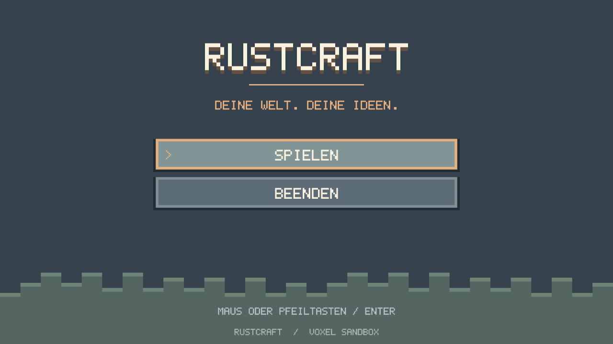
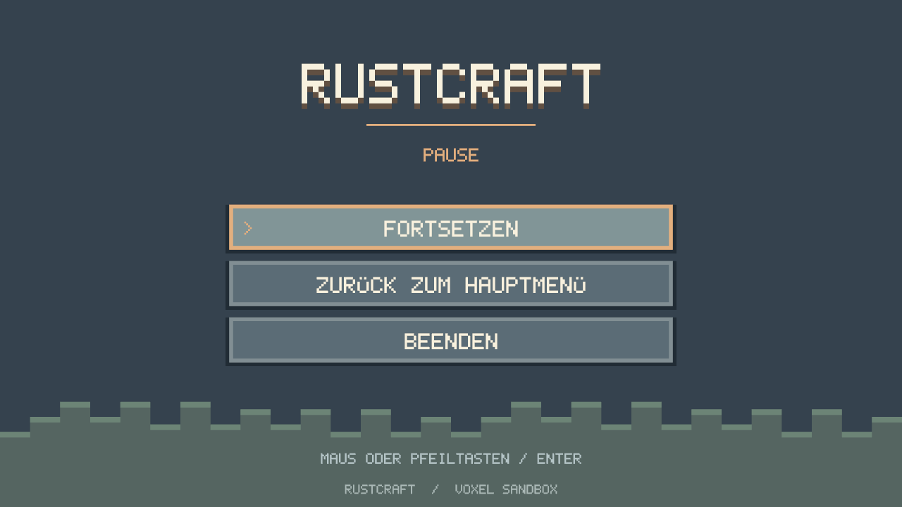
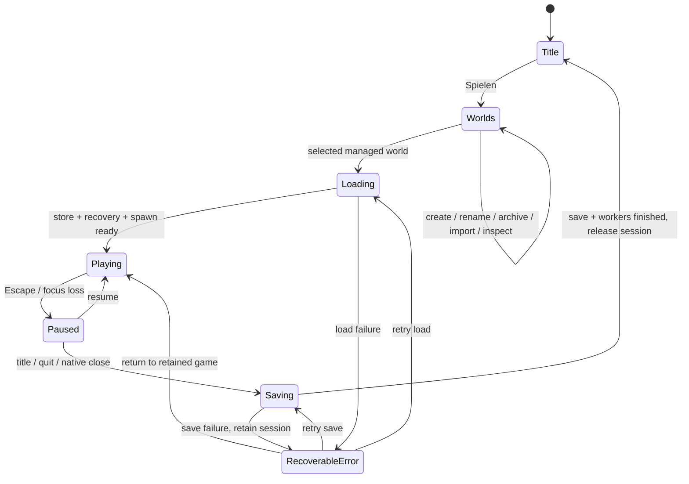

# Slice 13: menus and session lifecycle

RustCraft starts at an original pixel title screen. Since Slice14, **Spielen**
opens the [world catalog and creation/import pages](WORLDS.md). Only explicit
creation/import publishes a world; Play opens the selected existing bundle.
**Beenden** exits. Mouse hover/click and Up/Down + Enter work; activation happens
on release with visible press feedback. Loading/saving entries are disabled.
The centered 480×270 logical layout scales to the available window in either
axis, including 720p, 1080p, 4:3 and wide windows. The quiet stepped landscape,
copper/slate/cream frames and bitmap title are authored geometry, not imported art.

Escape closes inventory first (including its all-or-nothing held-stack return),
then opens Pause. **Fortsetzen** or Escape resumes with mouse capture. **Zurück zum
Hauptmenü** and **Beenden** save before leaving. Focus loss pauses normal gameplay;
an already-open inventory remains its own paused modal. Returning focus alone
does not resume. Mouse motion/clicks from menu activation cannot edit blocks.
Physics, player input, targeting/edits and hand motion are inactive while paused.
The existing hotbar/inventory and hand are otherwise unchanged.

## State and ownership

`session::ClientFlow` is an explicit enum/resource state machine for Bevy 0.20.
It changes before fixed simulation, with ordered inventory → lifecycle → menu →
camera input. This avoids a one-frame delay between Escape/focus loss and physics
without adding Bevy state/UI/text/font dependencies. Run conditions guard
session systems when `VoxelWorld` is absent. A dedicated `SessionSetup` schedule
reuses the existing ordered setup systems for each session. Startup hooks also
support the existing standalone regression fixtures; no production world exists
at Startup.

`begin_loading` resolves the data root and selected catalog ID and spawns one load worker. The worker owns
SaveStore, journal replay, inventory validation, spawn-region reads and initial
column generation. A failure drops the store/lock and exposes an error; no
fallback world/directory or damaged-file replacement is attempted. Closing during
Loading queues Quit; successful loading then follows the final-save path.

Saving freezes gameplay and new terrain jobs. The existing save worker captures
world/inventory together, polls completion and saves revisions newer than an
in-flight job before declaring completion. F5, real-time autosave, pressure saves,
world formats v1–v4, identities, journal and regional protocols are unchanged.
A failed final save keeps the world, inventory, pending job result and exclusive
lock alive. The error panel offers retry or return to the retained game; it has no
discard-unsaved action. Full OS errors remain in the log; preserve the entire
directory before external recovery (see SAVE_FORMAT and INVENTORY).

After final-save success, `Last` polls terrain and legacy mesh workers until they
finish. Only then are session root entities recursively removed, worker/store
resources dropped and the lock released. Every session entity carries an ownership
marker. Asset IDs created synchronously during SessionSetup plus runtime chunk
mesh handles are explicitly removed; global/engine/menu assets are retained.
Input, view, player, inventory modal, gestures, hand actions, dirty/lighting/error
state are reset. No worker join blocks a normal lifecycle frame. Destructor joins
remain emergency protection if another runner drops the whole App.

`Destination` selects Title/Quit. Slice14 adds `ClientState::Worlds` and pins
`selected_world` before the load worker opens it through WorldCatalog. All setup,
save barriers and cleanup described here are reused. Catalog pages own one separate worker
and no gameplay resources. Settings remain Slice15.

## Current native acceptance

See [Slice14 Void Fish and Windows11 PowerShell tests](WORLDS.md#void-linux-glibc--fish-acceptance),
including separate A/B/A sessions and legacy-copy imports. The historical Slice13
save-failure procedure still applies to an isolated **worlds/ID** directory:
obstruct an absent player.rcp.bak with an empty directory, change selection and
return to title. The session must remain locked on error until that deliberately
created empty obstruction is removed and save retried. Never inject errors into
real saves or delete journals/locks.
