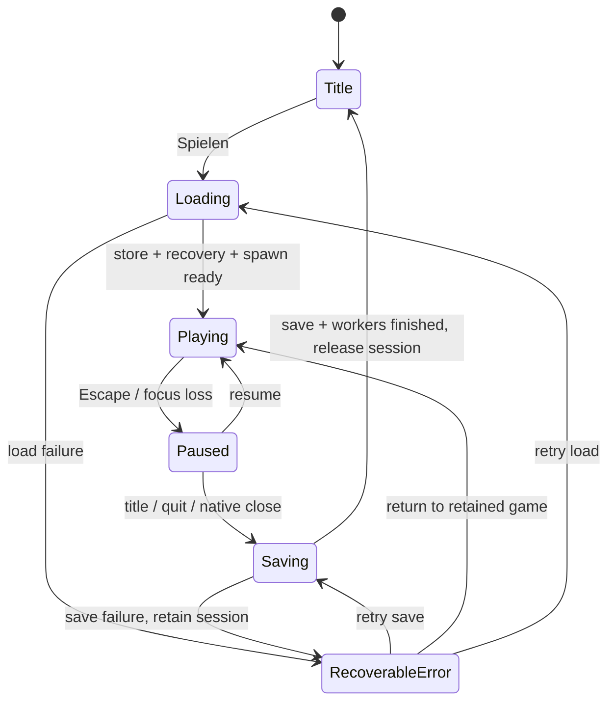

# Slice 13: menus and session lifecycle

RustCraft starts at an original pixel title screen. **Spielen** opens the existing
single world, or creates one only when no valid/invalid save evidence exists.
**Beenden** exits. Mouse hover/click and Up/Down + Enter work; activation happens
on release with visible press feedback. Loading/saving entries are disabled.
The centered 480×270 logical layout scales to the available window in either
axis, including 720p, 1080p, 4:3 and wide windows. The quiet stepped landscape,
copper/slate/cream frames and bitmap title are authored geometry, not imported art.


Escape closes inventory first (including its all-or-nothing held-stack return),
then opens Pause. **Fortsetzen** or Escape resumes with mouse capture. **Zurück zum
Hauptmenü** and **Beenden** save before leaving. Focus loss pauses normal gameplay;
an already-open inventory remains its own paused modal. Returning focus alone
does not resume. Mouse motion/clicks from menu activation cannot edit blocks.
Physics, player input, targeting/edits and hand motion are inactive while paused.
The existing hotbar/inventory and hand are otherwise unchanged.


## State and ownership

`session::ClientFlow` is an explicit enum/resource state machine for Bevy 0.20.
It changes before fixed simulation, with ordered inventory → lifecycle → menu →
camera input. This avoids a one-frame delay between Escape/focus loss and physics
without adding Bevy state/UI/text/font dependencies. Run conditions guard
session systems when `VoxelWorld` is absent. A dedicated `SessionSetup` schedule
reuses the existing ordered setup systems for each session. Startup hooks also
support the existing standalone regression fixtures; no production world exists
at Startup.



`begin_loading` resolves the data path and spawns one load worker. The worker owns
SaveStore, journal replay, inventory validation, spawn-region reads and initial
column generation. A failure drops the store/lock and exposes an error; no
fallback world/directory or damaged-file replacement is attempted. Closing during
Loading queues Quit; successful loading then follows the final-save path.

Saving freezes gameplay and new terrain jobs. The existing save worker captures
world/inventory together, polls completion and saves revisions newer than an
in-flight job before declaring completion. F5, real-time autosave, pressure saves,
world formats v1–v4, identities, journal and regional protocols are unchanged.
A failed final save keeps the world, inventory, pending job result and exclusive
lock alive. The error panel offers retry or return to the retained game; it has no
discard-unsaved action. Full OS errors remain in the log; preserve the entire
directory before external recovery (see SAVE_FORMAT and INVENTORY).

After final-save success, `Last` polls terrain and legacy mesh workers until they
finish. Only then are session root entities recursively removed, worker/store
resources dropped and the lock released. Every session entity carries an ownership
marker. Asset IDs created synchronously during SessionSetup plus runtime chunk
mesh handles are explicitly removed; global/engine/menu assets are retained.
Input, view, player, inventory modal, gestures, hand actions, dirty/lighting/error
state are reset. No worker join blocks a normal lifecycle frame. Destructor joins
remain emergency protection if another runner drops the whole App.

`Destination` currently selects Title/Quit. The menu's state-to-action entries and
the load/install boundary are the extension points for Slice 14's selected world
and Slice 15's settings. Neither feature is implemented in this slice.

## Native acceptance on Void Linux (Fish)

Use the native dependencies listed in PLATFORMS.md and a fresh absolute test path:

```fish
git fetch origin
git switch feat/slice-13-main-pause-menu
set test_dir (mktemp -d /tmp/rustcraft-slice13.XXXXXX)
echo $test_dir
env RUSTCRAFT_DATA_DIR="$test_dir" RUSTCRAFT_WORLD_SEED=42 cargo run --locked -p rustcraft
```

Before Spielen, the directory must still be empty. Play, mine/place, change
inventory/selection, open E, Escape twice, resume with mouse and keyboard, then
return to title and play again **without restarting**. Verify the same edits and
inventory. Repeat several times, F5/autosave, focus loss, held W/Space/mouse buttons,
resize (720p/1080p/4:3/wide) and native close. A held inventory stack must never be
discarded; if it cannot fit, Escape keeps inventory open. Repeat on X11/Wayland.

For a safe final-save failure test, use only a disposable directory: after the
first save, close inventory, change selected slot, and make `player.rcp.bak` a
directory if that path is absent. Return to title; the error must retain the game.
Remove only that deliberately created empty directory and retry. Never perform
this injection in real saves, delete a journal, or remove a live lock.

## Windows 11 (PowerShell)

Install Rust via rustup, Visual Studio Build Tools with Desktop development with
C++/Windows SDK and a supported GPU driver (see PLATFORMS.md). In a fresh clone:

```powershell
git fetch origin
git switch feat/slice-13-main-pause-menu
$env:RUSTCRAFT_DATA_DIR = Join-Path $env:TEMP ("rustcraft-slice13-" + [guid]::NewGuid())
cargo run --locked -p rustcraft
```

The repository selects Rust 1.99.1. Keep that same absolute data path for later
runs. No external assets/Python/runtime service or renderer override is required.
Repeat the acceptance sequence above; cloud X11 and Windows CI do not verify
Windows mouse capture, compositor, DPI or physical GPU behavior.
