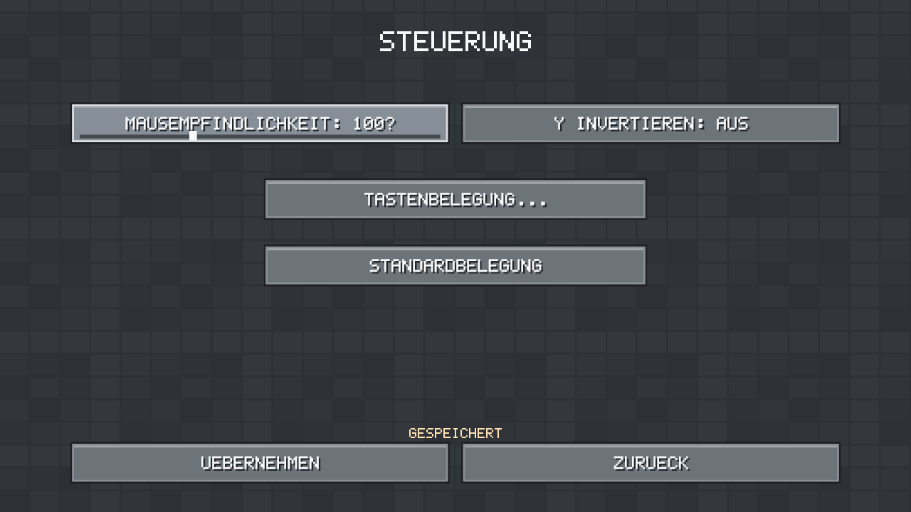

# Slice 15: user settings

Issue #27, stacked on Slice14 `fbe798d8766fdb78de6f62bb8d9efa7ea8215f82`.
Original RustCraft geometry/bitmap controls; no new dependencies or assets.
Title and Pause → **Einstellungen…** share the same configuration. Up/Down/Tab
select, Enter activates on release; Left/Right adjust a focused slider in exact
integer steps. Mouse drag adjusts sliders. Escape cancels key capture, display
preview, or returns one page. Back from the root discards unapplied edits and
returns to the originating Title/Pause page. Gameplay stays paused throughout.
**Uebernehmen** saves on a bounded worker and applies only after successful IO.
Saving temporarily disables navigation; native close waits for the worker and,
when in a world, the usual final world-save barrier. No per-frame settings IO.

## Offered settings and timing

| Option | Values | Effect after successful Apply |
| --- | --- | --- |
| FOV | 45–110 degrees, integer slider including **78** | Immediate; base **vertical** perspective FOV |
| Mouse sensitivity | 10–300%, 100% = 0.002 radians per physical motion unit | Immediate, independent of frame delta |
| Invert Y | on/off | Immediate |
| Render radius | 1/2/3 horizontal chunk radii | Live safe cache reconciliation; no reload, pending jobs validate desired targets |
| Display mode | windowed / borderless on current monitor | 15-second confirmation before saving; Escape, timeout or focus loss restores previous window mode/size |
| Window size | 960×540, 1280×720, 1600×900, 1920×1080 logical pixels | Preview/confirmation; compositor/DPI decides physical pixels; size is meaningful in windowed mode |
| VSync | requested on/off | Bevy AutoVsync / AutoNoVsync; supported fallback chosen by engine |
| Bindings | forward/back/left/right/jump/sprint/sneak/respawn/inventory/pause/hotbar 1–9 | Immediate, preserved over world changes and restart |

All offered settings persist and need **no restart**. Radius changes finish
asynchronously as chunks load/unload. Legacy full snapshots retain their finite
resident behavior. The displayed radius is a chunk radius, not a block distance.
VSync Off is a request: a compositor/driver may enforce synchronization. The UI
never promises an unsupported exclusive mode or guaranteed frame rate.

The original 45-degree vertical FOV remains the default; at 16:9 this is about
72.7 degrees horizontally. 78 degrees **vertical** is about110.4 degrees horizontal
at16:9. Formula: `horizontal = 2 atan(tan(vertical/2) * aspect)`. Sprint widens
the chosen vertical base by9%, with the existing easing. Applying a new base
resets that envelope; the overlay camera follows and the hand's existing lens
correction retains its intended projected size. No physics or targeting change.

Key capture uses portable physical letters A–Z, digits0–9, Space, left/right
Shift/Ctrl/Alt. Conflicts reject the candidate without replacing the old binding;
choose a free key to rearrange assignments. Enter/arrows/Tab stay reserved for
navigation, F3 for debug and F5 for save. Escape always remains emergency pause/inventory-close
and cancels capture; only the Pause action may own Escape in the file. A custom
Pause key also works. Standardbelegung resets keys in the draft; Allgemein →
Alle Standardwerte prepares a complete reset, committed only by Apply. Mouse
buttons, wheel and Shift-click inventory transfers keep their fixed meanings.
The existing movement gesture resource is reset after Apply, and capture/modal
transitions disarm held jump and double-forward sprint before gameplay resumes.

## Storage, failures and precedence

`<RUSTCRAFT data root>/settings.rcs` belongs to the user, outside `worlds/ID`.
The existing absolute `RUSTCRAFT_DATA_DIR` selects that root. Without it, Linux
uses absolute XDG_DATA_HOME/rustcraft or ~/.local/share/rustcraft; Windows uses
LOCALAPPDATA/RustCraft (APPDATA fallback). No alternative directory on IO failure.
Legacy-copy import now excludes root user-settings files along with catalog
containers; existing worlds, identities, regions and journals retain their formats.

Strict UTF-8 version1, maximum4096 bytes, exact ordered fields and exact key count:

```text
RUSTCRAFT_SETTINGS 1
fov=45
sensitivity=100
invert_y=false
radius=2
borderless=false
size=1
vsync=true
keys=KeyW,KeyS,KeyA,KeyD,Space,ControlLeft,ShiftLeft,KeyR,KeyE,Escape,Digit1,Digit2,Digit3,Digit4,Digit5,Digit6,Digit7,Digit8,Digit9
```

Size is the zero-based index of the sizes listed above. All ranges, booleans,
version, key names and duplicates are validated. Unknown fields/versions, missing
fields, malformed UTF-8, non-regular files and oversized files are errors. Defaults
are selected only when the file is genuinely absent with no temp/recovery evidence.
A bad existing file leaves a visible configuration error and blocks Play; a safe
window/menu shell allows inspection/recovery, rather than silently starting a world
with substituted preferences. Full filesystem paths/errors may need external
inspection; the bounded bitmap panel abbreviates long errors.

A short-lived `.settings.lock` OS lock and comparison against the bytes originally
read prevent cooperating writers/stale clients from overwriting another edit.
Writes validate, exclusively create `settings.rcs.tmp`, write/sync, then rename
in the same directory to replace the primary. Unix syncs the parent directory.
Failed pre-rename writes retain the primary; a pre-existing temp is preserved and
blocks saving. No per-frame writes, recursive deletion or world SaveStore access.
A post-rename directory-sync error may mean new bytes are already visible: preserve
files and restart to reread, rather than repeatedly forcing replacement. Windows
has no Unix directory-fsync guarantee; private local data directories are assumed.

On a decodable-size corrupt/unknown file, explicitly preparing All Defaults and
applying preserves exact original bytes in create-new `settings.rcs.rejected`
before replacement. Existing rejected evidence is never overwritten. Unreadable,
oversized or obstructed files require external repair with the client closed;
keep all evidence first. No automatic backup fallback, silent reset or migration.
An external edit requires a restart/reload; the running client never overwrites it.

Priority: explicit development environment override → saved preferences → defaults
on genuinely absent configuration. `RUSTCRAFT_LOAD_RADIUS` still validates1–3 at
world load and overrides the session radius. The graphics page marks that override;
Apply persists the user's selected radius, **never the environment value**.
`RUSTCRAFT_START_CHUNK` remains session-only; `RUSTCRAFT_WORLD_SEED` only prefills
new-world creation. Neither is copied into settings or changes existing identity.
There are no new command-line settings flags.

## Deliberate limits

Exclusive fullscreen is omitted: monitor/video-mode enumeration and cross-backend
switch/restore acceptance are not established. Windowed/borderless are engine
requests, subject to compositor policy; native Windows11/Void X11/Wayland still
need manual acceptance. No custom FPS limiter is offered without measured frame
pacing; VSync uses the existing renderer and physics remains fixed60 Hz. Sprint
and sneak retain reliable hold plus double-forward sprint, with no toggle latch.
Manual UI scaling is deferred: menus already fit a480×270 logical viewport and
inventory uses its existing bounded adaptive scaling; adding independent zoom
requires coordinated hit-testing and low-resolution/high-DPI acceptance. No fake
switches, driver controls, shader presets or new graphics features are displayed.

## Native acceptance: Void glibc / Fish

Install the existing prerequisites in PLATFORMS. In a clone, keep the same path
for restarts (use a persistent separate directory if /tmp cleanup matters):

```fish
git fetch origin
git switch feat/slice-15-settings
git pull --ff-only
set test_dir (mktemp -d /tmp/rustcraft-slice15.XXXXXX)
echo $test_dir
env RUSTCRAFT_DATA_DIR="$test_dir" cargo run --locked -p rustcraft
# After a normal close, same shell/path:
env RUSTCRAFT_DATA_DIR="$test_dir" cargo run --locked -p rustcraft
```

Set FOV78 using arrows for exact value; sensitivity/inversion and keys; Apply.
Create A/42 and B/43. Play A, edit/select inventory, Pause → Settings, change radius
3→1→2, FOV, rebind forward (e.g.Z) and Pause (P), Apply, Back → Pause → Resume.
Check mouse capture, hand/block, double-forward sprint, held jump, sneak edges,
new inventory/hotbar keys, focus loss and F5. Return to Title, open B then A;
worlds keep their own items/edits, preferences remain shared. Close/restart and
verify FOV/keys/radius. Try window size/borderless, cancel once with Escape, once
by waiting15 seconds, once by focus loss; confirm once and restart. Test720p,
1080p,4:3 and desktop DPI on both X11 and Wayland. Test a temporary
`RUSTCRAFT_LOAD_RADIUS=1` session, then remove it and verify the saved choice.
Only in a disposable root, preserve/corrupt settings.rcs, restart and check visible
error, blocked Play and explicit reset preserving `.rejected`. Never inject
failures into real worlds or delete their journals/locks.

## Native acceptance: Windows11 / PowerShell

Install rustup and Visual Studio C++ Build Tools/Windows SDK as in PLATFORMS:

```powershell
git clone https://github.com/ArturTrumpfheller/rustcraft.git
cd rustcraft
git switch feat/slice-15-settings
$env:RUSTCRAFT_DATA_DIR = Join-Path $env:TEMP ("rustcraft-slice15-" + [guid]::NewGuid())
Write-Output $env:RUSTCRAFT_DATA_DIR
cargo run --locked -p rustcraft
# Restart in the same PowerShell session with the same directory:
cargo run --locked -p rustcraft
```

Repeat the above sequence with normal Windows GPU drivers,100/150/200% DPI,
windowed/borderless, Alt-Tab and native close. No published binary, Python runtime
or external assets are needed to run. CI is compilation/regression evidence;
cloud software-rendered X11 cannot establish native compositor/GPU behavior.

## Stacked PR and later squash merge

Slice15's head is `feat/slice-15-settings`; its PR base stays
`feat/slice-14-world-management` until Slice14 is merged. The fork commit above
pins the boundary: **do not rebase all Slice14 commits after its squash merge**.
With a clean working tree and a preserved backup branch, after PR31 is merged:

```sh
git fetch origin
git switch feat/slice-15-settings
git branch backup/slice-15-before-main-rebase
git rebase --onto origin/main fbe798d8766fdb78de6f62bb8d9efa7ea8215f82
# Resolve conflicts, rerun checks, inspect origin/main...HEAD for Slice15 only.
git push --force-with-lease origin feat/slice-15-settings
# Then change only the Slice15 PR base to main using GitHub.
```

This transplants only commits after the pinned Slice14 boundary. If Slice14 later
changes before merge, deliberately review whether those changes must first be
carried into Slice15 and update the boundary/instructions accordingly. Neither PR
is merged automatically by this work.

## Captures

Actual RustCraft Xvfb/Mesa captures (not native GPU acceptance):





## Slice 15 UI polish and keyboard layouts

English is now the default for all application-authored menus, dialogs and errors.
Existing world names and data are never translated. Video Settings uses a discrete
**Render Distance: N chunks** slider (still a horizontal radius1–3). Clicking or
holding/dragging snaps to integers; Left/Right steps exactly one. Slider ranges
share one input/drawing adapter with FOV/sensitivity; future range increases need
an explicit streaming/configuration decision, not another cycling button.

All menu buttons share a darker slate backdrop and a single contrast palette.
Normal, hover, keyboard focus, pressed and disabled states differ in fill/border;
keyboard focus also has an inset marker. Text contrast is tested at least4.5:1
against each linear-color fill. Bitmap text sizes fit the available button width.

Bindings still use Bevy's **physical KeyCode** (US-position identifiers in the
unchanged version1 settings file). Labels use the OS-translated **logical_key**
from KeyboardInput events. On German QWERTZ, pressing the key marked Z reports
physical KeyY/logical Z; it displays Z while persisting KeyY. English QWERTY
reports/displays the corresponding Y/Z without a swap. Movement, double-forward,
inventory, hotbar and conflict detection continue using physical codes.

Bevy's cross-platform input stream does not supply a complete keyboard-layout
map at startup. The interface therefore learns character labels from focused
primary-window key presses and marks unobserved positions explicitly as
**Scan Y**, **Scan Z**, etc. These are physical positions, not guessed keycaps.
Press a key to identify it (or click a binding and rebind); labels update immediately.
The cache is not persisted: after restart, unknown positions are marked Scan
until observed again. A changed/conflicting OS character mapping invalidates old
learned labels; shifted letter case does not. Modifier-produced punctuation and
composed text are not treated as base key names. There is no universal Y/Z swap,
layout selector, OS-specific native dependency or change to saved bindings.

The VSync rollback regression remains covered: previews restore actual window
mode, full resolution and present_mode; confirmed changes install only after
persistence, and VSync-only Apply needs no display confirmation. The PR remains
on its existing branch/base until the owner explicitly requests its later rebase.
