# Procedural daylight sky and terrain fog (Slice 18)

Slice21 extends this historical baseline with a saved day/night clock, separate
sky/block COLOR contributions, procedural celestial bodies/stars and matching
fog gated by geometric sky exposure. See [the current contract](DAY_NIGHT.md).

An original blue daylight gradient surrounds the player. Distant terrain fades
smoothly into the same directional sky color. Nearby atlas texels, voxel skylight,
vertex AO, face shading and gameplay remain unchanged. This is static daylight;
no clouds, sun, weather, day/night, shadow maps or new settings are introduced.

## Appearance and distance

`client/src/atmosphere.rs` centralizes deterministic, scene-linear defaults:

| Parameter | Value |
| --- | --- |
| Upper sky RGB | (0.07, 0.28, 1.25) |
| Horizon RGB | (0.70, 1.20, 2.00) |
| Gradient | mix(horizon, upper, smoothstep(0, 0.5, max(ray.y, 0))) |
| Fog end | clamp(radius, 1, MAX_RADIUS) × CHUNK_SIZE |
| Fog start | 0.55 × end |
| Distance weight | smoothstep(start, end, length(surface − camera)) |
| Daylight weight | smoothstep(0.06, 0.28, max(vertex_RGB)) |
| Terrain output | mix(textured_shaded_RGB, sky(ray), distance × daylight) |

The lower hemisphere uses the horizon color. The upper color is reached at an
elevation of 30 degrees; no azimuth-dependent seam exists. Colors above one are
scene-linear radiance inputs to the existing Reinhard view tonemapper, not an
external HDR sky asset or a separate exposure system.

The active `StreamState.radius` wins over saved preferences, including environment
radius overrides. Finite legacy scenes (stream radius zero) use preferences.
Radius 1/2/3 therefore starts fog at **8.8/17.6/26.4 blocks**, ending at
**16/32/48 blocks**. The five-block interaction range stays clear even at radius 1.
Streaming requests a Chebyshev square of chunk columns around the player's
chunk. Its closest outer edge is always at least radius×16 away, irrespective
of the player's fraction within that chunk. The conservative inscribed circle
therefore reaches full daylight fog before any fully populated requested edge.
Using (radius+0.5)×16 would fail near a chunk edge. Distances remain fixed inside
and across chunks; camera-relative subtraction preserves them during rebasing.
This formula scales with the future maximum radius without changing the shader.

Parameters update in PostUpdate after live settings/streaming updates and before
render extraction. One shared terrain material and one sky material are changed
only when parameters differ. Changing fog itself never requests remeshing;
changing the actual render radius still performs the existing streaming work.

## Terrain integration and caves

`terrain.wesl` still samples the nearest-filtered atlas at explicit LOD0 using
repeating per-block UVs, then multiplies by the unchanged vertex COLOR. Binding102
adds the atmosphere uniform beside atlas100/sampler101. Fog runs afterwards,
before the original `main_pass_post_lighting_processing`. It changes no vertex
attribute, mesh construction, authoritative light value or world/save data.

`atmosphere.wesl` supplies **the same sky function to both materials**. Both then
use the same Bevy main-pass tonemapping/debanding path. This avoids blending
linear terrain toward an already display-encoded clear color. Actual rendered
horizon samples in the matched plains image are (172,195,213) in sky and
(171,195,213) at fully faded terrain; the one-step difference is consistent with
screen-space debanding. These observations supplement the shared shader code.
Raw pixel checks: [pixels.json](performance/slice18/pixels.json).

The existing interpolated vertex RGB is a conservative daylight proxy, including
skylight, face direction and AO. A maximum channel ≤0.06 bypasses daylight fog;
all level-zero face colors lie below it. Between 0.06 and 0.28 the influence grows
smoothly. This keeps sealed caves dark without scans, per-frame light queries,
indoor/outdoor state or another lighting simulation. AO remains visible nearby;
its contribution can also reduce fog on distant dark corners. Partially lit cave
entrances receive reduced tint. This is a visual heuristic, not volumetric light
transport: dark distant silhouettes may remain visible at a loading frontier.

## Sky rendering, cameras and lifecycle

`SkyMaterial` uses one retained, non-indexed, oversized clip-space triangle.
The shader uses vertex_index modulo 3 to tolerate mesh-buffer suballocation.
It reconstructs a view ray with `view_from_clip` and rotates it with
`world_from_view` using w=0. Camera translation and absolute world coordinates
never enter sky appearance. `NoFrustumCulling` prevents an irrelevant world-space
mesh bound from removing this background at large or negative coordinates.

The triangle writes depth 0 with reverse-Z GreaterEqual testing, disables depth
writes/culling and opts out of prepasses/shadows. Terrain depth therefore wins
regardless of draw order. There is one additional world opaque draw, **no new
render pass or full-screen postprocess**, and no sky texture. Fog adds distance,
smoothstep and RGB blending per affected terrain fragment, with early returns
for nearby/dark fragments. The sky shades uncovered screen pixels (and potentially
overdraws pixels depending on opaque ordering); native GPU cost is unmeasured.

Sky and terrain are layer 0. The hand/held block retains its separate layer 1
camera and depth clear, and menus retain layer 2. Inventory/hotbar/crosshair keep
their own materials and existing ordering. They cannot sample terrain fog.

Per active world: one sky entity, one mesh (three positions, **36 logical bytes**),
one SkyMaterial and its **48-byte** uniform. The existing shared terrain material
adds another 48 uniform bytes. Driver alignment/allocation overhead is not
measured. Two new embedded shader modules add no external assets. The shared
WESL module is loaded once and retained globally for imports. SessionEntity and
the existing SessionAssets capture own the sky entity/mesh; atmosphere cleanup
removes the material and handle resource. Returning to title and A/B/A loading
restore baseline asset counts. There are no per-frame mesh/texture allocations,
world scans or atmospheric generation jobs.

## Matched visual evidence

Captured on 2026-10-24, X11/Xvfb, Mesa llvmpipe Vulkan, 960×640, Reinhard,
AutoNoVsync. **Software rendering, not native GPU acceptance.** Baseline source is
exact merged Slice 17 `dc519cdbd6f1d37d037da514ce7144b1d7b749de`.
`atmosphere_gallery` is a deterministic, save-free renderer harness shared by
both builds. Plains, forest, cave and room are authored fixtures with identical
blocks/light inputs. Uneven terrain uses the unchanged generator v3, seed 2026.
Camera positions/orientations are constants in the example; radius, atlas,
meshing, skylight, AO and geometry are identical within each pair.

The baseline adapter copies only the harness/type module into that exact source,
removes the new material field and replaces the unused new uniform updater with
a no-op. **Run it with --baseline:** no sky entity/plugin and the original
Slice 17 terrain shader/flat clear color render the baseline. This is not merely
turning off fog in the new shader.

| Scene | Slice 17 before | Slice 18 after |
| --- | --- | --- |
| Open plains, radius 2 | 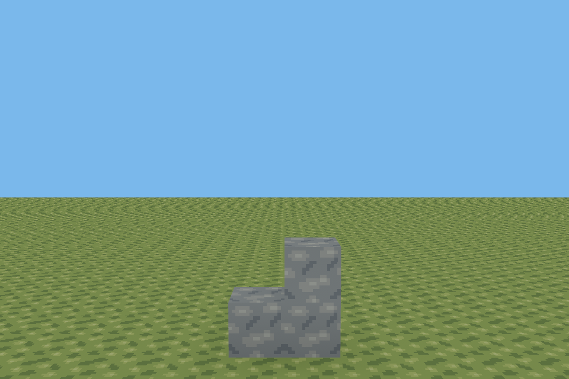 | 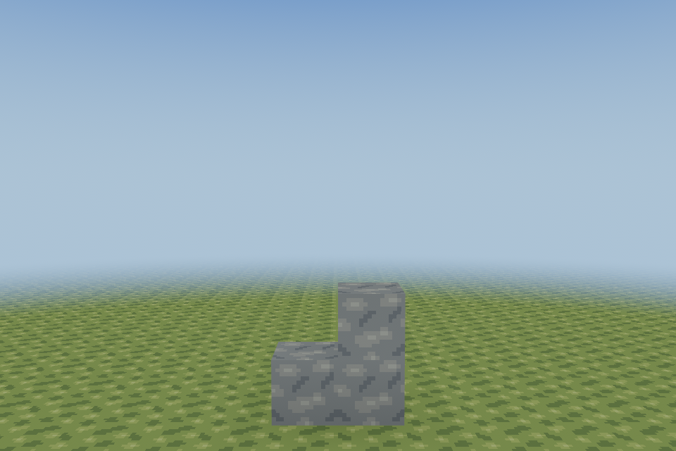 |
| Forest, radius 2 | 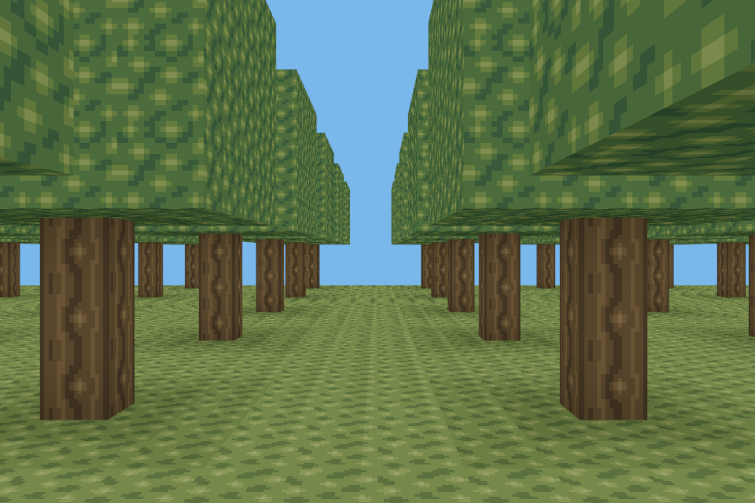 | 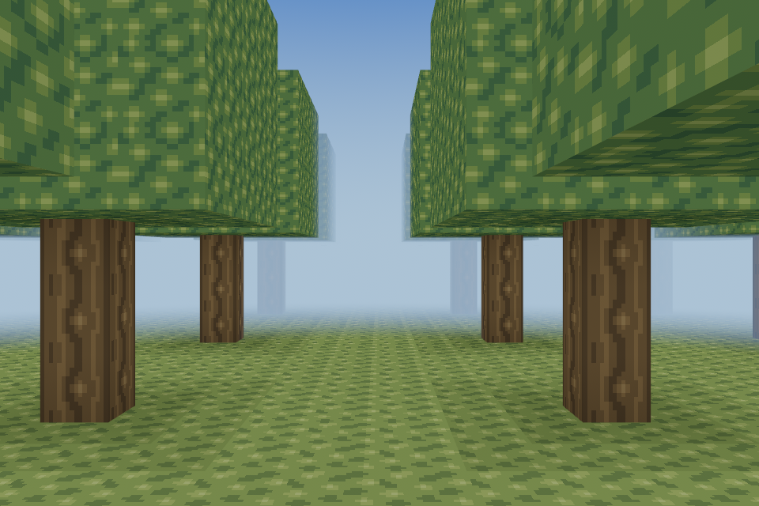 |
| Seeded uneven terrain, radius 3 | 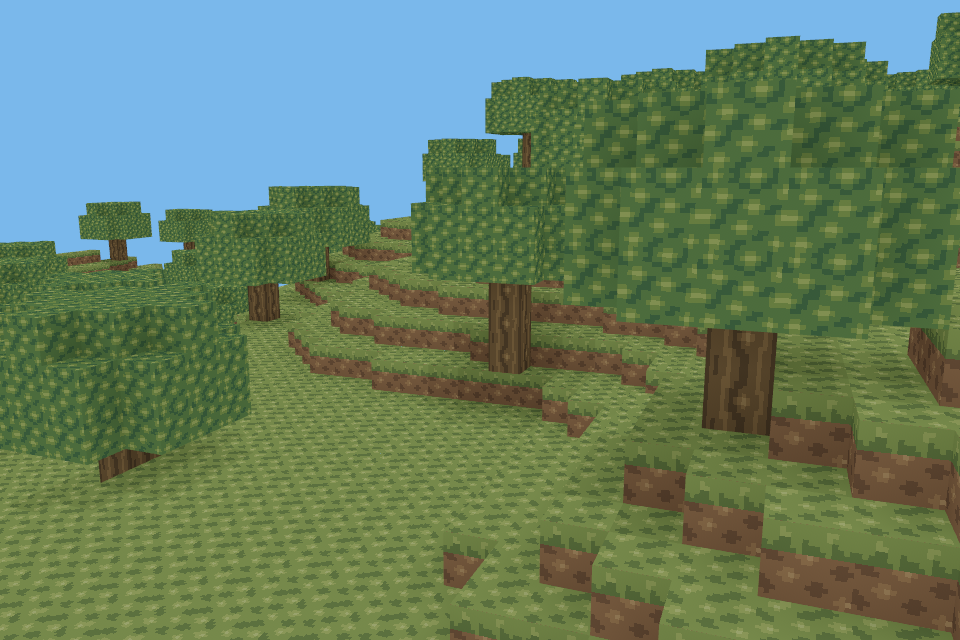 | 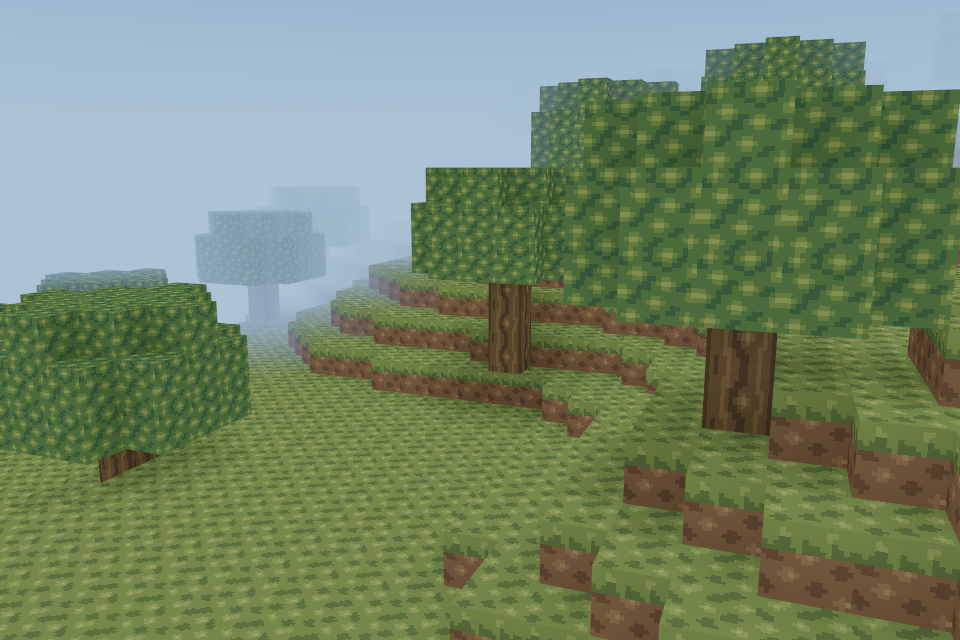 |
| Cave entrance, radius 2 | 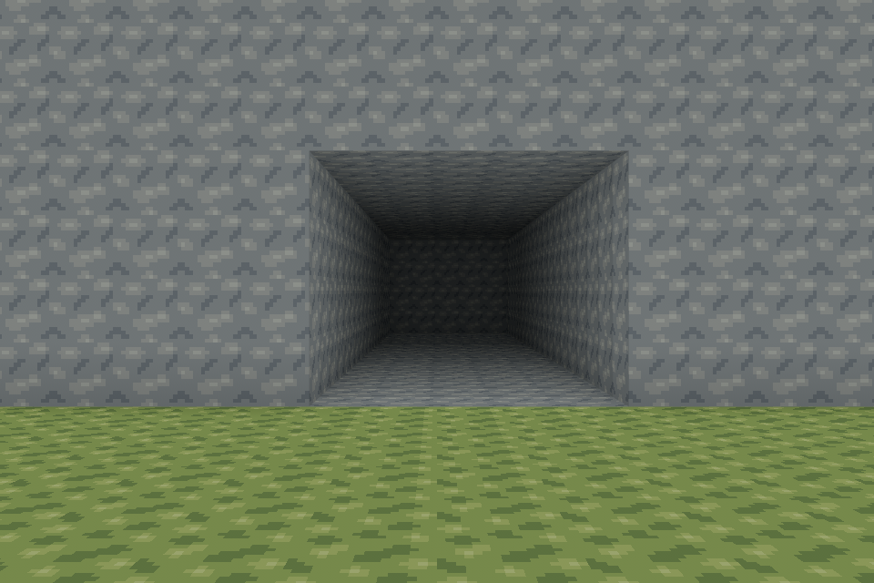 | 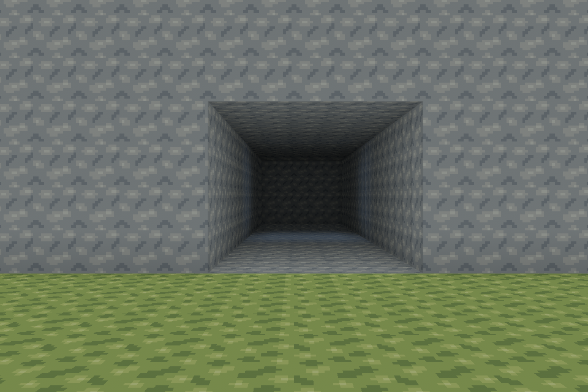 |
| Plains, radius 1 | 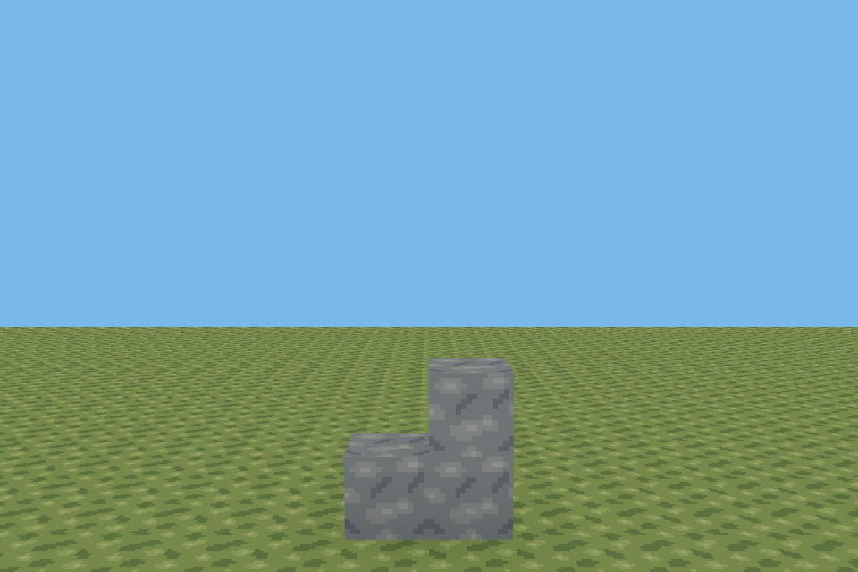 | 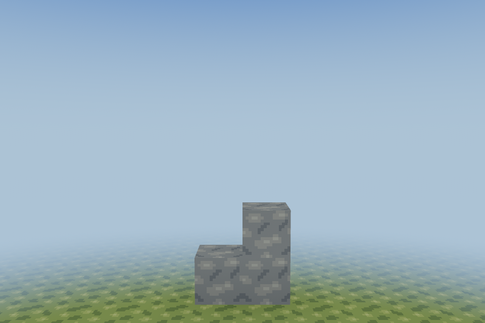 |
| Plains, radius 3 | 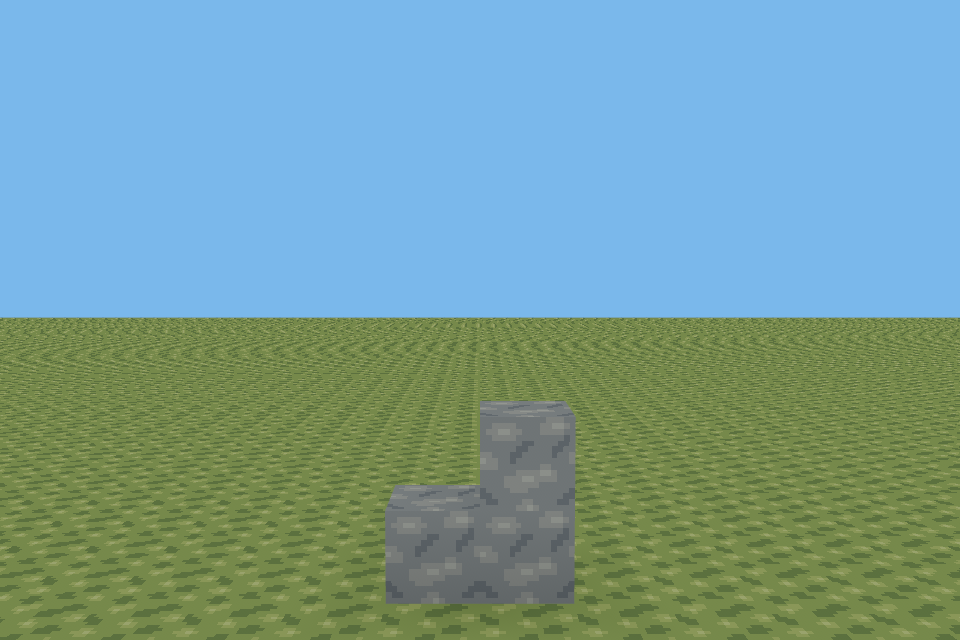 | 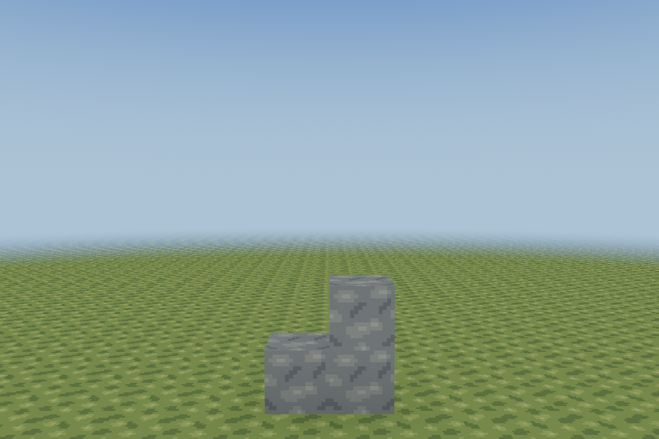 |
| Enclosed room, radius 1 | 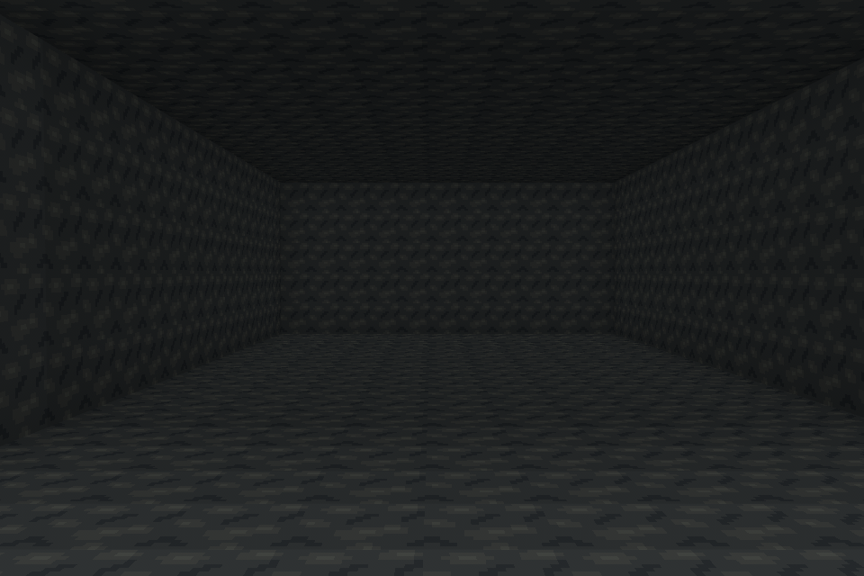 |  |

The near stone ROI (400,500)–(550,590) is pixel-identical at radius 1 and2
(13,500 pixels each). The dark cave core (440,300)–(520,360) is pixel-identical
(4,800 pixels). Across the entire room, only 5,062 of 614,400 pixels differ, by at
most 2/255 per channel; no bright blue wash appears. Open scenes show smooth
horizon fades and an elevation gradient without an obvious color seam.

## Normal client software smoke

An isolated copy of the existing test world was opened from the title with the
normal client (1280×720, X11 llvmpipe). The world/held block, E inventory,
empty-slot hand, Pause, save-and-return-to-title and reopening the same world
were observed. No shader/pipeline errors appeared; expected Xvfb/software-driver
warnings remained. This is a software smoke test, not native input acceptance.

| World and held block | Inventory |
| --- | --- |
| 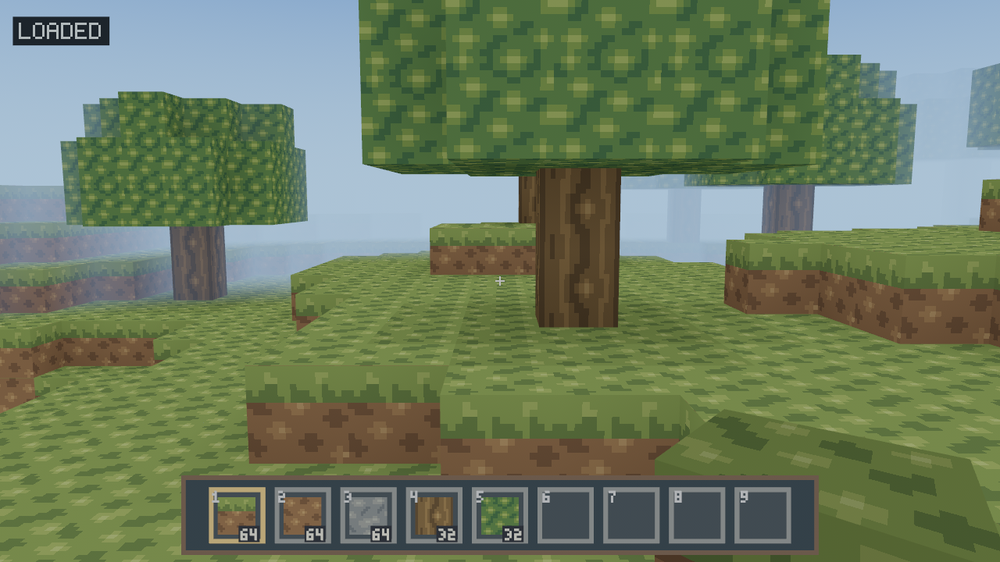 | 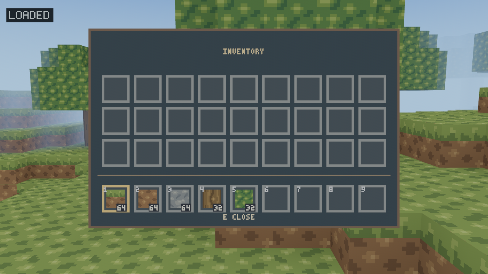 |
| Empty hand | Pause |
| 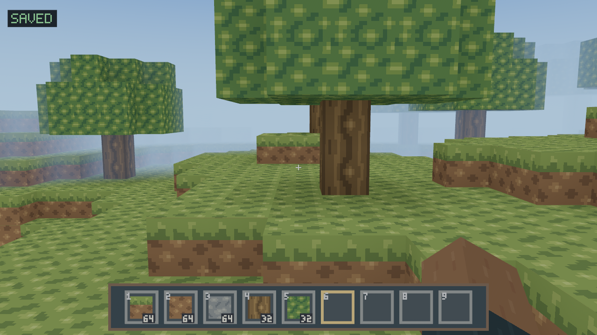 | 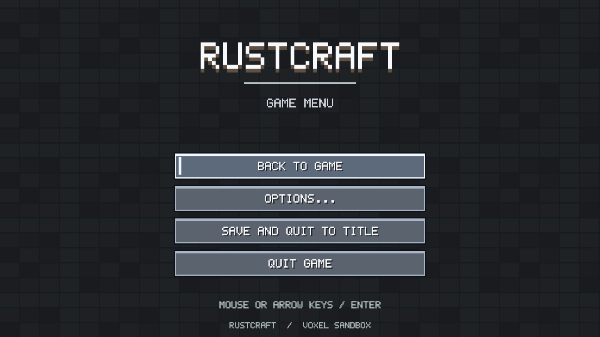 |

## Performance and reproduction

Measured on Debian 13 x86-64, AMD EPYC 9V74 (three exposed CPUs), Rust 1.99.1,
**dev/unoptimized**, Xvfb/llvmpipe Vulkan at 960×640, AutoNoVsync. Each case ran
sequentially, before then after, with 120 warmup and 180 measured frame intervals;
no second renderer or test suite ran concurrently. This is one software-rendered
run per case, not a hardware benchmark or a statistical confidence interval.
Raw [frames.csv](performance/slice18/frames.csv) includes p99, control CPU and
material writes; [environment](performance/slice18/environment.txt) records setup.

| Scene | Frame p50 ms,17 →18 | p95 ms,17 →18 | p50 change |
| --- | ---: | ---: | ---: |
| plains r2 | 33.01 → 44.88 | 41.67 → 74.72 | +36.0% |
| forest r2 | 47.47 → 59.21 | 58.77 → 78.98 | +24.7% |
| uneven r3 | 54.85 → 73.35 | 74.18 → 92.37 | +33.7% |
| cave r2 | 40.89 → 48.43 | 52.39 → 60.90 | +18.4% |
| room r1 | 40.82 → 52.49 | 51.71 → 69.37 | +28.6% |
| plains r1 | 32.18 → 44.34 | 43.64 → 57.26 | +37.8% |
| plains r3 | 33.92 → 46.28 | 43.80 → 58.77 | +36.4% |
| plains r3 moving | 32.75 → 44.57 | 40.06 → 58.58 | +36.1% |
| plains r3 moving + radius cycle | 32.36 → 47.57 | 37.57 → 59.11 | +47.0% |

The software rasterizer shows a substantial regression: roughly 7.5–18.5ms of
additional median frame time across these cases. Native GPU frame cost remains
an acceptance item; these results do **not** establish a negligible overhead on
hardware. CPU-side control remains small: static after-system medians are about
3.8–4.2 µs; moving/cycling medians include camera work. Static/moving unchanged
runs modify zero material assets. The 300-frame cycle run modifies 16 assets total
(eight parameter changes × two shared materials), without creating assets.
The implementation keeps the added work bounded and small on the CPU, but the
extra shader/draw cost must be evaluated on the owner's GPU before merge.


The isolated helper measured 175 ns/call unchanged and 173 ns/call with radius
changes every 128 calls ([raw output](performance/slice18/uniform-update.txt));
this tiny difference is timing noise, not a speedup claim.
The helper test measures five batches of 50,000 calls, reports median ns/call,
and asserts one terrain/one sky asset with zero unchanged writes. It excludes
Bevy scheduling, render extraction and the GPU; it is not whole-frame CPU time.
The gallery's control timing includes its optional camera motion and uniform
update. Frame measurements include the software rasterizer and presentation;
there are no GPU timestamp queries. No FPS improvement is claimed.

Reproduce on a graphical machine (Python 3.12+ for the baseline export helper):

```sh
python3 tools/prepare_atmosphere_baseline.py /tmp/rustcraft-slice17-sky
cargo build --locked --manifest-path /tmp/rustcraft-slice17-sky/Cargo.toml -p rustcraft --example atmosphere_gallery
cargo build --locked -p rustcraft --example atmosphere_gallery
python3 tools/measure_atmosphere.py /tmp/rustcraft-slice17-sky/target/debug/examples/atmosphere_gallery target/debug/examples/atmosphere_gallery /tmp/sky-frames.csv
cargo run --locked -p rustcraft --example atmosphere_gallery -- plains 2
cargo run --locked -p rustcraft --example atmosphere_gallery -- room 1
cargo test --locked -p rustcraft unchanged_uniforms -- --nocapture
```

Use distinct Cargo target directories for both checkouts. If CARGO_TARGET_DIR is
set globally, override it separately for each build. The gallery accepts
plains/forest/uneven/cave/room, radius 1–3, --motion, --cycle and --frames=N
(120 warmup frames, then up to 2,000 bounded samples). Cycle changes uniforms
once every 40 frames while **retaining the initial radius 3 geometry** to isolate
fog-update cost; it does not claim to benchmark streaming. Actual live settings,
stream radius precedence, no-fog-remesh and world transitions are tested in the
client integration schedules.

## Validation and remaining acceptance

All locked workspace checks pass: format, Clippy all targets with warnings denied,
155 client tests + 165 core tests, workspace build, and original texture generation
check. New coverage includes radius clamps/guaranteed circle, deterministic
48-byte parameters, dark thresholds, translation-free sky rays, live radius
changes without mesh changes, settings/stream precedence, pause/resume, A/B/A
world transitions, layer isolation and resource cleanup. Existing atlas/AO,
streaming, lighting, gameplay and persistence tests remain green.

Native Void glibc GPU (X11 **and** Wayland), Windows 10/11 and hardware frame costs
remain pending. Headless tests and llvmpipe do not establish compositor behavior,
mouse capture, driver compatibility or hardware performance. Fog softens a
populated desired frontier; it cannot hide unready interior chunks, solve the
finite world's edge or brighten deliberately dark distant faces. Radius changes
intentionally alter visibility immediately; no temporal weather/exposure system
is present.

Void Linux Fish, isolated test data (keep all real saves closed/backed up):

```fish
set -lx RUSTCRAFT_DATA_DIR (mktemp -d /tmp/rustcraft-sky-XXXXXX)
cargo run --locked -p rustcraft
# Create a new seeded world from the title; keep this root for A/B/A tests.
```

- [ ] Compare plains/forest/hills/cave gallery fixtures and a normal streamed world.
- [ ] Look straight up/down, rotate through 360°, walk across negative chunk edges;
      verify sky continuity, no parallax/depth clipping and stable fog.
- [ ] Walk toward a loading frontier, sprint/respawn/rebase and inspect radius 1/2/3.
- [ ] Apply radius 1→3→2 repeatedly while paused/playing; verify sharp usable reach,
      coherent horizon, no stale fog or resource growth.
- [ ] Inspect roofs, closed rooms and cave entrances; open/seal a skylight and
      confirm original AO and light propagation still work.
- [ ] Check hotbar/crosshair, E inventory, empty hand/held block against walls,
      Pause/Options, return to title and load A/B/A without restarting.
- [ ] On X11 and Wayland check capture/release, focus and window/fullscreen changes.
- [ ] Repeat performance runs in release with VSync controlled, record backend,
      GPU/driver, frame percentiles and comparison against Slice 17.

Windows PowerShell (use the existing platform prerequisites in PLATFORMS.md):

```powershell
$env:RUSTCRAFT_DATA_DIR = Join-Path $env:TEMP ("rustcraft-sky-" + [guid]::NewGuid())
cargo run --locked -p rustcraft
```

Repeat the same checklist on the platform-selected wgpu backend; do not force
Vulkan. Check resize/DPI, focus, mouse release and close/save. No platform-specific
render API or dependency was added by this slice.
