# RustCraft validation

## PR31 visual revision (2026-10-24)

Only menu layout/rendering changed; storage and session code remain untouched.
All five menu tests and the full 119-client/154-core regression suite passed,
including A/B/A cleanup, locks, imports and failed-save retention. Locked Clippy
with warnings denied, format, workspace build and texture validation passed.
Updated Xvfb/Mesa screenshots cover title, list, creation and confirmation;
mouse/keyboard cancellation, 4:3 resizing and native quit were exercised.
No new dependency, texture pack, font file or proprietary asset was introduced.


## Slice14 world management (2026-10-23)

Based on main `50b2ae6`; no dependencies, renderer features, generator outputs or
world/player/journal formats changed. Local final checks passed:

- `cargo fmt --all -- --check`
- `cargo clippy --locked --workspace --all-targets -- -D warnings`
- `cargo test --locked --workspace` (119 client +154 core tests on Linux)
- `cargo build --locked --workspace`
- `python tools/generate_textures.py --check`

Thirteen catalog regressions on Linux cover unique worlds/equal-seed generation,
separate inventories/blocks, per-world locks, paired journals/foreign identities,
valid pending intent with missing root, complete-copy legacy import with unchanged
source bytes and backups/opaque sidecars, blocked source/metadata corruption,
interrupted creation/partial copy, stale staging detection, collision/archive
failures, real non-root permission denial, symlinks and dangling catalog-lock
escape. Windows additionally tests junction rejection; Unix-only permission/link
tests are platform-gated. Original format/journal/recovery suites still pass.
Five UI tests cover Unicode input, numeric validation without a job, paging and
pinned selection, default-cancel confirmations, error/Legacy visibility,
720p/1080p/4:3 layout, dates and close waiting for a blocked catalog job. A full
Bevy lifecycle regression alternates A/B six times without restarting, checks
exact edits/selection/held stacks and inventory modal, releases locks and returns
to baseline mesh/material/image/camera counts after every session. Existing
save-failure/retry, newer-revision drain, physics, lighting, streaming, inventory,
menus and viewmodel regressions are retained.

Actual X11/Xvfb with Mesa25.0.7 llvmpipe/Vulkan used isolated external test roots.
Mouse/keyboard created A/42 and B/43, played A→B→A, persisted independent hotbars,
renamed A without changing its directory, canceled archive, resized to1280×720,
1920×1080 and1024×768 and quit normally. A complete closed-bundle legacy-layout
fixture exercised inspect → import confirmation → cancel, then confirmed import
and confirmed archive. Source SHA256 hashes (including player/regions/lock and an
opaque recovery sidecar) stayed identical through both operations. Inspected
original screenshots are committed as `docs/images/slice14-world-*.png`.
One harness assertion initially expected uppercase from unshifted XTest keys;
the stored lowercase name was correct and the subsequent test verified rename.
No game defect or source data loss occurred. This was a functional GUI check,
not a performance benchmark.

The first Windows CI run exposed Windows' refusal to rename a directory with
an open descendant lock handle. Archive now releases that verified handle only
on Windows under the still-held catalog mutex, which excludes all production
opens through the rename. Unix retains the bundle lock throughout. The regression
that found this remains unchanged. Ubuntu/Windows CI status is tracked in the PR. Native Void X11/Wayland, Windows11,
physical GPU/DPI/IME and filesystem power-loss guarantees remain manual/platform
limitations. No permanent delete, automatic staging recovery or GUI archive
restore is provided. See [WORLDS](WORLDS.md) for exact storage/import guarantees,
security assumptions and Fish/PowerShell acceptance instructions.


## Slice 13 menus and session lifecycle (2026-10-23)

Based on main `cdb28f3`; no core/dependency/format/generator changes.
Final local validation passed: `cargo fmt --all -- --check`,
`cargo clippy --locked --workspace --all-targets -- -D warnings`,
`cargo test --locked --workspace` (**113 client + 141 core tests**),
`cargo build --locked --workspace`, and
`python tools/generate_textures.py --check`.

Six full-client lifecycle tests cover title without store/world/camera, async
loading, inventory/Escape priority, paused physics/edits, resume click suppression,
focus/capture, three same-process v4 sessions with exact asset/camera reclamation,
edits/held-stack/selection persistence, real backup-path save failure with lock
retention/retry, corrupt-load preservation and native close during blocked loading.
An additional controlled in-flight save test verifies that return-to-title waits
for an older snapshot and a newer inventory revision. Existing physics, inventory,
rendering, legacy formats, journal/recovery and streaming regression suites pass.

Actual X11/Xvfb + Mesa 25.0.7 llvmpipe Vulkan smoke tests used a fresh absolute
temporary directory. The directory remained empty at title. Mouse Play, Escape,
keyboard resume/return, same-process reload, a real save failure/error dialog and
successful retry were exercised. Inspected 1280×720 title/pause screenshots are
committed in `docs/images/slice13-*.png`; also checked 4:3, wide and 1080p resizing.
The first graphical pass exposed redundant recursive-child despawn warnings;
cleanup now removes ownership roots only, with the final lifecycle suite passing.
This is functional software rendering, not a performance benchmark.

The existing Ubuntu/Windows CI matrix runs locked Clippy/tests/build plus format
and asset validation; consult the PR checks for live status. Native Void
X11/Wayland, Windows 11, physical GPU, DPI and compositor input acceptance remain
manual. World selection/settings are deferred. Legacy finite initial scene setup
retains the existing bounded synchronous light/mesh preparation; normal generated
world loading and all final-save/worker waiting run asynchronously. Full protocol,
limits and launch/acceptance steps: [MENUS](MENUS.md).


## PR #29 visual revision — single cuboid and Java reference calibration

Continues existing branch from31e3c8e; checkpoint f0669a8 preserved. No new slice/PR.
The initial four-part geometry and associated cost figures below are historical.
Current architecture, reference provenance, measured landmarks and dynamic
approximation limits: [VIEWMODEL](VIEWMODEL.md).

The unmodified official Java1.21.1 Demo was used as a controlled visual reference,
with wide Steve,854×480 and a verified FOV45 Options label. Recorded idle hand,
grass, swings, walk/sprint/sneak and real mining/placement; checked4:3. The later70° demo/focus-dialog capture is excluded.
No game code was decompiled/copied and no reference pixels/client files enter Git.

Five additional regressions cover one-cuboid topology/skin sampling, exclusive
arm-versus-block visibility, unchanged projected geometry across35–110° FOV,
measured reference landmarks at16:9/4:3, sway ranges and sampled swing depth.
Existing integration tests still cover real edits, save restoration, menus,
resource counts, UVs and floating origin. Swing duration now uses real elapsed
frame time, including low-FPS replay; fixed simulation is untouched.

Exact retained geometry:11664→7776 bytes (−33.3%), at most2→1 model draws and
60→12 triangles; one additional1-KiB skin image. The overlay render view remains.
No new hardware FPS/VRAM/RSS speedup claim or repeated large-world benchmark.

Local final checks passed: fmt, locked workspace Clippy with `-D warnings`,
**247 tests (106 client +141 core, none ignored)**, locked workspace build and
original texture regeneration check. Clippy's two findings (query type complexity
and constant-size chunk iteration in a test) were fixed before the full run.

Xvfb/Mesa25 llvmpipe/Vulkan,854×480,seed42,radius1: both the pre-revision executable
and revised executable were captured; the final elapsed-time fix was checked again
on the final build. All five block types, empty arm, curved swings, movement,
E inventory/capture restore,20 rapid mine/place attempts, F5/SAVED and normal
close passed. Software capture produces duplicate frames and input/render latency;
representative swing comparisons are not assertions of exact Java tick alignment.
Sneak/jump/landing/control regressions pass automated tests; their native feel and
Void/Wayland/Windows/hardware GPU rendering remain owner acceptance.

Owned before/after captures (same854×480,45°):
[old arm](images/slice12-before-arm.png), [revised arm](images/slice12-revised-arm.png),
[old block](images/slice12-before-block.png), [revised block](images/slice12-revised-block.png).
External Java captures are retained outside Git to avoid redistributing Minecraft
art. The later full4:3/70° attempt was interrupted by the demo player's death and
subsequent menus; those frames are excluded. The earlier cropped4:3 viewport check
and wide45° calibration, captured before that survival session, remain valid.

Ubuntu/Windows CI results are added after pushing this revision.

## Slice 12 — initial implementation (historical, before owner visual revision)

Base: accepted Slice11 main `cfcf645`, branch
`feat/slice-12-first-person-viewmodel`, Issue #24. See VIEWMODEL for rendering,
animation, source/provenance and resource accounting. No voxel_core, physics,
world/player format, generator, dependency, image-atlas or streaming changes.

### Checks

- `cargo fmt --all -- --check`
- `cargo clippy --locked --workspace --all-targets -- -D warnings`
- `cargo test --locked --workspace`: **242 tests,101 client +141 core**, none ignored.
- `cargo build --locked --workspace`
- `python3 tools/generate_textures.py --check`

Eight new focused tests compare every held cube's per-vertex face UV against
actual core terrain output; check overlay depth/color/layers and UI separation;
exercise all five items, numbers/scroll/empty slots, loaded/quick-transferred and
consumed/mined stacks in the same frame; perform a real player-session roundtrip;
check capture/menu/focus/respawn action gating, actual-distance walk/sprint/sneak,
vertical/landing reaction,30/60/144-FPS replay and1000 rapid retriggers; and run600
selection/action/FOV/aspect/far-origin updates with invariant mesh/material/image
counts and exact camera-child global transform/projection checks. Existing save,
movement, inventory, lighting/meshing and streaming regressions remain intact.

Early headless selection testing exposed that MinimalPlugins does not register
render-plugin-required Visibility for bare Mesh3d. Explicit child visibility now
makes both minimal and full rendering behavior unambiguous; no extra test tick or
input timing workaround. Repeated swings use an explicit active flag so consuming
a nonzero action serial while hidden cannot restart it after a pause.

### Graphical smoke and measured cost

Xvfb/X11, Mesa25.0.7 LLVM19 llvmpipe Vulkan, LP_NUM_THREADS4, debug,640×360,
seed42/radius1, separate fresh save directories. The v4 test passed all five
selected textured blocks and empty hand,24 rapid mine/place attempts, inventory
open/close, sneak, save, cursor release and normal window close. Additional
short runs verified contact with a wall at Z9.3 and a v3 original closed tunnel
at Y21/Z-9.6: hand/Stone remain readable, with existing UI in front. Screenshots
are in `docs/images/slice12-viewmodel.png` and `slice12-cave.png`. Ordinary Xvfb
and software-adapter warnings only; no application errors in completed runs.

Matched baseline `cfcf645` and Slice12 rendering code `4ae14a3` were built using
the same toolchain/target cache (baseline in an isolated detached worktree), then
run sequentially without compilation/other benchmarks. After identical capture/
resize/warmup, one8-second idle sample per version gave:

| Metric | Slice11 | Slice12 |
| --- | --- | --- |
| Process CPU (100%=one core) | 234.87% | 230.86% |
| RSS start→end,KiB | 426884→426892 | 435312→435432 |
| Resident chunks / terrain meshes | 27 /22 | 27 /22 |
| Terrain vertex/index bytes | 2332368 | 2332368 |

End RSS differs by8540 KiB (~8.34 MiB). CPU values are within this short software
trial's variability: no speedup or hardware-FPS guarantee is claimed. No matched
frame-percentile or physical-GPU/VRAM measurement was taken. A320×230 world-only
crop outside hand/UI is byte-identical between the matched screenshots, verifying
that the extra view did not retone/light the underlying world.

Exact additional geometry: six retained meshes, two StandardMaterials, zero
Images, four entities, at most two model geometry draws/60 triangles. Vertex/index
payload11664 bytes on CPU/GPU before alignment; engine/driver view and pipeline
memory is additional. One extra3D pass clears shared window/MSAA depth and loads
existing color. Bevy's target/MSAA depth cache is shared by these views; attachment
and GPU allocation details remain backend-owned. The242-test suite and600-update
retained-handle stress cover bounded ownership, not multi-hour driver endurance.

The successful Slice11 movement/fastbridging behavior is preserved; no need to
repeat worldgen/meshing benchmarks for unchanged code. Native Void X11/Wayland,
Windows GUI, custom driver/GPU/high-DPI and long GPU-memory runs remain owner
acceptance. Custom FOV/aspect are tested in-process; no settings UI added.
Full Ubuntu/Windows final-head CI is required and linked in the PR. Logs/binaries,
GUI harnesses and disposable save directories are outside Git under
`/workspace/.rustcraft-env/checks/slice12`; no real user save was opened.

## Slice 11 owner-requested polish — same PR #28

The owner accepted initial Slice11 movement, safe sneak and fastbridging on Void.
This follow-up retains the branch/base and adds9% eased sprint FOV,250-ms configured
forward double-tap, held jump with post-modal release gating, and a capped sprint
launch bonus. No save/generator/ID/dependency/streaming/texture changes.

- Final local fmt, locked workspace Clippy with `-D warnings`, **234 tests
  (141 core +93 client)**, workspace build and texture artifact check passed.
- New regressions: threshold249/250/251 ms, distinct/repeated/brief forward edges,
  conflict/rebinding resets; pending-tap versus held jumps, landing-only cadence,
  unsupported/ceiling behavior; stationary/sneak/wall/pending/roof bonus refusal,
  cardinal/diagonal9.2 cap; actual input focus/cursor/inventory/save/respawn/void
  resets; double-W+held-jump replay30/60/144 FPS; FOV easing, original/replaced
  baseline restore, aspect preservation, pause/sneak return and matched normal-FPS
  response; unchanged UI mesh/image/material counts during FOV animation.
- The old press-only jump regression now releases its tap before physics; a
  separate held test counts legal land/relaunch cycles. An initial cadence test
  mistook the landing's negative→zero velocity for a launch; corrected to count
  positive upward launches only. No physics exception was added for the test.
- Same 100-block flat simulation from rest: walk20.033 s, Ctrl or pre-latched
  double-W12.567 s, sprint+held-Space11.200 s (average4.992/7.958/8.929 blocks/s).
  The cap is9.2; repeated sprint hops are about12.2% faster on this course.
  20-block times:4.033 /2.567 /2.500 s. First hop from rest has no run-up bonus.
  See MOVEMENT for exact eligibility and `flat_course_sprint_jumping` reproduction.
- One targeted Xvfb/X11 Mesa25.0.7 llvmpipe debug GUI run,640×360/radius1,
  passed on an isolated v3/gen2 flat fixture: double-W observed8.07 blocks/s;
  three sampled jump arcs while holding Ctrl+direction+Space; E paused midair,
  held Space stayed blocked after closing until release/repress; FOV/terrain,
  retained readable HUD/target/crosshair, sneak, F5 and normal window close.
  The saved root stayed byte-identical. Software-rendered screenshots/logs are
  outside Git under the existing `slice11/polish-*` artifact paths. No application
  errors; ordinary Xvfb/software-adapter warnings only. Exact FOV response is
  verified by integration tests, not inferred photometrically from moving views.
  Native Void/Wayland/Windows acceptance is still required for these additions.
- Prior expensive meshing/lighting/large-world benchmarks were not rerun: those
  paths did not change and their full regressions remain. No hardware FPS claim.
- Full Ubuntu/Windows workflows at the final PR head are required; links/results
  are kept in PR #28. The initial Slice11 report below remains historical.

## Initial Slice 11 — responsive walking, sprinting and safe sneaking

Base: merged Slice-10 main `3656020`; branch
`feat/slice-11-movement-sneaking`, Issue #23. Tuning, edge policy and reproducible
simulation comparisons: [MOVEMENT](MOVEMENT.md). No dependency/feature, asset,
world/player format, frozen generator, block ID, light/mesh or streaming changes.

### Checks and regression coverage

- `cargo fmt --all -- --check`
- `cargo clippy --locked --workspace --all-targets -- -D warnings`
- `cargo test --locked --workspace`: **222 tests, 138 core +84 client**, none ignored.
- `cargo build --locked --workspace`
- `python3 tools/generate_textures.py --check`

Targeted physics/camera/edit/modal tests ran during implementation. Final full
suite retains prior save v1–v4/player recovery, journal/failure/corruption,
lighting, meshing, resource lifecycle, generation and inventory coverage. Added
coverage includes speed/acceleration/braking/turning; cardinal/diagonal ledges at
signed and distant seams; partial support, ledge sliding, sprint-to-sneak;
unsupported/edited support and airborne momentum; jumping; crouch body/eye,
blocked/pending headroom, crouched diagonal contact; Ctrl/Shift mapping/rebinding,
capture edge suppression, camera posture interpolation, modal pause, respawn and
30/60/144 render-FPS replay. Real input floor mining runs both standing/crouched.

Both Ubuntu and Windows full workflows passed for checkpoint `1682534`
([run 39975001709](https://github.com/ArturTrumpfheller/rustcraft/actions/runs/39975001709)).
Final PR-head checks are recorded by GitHub; they remain required before review.
Clippy initially caught eight adapter arguments; keyboard resources are grouped
with the existing SystemParam pattern. No lint suppression or physics workaround.

### Measured movement and graphical checks

The committed `twenty_block_movement_profile_records_speed_and_time_comparisons`
test replays actual physics, including acceleration, on the same flat floor:
20 blocks from rest take **4.683→4.033 s walking**, **3.617→2.567 s sprinting**
(Slice10→11), and **11.133 s sneaking**. Target speeds are 5.0/8.0/1.8 blocks/s.
These are exact simulated ticks, independently of rendering or wall-clock load.

Graphical smoke tests used Xvfb X11, 640×360, Mesa25.0.7 llvmpipe LLVM19 Vulkan,
LP_NUM_THREADS4, debug build and isolated directories. A known v3/gen2 fixture
with a flat raised platform showed warmed title-position samples of
**5.00 /8.06 /1.80 blocks/s** over 1.5 s (coordinates quantized to0.1, not a
precision benchmark). Verified Ctrl+Shift edge stopping at Z7.7 on floor starting
Z8, stable Y1, sideways sliding, Shift+Space leaving the ledge, E pausing with
Ctrl/Shift/direction/jump held, pointer capture/release, R, F5, restart and normal
native window close. The v3 root stayed byte-identical after the clean session.

A fresh v4/gen3 seed42/radius1 world traversed X0.5→22.1 using Ctrl and repeated
jump presses, crossing a streamed column boundary. After returning with R it
settled to **27 resident chunks, 22 meshes, 110592 block bytes**, 24 cached halo
columns and zero discarded results. One rolling128-frame return sample was
P50/P95/P99 **29.89/32.62/40.16 ms**, mean33.1 FPS; this is software-rendered smoke
telemetry, not a matched Slice10 performance comparison. Inventory/crouch/cursor,
F5 and normal close passed. No application errors in the completed runs.

Harness setup was corrected for the cloud Mesa driver path, X11 capture retry,
missing position text in finite-v2 mode, sampling an edge before it fully settled,
and clean F5 correctly retaining LOADED rather than SAVED. Cold first-visible
terrain made an early short speed sample unsuitable; the warmed run matched
simulation targets. These caused no game-code/backend changes. Successful speed
and edge checks were not repeated for the final close-only v3 rerun. Logs,
screenshots and disposable fixtures are outside Git in
`/workspace/.rustcraft-env/checks/slice11`; no real save directory was opened.

No allocation or GPU-resource path was added to movement; support probes are
bounded and reuse voxel collision queries. Expensive prior meshing/light stress
benchmarks were not repeated because those paths did not change; their regression
tests remain in the full suite. Native Void X11/Wayland, Windows GUI, physical GPU,
compositor shortcuts and subjective game feel still require owner acceptance.
No automatic step-up, one-block crawling, head bob, FOV animation or saved position/
posture is introduced. Safe owner checklist: [PLATFORMS](PLATFORMS.md#slice-11-movement-test-fish).

## Slice 10 — bounded voxel skylight and retro atmospheric lighting

Started from accepted `main` **bc34e76** (merged PR #19); the owner confirmed
Slice 9 on native Void. Branch `feat/slice-10-voxel-lighting`. Rust 1.99.1/Bevy 0.20.0,
dependencies/features, atlas pixels/UVs, block/item IDs, frozen generator outputs
and world v1–v4/player/session formats remain unchanged. A read-only generator
config accessor scopes pristine halo caches to seed/version. Older sections below
are historical. Algorithm, bounds, rendering tradeoffs and no-AO policy: LIGHTING.

### Checks and regression coverage

Passed on Debian 13 glibc x86-64, debug profiles:

```sh
python3 tools/generate_textures.py --check
cargo fmt --all -- --check
cargo clippy --locked --workspace --all-targets -- -D warnings
cargo test --locked --workspace
cargo build --locked --workspace
```

**209 tests passed (129 core +80 client), zero failed/ignored.** All 196 accepted
Slice 9 cases remain; footprint/stride expectations and asynchronous render waits
were adapted. New coverage includes:

- Direct sky, sealed rooms, indirect tunnel attenuation/cutoff, roof open/close,
  opaque dense leaf canopies, signed XYZ seams and full vertical occlusion.
- Independent all-sky-source reference flood on randomized roof/wall openings
  versus the optimized roof-frontier solver, plus chunk/source order equality.
- Exact sample equality, skipping unchanged mesh batches, cached halo reuse,
  seed-change invalidation and eviction. Local tokens include non-geometry roof
  dependencies without returning to global save-revision rejection.
- Actual Bevy worker schedules for a roof in one vertical chunk relighting an
  unchanged floor mesh in another; stale load/light samples never install,
  mesh handles remain stable, and stale legacy batches retain old complete meshes.
- Paired save/restart in v1/v2/v3/v4 retains edited blocks, held items and selection
  and reconstructs identical colors/meshes, including a far regional world.
  Lighting does not mutate world revisions or serialized bytes. Existing journal,
  corrupt/foreign files, inventory conservation, diagonal collision, respawn,
  texture UV/culling, regional seams and floating-origin regressions still pass.

Ubuntu and Windows completed the full workflow at implementation `6eb3457`
([run 39853408089](https://github.com/ArturTrumpfheller/rustcraft/actions/runs/39853408089)),
including the final cache identity guard. The PR checks provide final-head results. An initial Windows failure came from the new test
helper advancing extra physics ticks while waiting for async presentation. Waiting
now occurs only at mesh assertions; physics frame helpers again advance exactly
one frame. The floor-break test passes on both OSes without changing physics.
CI also emits bounded failure annotations: full runner-log storage was blocked
by the cloud network policy; the annotation exposed the actual failed assertion.
No native GUI claim follows from either CI job.

### Matched headless CPU comparison versus accepted Slice 9

Same cloud host, debug binaries, seed 42, radius 1, three independent trials/version,
medians, no compilation/GUI overlap. Baseline binary is accepted Slice 9 production
(source-identical to `bc34e76`); current CPU measurements include the final cache
identity guard. The existing tests exercise actual streaming/meshing and far
regional travel; their update timings are **not GPU/display frametimes**.

| Metric | Slice 9 | Slice 10 |
| --- | ---: | ---: |
| Surface, 32 edit batches, elapsed | 214.72 ms | 1112.92 ms |
| Surface update p50/p95/p99 | 0.379/0.555/0.738 ms | 0.372/0.714/0.874 ms |
| Surface complete-process CPU time | 0.675 s | 2.484 s |
| Surface process peak RSS | 37,036 KiB | 37,824 KiB |
| Surface terrain buffer bytes | 1,577,608 | 2,241,864 |
| Far travel elapsed | 0.939 s | 2.095 s |
| Far visit p50/p95 | 102.14/109.28 ms | 226.70/242.42 ms |
| Far complete-process CPU time | 1.510 s | 3.669 s |
| Far process peak RSS | 37,376 KiB | 38,284 KiB |

Both retain 27 peak residents, four region overlays and bounded queues in this
radius 1 workload. Far terrain payload is 1,641,296→2,332,368 bytes. The increase
is the expected **42.1% quad payload** from 32→48-byte vertices; face counts/indices
are unchanged. Driver allocations/alignment and CPU retained copies are separate.

Lighting materially increases worker CPU and load latency; it is not a free
performance improvement. Edits still use cached authoritative blocks and pristine
halos, not full column regeneration per click. Coalescing 256 rapid changes keeps
one current batch, and unchanged exact samples skip mesh work. Light work is a
bounded regional rebuild, not a persistent per-cell removal solver; optimizing
that CPU cost and packed light attributes are sensible next performance work.

### X11/Mesa graphics, correctness and stress

Xvfb X11, Mesa 25.0.7 llvmpipe/LLVM 19 Vulkan software renderer, LP_NUM_THREADS=4,
independent disposable directories. Renderer selection was overridden only in
the harness, not in the game. Both versions used the same saved v3 seed 42
platform/wall fixture, 640×360/radius 1/camera, eight-second warmup. No compilation
or headless CPU workloads overlapped. One graphical trial per version per rate.

| 64 applied edits, 0.4s/input, final 128 frames | Slice 9 | Slice 10 |
| --- | ---: | ---: |
| Mean FPS | 27.9 | 33.7 |
| p50/p95/p99 | 35.30/41.76/48.63 ms | 27.95/36.44/55.77 ms |
| Wall time | 25.66 s | 25.65 s |
| Process CPU (100%=one CPU) | 259.3% | 223.8% |
| RSS before→after | 425,416→425,784 KiB | 427,584→428,340 KiB |

| 128 applied edits, 0.15s/input, final 128 frames | Slice 9 | Slice 10 |
| --- | ---: | ---: |
| Mean FPS | 28.0 | 34.4 |
| p50/p95/p99 | 34.36/43.73/57.47 ms | 27.97/36.00/42.94 ms |
| Wall time | 19.28 s | 19.30 s |
| Process CPU | 255.8% | 229.8% |
| RSS before→after | 412,724→413,300 KiB | 428,948→429,664 KiB |

Both rates restored the exact root bytes and within-version pixel-identical
before/after screenshots. Final save revisions 66/130 prove all 64/128 edits
applied (including preliminary pair). New inventory retained Stone 64 total,
other starter totals and selected slot 3. Both stayed at 27 residents/23 meshes;
final terrain bytes 1,628,376→2,314,008. No renderer errors or empty-mesh warnings.
Repeated asset-count/eviction tests and short RSS plateaus support bounded
resources; these short runs cannot prove absence of every leak.

The unlit material reduces software rendering work despite additional light CPU,
but p99 worsens in the first trial. Do not infer native hardware speedups from
this, or hide startup tails: queue-to-install maxima were 1.461→1.261s (normal)
and 0.974→1.335s (fast); startup-inclusive dirty latency maxima 237→485ms and 90→512ms.
Fast-test worker maximum 62→255ms includes cold/first-use work, while stream-update
maximum stayed below 1ms in that run. No hard timing guarantees are asserted.
The normal Slice 10 run counted **16,234,560 light cells /301,776 indirect updates**
across startup+edits, **24** pristine source columns generated/cached and **27**
applied chunk arrays; no per-edit column regeneration or stale outputs.

An original sealed tunnel fixture at 960×640 verified actual darkness, entry
falloff, mining a roof opening, returning to the same view, placing it closed,
F5 and inventory/capture controls. Closed/open/closed RGB means in a fixed central
ROI were approximately **(28.76,30.88,31.00) → (48.29,51.23,51.47) → original**.
Baseline global lighting stayed around (152,157,157), unaffected by the opening.
Walking time gave slightly different camera coordinates between versions, so
these are qualitative visibility checks, not calibrated photometry. Exact root
restoration and Stone 64 were independently checked on both versions. UI remained
bright/readable in darkness. Actual original screenshots are in
`docs/images/slice10-cave-closed.png` and `slice10-cave-open.png`.

The first cave harness mis-scaled XTest relative mouse movement and aimed away
from the roof during placement, on both baseline and new code. Repeating in fresh
directories with calibrated absolute pitch targeting passed open/close and exact
world/item restoration. This required no game input change.

### Limits and native acceptance

No native Void/Wayland/Windows GUI or physical GPU/high-DPI testing here. Follow
PLATFORMS' Slice 10 Fish checklist with a fresh absolute save directory; existing
saves are never test fixtures. All prior paired-save/recovery limits remain.
No lights are persisted; loading reconstructs them from saved blocks/overlays.
There is no AO, emitted light/torches, day/night, transparent foliage or shader
rewrite. Flat face bands and a small readable cave floor are intentional.

Conservative full-height target sets can do more work than a fully incremental
cell solver. Large connected batches and dense edits still need native profiling.
The maximum radius 3 light domain is 967,872 cells; cached source blocks cap at
995,328 payload bytes and applied samples at 857,304 bytes, excluding scratch,
mesh/driver and map overhead. Startup regional-light errors can delay initial
terrain presentation rather than invent bright Air. Failed inputs retain safe
barriers/old coherent meshes and existing visible retry feedback.

All binaries, logs, scripts and disposable worlds remain outside Git. Atlas art,
licenses, worldgen goldens and save contracts are preserved. Original new code,
documents and screenshots are MIT OR Apache-2.0; no imported third-party assets.

## Slice 9 — functional inventory, retained hotbar and paired session saves

Started from accepted `main` **ee16009** (PR #16); the owner accepted Slice 8
on native Void. Branch `feat/slice-9-inventory-hotbar`. Rust 1.99.1 / Bevy 0.20.0,
Cargo.lock, engine features, terrain atlas, block IDs, frozen generators and world
formats v1–v4 are unchanged. Player/session sidecars are separately versioned v1.
The Slice-8 and older sections below are historical, not current UI instructions.

### Checks and regression coverage

Passed locally on Debian 13 glibc x86-64, debug profiles:

```sh
python3 tools/generate_textures.py --check
cargo fmt --all -- --check
cargo clippy --locked --workspace --all-targets -- -D warnings
cargo test --locked --workspace
cargo build --locked --workspace
```

**196 tests passed: 119 core + 77 client, zero failed/ignored**; all 162 accepted
Slice-8 tests remain. New/extended coverage:

- Stack bounds/IDs, full/partial merging, unlike swaps, half rounding, single
  placement, both quick-transfer directions and remainders; 20,000 deterministic
  mixed operations conserve each item total including cursor. Invalid slots,
  extreme selection scroll, full cursor return and failed/no-op edits lose nothing.
- Actual input schedules for nine keys, line/pixel wheel, focus, E/Escape capture
  restoration, click suppression, paused camera/physics/reset and outside clicks.
  Actual mining/placing counts, full/empty refusal, body/pending safety and 64
  alternating gameplay input cycles preserve block/item totals.
- New player/identity/journal round trips, truncation/corruption, valid-CRC invalid
  fields, foreign IDs/worlds, unknown versions, missing initialized files/backups,
  orphan player state, read-only legacy-v1 initialization, byte-compatible v1–v4.
  Injected journal/world/player commit failures and multi-region far-edit replay,
  idempotent backups, no factory/refill on recovery, corrupt-player preflight,
  inventory-only autosave/normal close/held cursor, failed close/retry, newer edits
  during an older captured save, world-only API refusal after initialization.
- Retained UI asset bounds and buffer reuse over 1,000 idle updates and 60 modal
  cycles, all 36 filled slots, cursor pointer motion without rebuild. Existing UV,
  atlas seams, regional corruption, travel/eviction, floating origin, spawn unload,
  diagonal collision and connected dirty publication tests all still pass.

Ubuntu and Windows GitHub Actions run artifact regeneration, fmt, Clippy, all
workspace tests and build using the unchanged workflow. Intermediate pushed
implementation `39bd25f` passed both jobs (run **39843251619**); the PR contains
current-head results. Neither CI job tests native graphical behavior.

### Matched CPU workloads versus accepted Slice 8

Same cloud host, debug binaries, seed 42, radius 1; three independent trials each,
medians. Preserved accepted Slice-8 production binary (`ee16009`, same tree as
`54c1347`) versus Slice-9 implementation, without compilation or overlapping GUI
work. These existing headless streaming tests isolate world/meshing, not the full
new UI/save protocol; their update timings are **not displayed GPU frametimes**.

| Workload / metric | Slice 8 | Slice 9 |
| --- | ---: | ---: |
| Surface seam, 32 installs, elapsed | 280.07 ms | 271.71 ms |
| Surface headless update p50 / p95 | 0.510 / 0.639 ms | 0.546 / 0.685 ms |
| Surface complete-process CPU time | 0.890 s | 0.899 s |
| Surface process peak RSS | 36,812 KiB | 35,732 KiB |
| Surface terrain buffer bytes | 1,577,608 | 1,577,608 |
| Far travel elapsed | 1.149 s | 1.122 s |
| Far visit p50 / p95 | 124.01 / 129.45 ms | 124.26 / 126.66 ms |
| Far complete-process CPU time | 2.082 s | 2.073 s |
| Far process peak RSS | 36,960 KiB | 36,204 KiB |

Both versions: 27 peak resident chunks, four region overlays, queue peak 11,
1,641,296 far-travel terrain bytes; zero discarded seam outputs. Differences are
small and noisy, not evidence of a new streaming optimization. No world/mesh
algorithm changed in this slice.

New retained-UI workload, three trials: median **854.97 ms for 1,000 idle app
updates** and **124.64 ms for 60 modal cycles**. These include all test-app systems,
not isolated UI function times. No idle rebuild, no resource-count growth: four
UI meshes, two UI materials, existing single atlas image. Counted vertex/index
payload is **39,184 bytes closed**, **74,144 open** with starter contents and
**199,376 with all 36 slots filled** (includes small valid hidden buffer caches;
excludes driver/ECS overhead). Moving a held cursor changes transforms only.

### Graphical input, restart and matched stress

Xvfb X11, Mesa 25.0.7 llvmpipe LLVM19 Vulkan software renderer, LP_NUM_THREADS=4,
independent temporary worlds, no native user saves. Actual XTest input at 960×640
verified nine-slot selection/wheel, E modal, original 3×9+9 layout/icons/counts,
left/right/Shift transfers, Wood32 → Wood31+Wood1, Grass64 split into slot32 +
held32, F5 and normal close. Restart with a different seed override retained the
world identity, selected slot6, all exact stacks and held cursor; modal reopened.
Returning the held stack restored Grass64. E/Escape release/regrab and second
Escape release were checked against native X11 pointer ownership. UI-only edits
left the original world manifest byte-identical. A separate fresh v4 far-start
run at X16008.5/Z-15991.5 verified modal/hotbar rendering and selected slot9 F5
persistence with 27 residents/18 meshes and no pending work. Screenshot:
`docs/images/slice9-inventory.png` (actual restored held stack).

The first restart script used 100-ms key presses and an immediate pointer probe;
it raced software-renderer/window event handling. Repeating with 350-ms presses
and bounded pointer-state polling passed. An early graphics run exposed Bevy
warnings for empty cursor meshes: corrected by retaining valid hidden buffers;
subsequent runs have no empty-mesh warnings. A separate benchmark launch initially
lacked the cloud's Mesa library path; it was repeated with the same explicit
software-driver environment on both versions. These are not native GPU results.

Matched graphical stress used the same saved v3 seed42 platform/wall fixture,
640×360, radius1, same camera, eight-second warmup and **32 break/place pairs**
(64 applied edits) at 0.4 seconds per input. Both restored the exact root bytes,
and before/after screenshots were pixel-identical within each version. New player
state retained Stone64 total (63+1 due to merge ordering), other starter totals,
selected slot3 and no held item. Revision reached66 including preliminary pair.

| Software-rendered stress / final 128-frame window | Slice 8 | Slice 9 |
| --- | ---: | ---: |
| Mean FPS | 24.3 | 24.7 |
| Frame p50 / p95 / p99 | 40.82 / 44.91 / 51.49 ms | 40.00 / 43.85 / 46.67 ms |
| 64-input wall time | 25.65 s | 25.64 s |
| Process CPU / elapsed (100% = one CPU) | 263.4% | 264.4% |
| RSS before → after stress | 419,496 → 420,288 KiB | 412,072 → 412,396 KiB |
| Resident / terrain meshes | 27 / 23 | 27 / 23 |
| Final terrain bytes | 1,628,376 | 1,628,376 |

One graphical trial per version: not a statistically rigorous hardware comparison.
RSS plateaued during the short run; this alone cannot prove absence of all leaks.
Resource lifetime is additionally covered by repeated asset-count/travel tests.
Startup-inclusive queue-to-install maximum was 1.090 vs 1.046 seconds; maximum
observed dirty latency was 99.9 vs 299.6 ms, including first-use pipeline warmup.
The latter spike must not be hidden by the steady-state frame table; physical GPU
and longer-duration latency checks remain necessary. Both runs had zero discarded
outputs and correct seam restoration. No compiler/CPU tests overlapped GUI runs.

### Remaining limits and safe native acceptance

Native Void X11/Wayland, physical GPU/older GPU, high-DPI/touchpad and Windows GUI
remain untested here. Use PLATFORMS' Slice-9 Fish instructions in a fresh absolute
save directory. No crafting, dragging/drop entities, armor/offhand or player
position persistence. World size/streaming/texture contracts stay Slice8's.

Session durability is save-level redo, not per-click or simultaneous multi-file
commit. Inventory-only changes also save; unsaved changes after capture can be
lost on forced termination. Dense journals add bounded temporary memory/disk I/O
(max32MiB, eight dirty regions), not measured here as a dense-write benchmark.
The identity-before-first-journal gap deliberately fails closed if interrupted.
Corrupt/unknown/missing initialized data is preserved, not silently reset.
Only complete closed-directory backups preserve region/player consistency; older
clients/external file edits can violate the protocol. See INVENTORY/SAVE_FORMAT.
Logs, binaries, scripts and disposable saves stay outside the repository; no
private data, third-party UI art, new dependencies or generated texture changes.

## Slice 8 — original 16×16 art and shared terrain atlas

Started from accepted `main` **c1186df** (PR #14). The owner confirmed Slices 1–7
on native Void; older sections below describe historical development measurements.
Rust 1.99.1 / Bevy 0.20.0 and the complete dependency/feature graph are unchanged.
No save format, block ID, worldgen output, physics or streaming policy changed.

### Checks and coverage

Passed on Debian 13 glibc x86-64, debug profiles:

```sh
python3 tools/generate_textures.py --check
cargo fmt --all -- --check
cargo clippy --locked --workspace --all-targets -- -D warnings
cargo test --locked --workspace
cargo build --locked --workspace
```

**162 tests passed (99 core + 63 client), none failed or ignored**. All 154
accepted Slice-7 tests remain. New/extended tests cover every block/face selection,
full atlas footprints and upright/mirrored UV orientation, unchanged CCW vertices,
normals/indices, mixed-material culling at signed X/Y/Z chunk seams, explicit
sRGB/nearest/LOD0 sampler, opacity, every extruded gutter/corner, distinct tiles,
actual Bevy vertex stride and one shared Image/material across mining, empty/
refill, travel/eviction, far rebase and regional save/restart. Existing diagonal
contact, spawn unloading, dirty seam batches, corruption and v1/v2/v3/v4 goldens
still pass. CI additionally checks JSON → committed PNG/RGBA regeneration on both
Ubuntu and Windows. See the PR for current-commit remote results.

Asset provenance, explicit dual license, editable grids/palettes, PNG previews
and standard-library generator are in `assets/terrain/README.md`. Runtime embeds
raw pixels once, needing no image decoder, Python or working-directory lookup.
A screenshot of actual original terrain/UI is in `docs/images/slice8-terrain.png`.
All other test fixtures, logs, binaries and control scripts remain outside Git.

### Matched headless measurements versus Slice 7

Same host, Rust debug builds, seed 42, radius 1; **three separate trials per
version**, medians below. Baseline binary/test harness was preserved from the
accepted Slice-7 production tree (c1186df, same production source as 5853f27).
Runs directly execute compiled binaries, exclude compilation and do not overlap
GUI workloads. Mesh geometry, seed, camera-independent test inputs and output
face counts match; the only terrain attribute change is color → UV. Process CPU
and RSS include initial loading/runtime; workload elapsed excludes initial load.
Cloud scheduling remains noisy; small differences are not statistical guarantees.

| Workload / metric | Slice 7 | Slice 8 |
| --- | --- | --- |
| Terrain vertex stride / logical total mesh bytes per quad | 40 / 184 bytes | 32 / 152 bytes |
| 128 surface changes, 32 coalesced batches: elapsed | 264.63 ms | 272.61 ms (~3% more) |
| Same: median longest worker | 7.84 ms | 7.02 ms |
| Same: headless update P50 / P95 / P99 | 0.589 / 0.794 / 0.862 ms | 0.574 / 0.690 / 0.836 ms |
| Same: whole-process CPU | 0.901 CPU s | 0.901 CPU s |
| Same: peak process RSS across trials | 36,924–37,428 KiB | 34,832–35,712 KiB |
| Same: restored mesh buffers / discarded results | 1,909,736 bytes / 0 | 1,577,608 bytes / 0 |
| Regional far tour, edits/eviction/save/restart: elapsed | 1.207 s | 1.183 s |
| Same: visit P50 / P95 | 131.35 / 139.17 ms | 127.14 / 137.84 ms |
| Same: whole-process CPU | 2.233 CPU s | 2.175 CPU s |
| Same: peak RSS across trials | 36,972–37,104 KiB | 35,320–35,652 KiB |
| Same: peak chunks / final cached regions / logical buffers | 27 / 4 / 1,986,832 bytes | 27 / 4 / 1,641,296 bytes |

The first straightforward per-vertex UV implementation measured 300.97 ms median
for the surface workload. Replacing repeated atlas divisions/normal matches with
a **448-byte compile-time quad table** reduced that median to 272.61 ms. Geometry
and UVs are tested unchanged. The final headless difference is small, not a claim
that texturing makes all jobs faster. GPU/CPU terrain vertex payload shrinks 20%;
with identical u32 indices, total logical terrain buffers shrink **17.39%**.
The shared atlas adds **32,768 pixel bytes each on CPU/GPU**, excluding driver
alignment, bind groups and allocator overhead. No extra terrain materials/draw
calls are introduced. Values describe logical buffers, not measured driver VRAM.

Reproduce CPU workloads separately without compiling/rendering simultaneously:

```sh
cargo test --locked -p rustcraft surface_seam_mining_metrics -- --nocapture
cargo test --locked -p rustcraft large_world_travel -- --nocapture
cargo test --locked -p rustcraft streaming_reuses_one_atlas -- --nocapture
```

### Matched graphical stress and visual checks

Xvfb X11, Mesa 25.0.7 llvmpipe Vulkan, 640×360, debug, `LP_NUM_THREADS=4`, radius 1.
Backend/driver overrides were confined to the test process. Both versions used the
same original disposable v3 wall/platform save, view and timing: eight-second
warmup, then **32 break/restore cycles (64 applied edits)**, 400-ms click intervals.
Two preliminary edits validate capture/raycast/save, then save revision **2 → 66**
proves all stress operations occurred. Both final saves equal the original bytes;
each version's own initial/restored screenshots are pixel-identical. Cross-version
screenshots intentionally differ because terrain is now textured.

| Graphical metric | Slice 7 | Slice 8 |
| --- | --- | --- |
| Stress wall time / process CPU | 25.654 s / 67.21 CPU s | 25.658 s / 67.33 CPU s |
| CPU percentage (sum of threads, one core=100%) | 262.0% | 262.4% |
| Sampled RSS start → end | 418,100 → 418,632 KiB | 415,656 → 415,668 KiB |
| Final rolling frame P50 / P95 / P99 | 38.46 / 43.03 / 44.15 ms | 41.58 / 53.37 / 59.15 ms |
| Mean FPS in final 128-frame window | 25.7 | 23.1 |
| Lifetime streaming-system maximum | 0.433 ms | 0.373 ms |
| Final chunks / meshes / logical buffer bytes | 27 / 23 / 1,971,192 | 27 / 23 / 1,628,376 |

Texturing **did not improve software-renderer FPS**: the observed mean fell about
10%, with a higher P95/P99, while total CPU during the fixed-duration input sequence
was essentially equal. There is one additional nearest atlas sample per terrain
fragment. This single paired software run does not identify physical AMD/DX12 GPU
cost or guarantee FPS on Void/Windows. No GPU-only profiler was available. Stale
job discards were zero on both runs; initial eight column loads stayed eight,
with no per-edit full-column generation. Resource counts returned to their initial
values; sampled memory plateaued. This supports ownership correctness, not proof
against every driver/VRAM leak.

Inspected graphical screenshots show sharp pixel edges, distinct grass top/side,
dirt, stone, upright bark, end-grain on both ends and opaque leaves. A fresh gen3
world exercised capture/look, selection, jumping, HUD, release and normal close.
An isolated legacy-v2 showcase exercised actual Wood removal/placement and F5;
the placement landed on the aimed adjacent wall cell, not the harness's initially
assumed top cell, so that showcase's automatic exact-restoration assertion was
inapplicable. The matched stress fixture above supplies verified exact restoration.
An initial new-run capture attempt required focus after resize; it was excluded
and the successful complete paired sequence was repeated with correct focus.

A graphical **v4 far-load compatibility** run used a copy of the accepted Slice-7
seed-42 world near `[16008.5,6,-15991.5]`. Existing Air `(16008,5,-15993)` and Wood
`(16008,4,-15993)` rendered with the new atlas and retained their exact regional
records. A seed override did not alter the loaded world. R evicted all nine distant
columns and reloaded origin (27 chunks/four region maps), with correct target/UI
alignment. Manifest, regional primaries and backups remained byte-identical after
close. Far startup queue-to-install maximum was 948 ms including renderer startup;
longest terrain job 20.34 ms. Screenshots of the textured hole/end-grain and origin
were inspected. Tests launched the embedded-asset executable outside the repo root.

### Remaining native acceptance

Use the [isolated Fish procedure](PLATFORMS.md#slice-8-texture-test-fish), never
fault-inject or overwrite real saves. Back up the whole closed regional world.
Native Void X11/Wayland + AMD, Windows GUI, actual GPU timings/VRAM endurance and
long exploration remain manual acceptance. Nearest LOD0 deliberately permits
distant minification shimmer; no global mip chain that could bleed atlas tiles
is enabled. Lighting, save formats, generators and finite supported extent are
unchanged. Per-tile mipmaps, texture arrays and dynamic lighting are future work.

## Slice 7 — local large-world generation and regional persistence

Started from accepted `main` **d2acca8** (Slice 6 and native corrections). This
section describes the current implementation; earlier sections below are historical.
No dependencies, engine features, lockfile, toolchain or texture assets changed.

### Architecture and regression coverage

New worlds: **65,536×65,536×48**, generator v3 and format v4. This is a deliberately
bounded rollout with local sampling and floating rendering origin, not an infinite
world claim. v1/v2 snapshots and v3/gen2 worlds keep their exact bounds/generation;
there is no implicit migration. See ARCHITECTURE, WORLDGEN and SAVE_FORMAT for the
full contracts. One worker and radius-bounded caches remain; distant clean region
maps and local tokens are pruned. Unsaved regional data is retained with pressure
saving and an eight-dirty-region edit cap, including after I/O failures.

Passed locally on Debian 13 glibc / Rust 1.99.1 / Bevy 0.20.0:

```sh
cargo fmt --all -- --check
cargo clippy --locked --workspace --all-targets -- -D warnings
cargo test --locked --workspace
cargo build --locked --workspace
```

**154 tests passed (95 core + 59 client), none failed or ignored**; all 132 accepted
Slice-6 tests remain. Added coverage: distant deterministic columns/seed extremes,
visit order, local/full halo equality, far trees/caves, region and chunk boundaries,
far startup with saved edits, render-origin camera/mesh alignment, bounded distant
travel, directional load priority, fast edit batches without column regeneration,
stale work versus regional edits, failed regional loads/barriers/F5 retry, v4/region
byte goldens, corrupt/truncated/foreign/unknown data, partial multi-region commits,
post-rename sync failure/retry, backups, saved-revision versus newer edits, regional
COW/backpressure, save/evict/revisit/restart and repeated 24-region eviction. Existing
diagonal contact, spawn eviction, physics, seam meshes and v1/v2/v3 tests still pass.
Headless ECS resource assertions match resident chunks, terrain entities and Mesh
assets exactly after travel and empty/refill cycles.

### Comparison with accepted Slice 6

Debug builds, seed 42, radius 1, same host. Baseline production source is the
accepted d2acca8; only the benchmark harness gained the same P99 print. Local
packages were cleaned between source trees to avoid shared-target mtime reuse.
Measurements execute compiled binaries without Cargo compilation/competing builds.
No absolute timing thresholds gate CI; cloud scheduling is noisy.

| Workload / metric | Accepted Slice 6 | Slice 7 |
| --- | --- | --- |
| Generator setup / persistent height-tree planning | gen2: 3.077 ms / 69,632 bytes | gen3: 0.000756 ms / 0 bytes |
| 12 column jobs: median / P95 including generation + meshing | gen2: 37.64 / 41.25 ms | gen3: 11.39 / 14.33 ms |
| Identical gen2 128 surface changes: median elapsed, three trials | 409.82 ms | 252.28 ms (~38% less) |
| Same workload: median longest worker | 16.91 ms | 9.38 ms |
| Same workload: median headless update P50 / P95 / P99 | 0.396 / 0.738 / 2.162 ms | 0.459 / 1.038 / 2.241 ms |
| Same workload: median whole-process CPU (includes initial load) | 1.050 CPU s | 0.984 CPU s |
| Same workload: sampled process peak RSS range | 34,428–34,668 KiB | 33,588–35,804 KiB |
| Identical gen2 seven-center tour / two edits: elapsed | 2.867 s | 2.227 s |
| Tour: longest worker / process peak RSS | 113.24 ms / 34,312 KiB | 45.59 ms / 35,208 KiB |
| Tour: accepted jobs / discarded / peak resident chunks | 55 / 0 / 27 | 55 / 0 / 27 |

The generation comparison uses different explicitly versioned terrains; equal
aggregate mesh bytes (2,455,848) do not imply identical terrain. The mining and
seven-center comparisons **do** use identical frozen gen2 geometry (final logical
buffers 1,909,736 and 1,849,384 bytes respectively). Faster worker time is not a
claim of better every-frame latency: the measured headless main-thread P95/P99
increased slightly. Regional snapshots/caches are bounded but not free.

New regional tour: nine visits including chunk coordinates ±1000 and supported
edges (blocks approximately ±16,000 and ±32,768), edits/eviction/save/restart:
1.120 s after initial loading, visit P50/P95 114.22/123.57 ms, longest worker
31.25 ms, peak 27 resident chunks, queue peak 11, final four cached region maps.
Whole test process (including startup/restart assertions): 1.648 s wall,
1.908 CPU s, peak RSS 36,360 KiB. No historical region index or global edit map
accumulates. A separate 24-region core test saves then prunes each regional map,
keeps the manifest byte-identical and reloads every far edit.

Reproduce separately, without competing workloads:

```sh
cargo test --locked -p voxel_core local_generation_benchmark -- --nocapture
cargo test --locked -p rustcraft surface_seam_mining_metrics -- --nocapture
cargo test --locked -p rustcraft moving_radius_releases -- --nocapture
cargo test --locked -p rustcraft large_world_travel -- --nocapture
```

Frame intervals, CPU and RSS refer to different scopes: frame metrics are host
update/wall intervals, worker durations include scheduling, process CPU sums all
threads, RSS includes runtime/driver allocations. Logs also expose recent native
P50/P95/P99, queue-to-install maximum, dirty latency and buffers. These are not GPU
execution timestamps or a release-build FPS guarantee.

### Graphical tests (software renderer, not native acceptance)

Xvfb X11, Mesa 25.0.7 llvmpipe Vulkan, debug client, 640×360, radius 1,
`LP_NUM_THREADS=4`. Backend selection was confined to the test process.

- Matched legacy gen2 seam fixture: **64 break/restore cycles, 128 applied edits**,
  confirmed by save revision 2 → 130. Restored save bytes and inspected settled
  screenshots matched the original exactly (pixel difference empty). Eight
  initial load jobs remained eight: no full-column regeneration during mining.
  Final resources returned to 27 chunks / 23 meshes / 1,971,192 logical buffer
  bytes. Stale local batches retried safely (five discards), preserving geometry.
- Current graphical stress: 25.934 wall s / 60.65 CPU s (~234% of one core), sampled
  RSS 411,056 → 412,224 KiB, plateauing around 412,000 KiB. Final rolling
  frame P50/P95/P99 36.82/44.56/50.50 ms, mean 26.5 FPS. Lifetime streaming-system
  maximum 3.78 ms; these include host/driver scheduling. Mesa dominates overall
  process cost; lower worker CPU does not establish a physical GPU/fan improvement.
- Synthetic 80-ms clicks and one 200-ms baseline run lost button edges during
  irregular software frames (baseline revision reached 129 instead of 130).
  Those attempts are **not valid matched graphical performance comparisons** and
  are excluded from improvement claims. The current successful 200-ms run waited
  for visible save completion before reading bytes. Headless matched comparisons
  above provide the reproducible before/after performance evidence. Driver/VRAM
  leaks are not ruled out by short RSS samples; headless counts test ownership.
- Fresh v4/gen3 seed-42 native client start at chunk `1000,-1000` (feet
  `[16008.5,6,-15991.5]`): actual mining and Wood placement persisted regional
  records `(16008,5,-15993)=Air` and `(16008,4,-15993)=Wood`. CRCs checked; restart
  retained both records and the inspected hole/placed-block geometry. An override
  seed 12345 did not change the loaded seed 42. R evicted all nine distant columns
  and safely reloaded origin, with 27 chunks / four cached regions and no far
  overlays retained. Capture/release, look, target outline, HUD and normal close
  were exercised. The harness needed pointer recentering after resize to keep
  injected button events inside the window; no backend changes were made.
- Far graphical observations: cold full radius-1 readiness ~1.00 s queue-to-install
  maximum, eight loads, longest generation/mesh job 32.05 ms. After the final edit,
  rolling P50/P95/P99 32.23/40.54/104.17 ms, mean 28.9 FPS; lifetime streaming update
  max 1.80 ms. Startup samples include shader/renderer initialization and are not
  steady-state FPS estimates. Respawn/reload also succeeded after restart.

All fixtures, separate baseline source, logs, scripts and screenshots are outside
the repository. No player's saves were accessed. Graphical runs verify operation,
not long-distance walking endurance, Wayland or Windows GUI performance.

### Persistence limits and safe native acceptance

Regions are **individually atomic**, not a whole-world transaction. A failed save
may commit some regions; all dirty in-memory state remains for retry. Eight dirty
regions bound unsaved cache growth; later new-region edits are refused while
saving fails. No per-click journal: forced termination can lose unsaved edits.
Missing primaries with backups, corrupt data and identity mismatches block loading
rather than regenerating. External deletion of the sole regional primary without
its backup cannot be distinguished from never-edited terrain. Back up the complete
closed data directory, not only the manifest. Details/recovery: SAVE_FORMAT.

Use the [isolated Fish instructions](PLATFORMS.md#slice-7-manual-test-fish).
Native Void X11/Wayland and Windows GUI, physical GPU profiling, dense-region COW,
large connected bulk edits and long-duration driver/VRAM tracking remain manual
acceptance work. No actual player directories are accessed by development tests.

## Slice 6 — PR #12 native-review corrections

The owner's first native Void test confirmed streaming, timely terrain loading,
edit retention on revisit and F5/autosave/restart. Three reported problems were
reproduced against `061469f`, then corrected on the existing
`feat/slice-6-chunk-streaming` branch. No generator, extent, texture, dependency,
lockfile, engine feature or save-byte contract changed. Issue #13 remains separate.

### Reproductions and causes

1. **Distant spawn island:** `desired` unconditionally inserted [0,0], and the same
   set controlled CPU and render residency. A regression that moves to [3,3] at
   radius 1 failed because the origin chunk and meshes remained. The origin now
   uses ordinary eviction. R/void requests it again, waits above the finite world
   with physics/interaction disabled, then searches actual edited spawn ground.
   Both interpolation positions reset together. No persistent pin or clipping fix.
2. **Diagonal jitter:** collision clips with 1e-8 open contact intervals, but
   `fits_in_world` previously tested exact overlap. At x=2.3 the reconstructed
   AABB minimum is 1.9999999999999998. The streamed player adapter misclassified
   legal face contact as penetration and ran clearance recovery every few ticks.
   The actual ECS/camera reproduction backtracked at tick 26 from [2.3,1,0.7] to
   [2.4891969797,1,0.5108030203]. Clearance now uses the same contact tolerance.
   Camera interpolation was exposing the corrective teleports; its interpolation
   algorithm and Y/X/Z sweep order did not need changing. Meaningful penetration,
   wall sliding, jumping, ceilings and high-speed sweeps remain tested.
3. **Mining load and incorrect transient faces:** dirty chunks became whole-column
   regeneration jobs; any global world edit rejected every running result, and
   opposite dirty sides of a seam could install in separate frames. New loads
   still generate deterministic columns, but edits snapshot cached targets/face
   neighbors and remesh only dirty chunks. Missing halo cells alone are sampled.
   Local mesh tokens cover owner and affected face-neighbors, survive eviction and
   are independent of global save revisions. Connected dirty targets coalesce and
   publish together after whole-batch validation; stale batches preserve newer
   invalidations. Nearest dirty components precede new loads. Center movement can
   no longer cause a second generation of a just-installed in-flight column.

### Checks and targeted coverage

`cargo fmt --all -- --check`,
`cargo clippy --locked --workspace --all-targets -- -D warnings`,
`cargo test --locked --workspace`, and `cargo build --locked --workspace`.

**132 tests passed (79 core + 53 client), none failed or ignored.** New regressions
cover the failing camera trajectory, 48 signed/oriented/elevated diagonal corner
arrangements with prolonged rest and jumps, real versus numerical penetration,
origin CPU/mesh/asset eviction, R and void reload of edited spawn, frozen waiting
and suppressed editing, local versus unrelated invalidation, all-axis cached
versus full-neighbor meshes at pending seams, channel-controlled stale batch
rejection, coalescing 256 edits into one two-chunk batch, dirty/load priority,
center-change duplicate loads, surface mining and resource stability. Historical
v1/v2 fixtures, v3 overlays, generation goldens, corruption/failure injection,
save/evict/restart and previous gameplay tests all remain passing.

### Reproducible before/after CPU measurements

Debian 13 glibc, Rust 1.99.1, Bevy 0.20.0, **debug builds**, seed 42, radius 1.
The old version was built from an isolated source copy of `061469f`, with the same
`surface_seam_mining_metrics` test function added solely as a measurement harness.
Local packages were cleaned between source trees to prevent shared-target mtime
cache reuse. Measurements exclude Cargo compilation and initial cache loading;
these are single paired observations, not statistical/native GPU guarantees.

Run current harnesses separately (without competing builds/graphics):

```sh
cargo test --locked -p rustcraft surface_seam_mining_metrics -- --nocapture
cargo test --locked -p rustcraft repeated_seam_mining_workload -- --nocapture
cargo test --locked -p rustcraft moving_radius_releases -- --nocapture
```

| Workload / metric | Before | After |
| --- | --- | --- |
| 128 surface changes: 16 break/restore cycles of x=14..17, z=8 at each column's surface; drain after each group of four edits | 1.932 s; 64 regenerated/meshed columns | 0.239 s; 32 atomic mesh batches; no complete chunk regeneration |
| Slowest worker in that surface workload, startup excluded | 57.59 ms | 7.66 ms |
| Main-thread headless `App::update` p50 / p95 / maximum, including dispatch and install polls | 0.178 / 0.268 / 1.100 ms (1,564 samples) | 0.237 / 0.391 / 0.628 ms (205 samples) |
| Final terrain buffer bytes, same surface workload | 1,909,736 | 1,909,736 |
| 128 sparse Wood/Air changes at y=25, same seam/groups | 1.845 s; 64 regenerated columns | 0.053 s; 32 batches / 64 mesh targets; zero regenerated columns |
| Radius-1 seven-center tour / two edits (historical initial comparison) | 2.92 s; peak 30 chunks including spawn pin | 1.59 s; peak 27 chunks; 55 accepted results, zero discards |

The small main-thread p95 increase reflects neighborhood snapshots instead of
only an overlay Arc; expensive generation/meshing remains off-thread. The sparse
workload samples just one pending outer face (256 cells) per batch; a fully cached
neighborhood samples zero generator cells. No absolute timing assertions gate CI.

### Graphical stress and memory observations

Actual client on Xvfb X11 / Mesa 25.0.7 llvmpipe Vulkan, backend selected only for
the test process. Both comparison runs used 640×360 windows, `LP_NUM_THREADS=4`,
radius 1 and the same original disposable v3 platform/wall fixture. XTest issued
64 alternating break/place cycles at a chunk seam (128 operations). Two preliminary
operations validated the ray/save, then logs confirmed save revision 2 → 130,
so all 128 stress operations were applied. Both final files exactly matched the
original fixture bytes, and settled before/after screenshots were pixel-identical.
The current version also passed another 128-operation run with changing mouse aim
across multiple wall blocks; inspected hole screenshots showed the exposed faces.
Capture, look, F5/HUD, release and normal close worked. A separate edited-bridge travel fixture confirmed distant residency dropping to 18 chunks with no spawn pin, R returning to 27 chunks, then automatic void recovery after walking off the finite edge. Its save bytes stayed unchanged; screenshots of distant origin eviction and edited-spawn return were inspected. Test screenshots, fixtures,
source copies, logs and scripts are outside the repository and are not committed.

- Current fixed-target run: eight initial generated columns, then **no regenerated
  columns**, 256 mesh targets for 128 edits, **zero discarded jobs**. Summed worker
  wall time for the stress segment was ~183 ms. The resource set stayed at 27
  chunks / 23 terrain meshes; voxel payload 110,592 bytes and restored logical
  terrain buffers 1,971,192 bytes. Headless tests separately assert exact mesh
  asset/entity counts through empty/refill and travel cycles.
- Current rolling frame-interval p95 at the end: ~24.1 ms (128 samples). Lifetime
  install maximum ~0.097 ms, streaming-system maximum ~0.305 ms; the changing-aim
  run had a ~4.45 ms system maximum and ~26.8 ms final frame p95. Lifetime dirty
  latency maxima (~100/120 ms) include cold startup. These are software-renderer
  frame intervals, not GPU execution timestamps or a desktop FPS promise.
- Process CPU during the fixed-target sequence: **24.79 CPU-seconds / 10.34 wall
  seconds before**, **25.94 / 10.33 after** (~240% / 251% of one core). Overall
  software-renderer CPU did **not** decrease; rendering/driver work and frame
  throughput dominate this measurement. The worker savings do not establish a
  native GPU/fan-load improvement. No GPU-only profiler was available.
- Sampled RSS before → after the sequence: old 410,628 → 411,112 KiB; new
  415,000 → 415,276 KiB. The additional changing-aim run stayed 416,464 → 416,468
  KiB. Counts/buffers return to their initial state and sampled memory plateaus;
  this is evidence against a per-edit resource leak, not proof of all driver/VRAM
  behavior. Values include Bevy, Mesa/LLVM and shader caches, not only voxels.

### Limits and safe native retest

Use the [isolated Void procedure](PLATFORMS.md#pr-12-native-review-retest), retaining
one absolute `RUSTCRAFT_DATA_DIR` for restarts and a fresh directory per seed.
Native Void X11/Wayland and Windows GUI retesting, physical GPU profiling, dense
edit-overlay copy-on-write and very large connected bulk edits remain unverified.
Legacy v1/v2 semantics and save replacement/backup/lock guarantees are unchanged.
This still is finite streaming, with no new textures, automatic migration, region
files, infinite extent or per-click crash journal.

## Initial Slice 6 — before native-review corrections

Validated locally on 2026-10-22, starting from latest `main` at `49023f7` after PR #10. Debian 13 glibc x86-64, Rust 1.99.1 / Bevy 0.20.0. The owner confirmed slices 1–5 on Void. This is a bounded streaming implementation, not an infinite-world claim or a native Void/Windows benchmark.

### Passed development checks

```sh
cargo fmt --all -- --check
cargo clippy --locked --workspace --all-targets -- -D warnings
cargo test --locked --workspace
cargo build --locked --workspace
```

**118 tests passed, none failed or ignored** (75 core + 43 client; no doctests defined). All 101 previous tests remain passing, with unknown-version fixtures adjusted because v3 is now supported. No dependency, engine feature, lockfile, toolchain or downloaded-asset additions. The existing Ubuntu/Windows matrix runs the same checks and golden fixtures; the PR records remote results.

- Generation/meshing: all frozen generator-v1 snapshots retained; new generator-v2 golden columns pin seeds 0, 42 and u64::MAX across expanded negative/positive coordinates. Reverse/repeated requests, full-neighbor reference versus thin-halo meshes, tree/cave/edit seams and finite bounds are covered.
- Lifecycle: every radius/center policy stays bounded and includes the spawn pin, including extreme travel coordinates. ECS tests move repeatedly between distant columns, release CPU blocks/entities/mesh assets, preserve unsaved Air and Wood edits, and verify unchanged edit revisions. Separate channel-barrier tests reject obsolete still-current-revision results and stale edit-revision results; neither may overwrite edits or resurrect evicted GPU resources. Repeated empty/refill cycles release assets without losing readiness.
- Safety/gameplay: pending floor/wall barriers prevent tunneling and reject raw/player edits, wall contact remains movable, teleports pause until ready then recover clearance, and void recovery uses pinned spawn. All existing walking/jump/input/targeting/placement/collision/remesh tests remain passing.
- Persistence: independent 40-byte v3 golden identity, explicit Air, malformed metadata/reserved flags/IDs/coordinates/CRC/truncation, full overlay snapshots without resident chunks, and identity/mode/seed replacement refusal. Evict → failed save → retry → restart tests retain removed and added cells in old/newly visited columns. Injected partial/sync/backup/pre-rename failures preserve the previous durable generation and dirty evicted overlay. Existing historical v1/v2 fixtures, locking/backup/atomicity/recovery tests still pass; a loaded v1 survives idle/F5/normal close byte-for-byte without migration.
- All files/tests/runs use isolated disposable directories or explicit absolute `RUSTCRAFT_DATA_DIR` paths outside the repository. No actual player saves are accessed or committed.

### Measured workload and budgets

Debug/cloud observations, not hard timing thresholds or release/GPU performance guarantees:

| Workload | Measured result |
| --- | --- |
| Headless seed-42 radius-1 tour, 56 column installs/remeshes, seven center visits, two edits and repeated eviction/return | ~2.92 s total; peak 30 resident chunks; longest isolated worker ~58.3 ms; final logical terrain buffers 2,030,808 bytes |
| Same tour before thin face-halo optimization | ~14.99 s total; longest worker ~342.7 ms; identical resulting meshes/data |
| Graphical default-radius-2 restart, seed 2026 | 75 resident chunks, 56 rendered terrain meshes; 307,200 block payload bytes; 4,804,056 logical terrain buffer bytes; longest worker ~88.6 ms; full desired set ready ~2.6 s after initial startup meshes |
| Pinned spawn preparation / three initial meshes in that run | ~31.2 ms / ~8.7 ms |
| Software-rendered process RSS sample after default-radius loading | 343,736 KiB (~336 MiB), including Bevy, Mesa/LLVM, driver, shaders and all application data; a sample, not measured peak RSS |
| New unedited v3 file / one edited cell | 40 / 54 bytes, independent of explored resident set |

Default radius 2 retains at most 75 vertical chunks. The conservative configured ceiling is 150 chunks / 614,400 block payload bytes, excluding container overhead. The thin worker halo holds at most 15 chunk vectors / 61,440 payload bytes, with up to three additional returned chunk copies before the halo drops (~73,728 transient block bytes). Generator-v2 heights use ~64 KiB. Mesh buffers, driver allocations, save validation and the central edit overlay have separate budgets. Overlay records are capped by the 786,432-cell finite volume; dense-map copy-on-write latency is an explicit prototype limit, not profiled here. No per-frame generation, whole-world cloning or disk I/O; one worker/column result at a time.

### Graphical checks

Real client on Xvfb X11 + Mesa 25.0.7 llvmpipe Vulkan software rendering. The native XTest procedure placed Wood, checked v3 metadata/CRC and F5 success, walked/sprinted/jumped across a column boundary, observed new x=2 columns (beyond the original +32 range) loading while old columns were removed, and returned through R. Capture/Escape and existing save feedback remained functional. Pure movement/residency left saved overlay bytes unchanged. The edited column was the pinned spawn column in this graphical run; tests separately cover edited-column eviction before saving.

A fresh process with a different seed override and default radius 2 loaded the persisted identity (seed 2026/gen2), reached 75 chunks, displayed the saved Wood block and did not rewrite the file. A separate historical v2 procedural fixture ran in explicit `LEGACY 64x64` mode, ignored invalid seed/radius overrides and remained byte-identical through idle F5 and native close. Screenshots were inspected. Only expected software-adapter/Xvfb warnings occurred in the final runs; ready-empty chunks no longer submit empty GPU meshes. No screenshots, generated worlds or harness files are committed.

### Remaining limits / acceptance

Native Void glibc X11/Wayland and Windows GUI tests, physical-GPU frame performance, real compositor behavior and dense-edit copy-on-write profiling remain outstanding. Follow [the isolated manual procedure](PLATFORMS.md#slice-6-manual-test). This is a bounded 128×128×48 new-world mode; legacy worlds remain finite and fully resident. No opt-in legacy expansion, infinite terrain, region files, per-chunk disk cache, per-edit durable journal or cancellation inside a running job. Mesh presentation can lag authoritative edits by a worker job; pending frontiers deliberately block interaction/motion. Unsaved edits survive eviction in RAM, but forced termination may lose changes since the last completed save. Existing filesystem/power-loss/backup limitations remain in [SAVE_FORMAT.md](SAVE_FORMAT.md).

## Slice 5 — seeded finite terrain, caves, trees and compatible saves

Validated locally on 2026-10-21, starting from latest `main` at `353daac` after PR #8. Environment: Debian 13 glibc x86-64, Rust 1.99.1, Bevy 0.20.0. The owner confirmed slices 1–4 on Void; native slice-5 Void/Windows play-testing is separate.

### Passed development checks

```sh
cargo fmt --all -- --check
cargo clippy --locked --workspace --all-targets -- -D warnings
cargo test --locked --workspace
cargo build --locked --workspace
```

**101 tests passed, none failed or ignored** (66 core + 35 client; no doctests defined). All 86 previous tests remain passing, with legacy expectations extended for five selection slots and v2 writing. No new crates, Bevy features, toolchain changes, lockfile changes or downloaded assets were needed. The existing Ubuntu/Windows CI matrix runs these checks and the same golden fixtures; the PR records remote outcomes.

- Determinism: full-snapshot golden CRCs for seeds 0, 1, 42, 2026 and u64::MAX; repeat generation, reversed chunk order, distinct seeds and unsupported generator versions. Terrain tests cover coherent height range/slopes/layers, connected bottom foundation, finite bounds, empty/out-of-bounds chunk handling and extreme coordinate reads.
- Caves/trees/spawn: continuous headroom along the stair-stepped entrance and cross-world cave; supported trunks, clear crowns, spacing and cross-chunk foliage; 24 seeds with actual player physics settling on clear supported ground. ECS startup/R/void recovery use generated terrain instead of the old demo Y. Wood/Leaves cull neighboring faces across positive/negative seams and are physically solid.
- Compatibility: independent historical v1 fixtures (mixed materials, negative coordinates and removed terrain) load without byte changes or factory calls; a changed save upgrades to v2 and retains exact v1 bytes in the backup. v1 rejects new IDs, v2 round-trips Wood/Leaves, unknown formats abort without regeneration/overwrite. Existing CRC/truncation/invalid data, injected atomic-write failures, locking and recovery tests remain passing.
- Lifecycle/gameplay: a newly generated unedited world saves once, survives restart, ignores a different override seed and skips idle rewrites. Edits/removals/new materials persist after restart. First-creation failure remains dirty and prevents silent close; F5 retries. Strict seed parsing is tested without mutating process environment. Existing input/capture/physics/edit/remesh regressions remain passing; keys 4/5 place/break the expected materials.
- Save HUD: all used glyphs and status/color mappings, actual ECS updates while uncaptured, repeated saving/error/success transitions and resize with one retained mesh/material. No per-frame text mesh allocation when status is unchanged.

### Graphical and executable checks

Used the real client on Xvfb X11 + Mesa 25.0.7 llvmpipe Vulkan software rendering. All runs used explicit isolated absolute data directories outside the repository; actual player saves were never read or modified. Inspected screenshots of terrain/trees, five selection swatches, yellow `SAVING...`, green `SAVED` and persistent red `SAVE ERROR - F5 RETRY`.

The XTest procedure exercised initial generation and saving **without edits**, capture/look, Wood placement through autosave, breaking, F5, Leaves placement saved by normal native close, Escape release and visible feedback while paused. Independent Python `struct`/`zlib` checks verified v2 records/CRC and material-count changes. A real backup-path I/O error left the primary byte-for-byte intact, displayed the error, and successfully retried with F5 after removing the obstruction. Previous-generation backup bytes were checked. Native close exited successfully.

Restarting with an intentionally invalid seed override loaded the final saved world unchanged; it did not invoke seed validation/generation. Walking changed the rendered view after load; jump/reset/cursor inputs were also exercised, with detailed movement invariants covered by ECS/core tests. A second fresh world with seed 42 matched its golden snapshot and differed from the seed-2026 world. The real executable rejected an overflowing seed for a missing world without writing a primary/backup.

Measured debug/cloud startup: seed 2026 generated 34 resident chunks in ~126 ms and built initial meshes in ~233 ms; seed 42 generated 36 chunks in ~151 ms and meshed in ~230 ms. Files were ~1.29 MB and ~1.21 MB respectively. These are bounded startup observations, not benchmarks of the owner's GPU, release builds or peak renderer memory. Only expected software-adapter/Xvfb warnings and intentionally induced save errors occurred.

### Remaining acceptance and deliberate limits

Native Void glibc X11/Wayland and Windows GUI tests, physical GPU/frame performance, compositor/pointer behavior and hands-on cave traversal remain outstanding. Follow [the isolated manual procedure](PLATFORMS.md#slice-5-manual-test). Software rendering and headless CI do not establish these outcomes.

The volume remains finite; caves use a simple connected tunnel/ramp plan, trees have no growth/decay and leaves are solid/opaque. No streaming, biomes, water, seed metadata, player/inventory persistence or new lighting system. Loaded snapshots are authoritative and v1 upgrades only on changed saves. Backups retain one generation; old clients cannot read v2. Power-loss/forced-termination limitations from slice 4 remain documented in [SAVE_FORMAT.md](SAVE_FORMAT.md).

## Slice 4 — versioned save/load and autosave

Validated locally on 2026-10-21, starting from `main` at `6026f74` after PR #6. Environment: Debian 13 glibc x86-64, Rust 1.99.1, Bevy 0.20.0. The owner confirmed slices 1–3 on Void; this report does not claim a native slice-4 Void or Windows play-test.

### Passed development checks

```sh
cargo fmt --all -- --check
cargo clippy --locked --workspace --all-targets -- -D warnings
cargo test --locked --workspace
cargo build --locked --workspace
```

**86 tests passed, none failed or ignored** (58 core + 28 client; no doctests defined). All 65 previous tests remain passing. The sole new crate is `crc32fast` 1.5.3; Cargo metadata confirms MIT OR Apache-2.0 and the inventory/lockfile are updated. The Ubuntu/Windows workflow retains all four required checks; remote results are recorded on the PR.

- Format: independent golden little-endian/CRC fixture; canonical full-snapshot round trips; all materials, deleted/replaced terrain, negative/boundary coordinates, new chunks and valid empty worlds. Decode validates every truncated prefix of an edited-world snapshot, trailing bytes, corrupted payload, magic/version/count/length, unknown/zero IDs, duplicate/unsorted positions, unsupported coordinates and oversized input.
- Filesystem: missing save and stale temps, restart after replacement, previous-generation backup, exclusive lock/release, unsupported imports, invalid paths, oversized disk files and real backup-directory failure. Injected partial-write, post-sync, backup-commit, pre-rename and post-commit errors test preservation, cleanup and honest failure reporting. Corrupt primary is never overwritten; missing primary with backup refuses a new demo; explicit preserve/copy backup recovery is tested.
- Client/ECS: platform path resolution without mutating process environment, clean/no-op frames and manual save, real-clock dirty autosave while unfocused, no idle rewrites, F5 restart, an older in-flight snapshot retaining newer dirty edits, latest-revision save before close, failure canceling close and successful retry, input pause/resume around final saving, restored mesh generation and authoritative collision, and safe spawn above saved blocks.
- All persistence tests use unique disposable directories, not actual per-user saves. A real executable test additionally rejected a truncated save before graphics initialization with a nonzero exit and byte-for-byte preservation of the damaged file.

### Graphical save/restart test

Ran the real client in Xvfb X11 using Mesa 25.0.7 llvmpipe Vulkan software rendering, with an isolated absolute `RUSTCRAFT_DATA_DIR` outside the repository. A local XTest harness exercised capture/look, block selection and placement, F5 save, a terrain change saved by the actual 30-second timer while the cursor was released, and a final edit saved solely by native window close. Binary magic/version/CRC were checked independently with Python `struct`/`zlib`; each backup matched the preceding generation. The native close exited successfully after the final primary changed.

A fresh client process reported `Loaded` and read exactly the final snapshot. Inspected screenshots showed the saved stone placement; every terrain pixel matched the pre-close view after restoring the same view direction (the small crosshair/swatch area was excluded because Escape feedback can differ for one rendered frame). Mouse capture/look and walking/jumping still worked after load; movement did not rewrite the save. Headless ECS tests separately assert restored blocks are solid, meshes use restored data, and obstructed spawns are clear.

Only expected software-adapter/Xvfb warnings occurred. This establishes functional save/render/input coverage, not physical-GPU performance or real-compositor behavior. No generated saves, logs, screenshots or test harness assets are committed.

### Remaining acceptance and limits

Native slice-4 Void X11/Wayland and Windows GUI checks remain outstanding. Follow [the manual procedure](PLATFORMS.md#slice-4-manual-test), including corruption recovery in a disposable copy. The existing CI matrix exercises filesystem replacement/locking and builds/tests on Ubuntu and Windows; headless CI does not establish desktop input behavior.

One bounded world is saved; player position, inventory, world selection, seeded generation and migration remain deferred. Unknown formats stop safely. Backups retain one generation, not unlimited history. File syncing/rename cannot promise survival of arbitrary hardware/filesystem failure or forced termination; Windows does not perform Unix directory fsync. See [format and failure policy](SAVE_FORMAT.md).

## Slice 3 — targeting, breaking and placement

Validated locally on 2026-10-21, starting from `main` at `31928c4` after PR #4 and the updated public-repository/asset policy. Environment: Debian 13 glibc x86-64, Rust 1.99.1, Bevy 0.20.0. The owner confirmed the previous walking prototype under Void; this is not a new native Void play-test claim.

### Passed development checks

```sh
cargo fmt --all -- --check
cargo clippy --locked --workspace --all-targets -- -D warnings
cargo test --locked --workspace
cargo build --locked --workspace
```

**65 tests passed, none failed or ignored** (45 core + 20 client; no doctests defined). No dependency, feature or lockfile changes were needed.

- DDA: all axis directions, positive/negative chunk seams, scaled directions, empty/missing cells, inclusive reach and misses, inside-solid starts, integer boundaries, parallel axes, diagonal/near-tie rules, invalid/nonfinite input and i32 overflow.
- Mutation/edit rules: change/no-op reporting, bounds without unnecessary allocation, selection slots, repeated clicks, player feet/head/corner overlap and allowed contact, inside-solid placement rejection, out-of-bounds placement, missing neighbor storage, dirty face neighbors and updated physics collision.
- ECS/input: capture/refocus click suppression, inactive/unfocused/released controls, no active camera, reset frames, empty clicks, simultaneous-button priority, selected-block/title/target feedback, configurable reach, protected authoritative body despite interpolated eye, floor breaking followed by actual falling and rejected body placement. View rotation still works on subsequent mining clicks.
- Rendering: geometry changes through actual click handling, positive/negative seam remeshing, safe empty meshes, 50 repeated boundary remove/refill cycles with stable mesh handles/counts, and no idle remeshing. Existing voxel/physics/FPS tests still pass. Respawn also searches above newly built spawn obstacles.

### Passed graphical smoke test

Ran the client on Xvfb X11 with Mesa 25.0.7 llvmpipe Vulkan software rendering. Inspected screenshots of the crosshair, three color swatches/selection frame, black target outline and placed dirt geometry. A local XTest harness verified:

1. Captured input and selecting slot 2 update the block feedback.
2. Right-click placement changes rendered geometry; left-click breaking restores the original scene.
3. Five more place/break cycles restore the same rendered image.
4. Walking still changes the view while the overlay is active.
5. Mining the supporting floor changes graphics and makes the player fall.
6. Placement into the standing player is rejected without changing the rendered scene.
7. Escape/focus loss release capture; an uncaptured right click does not edit; refocus does not capture automatically.
8. Closing the native window exits successfully.

The renderer had only expected software-adapter/Xvfb settings warnings. No packaged assets or GPU backend settings were added to the application. The software test is not a performance benchmark or a physical-driver compatibility claim.

### Remaining platform checks

The existing Ubuntu/Windows GitHub Actions matrix runs formatting, Clippy, tests and builds on the PR; consult its live checks for the remote outcome. Native slice-3 GUI checks on Void X11/Wayland and Windows remain outstanding, including real pointer/compositor behavior, window resizing and physical GPU performance. Use [the manual procedure](PLATFORMS.md#slice-3-manual-test).

Edits remain in memory only and disappear on exit. Editable coordinates are X/Z [-32,32), Y [-16,32); missing chunks are air. Persistence, mining timers, inventory, world generation and texture packs are outside this slice.

## Slice 2 — walking, gravity, jumping and collision

Validated locally on 2026-10-21: Debian 13 glibc x86-64, Rust 1.99.1, Bevy 0.20.0, starting from `main` at `e83fa40` after PR #2. The owner reported that slice 1 worked on Void and that its Ubuntu/Windows CI passed; those results are baseline evidence, not native validation of slice 2.

### Development checks

```sh
cargo fmt --all -- --check
cargo clippy --locked --workspace --all-targets -- -D warnings
cargo test --locked --workspace
cargo build --locked --workspace
```

All local checks passed. **34 tests passed, none failed or ignored** (25 core tests and 9 client tests; no doctests defined).

- The 11 original voxel/indexing/meshing tests remain passing.
- 14 physics tests cover ten seconds of jitter-free floor rest, jump/landing/apex, rejected air jumps and stale support, ceilings, normalized acceleration/sprinting/braking, yaw, wall sliding/corners, ledges, negative and positive X/Z chunk seams, walls approached from both sides, high-speed floor/wall/ceiling sweeps, terminal falls onto a single block at negative Y, climbing a one-block terrace, air momentum and a 6,000-tick command replay with collision-invariant checks.
- 8 camera/controller tests exercise actual Bevy scheduling: identical simulation states at 30/60/144 FPS, queued jump edges across zero-tick frames and consumption across multi-tick frames, no held-key auto-jump, pause/focus/cursor transitions, pitch/mouse frame-rate independence, capture without hover jumps, reset/void recovery without interpolated teleports and movement using reset yaw immediately. The original scene plugin test still checks four nonempty meshes and the shared material.

### Graphical/input regression check

The client was run with `cargo run --locked -p rustcraft` on Xvfb X11 and Mesa 25.0.7 llvmpipe Vulkan software rendering. Screenshots of standing and jumping onto the terrace were inspected. A local XTest harness checked native pointer capture, relative mouse look, walking, solid-terrace blocking without jitter, jump plus forward movement onto the terrace, settling, Escape release, paused movement and focus-loss/re-entry behavior. The native close request exited successfully.

The software adapter and Xvfb display/settings warnings are expected. This does not benchmark physical GPU performance or verify a desktop compositor. Backend selection was supplied to the smoke-test process only; the application keeps normal native backend discovery.

### Coverage limits and follow-up

The existing Ubuntu/Windows GitHub Actions matrix runs all required Cargo checks on this PR; consult its live result for remote CI status. Native slice-2 play-testing on Void X11/Wayland and Windows remains required using [the manual procedure](PLATFORMS.md#slice-2-manual-test). In particular, physical input feel, compositor pointer behavior and actual GPU drivers are not established by this software-rendered run.

Physics assumes a valid, non-intersecting initial player AABB and finite positive tuning. It does not depenetrate a player spawned inside blocks. Automatic step-up, crouching, block editing and save/load remain outside this slice. Command replay is repeatable in these tests, not a guarantee of cross-platform floating-point lockstep.

## Historical slice 1 validation

Validated on 2026-10-20 in the Codex cloud environment: Debian 13 glibc x86-64, Rust 1.99.1, Bevy 0.20.0. This is not a Void Linux or Windows play-test report.

### Passed development checks

From the repository root:

```sh
cargo fmt --all -- --check
cargo clippy --locked --workspace --all-targets -- -D warnings
cargo test --locked --workspace
cargo build --locked --workspace
```

All completed successfully. There were **16 passing tests**, with no failures or ignored tests (the library has no documentation tests):

- 11 `voxel_core` tests: exhaustive chunk indexing, bounds, negative coordinate boundaries and round trips including i32 limits, checked overflow, world lookup, fixed scene repeatability, empty/single/adjacent block geometry, all-axis inter-chunk culling, cavity faces, outward triangle winding and vertex attributes.
- 5 client tests: the real scene plugin creates four nonempty mesh entities and one material; click/Escape/focus cursor transitions; movement gating; normalized diagonal flight and reset; frame-time-independent mouse look and pitch clamping.

The tests execute engine-independent logic and actual Bevy ECS systems. They do not initialize a graphics backend.

### Passed graphical smoke check

The unmodified client was launched with `cargo run --locked -p rustcraft` in an isolated Xvfb X11 display using Mesa 25.0.7 **llvmpipe software Vulkan** (LLVM 19.1.7). Backend selection was supplied only to that local test process; the application does not hardcode Vulkan.

A screenshot was inspected: a lit, connected terraced voxel surface, stone landmark and sky are visible. A local XTest harness then verified:

1. A left click acquires the native X11 pointer grab.
2. Relative mouse input changes the rendered view.
3. WASD input changes the rendered view.
4. Escape releases the native pointer grab.
5. Movement keys after release leave the rendered image unchanged.
6. Focus loss releases capture; regaining focus does not recapture it.
7. A native window-close request exits the application successfully.

Xvfb emits expected display/settings warnings, and Bevy warns about the software adapter. This is functional rendering/input smoke coverage, not a performance benchmark or a guarantee for physical graphics drivers.

### Outstanding platform acceptance

- Native Void Linux glibc with the owner's graphics driver.
- A real Wayland session, including pointer locking and focus transitions.
- Native Windows MSVC compilation and GUI testing. The repository's GitHub Actions matrix is configured for Ubuntu and Windows; no remote CI result is claimed here.
- Manual resize, physical input feel, fullscreen behavior and supported GPU/driver combinations.

Follow the [manual test procedure](PLATFORMS.md#slice-1-manual-test). Full v0.1 gameplay is intentionally incomplete: collision/gravity, block interaction, seeded generation, hotbar and save/load are later slices.

## Slice 15: settings (stacked on Slice14)

Local Linux validation on 2026-10-24: format, locked workspace Clippy with
`-D warnings`, all **138 client +154 core tests**, locked workspace build and
`python tools/generate_textures.py --check` passed. Existing FOV/viewmodel,
legacy formats/generator fixtures, inventory and session/resource checks pass.
New tests cover strict settings format/ranges/versions, first start/restart,
corruption preservation, stale writers, lock contention, interrupted temp files,
key conflicts/reset/capture, timed display/focus rollback, queued close during
settings IO, exact78° and mouse sensitivity, three world sessions with bindings,
and live radius changes with obsolete in-flight work and exact mesh reclamation.

Actual Xvfb/X11 + Mesa25.0.7 llvmpipe/LLVM19.1 Vulkan software rendering:
mouse slider saved78°, capture rebound forward to Z, restart restored graphics,
window-size preview canceled, Pause → Settings → Apply → Resume, live radius
2→3→1, 720p/1080p/1024×768 and native WM close passed. Screenshots were visually
inspected; an overlapping preview hint and key-page label were corrected before
these captures. Logs showed75→147→27 resident chunks, meshes50→99→18, with
out-of-radius resources reclaimed and zero edited region records in this scenario.
The software world averaged about4FPS at radius3/1280×720; this is a GUI smoke,
not a physical GPU performance comparison. Scripted inputs needed generous
spacing under software rendering; no native input-latency result is claimed.

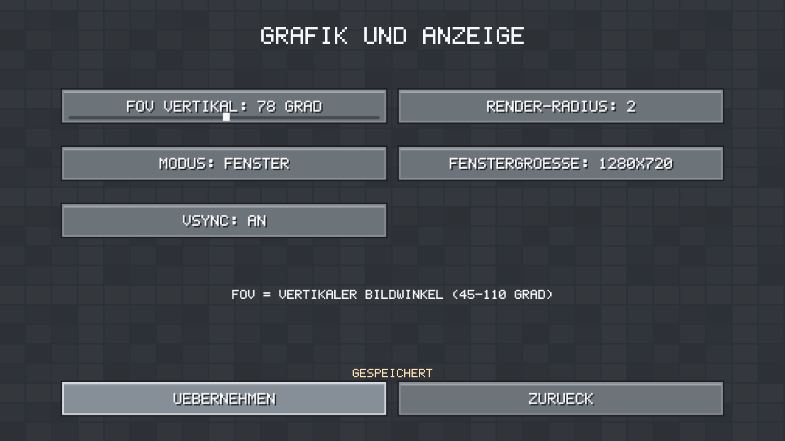
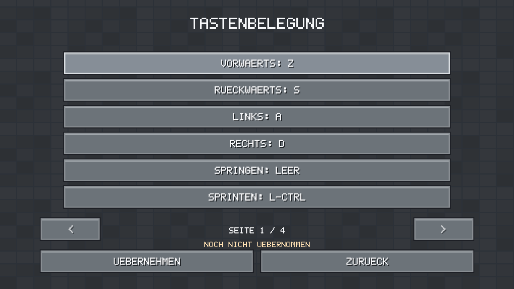
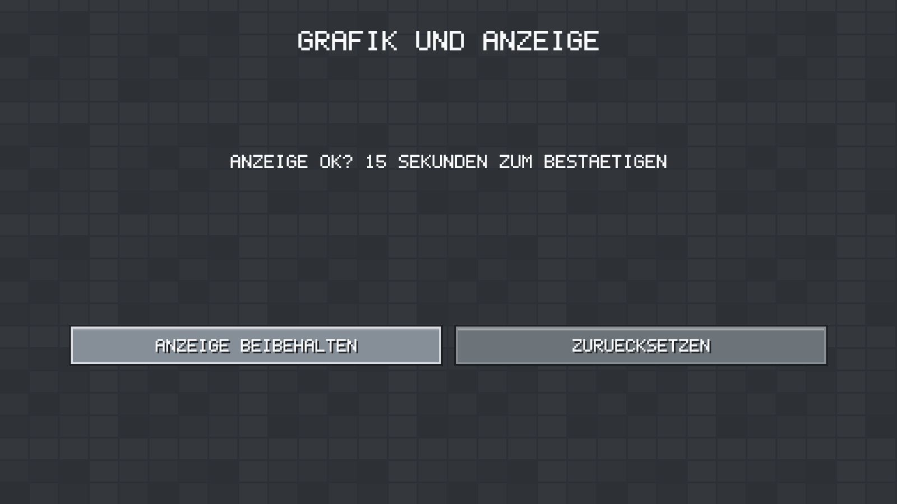
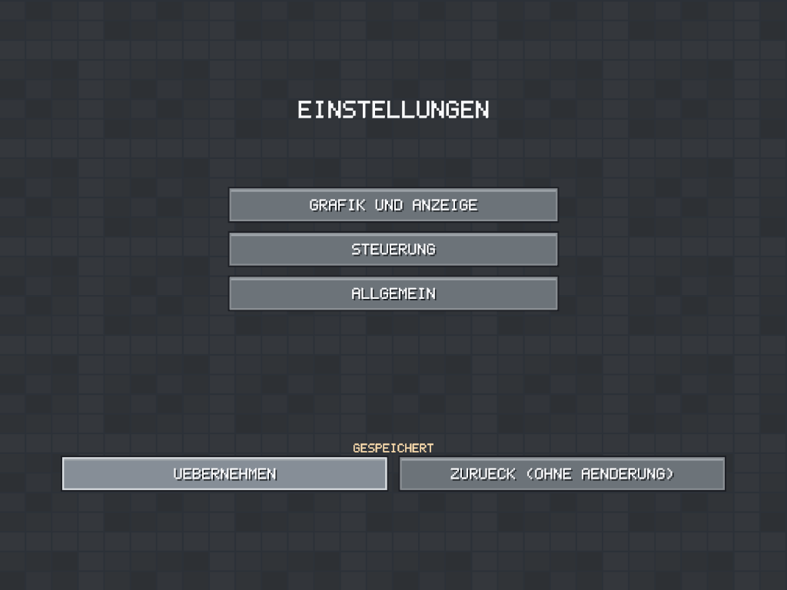
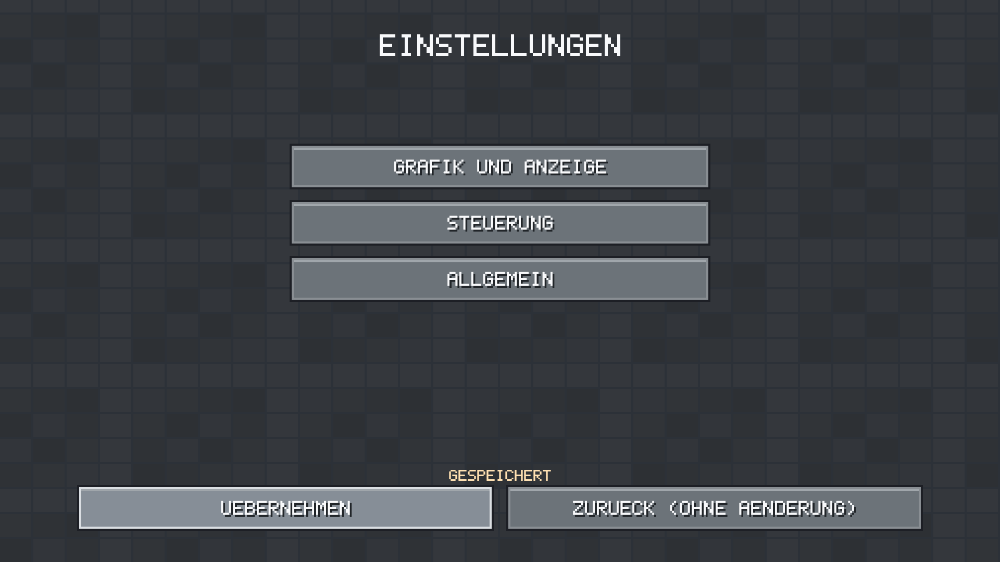
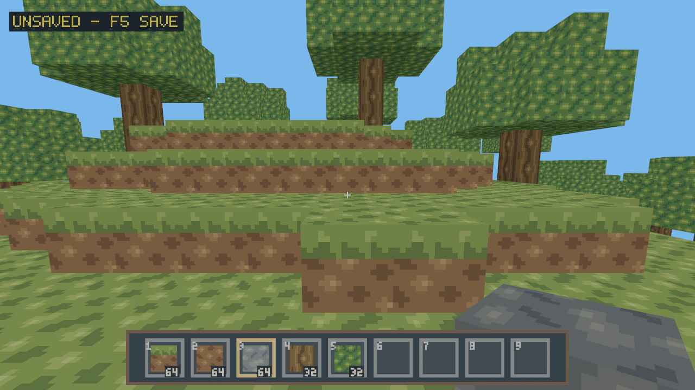

Ubuntu/Windows CI results are linked in PR32. Native Void X11/Wayland and
Windows11 GPU/DPI/compositor acceptance remains manual; automated tests and
Xvfb do not establish it. Exact supported options, deliberate omissions,
recovery and reproducible Fish/PowerShell instructions: [SETTINGS](SETTINGS.md).

Final visual cross-check at78° vertical confirmed both the empty arm and held
Stone. The original held Grass top blends into this grassy test scene; a plain
color diagnostic and Stone selection distinguish the model from the terrain.
Temporary diagnostics were removed; no viewmodel/culling/material change is
part of Slice15.

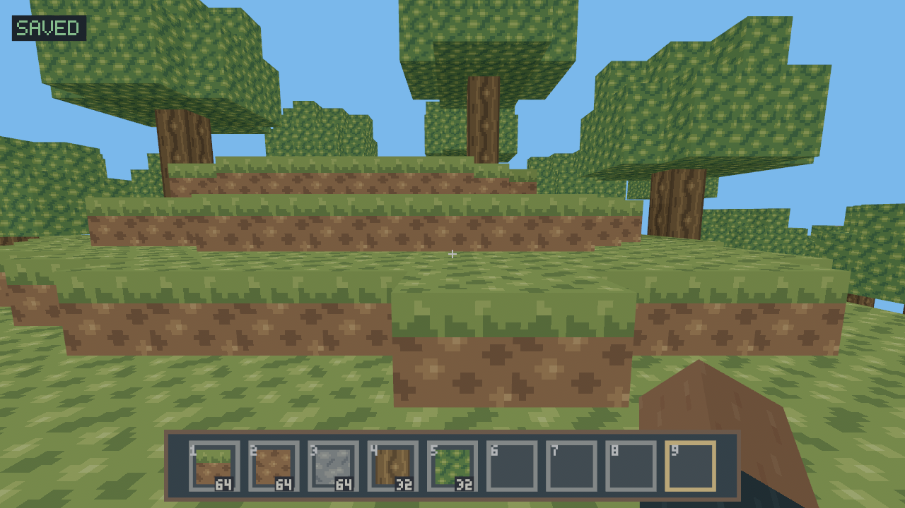

## Slice 15 UI polish: English, discrete distance and keyboard labels

Local checks passed: format, locked workspace Clippy with warnings denied,
**147 client +154 core tests**, locked workspace build and texture consistency.
Targeted tests cover integer slider snapping/clamping, mouse click/drag/release,
Left/Right stepping, radius persistence, English text bounds, distinct button
states and text/fill contrast >=4.5:1. Existing navigation/confirmation and VSync
rollback tests remain green. Simulated OS logical-key events test German QWERTZ
and English QWERTY through capture, save/reload and physical movement commands.

Actual Xvfb/X11 + Mesa llvmpipe smoke passed: English title, creation/world list,
options, distance3 click and distance2 drag with persisted values, 720p/1080p/4:3,
plus native close. Using setxkbmap de/us on the test X server, physical US Y/Z
positions produced the expected logical Z/Y (German) and Y/Z (English) labels.
The saved file retained physical KeyY/KeyZ values, with no format change. These
captures verify X11 software rendering/input, not native Wayland/Windows GPU/DPI.
Unobserved character keys deliberately show Scan names; see SETTINGS for the
cross-platform layout-cache limitation and restart behavior.

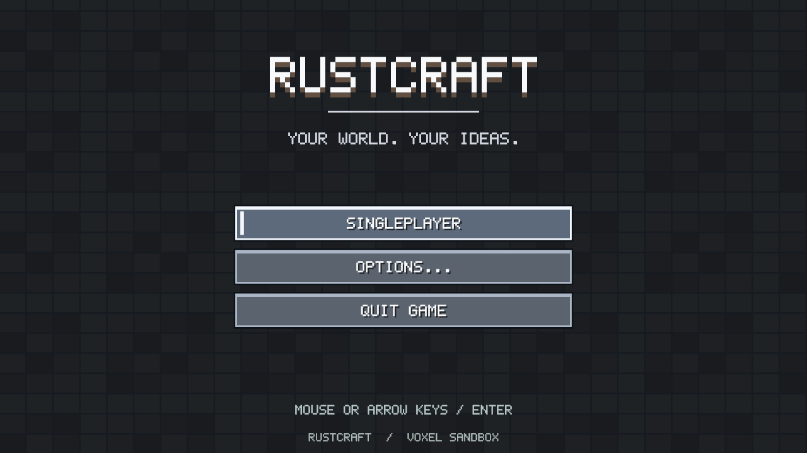
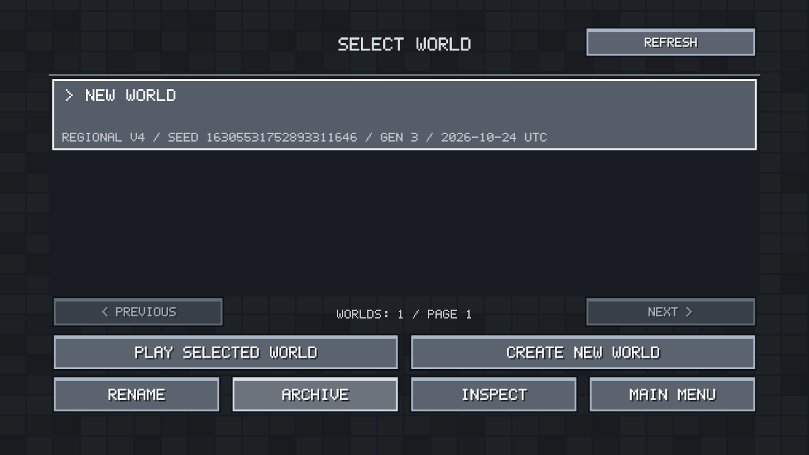
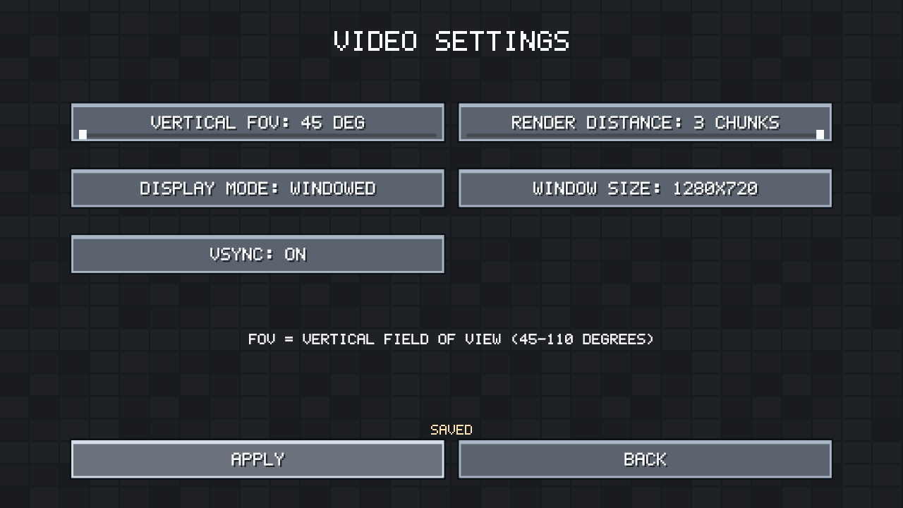
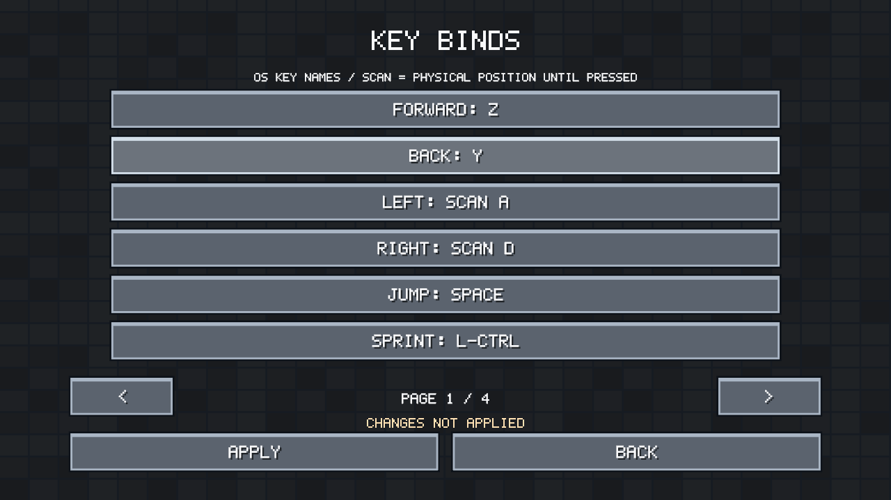

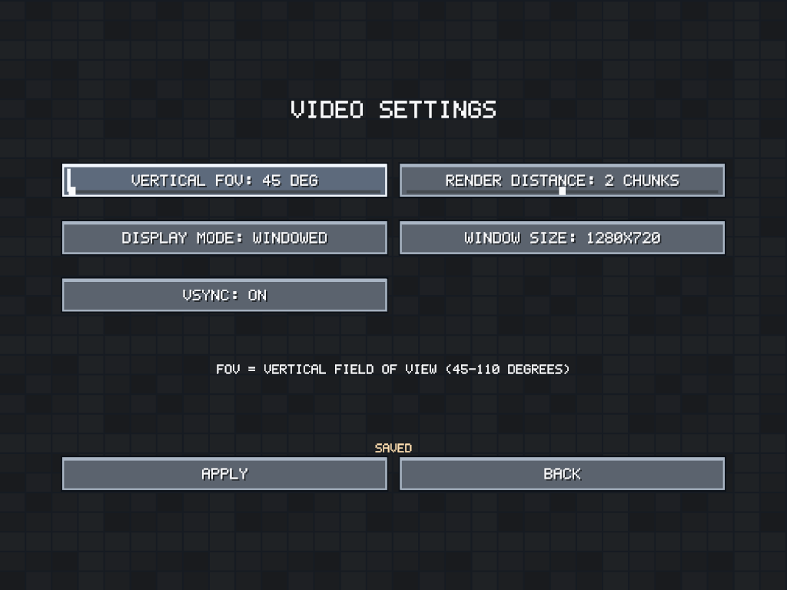
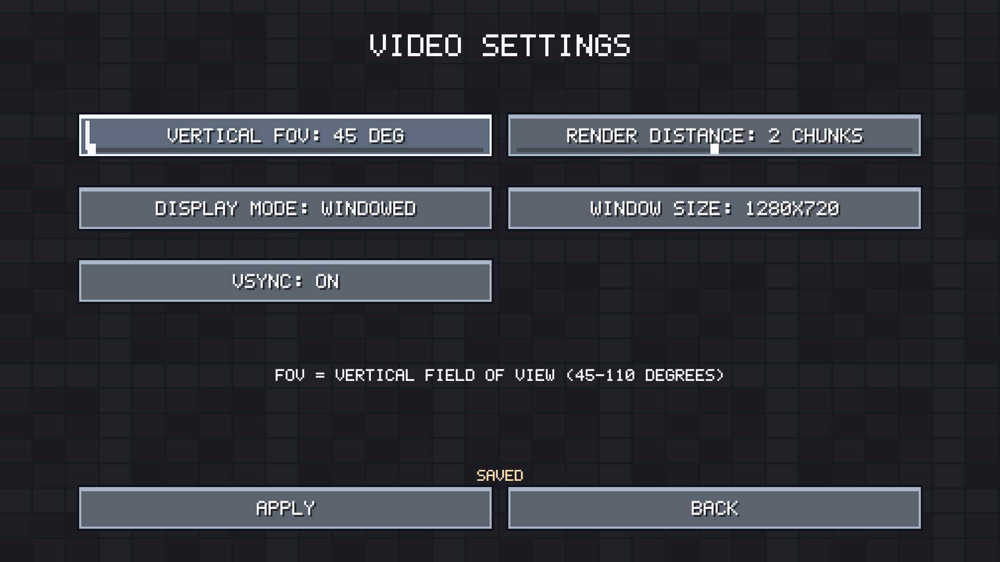

## Slice 16 greedy meshing

See [measured results, visual evidence and limitations](GREEDY_MESHING.md).
Local locked build, format, all-target Clippy, 302 workspace tests, atlas artifact
check, matched release benchmarks and X11 software rendering passed. Native
GPU/Wayland/Windows and remote CI results are separate outstanding checks.

## Slice 17 ambient occlusion

See [AO validation, matched screenshots and Slice 16 comparisons](AMBIENT_OCCLUSION.md).
Format, locked all-target Clippy, 310 workspace tests, locked workspace build and
texture regeneration check passed locally. Native Void GPU/Wayland/Windows
acceptance remains separate from X11 software-rendered fixture evidence.

### Slice 17 visual/performance revision

The owner accepted initial Slice17 functionality on native Void but found AO
too subtle. The revision strengthens only the visual corner factors, reuses
occupancy for visibility and allows provably identical affine greedy fields.
See AMBIENT_OCCLUSION for three-way screenshots, profiles, matched benchmarks,
remaining regressions and revised native acceptance. Native approval of the
initial version is not approval of this revision. All local required checks pass
with 313 workspace tests (148 client + 165 core); original Ubuntu/Windows CI passed.
Revision CI is reported on PR #34.

## Slice 18 — procedural sky and distance fog

Implemented against merged Slice 17 dc519cdbd6f1d37d037da514ce7144b1d7b749de.
All required locked commands passed on Linux/Rust 1.99.1:
format check; Clippy workspace/all-targets with warnings denied; workspace tests
(155 client,165 core); workspace build; original texture regeneration check.

Seven matched before/after X11 llvmpipe pairs cover plains, forest, seeded uneven
terrain, cave entrance, enclosed room and radii1/3. Pixel checks establish unchanged
near-field texels and dark cave core, with matching rendered horizon colors.
The comparison uses the exact old terrain shader in a shared deterministic
harness. Software frame percentiles, control/update CPU timings, raw data,
reproduction commands, limitations and native checklists are in [SKY_FOG](SKY_FOG.md).
These observations do not substitute for native Void X11/Wayland or Windows GPU,
input, compositor or performance acceptance.

Normal-client X11 software smoke additionally observed world loading, held block,
empty hand, inventory, hotbar/crosshair, Pause, save/return to title and reopening
the same isolated test world. Captures are linked in SKY_FOG. No shader or pipeline
errors occurred; Xvfb/software-driver warnings were expected.

## Slice 19 — F3 and gameplay polish

Base main is the accepted Slice 18 merge `f381ce196bb3162fa3e834b412b943375d24facf`.
The five locked format/Clippy/test/build/texture commands pass on Rust 1.99.1;
329 tests pass (164 client,165 core). One CPU-cost benchmark is ignored in the
normal suite and was explicitly run successfully. No dependency/lockfile change.
Ground walking/sprinting/sneaking measure 4.317000/5.612000/1.295000 blocks/s after
warmup at 30/60/144 render FPS, including normalized diagonals and exact final-state
replay. Physics uses the same fixed 60-Hz core. Existing collision, ledge, jump,
FOV, streaming and lifecycle coverage remains active.

New coverage includes F3 press/hold, unavailable/finite frame data, negative/far
coordinates independent of render origin, bounded resize/text updates, immediate
cleanup hiding and retained assets; tick-for-tick neutral inventory falling and
landing; modal-held movement/jump rearming; real Pause/settings/focus freezes,
contextual backgrounds and A/B/A resource reclamation.

Production-client software X11 screenshots, raw movement/course/CPU-cost output,
resource accounting, exact acceptance commands and limitations are collected in
[the Slice 19 guide](DEBUG_GAMEPLAY.md). Xvfb/Mesa evidence is not native Void/
Windows GPU, Wayland or high-DPI acceptance. Those checks remain for the owner.

## Slice21 day/night

Final local locked workspace checks: fmt, all-target Clippy with warnings denied,
tests (179 client +199 core passed; three opt-in cost tests ignored by default),
build and original texture artifact check passed. The new ignored clock/uniform
cost test was also run explicitly. Coverage includes exact fixed-step replay,
rollover, legacy player reads, corruption, crash-stage journal recovery,
time-only autosave/F5/final save, newer ticks during an in-flight snapshot,
F3 reporting, radius/travel and zero time-driven terrain work/asset growth.

Eight production-shader X11/software Vulkan captures and three-process paired
radii1–3 measurements against accepted Slice20 are in [DAY_NIGHT](DAY_NIGHT.md)
and [raw performance data](performance/slice21/README.md). The software renderer
shows median frame cost +13.9% / +14.8% / +16.8%; native GPU acceptance remains
open. No claim of native Void/Windows or Radeon performance is made.

Production-client software X11 smoke: loaded a copied Slice20 player v1/world,
verified the visible F3 clock and accepted held torch, and saved player v2.
Pause/F5 snapshots remained exactly day0/step8157 across a wait; after resume
and another F5 the clock reached step8360. The legacy world root stayed
byte-identical. This is cloud software-renderer evidence, not native acceptance.


### Slice21 sun/moon visual polish

The follow-up keeps PR#38 open and enlarges both projected sides by 18%, adds an
original 16×16 four-shade point-sampled moon and fades the last below-horizon
strip before the original visibility cutoff. Timing, sky/fog/star parameters,
lighting, persistence and terrain work stay unchanged. Local all-target Clippy,
fmt, workspace tests (180 client +199 core passed; three opt-in cost tests
ignored), build and texture checks passed; the final embedded shader also ran
through the atmosphere suite and actual renderer captures. Projection coverage
spans six resolutions, three FOVs and representative day/horizon/night times.
Production captures cover noon, sunset, the last strip before disappearance,
moonrise and midnight at 1280×720,960×720 and 640×480. The baseline comparison
harness was compile-checked with the extended gallery adapter.

[Updated images and provenance](DAY_NIGHT.md#sunmoon-visual-polish-before-merge)
and the [paired performance data](performance/slice21/celestial-polish/README.md)
include exact settings and limits. The owner's Void/RX 9060 XT baseline result
(~240 FPS, VSync disabled) precedes these visual changes; native visual review
of the polish remains open.
