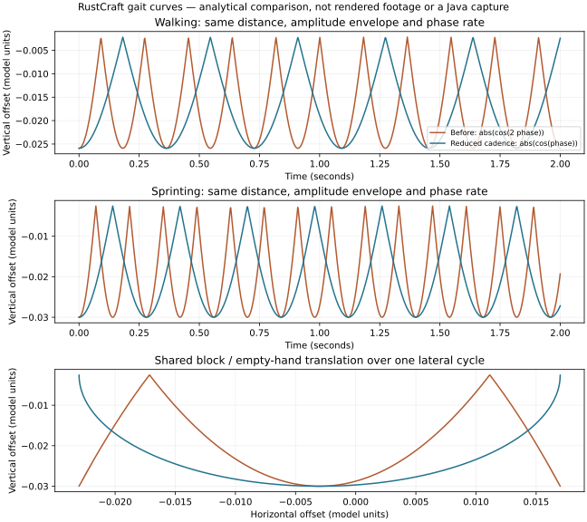

# First-person viewmodel (Slice 12, PR #29 visual revision)

> Final Slice20 restores the historical held-cube positioning below.
> The original empty-arm calibration and Slice19 motion remain in use.

## Reference and calibration

The target is modern Minecraft Java's **wide standard arm**, not the slim model.
Primary visual reference: the **unmodified official Java1.21.1 Demo**, run locally
on 2026-10-23 with the built-in wide Steve skin. The default slim skin was checked
and excluded. No Minecraft source was read/decompiled/copied. The executable and
all reference captures stay outside this repository; no Minecraft pixels are game
assets or redistributed here. Official [version metadata](https://piston-meta.mojang.com/v1/packages/1757c8b1fbfc6b638504e1f6cceb05893f7389d5/1.21.1.json).

Both applications were captured at **854×480, vertical world FOV45°** (Java's
Options label was checked), with separate empty-hand and grass-block idle/attack,
walking, sprinting, sneaking and placement recordings. An earlier cropped capture of an854×640 viewport confirmed ordinary aspect-dependent perspective, rather
than anchoring the arm to the viewport's right edge. RustCraft's35–110° FOV
stability is regression-tested; a later Java70° capture was interrupted by a
demo/focus dialog and is not counted as a verified wide-arm comparison. Software60-Hz capture does
not guarantee60 distinct rendered frames or exact tick-phase alignment.

Measured idle landmarks, pixels from top-left, rounded/manual edge selection:

| Model | Java reference | RustCraft projected geometry |
| --- | --- | --- |
| Wide arm, left/top/right upper silhouette | (602,374), (658,338), (737,383) | (602.9,375.5), (659.2,339.4), (738.6,384.6) |
| Grass, left/back/right top corners | (559,392), (618,349), (828,392) | (559.1,392.3), (618.4,349.4), (828.7,392.3) |
| Wide arm tip at854×640 | about(736,450) | (736.5,452.5) |
| Walking tip range at854×480 | x639.6–674.5, y336–368 | x639.9–674.0, y335.4–367.9 |

The static fit is within about3 pixels at these landmarks, **not a pixel-identical
claim**. Rotations/positions in `model_pose` are independently fitted parameters
in our chosen coordinate system, not recovered/exact Mojang constants. A70°
calibration lens is emulated within the existing overlay by scaling camera X/Y
before model rotation; world FOV, sprint FOV and UI keep their existing behavior.

## Geometry, artwork and rendering

Exactly **one rectangular cuboid** forms the arm:24 vertices,36 indices, width:
length:depth1:3:1. Sleeve and skin are painted parts of the same surface; no thumb,
palm, cuff, second arm part or skin overlay geometry. The original16×16 RustCraft
skin/slate pixels are reproducibly authored by `arm_image`; end caps sample the
appropriate skin/sleeve part. Nearest filtering, one mip, no new decoder/files.

An empty selected slot shows only that arm. A block shows only the selected cube,
without a second arm beneath it. Five retained cubes use the terrain atlas's exact
face UVs, including grass/dirt and wood end-grain. Terrain art is unchanged.

The existing camera-child overlay still loads world color, clears depth and draws
layer1. World/target remain layer0; existing near-camera UI remains layer1. No
third camera/pass. A uniform3× scale of **both** model position and geometry
preserves every projected pixel while placing the entire swing behind UI depth.
Tests check all100 sampled swing phases against that depth bound. Camera parenting
retains floating-origin behavior; model motion never changes aim or the body.

Six retained meshes, two materials, one additional16×16 RGBA image (**1024 bytes**)
and four entities are created once. Geometry payload is **7776 bytes**, down from
11664; at most **one model draw/12 triangles**, down from two/60. The overlay view
cost remains; renderer attachments, asset metadata and driver allocations are
additional. Counts stay constant during600 selection/action/FOV/rebase updates.
There are no per-frame mesh/material/image allocations or environment lights.

## Motion and limits

- Idle is still. Ground travel drives phase (2 radians/metre), independent of keys
  or rendering FPS; pushing a wall stops it. Walk and sprint share the bounded
  sway envelope, with sprint advancing faster because distance increases faster.
  Sway rotates about the camera, not each cube's centre. Sneak suppresses gait sway
  and lowers the resting pose slightly; jump/fall/landing offsets remain bounded.
- A350-ms visual action includes the held cube's roughly50-ms lowering lead-in and
 300-ms curved swing. Arm and block have different fitted paths. Fast inward
  rotation, earlier lift, downward sweep and slower recovery combine translation,
  rotation and pivots. Placement uses the same bounded action rig. Elapsed real
  time advances actions even below20 FPS; smoothing steps remain capped50 ms.
- Dynamic curves are **approximations checked against recorded phases**, not an
  exact reconstruction of Java's equip/cooldown internals. Activation/tick phase,
  face shading, small turning inertia and every Java transition are not identical.
  No combat cooldown or mining-duration mechanic is added. RustCraft's existing
  accepted click-attempt gate still animates misses/refused edits too.
- Rapid clicks consume serials and restart only a sufficiently advanced action;
  they never queue/stack unbounded motion. Menus, cursor release, focus loss,
  capture, spawn waiting and respawn hide/reset history. Selection is synchronized
  after real edits in the same frame, including last-stack placement and mining.

World/player formats, generators, IDs, physics, streaming, textures and input
bindings remain unchanged. See [validation](VALIDATION.md) and the
[isolated Void Fish checklist](PLATFORMS.md#slice-12-viewmodel-test-fish).

## Slice 19 native-feedback refinement

The owner accepted the F3, inventory, menus and movement speeds on Void Linux,
but reported excessive viewmodel bob. The follow-up halves horizontal gait sway
0.040 → 0.020, vertical sway 0.055 → 0.0275 and roll 0.035 → 0.0175 radians.
The small gait biases are also halved; landing offset falls 0.045 → 0.030.
Named `BOB_*` / `LANDING_OFFSET` constants in `viewmodel.rs` keep these tunable.
Distance-driven rhythm, exponential entry/exit smoothing, crouch and vertical-air
response remain unchanged. Sprint adds cadence, not a larger amplitude.
The shared transform affects held blocks and empty hands; no full-camera bob is
introduced. The 350-ms mining/placing swing, its fitted curves and feedback are
unchanged, as are physics speeds 4.317 / 5.612 / 1.295 blocks/s.

Tests cover idle/walk/sprint/stop/sneak/fall/landing transitions at 30/60/144 FPS,
a visible but reduced projected arm excursion, both model types, retained assets
and existing action timing/pose regressions. Native acceptance of this revised
feel remains open in PR36. Compare the same scene and route on Void: idle → walk
→ sprint → stop, then jump/land, with a block and an empty slot; mine/place in both.
A matched rendered before/after clip was not produced in this follow-up.

## Slice 19 gait-cadence correction

Native Void feedback after the amplitude reduction identified rapid vertical
oscillations. `abs(cos(2 * phase))` produces four vertical bounces per lateral
cycle; `abs(cos(phase))` produces two, aligned with the alternating lateral
extrema. The centre crossings are low points; the left/right extrema are high
points. This preserves the reduced vertical range and removes the extra bounces
between centre and extremum. Both arm and held block use this shared transform.

`GAIT_RADIANS_PER_BLOCK` stays at 2.0: cadence follows actual travelled distance,
so sprint increases rhythm without amplifying it. With the existing speeds:

| Mode | Previous vertical cadence | Corrected vertical cadence |
| --- | --- | --- |
| Walk, 4.317 blocks/s | 5.497 Hz | 2.748 Hz |
| Sprint, 5.612 blocks/s | 7.145 Hz | 3.573 Hz |

These are analytical steady-motion frequencies (`speed * 2 / pi` after correction),
not a measurement of Minecraft Java. All reduced amplitude/bias constants, landing,
crouch, air response, action rig, camera and sprint FOV remain unchanged.
Regression tests count vertical peaks across ten seconds at 30/60/144 FPS after
warmup (27 walk / 35 sprint peaks, boundary-limited finite windows), compare poses
at shared timestamps, verify alternating trajectory extrema, amplitude bounds
and stationary settling. Existing interaction/landing/model/resource tests pass.

The graph uses identical distance, phase and amplitude envelopes before/after;
it is an analytical curve comparison, not rendered gameplay footage. It was drawn
with authoring-only Matplotlib; no runtime dependencies or bundled fonts added.
The legitimate Java Demo captures documented above are historical references and
are not present in this workspace. No new direct Java A/B comparison or exact
Java cadence claim is made. Native visual acceptance of this rhythm remains open:
repeat the same flat route with fixed FOV and a held block, then an empty hand,
walking/sprinting/stopping, followed by jump/land, sneak and mine/place.

## Slice20 item presentation profiles

`viewmodel/presentation.rs` owns a small `Presentation` value: equipped position,
Euler rotation, scale, optional model-origin correction, swing pivot and held/arm
category. `for_item` currently chooses Arm (empty), Block (ordinary blocks) or
Slender (Torch). Future tools/food can add profiles without modifying bob/swing
math. The original motion step and held/arm swing curves retain their timing,
travel and angles; equipped poses are independent inputs to that animation.

Final Slice20 restores the BLOCK profile exactly to the original`d5c9c17`
position/pivot(0.56,-0.52,-0.72), rotation(0,45,0), scale0.40. The original camera
X/Y FOV correction is retained; the later extra camera-X aspect correction is
removed so ordinary blocks match at every original aspect ratio. ARM is unchanged.

Only SLENDER/Torch is tuned: position/pivot(0.56,-0.46,-0.72), rotation(0,35,12),
scale0.40, origin(0.5,0.35,0.5). This is a small lift of0.06 from the initial
Slice20 pose. Its lower shaft remains below the screen; some wood and the bright
tip remain visible. Projected tip/base tests confirm a left lean at FOV70/78/90/100.
The whole model need not fit above the hotbar. Original mesh/texture data, arm
proportions, bob cadence/amplitude and action curves are unchanged. Ordinary
blocks are compared against the frozen original transform/lens at16:9,3:2,4:3.
No per-frame allocation, per-item rendering entity or new texture/material.
