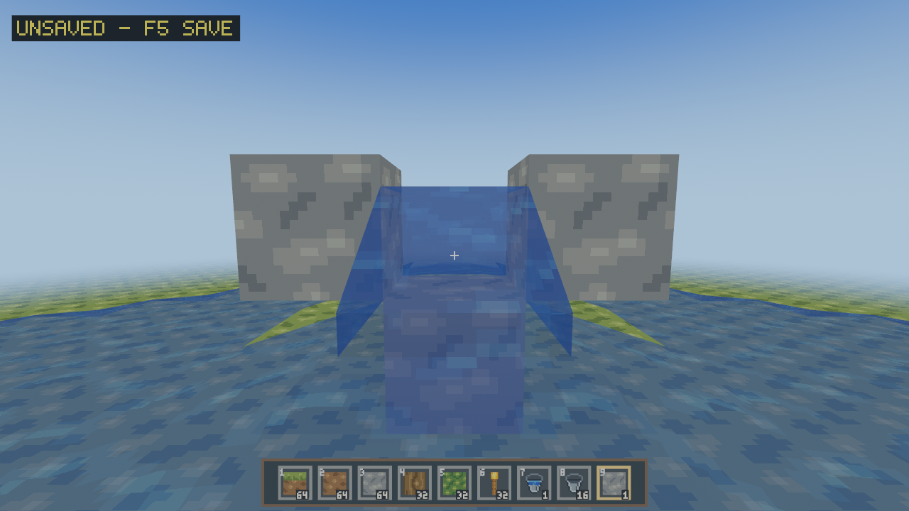
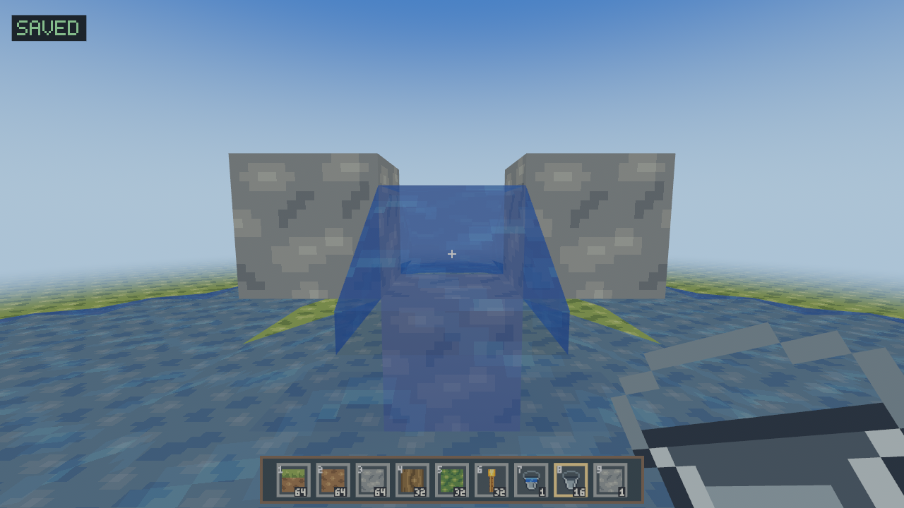
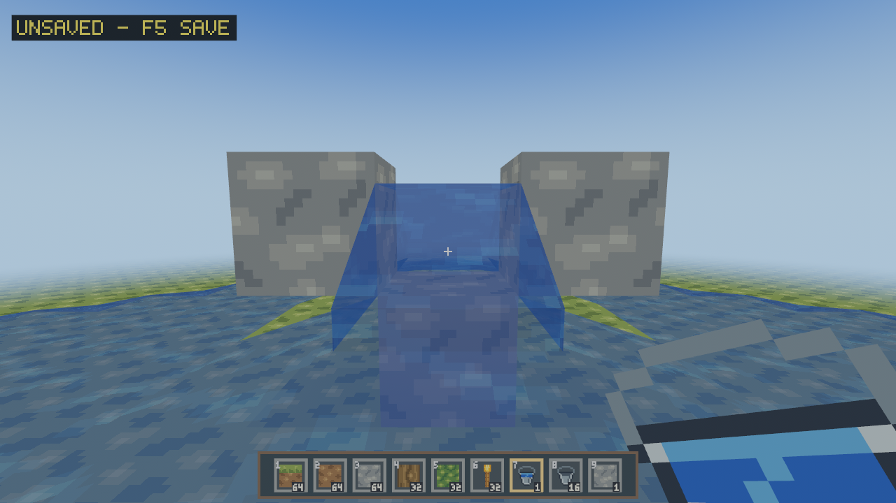
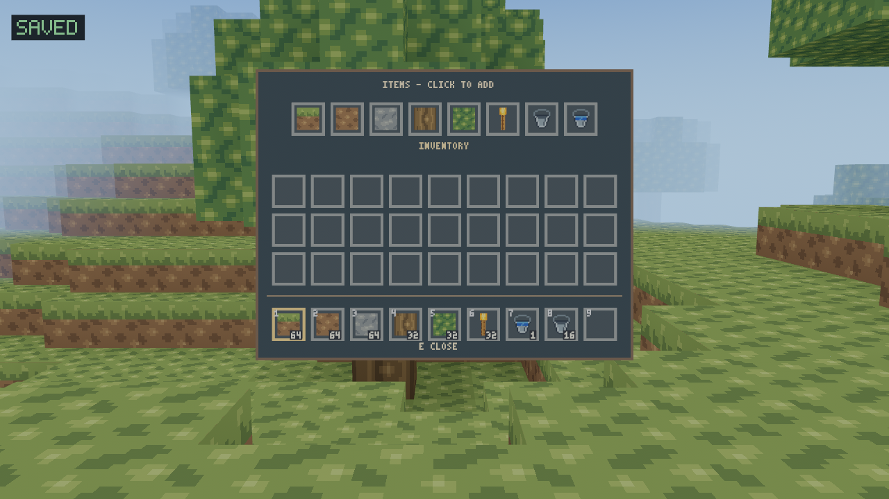
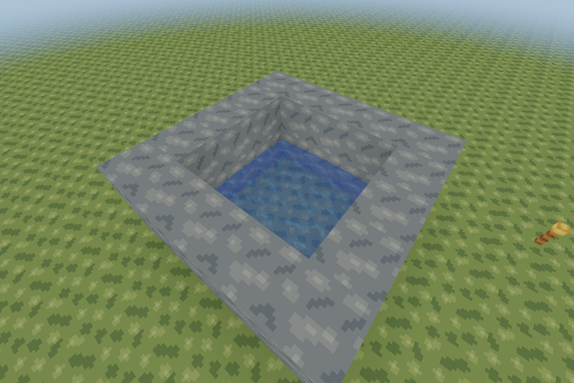
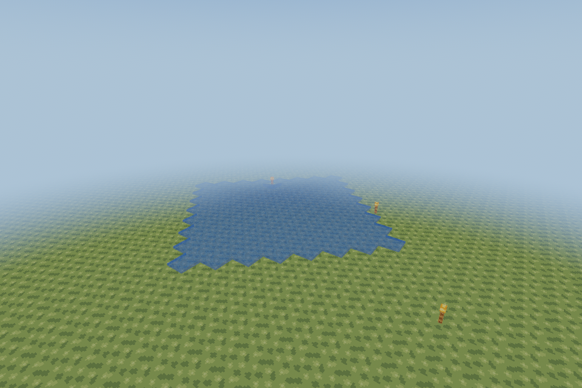
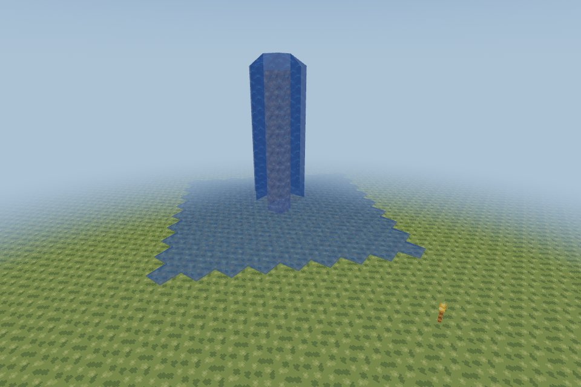
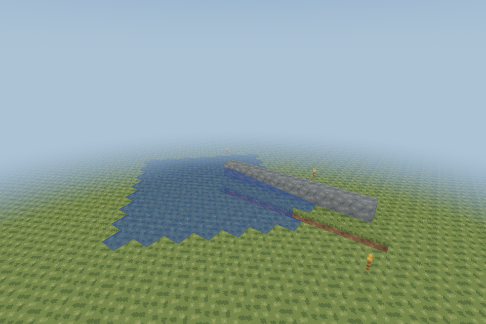
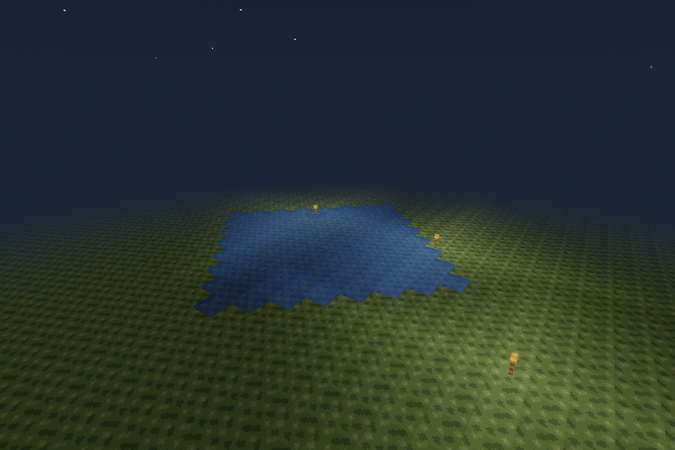

# Natural water (Slice 28 / generator v8)

New generator8 worlds contain actual WaterSource volumes in shaped ponds, lakes,
river channels, ocean basins and selected closed cave pools. Existing worlds keep
their original generator; none acquire natural water automatically. Existing
water textures, state IDs, buckets, swimming, underwater detection, transparent
meshes, torch washing and source/flow rules are shared with player water.

## Initialization and lifecycle

Procedural water is generated directly, before the authoritative saved overlay is
applied. Installing an untouched stable body produces no edit records and needs
no settling ticks. The global queue cap and normal256-update tick budget are
unchanged. Chunk installation still checks the bounded route neighborhood, but
sources wake only if a loaded, replaceable non-source consumer exists beside or
below them. Air above a source is not a consumer. Non-source flow still wakes for
recession; newly loaded dry chunks can reactivate deferred feeders, including
diagonal/four-step route dependencies. Eviction drops pending work for the evicted
column and never loads another column for water.

Edits use the normal event-driven simulator: mining a bed lets nearby water fall
into the opening, replacing water with solid blocks displaces it, sources wash
torches through the existing atomic item-drop path, and unsupported flow recedes.
Sources never relax into another state and relaxation never creates a source.
No second hydrology simulator or automatic source regeneration exists.

## Collection, construction and saved authority

Every generated occupied cell is an existing source. Collecting a surface source
removes exactly that source and exchanges the bucket normally. Nearby sources
remain permanent; their ordinary flow may fill the collected hole with **flowing
water**, which cannot be collected as a new source. Collecting one source does not
drain an entire source-filled lake. Opening a large lake into excavations can
create lasting flow, just as a player source does. Closing the opening permits
unsupported downstream water to recede.

Only actual edits and resulting fluid changes enter regional overlays. Explicit
Air, collected sources, construction and independently placed sources survive
regeneration/save/reload. An Air record overrides procedural water on install;
subsequent legitimate fluid flow can still enter that cell. Manifest5, region1,
record budgets and coordinated inventory/world redo recovery are unchanged.

Surface sources occupy through Y2 (visible level2+8/9); cave pools use Y-52.
The foundation is not a hydrological simulation boundary outside supported world
coordinates. The finite horizontal edge remains the game's existing cutoff.

[Architecture](WORLDGEN.md), [survey, actual images, queue/performance results and
Void/Fish checklist](performance/slice28/README.md). Existing per-chunk transparent
sorting can still misorder overlapping water/terrain views; no global transparent
sort, new shader, currents, oxygen or waterlogging is introduced.

---

# Water gameplay — Slices 22–23

RustCraft's first water implementation keeps simulation in `voxel_core` and
presentation in the Bevy client. No dependency, generator, terrain atlas, opaque
vertex layout or world-envelope changes. Dropped items add a bounded player-v3
extension inside the existing coordinated save journal.
The original code, procedural 16×16 ripple tile and screenshots are
MIT OR Apache-2.0. No Minecraft code, artwork or texture pack is included.

## State and behavior

`Block` remains **one byte**. Existing block IDs 0–10 retain their exact meanings.
Explicit additional stored IDs are **11 source**, **12–18 horizontal levels 1–7**,
and **19 falling**. `fluid::Fluid` validates its small state registry and exposes
`FluidKind::Water`; the packed block variants keep dry chunk storage unchanged.
A future lava kind needs its own explicit IDs, rules and material, rather than
reinterpreting these values. No unused reaction, viscosity or fluid framework.
Item IDs 1–6 are unchanged. **Legacy Water Source = 7, Empty Bucket = 8,
Water Bucket = 9**. ID7 is retained as an inert compatibility item; see below.

Only explicit placement/import makes sources. A source remains until removed or
replaced, supplies downward water without consumption and never converts nearby
flow into new sources. Downward supply has priority; a supported water cell
supplies the strongest horizontal candidate plus one, stopping after level 7.
A falling column hitting support starts a fresh seven-block horizontal reach at
its foot. Strength decays along detours around obstacles. Slice23 adds bounded
downhill routing (below); infinite-source mechanics remain deferred.

Each queued cell computes from the same pre-tick state. The batch commits after
all candidates have been examined. Edits wake local and bounded route dependencies;
actual flow changes wake their neighbors. Removing the last source causes
unsupported levels to weaken and disappear. Downward columns and bounded
horizontal levels settle without continual updates. Multiple sources combine
by minimum level; queue budget and activation
order converge to the same fixed point in the tested fixtures.

## Scheduling, bounds and ownership

`World` owns transient `FluidUpdates`: FIFO positions plus hash-set deduplication.
Hash iteration never chooses processing order. The queue reserves/grows flat
buffers; it does not allocate a linked node per update. Overlay record allocations
remain necessary for persistent edits. The supported resident maximum is
147×4096 pending positions; unknown cells are never enqueued. Eviction removes
obsolete requests. No fluid operation requests a chunk or creates a worker.

The client runs **5 fluid ticks/s**, sharing the existing 60-Hz physics gate, with
**256 processed cells/tick** by default. `FluidConfig::budget` and the client's
`FluidRuntime.config` are explicit tuning points; this slice adds no settings UI.
The adapter retains a reusable change vector and coalesces mesh dirtiness per
batch. Pause, Options, focus loss and final saving stop simulation; inventory
continues it. A paused phase resets, so resume cannot accumulate fluid catch-up.
F3 reports resident water cells, pending requests, last tick processed and CPU ms.
The count reads per-chunk counters, never scans voxel contents for diagnostics.

Worker mesh snapshots deliberately omit transient fluid scheduling. One existing
terrain worker remains the only terrain/mesh job in flight. For a water/Air-only
streamed batch with valid applied light, it reuses exact chunk light samples and
builds **only water geometry**: no light flood or opaque greedy rebuild. Solid,
AO or torch changes retain the normal coherent lighting/meshing path. Mixed
batches use that conservative path. Legacy finite worlds use their existing
bounded light/mesh worker for changes. Animation changes one retained water
uniform, never mesh data. Dry frames do not update water material uniforms.

## Streaming and persistence

Loaded neighboring chunks exchange flow normally. Unknown/pending neighbors form
closed boundaries, and an existing boundary flow cell is retained until all its
local dependencies are known. This avoids retracting saved water using missing
source data. Installing a chunk wakes its water plus touching neighboring water;
dry chunks skip their contents in constant time. Lifecycle scanning is limited to
newly installed wet chunks/touching wet faces, never performed every frame.

Eviction removes voxel/GPU caches and transient requests, while regional overlays
remain authoritative. Loading restores every source and flow level, then locally
reconciles it. A frontier with unavailable dependencies can remain frozen until
those chunks return. No global pending-boundary map, forced loading or infinite
exploration history is retained.

Water changes use the existing atomic in-memory batch, regional COW overlays,
revision tokens and coordinated world/inventory redo journal. Regions stay bounded
at 196,608 records; the existing eight-dirty-region backpressure and pressure-save
rules apply. A batch preflights newly dirty regions together. Save backpressure
retains bounded requests for retry rather than dropping state. Saves capture the
actual current flow, including a partially settled body, and replay it safely.

Existing Slice21 saves load unchanged, including old player v1/v2 files and
world v1–v4 modes. Generators 1–3 are untouched. New readers accept additive water
IDs; **older clients reject saves containing these IDs**. Use complete closed
world-directory copies for compatibility testing. Existing inventories are never
refilled or overwritten. New worlds receive one Water Bucket in hotbar slot 7
and 16 Empty Buckets in slot 8; existing worlds use the inventory item palette.

## Rendering and interaction

Water uses a dedicated `WaterMesh` and shared blended `WaterSurface`, separate
from opaque terrain and its greedy vertex layout. Each resident chunk has at
most one additional water entity/mesh. Handles are retained across replacements;
empty meshes, eviction and session teardown release them. The shared original
16×16 stepped ripple tile uses three authored blue shades and scrolls in subtle
quantized shader UV steps (1.5 texels/s vertically). No texture uploads,
remeshing, reflections, refraction or GPU readback are needed for animation.

Surface corner heights are sampled in world coordinates from all touching water
cells, including diagonals. Sources receive eightfold weight, dry Air contributes
zero height to taper shore edges, and flow progressively
lowers the surface. Falling/vertically covered water fills the cell height.
Neighboring chunks compute identical shared edge heights. Water/water faces and
opaque-adjacent faces are hidden; solid terrain retains its visible faces beneath
transparent water. Sky/block light remain independent, transmitted exactly like
Air in this first slice. The existing day/night uniform scales only sky light.

Transparency uses Bevy's standard mesh-level alpha sorting, alpha 0.65 and
backface drawing for underwater views. **There is no per-face sorting or
order-independent transparency**: intersecting waterfalls and stacked surfaces
can blend imperfectly. No realistic optical depth or water absorption yet.

## Buckets and targeting

Empty Bucket (stack limit **16**) collects only a source with right click; flowing
and falling water are skipped. Source removal wakes the existing recession queue.
Water Bucket (stack limit **1**) places a source against a loaded block face or
into a targeted torch cell, then becomes empty. A solid, an already occupied
source, unloaded data, out-of-bounds location, save backpressure or exhausted
drop capacity rejects the operation. Water is non-collidable and can be placed
around the player; ordinary solid placement retains authoritative and displayed
body-overlap protection. Buckets require a reachable surface; no mid-air placement.

`raycast_with(TargetMode)` explicitly distinguishes ordinary Blocks from
CollectSource. Normal mining ignores **all** water and can break a solid behind
it; water is never a mineable block. Empty-bucket targeting stops at the first
source or obstructing block/torch. Water-bucket targeting ignores water and uses
the solid face, or the selected torch cell. Ordinary blocks can displace water
in a valid adjacent cell. All paths retain the existing five-block reach and
pending-world barriers. Sources under flowing water can still be collected.

The visible block outline always uses the ordinary Blocks ray, regardless of
the held item. It skips every water state and marks a solid/torch behind water
when reachable. Collection still uses its independent CollectSource ray inside
the inventory action. Previously the empty-bucket source hit was also passed
to the normal highlighter, whose non-torch fallback drew a full cube around it;
the water mesh and debug renderer were not the cause.

Inventory conversion is staged on a copy before validated world mutation. A last
empty bucket converts in its own slot, even when every other slot is full. For
a stack of empties, a collected Water Bucket needs a free slot; otherwise both
inventory and source stay unchanged. Failed placement never consumes a bucket.
Stack bounds also apply to clicks, merges, quick transfers and save validation.

Buckets use original 16×16 steel/water pixel silhouettes shared by inventory and
thin, double-sided held-item meshes (`item_art.rs`). No blue stone cube remains.
Only buckets get a new pose; the accepted Slice20 block, torch and arm positions
are unchanged. No downloaded/proprietary artwork or new image dependency.

The shared bucket-only equipped profile now uses position/pivot
`(0.64, -0.46, -0.72)`, XYZ rotation `(0, -45, 25)` degrees and scale `0.68`
(previously `(0.56, -0.36, -0.80)`, `(0, -15, -12)`, `0.34`). Its larger,
lower silhouette enters from the lower-right screen edge, with yaw for
perspective and roll toward the grip. Both variants retain their distinct pixel
colors. The existing lens correction, overlay depth scaling, bob and swing are
unchanged. Frozen-pose tests cover every original block, Torch and empty arm;
bucket tests cover matching poses, distinct colors, lower-right projection and
camera/HUD depth clearance through walking, sprinting and use animations.

## Torches and dropped items

`Block::fluid_replaceable` / `fluid_drop` is the small decoration policy. Air,
existing water and all five torch orientations are eligible; arbitrary solids
are never overwritten by flow. A dry torch remains until actual water arrives.
Fluid ticks and bucket placement both commit torch removal, water and exactly
one Torch item together. Repeated updates cannot drop the same torch again.

Torch→water changes emission14→0: the client marks the ordinary terrain/light
footprint, recalculates neighboring light and invalidates stale worker results.
Water→water/Air changes keep the existing cached-light, separate-water-mesh path.

`World` owns stationary item stacks, indexed by chunk and cell. Only resident
chunks render them, using a recognizable small upright Torch model on separate
item entities. A player within1.5 blocks collects available stack capacity; a
full inventory leaves the remainder in the world. Pickup checks at most27 local
chunk indices, never all saved drops or world cells. A second pickup cannot
collect an already transferred item. Inventory-open simulation allows pickup;
Pause, Options, focus loss and final saving stop it.

There are at most **4096 dropped stacks per world**, at most64 Torches per cell.
Repeated destruction at a cell merges its stack. At capacity, a bucket action is
rejected and natural displacement waits in the bounded fluid queue until space
is released. Items never expire or disappear to enforce the limit. This rare
backpressure can temporarily preserve a torch in water's path. There is no item
physics, current, despawn timer, mob or general mining-drop overhaul.

Item entities share one lazily allocated mesh/material per session; the material
reuses the terrain atlas. Emptying/streaming removes entities, the mesh/material
can be reused, and session teardown explicitly releases both. Distant logical
items survive chunk eviction and do not force chunk loads. Render-origin changes
reposition item entities without changing authoritative cells.

## Existing worlds, item selection and compatibility

Open **E**: the **ITEMS - CLICK TO ADD** row offers all five blocks, Torch, Empty
Bucket and Water Bucket. Left click adds one; Shift+left click adds that item's
maximum stack. Grants merge/use free slots and are all-or-nothing. Full inventory
shows **NO ROOM**. Existing slots and the held cursor are never overwritten.
The catalog is `Item::CREATIVE`; adding future implemented items does not require
refilling saves or introducing game modes.

A saved Slice22 prototype **item ID7 keeps its original ID, count and ownership**
on load. It is visibly named Legacy Water in the window title and cannot be
placed or mined. Select its hotbar slot, open E, and click **CONVERT 7**: one legacy
source item becomes one Water Bucket, only when the complete result fits. Repeat
as desired. No implicit reinterpretation, deletion or automatic inventory refill.
Already placed water source block IDs remain unchanged.

World formats1–4 and frozen generators1–3 are unchanged. Player-v1/v2 files still
load without being rewritten. Sessions with no dropped items retain the192-byte
player-v2 envelope. Nonempty drops use **player v3**, with the same192-byte prefix,
a u32 count and sorted15-byte records (x/y/z i32, item u16, count u8), bounded to
61,636 bytes, CRC-protected and world-bound. Drops and inventory are captured in
the **same existing session.pending journal** as world edits. Interrupted creation
or pickup replays the same ownership once; backups retain prior generations.
After the last item is picked up, the next save may use v2 again.

Older clients cannot read player v3, bucket IDs8/9 or water blocks. Keep complete
closed-directory backups before trying older builds; never restore only one
world/region/player file. Forced termination can still lose changes since the
last successfully committed save; per-click durability is outside this slice.

## Downhill routing (Slice 23, Issue #40)

Horizontal feeders now choose the shortest reachable downward route before
supplying their neighbors. A direct fall still takes priority. The deterministic
breadth-first search uses the fixed order -X, +X, -Z, +Z and combines all first
directions belonging to equally short paths, including paths that merge. Without
a reachable drop it retains ordinary spreading into eligible sides.

The limit is **four total horizontal steps from the feeder**, or its remaining
horizontal level range, whichever is smaller. Sources and supported falling
water have seven steps available; horizontal level L has 7-L. Four steps give
local channel/corner awareness without looking across a whole seven-step pool
on each update. At most **41 distinct cells** enter the search queue. Three fixed
81-byte grids and a 41-entry coordinate queue are stack scratch; there is no
recursive search or heap allocation per search. Solids, permanent sources and
unknown cells cannot be crossed. A route cannot pass an unknown floor, climb a
step or continue horizontally past a drop. Existing flowing/falling water is
traversable: temporary occupancy cannot close its own route and cause feedback.
No source is ever created by relaxation. IDs and saved flow levels are unchanged.

A transient, lazily allocated **one-byte-per-cell route cache** avoids repeating
unchanged searches between ticks. Only queried resident chunks allocate a 4096-
byte array; maximum payload at radius3 is 602,112 bytes, plus small map/allocator
overhead. Every changed feeder level invalidates its own entry. Terrain/source
edits invalidate and wake wet feeders in a radius-four horizontal diamond on
the edit's plane and the plane above (the changed block can be a floor). Their
ordinary neighbors are also queued, so obsolete branches recede. This happens
even when no water directly touches the edited block. Water-to-water/Air changes
retain the smaller immediate-neighbor wakeup. The FIFO, synchronous pre-tick
reads, 5-Hz cadence, budget256 and save/drop backpressure stay authoritative.

Chunk installation and eviction invalidate/wake water within the same bounded
distance of that chunk, including diagonal corners and interior feeders beyond
the touching face. Dry chunks skip voxel scans using their existing counters.
Eviction frees the corresponding route arrays. Missing data remains a closed
boundary and never triggers loading/generation; existing cells with immediate
unknown dependencies retain Slice22's freeze-until-install behavior. Cache and
search state are not persisted. Loading actual sources/levels wakes ordinary
reconciliation, including partially settled saves. Settled water drains its queue
and does no repeated route work. Worker meshing and water-only light reuse are
unchanged.

This is independently implemented Java-inspired routing, not exact Java parity:
the four-step definition, synchronous bounded FIFO relaxation, frozen streaming
frontiers and explicit-source-only rule are deliberate. There are still no
infinite-source rules, player/item currents, lava or natural water generation.
Measured costs, unfavorable comparisons and native-test limitations are recorded
in [Slice23 performance](performance/slice23/README.md).

## Movement

Water is non-collidable. Actual body overlap with the sloping surface selects
fixed-step water drag/control: 2 blocks/s horizontal target (1 while crouched),
slower descent capped at 2 blocks/s, and held Jump accelerates upward to 2.5.
Leaving water selects the original land/air controller constants.
Body detection uses bounded samples of overlapped cells; very thin contact at
a sloping shore is approximate. The eye uses the mesh's triangle heights to select a subtle retained blue overlay;
HUD/inventory remain readable. There is no oxygen, drowning, health, entity
current or automatic surface jump.

### Water-to-land exit (Slice 23)

The regression was reproduced before changing movement: held Jump against a
one-block ledge stalled at X=0.7, feet Y=1.775 in level1 water. Surface overlap
ended before feet reached the ledge's Y=2 top; 2.5 blocks/s upward speed can rise
only about 0.11 further under the original fixed-step gravity24. Lower levels
lose contact earlier still. The source case alone did not expose this failure.

Holding Jump and moving toward a nearby, clear **one-block ledge** now permits
one bounded 7.8-block/s exit impulse. The probe reaches only 0.35 blocks from
the current body center. It requires a blocked horizontal path, full vertical
headroom, a clear raised path and actual loaded solid support at the destination.
Crouching, no directional input, a distant surface, a two-block wall, missing
data or a low ceiling cannot trigger it. The probe never moves the player.

The existing authoritative Y/X/Z collision sweeps resolve every real movement
step. Once launched, original gravity applies immediately, even while still
touching water, so swim damping cannot erase the impulse. No further launch is
available until landing or descending back into water below the launch height;
releasing/repressing Jump in the air cannot rearm it. There is no teleport or
automatic climbing. Without a valid ledge, the original swim acceleration and
2.5-block/s cap remain. Surface/eye detection, body dimensions, dry gravity,
walking/sprint/sneak, normal/sprint jumps and view/camera behavior are unchanged.
The additional controller state is transient and changes no save format.

## Validation and reproduction

See [follow-up comparison against PR39](performance/slice22/completion/README.md)
for the current CPU, item lifecycle and software-renderer measurements.
The [original Slice21 comparison](performance/slice22/README.md) is retained as
historical data, including active fill/steady work and mesh payloads. The standalone gallery settles fixtures before screenshots and steady runs;
`--active` separately exercises expansion/recession while measuring rendered frames.

```sh
cargo fmt --all -- --check
cargo clippy --locked --workspace --all-targets -- -D warnings
cargo test --locked --workspace
cargo build --release --locked -p rustcraft
cargo run --release --locked -p voxel_core --example water_bench
cargo run --release --locked -p voxel_core --example water_completion_bench
cargo build --locked -p rustcraft --example water_gallery
python tools/capture_water.py --output work/water-captures
```

Gallery cases: `dry`, `pool`, `flat`, `waterfall`, `channel`, `night`, `several`,
`boundary`; e.g. `target/debug/examples/water_gallery waterfall 2 --time=6000`.
No saves or gameplay commands are exposed by the gallery.

## Void Linux manual acceptance (Fish)

Slice23-specific reproducible routing, drainage-edit, shore and save/reload steps:
[native acceptance checklist](performance/slice23/ACCEPTANCE.md).

Use normal Void glibc X11/Wayland drivers; no forced backend. Windows10/11 uses
the same game logic and the existing CI matrix; native GUI acceptance is separate.

```fish
git fetch origin
git switch feat/slice-23-fluid-behavior-v2
set water_test_dir (mktemp -d /tmp/rustcraft-water.XXXXXX)
echo $water_test_dir
env RUSTCRAFT_DATA_DIR="$water_test_dir" cargo run --release --locked -p rustcraft
# Create a new world, seed 42. Keep the same directory for the restart.
```

1. **Existing world:** open E, obtain both buckets through ITEMS. Test single and
   Shift-stack grants, occupied cursor and full inventory (NO ROOM, no overwrite).
   In a copied Slice22 prototype save select legacy item7 and test CONVERT7; save
   and reload without conversion too. IDs1–6 and existing builds must stay intact.
2. **Buckets:** select7 in a new world, place/collect a source, watch spreading
   and recession. Try flowing/falling water, a source behind flow, a wall blocking
   the ray, stacked empties with no free slot, loaded boundaries and reach limits.
   Counts must be conserved on every rejected action and after F5/restart.
3. **Targeting:** mine stone behind sources/flow; water itself has no mining
   target or full-block outline, even with Empty Bucket selected. A reachable
   solid behind water keeps its own outline; right click still collects the
   nearer source. Place stone into water, including near the player's current/displayed
   body. Try torch faces and verify ordinary Slice20 held poses remain unchanged.
4. **Torches/items:** wash floor and all four wall torches with flow and buckets.
   At night check immediate loss of their emission after the worker update,
   intact neighboring lights, one small Torch item and continued propagation.
   Approach to pick it up; repeat with full/partially full inventory. Save before
   pickup, after pickup and while flow is active; restart and switch world A/B/A.
5. **Seams/visuals:** repeat at X/Z ±16 and ±64, including corners. Inspect small
   pools, shore slopes and waterfall feet from above/below. Walk out of render
   distance/back; no holes, growing mesh assets or resurrected sources/items.
   Overlapping translucent surfaces may show the documented mesh-sort limitation.
6. **Movement/time/gates:** swim with held Jump, crouch and leave the pool. Open E
   (water/time/pickup continue), Pause/Options, or lose focus (all freeze). Resume
   after several seconds without catch-up. Recheck normal land sprint/jump and
   day/night light. No oxygen, drowning or survival behavior is introduced.
7. **Saving/resources/performance:** F5, autosave and normal-close during flow;
   use disposable full copies for save-failure testing. Repeated world switches
   must release item/terrain/water resources. With VSync off record resolution,
   radius, GPU/driver/backend, frame P50/P95/P99 and RSS for dry, steady/active
   water, several washed torches, pickup and seams. Compare against this PR's
   baseline as well as the owner's ~240-FPS Slice21 report. Repeat native Void
   X11/Wayland and Windows; software Vulkan does not predict RX9060 XT performance.

## Captured gameplay UI

### Final polish (PR39)

Actual unmodified production client, 1280×720, vertical FOV70°, Xvfb X11 and
Mesa lavapipe software Vulkan. The isolated finite fixture has a grass floor,
one source at `(0,2,7)`, a stone pedestal and two side blocks after mining the
backing stone through water. Normal propagation and swimming remain enabled.
No debug outlines or screenshot
overlays are added. These captures do not establish native Void/Windows GPU or
Wayland behavior.

Source without a water selection cube:



Empty bucket entering from the lower right:



Water bucket with the same pose and distinct fill:



The focused client regression runs the real input/target/highlight schedule:
all three held item types still mark the solid behind water; water alone leaves
the highlight hidden; right click collects and places the source with the
correct inventory transitions. Existing core tests cover propagation/recession,
torch washing, swimming, lighting, streaming and persistence.

Software-client smoke checks also collected the source (stack of empties
16→15), observed recession, placed new water (Water Bucket→Empty Bucket), used
F5 and closed normally. Reopening the saved world/player through SaveStore
confirmed the placed source and inventory ownership.

Final-polish verification: `cargo fmt --all -- --check`,
`cargo clippy --locked --workspace --all-targets -- -D warnings`,
`cargo test --locked --workspace` (192 client / 224 core passed; four existing
client measurement tests ignored), and
`cargo build --release --locked -p rustcraft` all passed. The client total
includes 20 viewmodel tests. No dependencies or gameplay/save formats changed.

Actual X11/lavapipe gameplay, using our original icons and retained inventory UI:



## Captured production-shader fixtures

Stable source/pool:



Horizontal flow:



Waterfall:



Excavated channel:



Night and independent torch light:


