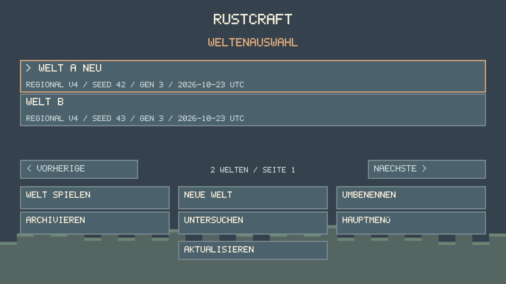
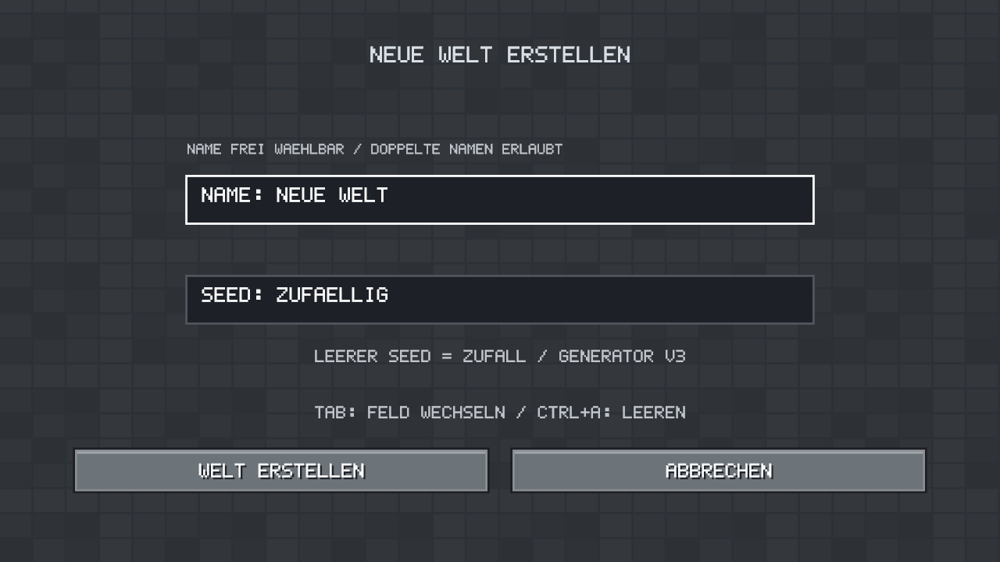
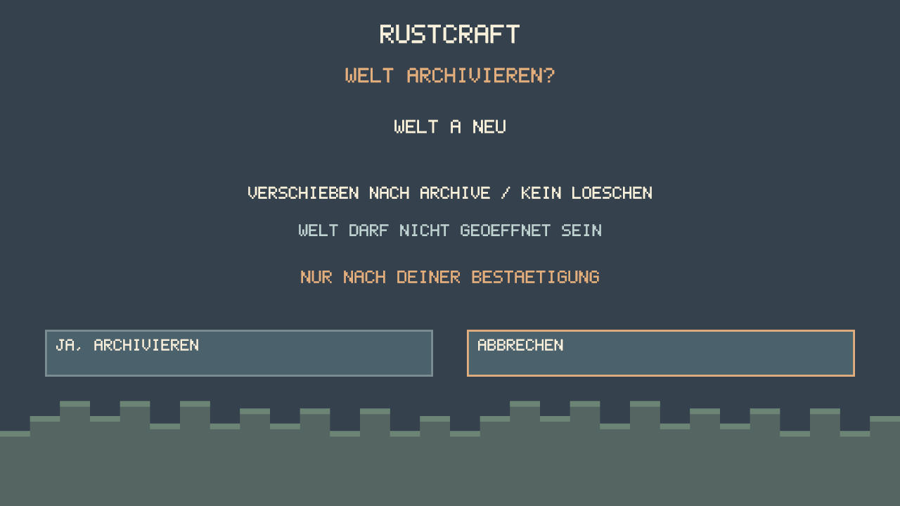

# Slice 14: multiple worlds and safe imports

Based on main `50b2ae6`, issue #26. No dependency, generator, world v1–v4,
player, identity or journal format changes. All new code/art is MIT OR Apache-2.0.

## Menu and controls

Title → **Spielen** → **Weltenauswahl**. Select one of three visible rows; use
Previous/Next or PageUp/PageDown for additional pages. The marked row (`>`) is
selected independently of keyboard focus. Mouse and Up/Down/Tab + Enter work;
actions activate on release. Escape returns/cancels. New-world creation requires
**Welt erstellen**; merely opening/canceling the form does no disk I/O.

Names are UTF-8, 1–96 characters, nonblank, without control characters. Names
are display data, never paths; duplicates and punctuation are allowed. Append,
Backspace and Ctrl+A (clear field) edit the focused field. German/Latin accents
and common punctuation have original bitmap glyphs; unsupported Unicode is
preserved exactly and displayed as `?`. No clipboard, insertion caret or full IME
composition editor yet. Name fields show their tail; list names are abbreviated.

Seeds accept decimal u64 (0 through 18446744073709551615). Empty means a newly
generated seed, stored before the world becomes visible. `RUSTCRAFT_WORLD_SEED`
now only prefills the creation form; it never changes an existing world. Generator
v3 remains frozen; equal seed/generator pairs reproduce the same terrain, while
new worlds have different immutable save nonces and separate player inventories.
Creation returns to the list. Type, seed, generator and UTC catalog creation date
are shown when validated. Imported worlds show **import date**, not a guessed
historical creation/last-played date. Last-played time is not tracked.

**Untersuchen** shows path/status and logs the full path/error without changing
payloads. Corrupt/unknown/missing initialized data remains listed; Play and Rename
are disabled. A locked world has a visible error and can be refreshed after the
other instance closes. Full validation can take time for large histories; listing,
creation, import, rename, archive and loading run on workers with a busy page.
Native close waits for an in-flight catalog operation. There is no automatic retry
of a failed mutation; refresh the list after filesystem errors.







## Data root and layout

`RUSTCRAFT_DATA_DIR` must remain an **absolute** path. It consistently selects
the whole RustCraft data root (also for isolated tests). Defaults are unchanged:
Linux absolute XDG_DATA_HOME/rustcraft or ~/.local/share/rustcraft; Windows
LOCALAPPDATA/RustCraft with APPDATA fallback. No alternate fallback on I/O errors.

```text
<data-root>/
  .catalog.lock                    # short-lived OS catalog transaction lock
  world.rcw, regions/, player...    # optional untouched legacy source bundle
  worlds/<32 lowercase hex ID>/
    world.meta                     # catalog ID, name, creation/import time, CRC
    world.lock                     # exclusive OS lock, shared by reads/save jobs
    world.rcw
    regions/...
    player.rcp
    player-world.rcid
    session.pending                # if an interrupted save needs redo
    *.bak, *.tmp.*, other sidecars  # retained with this bundle
  .staging/<new ID>/...             # unpublished creation/import, retained on error
  archive/<ID>/...                  # complete reversible archive, never active
```

A directory ID is separate from the UTF-8 name and the existing immutable binary
save identity. Rename changes only world.meta. Each world has a distinct SaveStore
and lock. All production opens take the catalog mutex while acquiring that lock;
archive/rename cannot race a cooperating open. Archive verifies the world lock,
refuses occupied targets and does no recursive deletion. Unix retains the world
lock through rename. Windows requires closing descendant handles before moving
a directory, so it closes the verified world handle under the still-held catalog
mutex immediately before rename; all production opens remain excluded. A failed
rename preserves the original directory. Archived IDs are not reused.

`world.meta` v1 is independent of all game formats: `RCMETA01` (8 bytes), exact
32-byte lowercase-hex directory ID, little-endian u64 catalog timestamp (seconds
since Unix epoch), UTF-8 name (1–96 Unicode scalar values), then CRC32 over all
preceding bytes (u32 little-endian). Maximum read 512 bytes. A metadata error
blocks Play; it never initializes a replacement world/player. Rename writes a
same-directory create-new temporary file, syncs and atomically replaces metadata;
Unix also syncs the directory. Failed writes leave the old metadata usable.

## Legacy protection and explicit import

Root-level world/player/region/journal evidence creates an **Alter Einzelspielstand**
entry, including corrupt evidence and recovery/temp files. It is inspectable but
cannot be played/renamed/archived directly. Use **Untersuchen → Legacy importieren…**,
then explicitly confirm the complete-copy operation. Cancel is selected initially.
Old isolated RUSTCRAFT_DATA_DIR test paths work through this same workflow.

1. Acquire catalog lock and exclusive source world.lock; refuse locked sources.
2. Inspect the full source tree without following symlinks/reparse points. Validate
   the existing root or a known pending initial intent, player binding/fingerprint,
   journal and every regional primary, including distant regions and orphan backups.
   No factory, player refill, journal replay or backup fallback runs on the source.
3. Reserve a fresh ID with create-new directory semantics under `.staging`. Copy
   **every** source file/subdirectory, including unknown recovery files, backups,
   journal, lock file contents and empty directories. Only the four container-owned
   root entries `worlds`, `archive`, `.staging`, `.catalog.lock` are excluded.
4. Files are copied with create-new handles and synced. Source metadata named
   `world.meta` is a reserved-name conflict and fails safely rather than overwriting.
   Write new catalog metadata, fully validate the copy, sync its directories, then
   publish with a same-filesystem directory rename into `worlds/<ID>`.
5. Loading the imported world later replays its own valid journal via the existing
   SaveStore protocol. Source journal/player/regions/backups remain byte-identical.

The source world.lock may be created if an old bundle has no lock file; this is
lock bookkeeping only. Every existing source file is left intact. Imports preserve
immutable **original** world/player identities, including old finite formats;
the new catalog ID is unique. Repeated explicit imports make independent copies,
not rekeyed binary worlds. No source file is moved, removed or automatically fixed.
A full external closed-directory backup remains recommended before recovery.

Interrupted operations stay visible as **Unvollstaendige Operation** entries under
`.staging`, with a path for inspection. They are never playable and never resumed,
removed or published automatically. Preserve them before manual recovery. A
post-rename directory-sync failure can report an error although a complete world
is already visible; refresh before retrying. Errors never overwrite another world.

## Archive and recovery

**Archivieren** pins the selected ID and asks for confirmation; Cancel is initially
selected. It moves the entire inactive/unlocked directory to `archive/<ID>`.
No permanent delete or automatic cleanup exists. To restore manually, close all
RustCraft instances, preserve a complete backup and move that whole directory back
to `worlds/<same ID>` **only if the target is absent**. Do not merge directories.
Invalid metadata can be examined in a preserved copy; there is no automatic repair
that might hide damaged data. Recovery rules in SAVE_FORMAT and INVENTORY still
apply: individual `.bak` files are not a complete session rollback.

## Session boundary and security limits

A → Pause → Title → B → Pause → Title → A uses Slice13's final-save barrier,
newer-revision drain, terrain/meshing worker drain, entity/asset teardown and lock
release before opening another store. Player/inventory/held cursor, input,
lighting caches, camera and viewmodel are rebuilt/reset. A failed save retains
both the old session and its lock and offers Retry/Return; no discard transition.
Tests check six alternating sessions and exact mesh/material/image/camera counts.

IDs are strict ASCII hex; names never enter path construction. Ancestors and
all bundle entries reject symlinks, dangling links, special files and Windows
reparse points/junctions. Tree depth is capped at32. The data root should be a
private local user directory, with no concurrent external file manipulation.
OS locks cover cooperating clients, not malicious processes replacing directories
while the game runs, remote filesystem guarantees or power-loss-proof hardware.
Windows lacks the Unix directory-fsync guarantee; existing SaveStore limits remain.
Catalog validation scans historical paths on its worker and can be slow for very
large worlds; no per-frame filesystem scans are added. Player position remains
session-only. Settings belong to Slice15.

## Void Linux glibc / Fish acceptance

Use the native dependencies/drivers from PLATFORMS.md (X11 and Wayland supported).
Run in a fresh, isolated root and keep the same Fish shell/path for restarts:

```fish
git fetch origin
git switch feat/slice-14-world-management
set test_dir (mktemp -d /tmp/rustcraft-slice14.XXXXXX)
echo $test_dir
env RUSTCRAFT_DATA_DIR="$test_dir" cargo run --locked -p rustcraft
```

Create A/seed42 and B/seed43. Play A, mine/place, change hotbar/inventory, Pause →
Title; play B and confirm clean starter state. Make different edits, return to A
without restarting and verify A's blocks/items. Repeat six times, then restart
using the same root. Create C/seed42 to compare terrain with A's unedited areas.
Rename A with umlauts; verify its directory ID stays unchanged. Confirm archive
of C, restart and verify it is absent from the active list but present in archive.
Cancel creation/archive/import once. Create >3 worlds and test paging, keyboard,
720p/1080p/4:3, focus loss and held inputs. E, Escape, movement, hand, lighting,
F5/autosave and final-save error/retry must retain their existing behavior.

For migration, use a **complete closed-directory copy** of a pre-Slice14 test
save as another isolated RUSTCRAFT_DATA_DIR. Inspect the Legacy entry, cancel
import, then confirm import. Compare source file hashes before/after (except a
new lock file if absent), and check the imported inventory/edits after play.
Never use a real save for deliberate corruption/failure tests.

## Windows 11 / PowerShell acceptance

Install rustup and Visual Studio C++ Build Tools/Windows SDK as in PLATFORMS.md.
In a clone (Rust1.99.1 is selected automatically):

```powershell
git fetch origin
git switch feat/slice-14-world-management
$env:RUSTCRAFT_DATA_DIR = Join-Path $env:TEMP ("rustcraft-slice14-" + [guid]::NewGuid())
Write-Output $env:RUSTCRAFT_DATA_DIR
cargo run --locked -p rustcraft
```

Keep the same absolute path for restarting; repeat A/B/A, naming, paging,
archive, legacy-copy import and focus/DPI tests above. No Python, external assets,
renderer override or admin rights are needed to run the game. Windows CI checks
compilation/tests; physical GPU, compositor, capture and IME behavior require
native manual acceptance.
