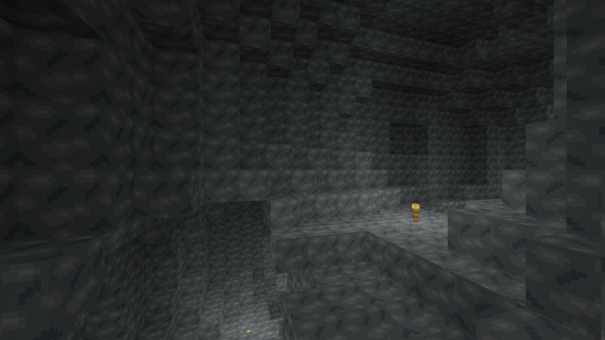
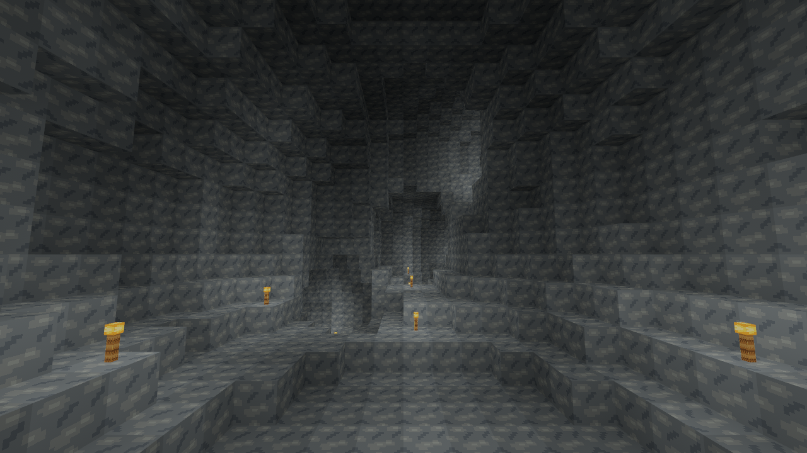
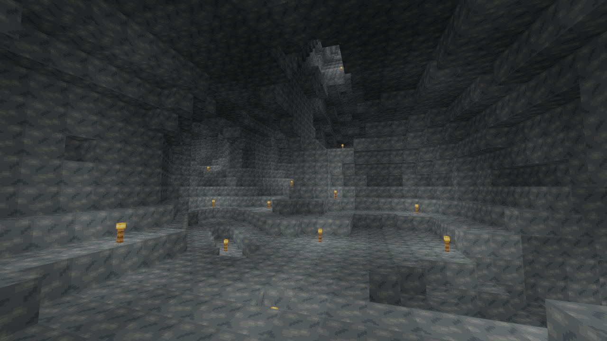
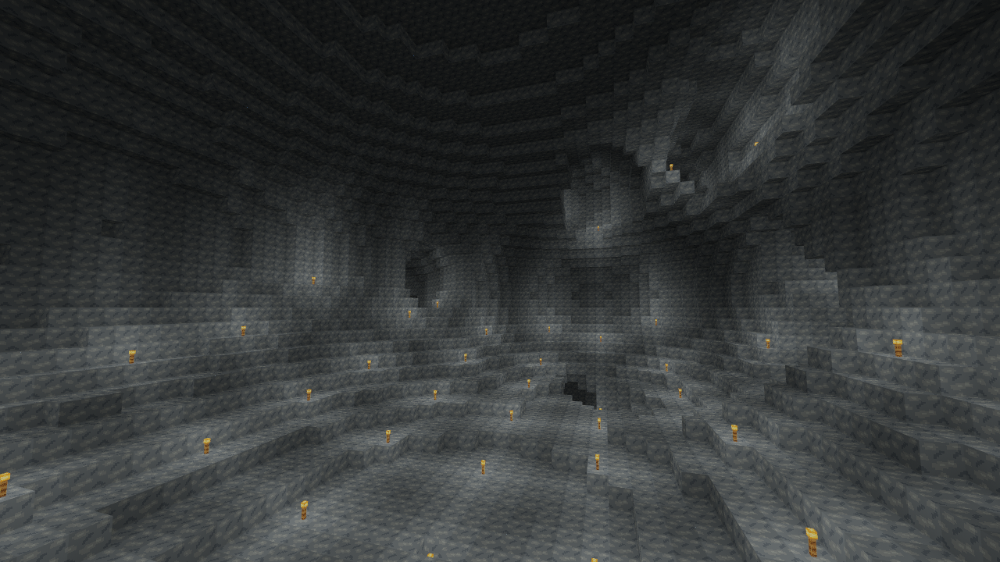
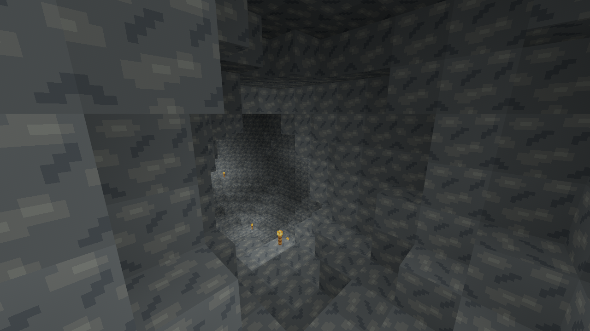
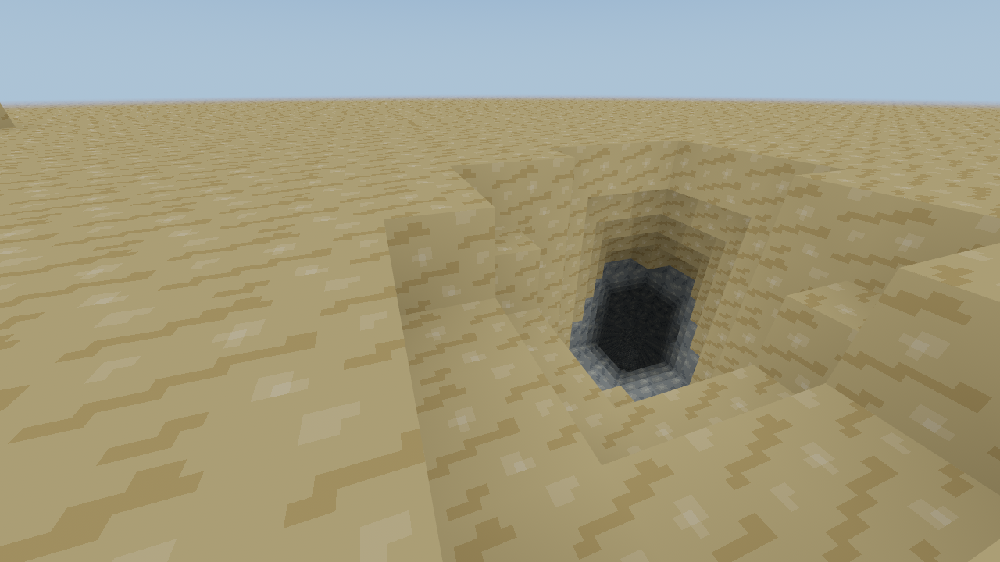

# Slice 27 — Cave Generation v2 evidence

Original RustCraft code/art, MIT OR Apache-2.0. Baseline is merged Slice26
`30bc9955c77f002987ee1258eabbaf5fc8a4bbb5`. This report measures cloud CPU and
Mesa software rendering, not the owner's i3-13100 / RX9060 XT16 GB /32 GB /
Void glibc /1920×1080 hardware. Native Void X11/Wayland and Windows acceptance
remains open. [Algorithm and compatibility](../../WORLDGEN.md).

## Quality survey

`cave_survey` samples X/Z[-128,128), Y[-60,24), retaining only cells at/below
the unchanged terrain height. Air cells are six-connected in a bounded byte mask.
The denominator excludes surface sky. Components smaller than64 cells are omitted
from the component count; largest-component percentage uses all sampled cave Air.
Components can be clipped or connected outside the sample; these are neither
whole-world connectivity nor player-sized walkability guarantees. “Entrances”
counts components touching a carved surface cell and reaching below Y=-20,
not individual mouths. Other mouths occur outside this small footprint.

| Seed | Cave cells | Underground % | Components ≥64 | Largest / share | Entrance components | Mixed / uniform Stone chunks |
| --- | ---: | ---: | ---: | --- | ---: | --- |
| 0 | 148,028 | 3.105 | 15 | 36,183 / 24.44% | 0 | 670 / 684 |
| 42 | 178,196 | 4.032 | 18 | 95,821 / 53.77% | 0 | 637 / 648 |
| 2026 | 127,911 | 3.003 | 9 | 55,003 / 43.00% | 1 | 548 / 731 |
| 18446744073709551615 | 107,815 | 2.539 | 16 | 40,319 / 37.40% | 1 | 527 / 753 |


The sampled underground stays predominantly Stone. Caves occur in all sampled
20-block depth bands across the seeds, with the greatest volume at mid-depth.
The first four bottom layers are protected everywhere. Region-to-region variation
is intentional; a particular256² area need not contain a large room or entrance.
[Raw counts](cave-survey.csv). The independent bounded feature tests also require
medium and multi-chunk large rooms, curved/sloping paths, multiple branches
sharing real chamber centers, and geometry crossing horizontal/vertical seams.

```fish
cargo run --release --locked -p voxel_core --example cave_survey
```

## Performance method

`cave_bench` is copied unchanged into the detached baseline worktree. No baseline
production code is patched. Three interleaved runs compare baseline/gen6,
current/gen6 and current/gen7 with identical seeds/coordinates. Each scene has
32 raw-generation/light/mesh samples and96 worker samples after five warmups.
Linux thread CPU uses `CLOCK_THREAD_CPUTIME_ID`; other hosts report NaN.
P50/P95/P99 use a floor-index estimator; even96 samples give limited tail evidence.
Tables use medians of each run's reported statistics. Raw files remain in [raw](raw).
Builds, captures and tests are finished before timing, avoiding local competing jobs.
Host: AMD EPYC9V74, three visible logical CPUs with a two-CPU cgroup quota.

```fish
git worktree add --detach work/slice26-baseline 30bc9955c77f002987ee1258eabbaf5fc8a4bbb5
python3 tools/benchmark_caves.py --baseline work/slice26-baseline --output work/slice27-results
```

`same_content` is seed42/chunk65,65. A regression compares every block descriptor
in its complete3×3 source halo across v6/v7, so it is a genuine identical-content
comparison. Other rows are same-coordinate comparisons with **different cave
geometry**. “Solid underground” times a proven uniform Stone16³ target at
chunk128,-4,128; its full-height worker column/neighbor columns can contain caves
elsewhere. “Surface” still meshes the complete vertical column, including the
new underground surfaces. It is not a surface-only geometry benchmark.

`raw_column` includes local surface/tree/cave planning and all16 chunk descriptors;
`raw_chunk` uses an already-built sampler for the named slab. Warm jobs reuse
pristine source columns, reconstruct lighting and mesh the column. Cold job time
includes the first9-column source/cache construction. Standalone meshing scans
all16 targets with an already-computed light field, whereas production skips
empty/enclosed targets; it is not expected to sum exactly with light time to the
worker duration. Mesh bytes use actual vertex/index layouts. Resident mixed and
uniform Stone counts cover the3×3 prepared area, not just one target slab.

Requested heap is the allocator high-water above the pre-job baseline, including
the first cold cache build. It excludes allocator metadata, stack, OS RSS, Bevy
and GPU memory. Cache bytes count actual voxel vectors, not readiness descriptors
or map overhead. Core installation only inserts regional maps/chunk descriptors;
normal client Bevy installation is reported separately below.

All times are microseconds; sizes are bytes. Identical-content comparison:

| Metric | Slice26/gen6 | Current/gen6 | Current/gen7 |
| --- | ---: | ---: | ---: |
| Raw column P50 | 340.66 | 386.47 | 211.46 |
| Cold job | 3,638.98 | 4,089.26 | 2,497.29 |
| Warm job P50 | 482.05 | 494.19 | 496.92 |
| Warm job P95 | 504.41 | 537.49 | 552.52 |
| Warm job P99 | 584.65 | 626.91 | 595.05 |
| Thread CPU P50 | 482.12 | 494.33 | 496.81 |
| Light P50 | 286.67 | 287.86 | 294.08 |
| Standalone mesh P50 | 368.12 | 402.87 | 402.56 |
| Mesh bytes | 5,952.00 | 5,952.00 | 5,952.00 |
| Resident mixed | 9.00 | 9.00 | 9.00 |
| Resident uniform Stone | 36.00 | 36.00 | 36.00 |
| Resident voxel bytes | 36,864.00 | 36,864.00 | 36,864.00 |
| Cache voxel bytes | 36,864.00 | 36,864.00 | 36,864.00 |
| Additional peak requested heap | 243,616.00 | 243,616.00 | 243,616.00 |
| Core install P50 | 4.15 | 4.33 | 4.30 |

Current v7, content-scaled scenes (P50/P95/P99 per complete column job):

| Scene | Raw column / slab µs | Job P50/P95/P99 µs | Thread CPU µs | Light / mesh µs | Mesh bytes |
| --- | --- | --- | ---: | --- | ---: |
| surface | 341.37 / 44.66 | 1675.47 / 1855.23 / 1970.93 | 1675.53 | 1152.62 / 592.84 | 298,840 |
| same_content | 211.46 / 41.64 | 496.92 / 552.52 / 595.05 | 496.81 | 294.08 / 402.56 | 5,952 |
| solid_underground | 245.86 / 0.24 | 1448.19 / 1627.26 / 1804.36 | 1448.31 | 963.18 / 506.44 | 100,440 |
| narrow_tunnel | 256.70 / 36.55 | 1182.48 / 1269.73 / 1467.44 | 1182.56 | 762.56 / 471.95 | 121,520 |
| medium_chamber | 301.96 / 28.52 | 1634.79 / 1875.24 / 1918.11 | 1635.02 | 1142.16 / 568.35 | 246,760 |
| large_cavern | 375.61 / 67.85 | 1342.46 / 1425.38 / 1635.57 | 1342.64 | 969.55 / 430.12 | 113,832 |
| intersection | 259.91 / 31.86 | 1386.45 / 1465.90 / 1609.56 | 1386.66 | 967.73 / 481.85 | 136,648 |
| vertical_connection | 286.18 / 30.42 | 1437.02 / 1565.37 / 1819.36 | 1437.30 | 971.42 / 518.57 | 211,544 |
| large_cavern_torch | 373.19 / 67.85 | 1440.36 / 1573.21 / 1759.06 | 1440.55 | 1012.81 / 440.60 | 142,352 |

| V7 scene | Resident mixed / Stone | Resident/cache voxel bytes | Additional peak requested heap | Core install µs |
| --- | --- | --- | ---: | ---: |
| surface | 30 / 17 | 122,880 / 122,880 | 1,012,652 | 8.19 |
| same_content | 9 / 36 | 36,864 / 36,864 | 243,616 | 4.30 |
| solid_underground | 35 / 19 | 143,360 / 143,360 | 727,456 | 7.68 |
| narrow_tunnel | 25 / 20 | 102,400 / 102,400 | 587,036 | 5.75 |
| medium_chamber | 37 / 11 | 151,552 / 151,552 | 943,020 | 7.35 |
| large_cavern | 31 / 14 | 126,976 / 126,976 | 701,540 | 6.89 |
| intersection | 26 / 19 | 106,496 / 106,496 | 662,564 | 6.41 |
| vertical_connection | 26 / 19 | 106,496 / 106,496 | 739,940 | 7.05 |
| large_cavern_torch | 31 / 14 | 126,976 / 126,976 | 966,048 | 7.45 |

Same-content warm P50 is496.92 µs versus482.05 µs on Slice26 (+3.1%); raw
column generation falls from340.66 to211.46 µs (-37.9%). Current frozen-v6 warm
P50 is494.19 µs (+2.5%); its raw generation is386.47 µs (+13.4%), an observed
historical-generation overhead/code-layout regression despite identical output.
This is retained explicitly rather than claiming every old-world timing improved.

The ordinary origin-column v7 job costs1.675 ms versus0.826 ms (+103%), with
298,840 versus24,056 mesh bytes (12.4×) and30 versus14 resident mixed chunks.
Its actual thread CPU rises similarly; this is real additional cave/light/mesh
work, not merely wall-clock scheduling noise. The measured cold job falls from
5.542 to5.218 ms because generation shortcuts offset some added work. A true
uniform deep target takes0.24 µs through an existing sampler and allocates no
voxel array. These are bounded cloud results, not a native frame-rate guarantee.
Full same-coordinate baseline/current rows, all costs and identities are retained
in [summary.csv](summary.csv).


The v7 implementation caches primitive metrics, restricts rasterization to shape
bounds, skips distant routes, uses fixed route arrays and an allocation-free
point visitor, and returns deep Stone/upper Air descriptors without full voxel
scans. Solid chunks do not allocate4096 cells merely because caves exist elsewhere.
Actual caves expand the existing contiguous light span and create additional
surfaces, so their higher light/mesh work is real content cost. No approximate
lighting, missing geometry, smaller halo or global full-height solve was used to
improve the measurements. The same-content comparison distinguishes this cost
from historical-world processing changes.

| Revision | Route Z /64 steps | P50/P95/P99 µs | Peak cached columns | Final cache bytes | Eviction/regeneration µs |
| --- | --- | --- | ---: | ---: | ---: |
| baseline-v6 | 0 | 1885.68 / 2709.98 / 2995.58 | 15 | 135,168 | 4988.35 |
| baseline-v6 | -5 | 1683.36 / 1965.67 / 2203.98 | 15 | 151,552 | 4891.80 |
| current-v6 | 0 | 1971.77 / 2699.63 / 3045.95 | 15 | 135,168 | 5481.46 |
| current-v6 | -5 | 1809.67 / 2103.01 / 2245.59 | 15 | 151,552 | 5112.85 |
| current-v7 | 0 | 2158.88 / 2666.14 / 3730.58 | 15 | 229,376 | 3905.60 |
| current-v7 | -5 | 2280.23 / 2644.37 / 3053.79 | 15 | 258,048 | 4443.21 |


Both travel probes stream full-height columns through the same worker; they differ
in X/Z path, not in a separate underground worker mode. Each64-step route prunes
the cache; returning to the first evicted column regenerates and verifies its
complete geometry/meshes against a fresh uncached job. Main-thread gameplay has
no cave plan/map service or world-sized startup work.

## Genuine renderer gallery

All six images below show actual generator7 output. Stone/Air geometry is never
manually carved or assembled. Production RustCraft atlas, terrain shader, greedy
mesh, AO and sky/torch light are used at1280×720 under Xvfb/Mesa software Vulkan.
Underground images use a **development lighting fixture**: supported existing
floor torches placed on a six-block grid. The fixture changes only torch cells;
it does not represent player inventory use or naturally generated torches.
The surface entrance capture uses daylight without the torch fixture.

Camera positions are absolute eye X/Y/Z; directions are XYZ vectors. Each row is
reproducible from `tools/capture_caves.py`. Gallery-only viewpoints do not add a
spectator movement mode to gameplay. The gallery renders radius5 context using
separate light batches, each within the existing seven-column target limit;
production radius1–3, solver bounds and cache budgets stay unchanged.

| Scene | Seed | Eye X/Y/Z | Direction X/Y/Z | Torches |
| --- | ---: | --- | --- | --- |
| Small winding tunnel | 42 | -63,-24,-142 | .3,0,-1 | fixture |
| Branching passage | 42 | -65,-30,-127 | 0,.1,-1 | fixture |
| Medium chamber | 0 | -60,-30,-117 | -.3,.08,-1 | fixture |
| Large cavern | 42 | 58,-34,-53 | -.3,.08,-1 | fixture |
| Vertical connection | 42 | -175,-39,-158 | -.7,-.25,.7 | fixture |
| Surface entrance | 2026 | 30,6,-37 | .35,-.6,-1 | none |

```fish
cargo build --locked -p rustcraft --example terrain_gallery
python3 tools/capture_caves.py --output work/my-cave-captures
# Read-only gallery; no save directory is opened:
cargo run --locked -p rustcraft --example terrain_gallery -- 42 51 -66 0 --generator=7 --eye=58,-34,-53 --direction=-0.3,0.08,-1 --cave-torches
```








## Validation

See [exact local checks](validation.txt). Frozen generator1–6 fixtures remain
unchanged. V7 independent column CRCs use ascending chunk Y/local Y/Z/X and stable
u16 little-endian material IDs, matching the v6 fixture convention:

| Seed | Chunk X/Z | CRC32 |
| --- | --- | ---: |
| 0 | 0,0 | 392822372 |
| 42 | 3,-5 | 4061003562 |
| 2026 | -1,-1 | 3418224074 |
| u64::MAX | -2048,2047 | 3382729508 |
| 42 | 2047,-2048 | 1524942302 |

Regressions exercise point/chunk sampling in reverse and parallel order, signed
and extreme coordinates, discovery bounds, foundation/spawn support, sparse
Stone/Air, deep room skylight/torch fields against the full reference, both sides
of vertical mesh seams, real cave collision/mining/inventory placement/fluid
recession, entrance-to-deep-component reachability, identity7 roundtrip/future
rejection, explicit Air/placed blocks/inventory/water through every coordinated
journal interruption, and v6/v7 client stale-worker/eviction/reload publication.
Historical gameplay, save capacity, IDs and fluid tests also run unchanged.

The actual release client was exercised through title → create seed2026 world →
catalog (Gen7) → play, supported spawn, F3 (generator7), F5/autosave, Pause/Quit
Game with a clean exit, then reopen/play the same world. Manifest5 remained64
bytes with the same seed/generator identity; inventory/world clock loaded normally.
The HUD development label is updated to Slice27. This is a GUI smoke test, not a
native movement/underground endurance acceptance run.

At radius1, the first run installed144 ready descriptors,20 meshes and45,056
voxel bytes. Worker P50/P95/P99 were1.963/3.445/3.445 ms across the small initial
load set; **actual Bevy installation maximum85.318 µs**, stream update maximum
200.731 µs. Reopen measured installation maximum120.351 µs and update maximum
271.938 µs. First queue-to-install maximum4.215 s included software-rendering/
startup frame delays; reopen was1.139 s. The first ten frame samples had P50
89.23 ms/P95 2.451 s; reopen P50 112.38 ms/P95 252.56 ms. These tiny software-GPU
startup samples do not characterize native GPU performance. Raw production
metrics: [first run](raw/client-smoke.txt), [reopen](raw/client-reopen.txt).

## Void Linux glibc / Fish acceptance

Use the existing project Void build packages and normal supported Mesa/Radeon
drivers. Test X11 and Wayland separately. Record backend, driver, resolution,
radius and VSync; cloud rendering/CI does not validate native input or GPU speed.

```fish
git fetch origin
git switch feat/slice-27-cave-generation-v2
git pull --ff-only
set cave_root (mktemp -d /tmp/rustcraft-slice27.XXXXXX)
echo $cave_root
env RUSTCRAFT_DATA_DIR="$cave_root" RUSTCRAFT_WORLD_SEED=2026 RUSTCRAFT_LOAD_RADIUS=2 cargo run --release --locked -p rustcraft
# After normal close, reopen this same isolated catalog/world:
env RUSTCRAFT_DATA_DIR="$cave_root" RUSTCRAFT_LOAD_RADIUS=2 cargo run --release --locked -p rustcraft
# For old-world compatibility, copy the COMPLETE CLOSED v6 data root first:
set old_copy (mktemp -d /tmp/rustcraft-slice27-v6-copy.XXXXXX)
cp -a /path/to/closed-v6-data-root/. "$old_copy/"
env RUSTCRAFT_DATA_DIR="$old_copy" cargo run --release --locked -p rustcraft
```

1. Create a new named seed2026 world through Singleplayer. F3/catalog must report7.
   Spawn must have supported ground, clear headroom and no immediate cave pit.
   R, focus/capture, inventory, sprint/jump/sneak and pause behavior must match.
2. Walk to the seed2026 entrance near X31/Z-39, terrain Y4. Follow its descending
   passage, jumping/digging where necessary. It must reach real rooms and deeper
   passages. Use the gallery table to compare other seeds/locations separately.
3. Explore bends, forks, dead ends and the deeper room connections. Cross X/Z
   ±16/±64 and Y=-16/-32/-48. Look for missing/duplicate surfaces, texture/normal
   errors, abrupt region cuts, AO or lighting strips. Quiet Stone areas must remain.
4. Mine/place with actual inventory. Check count changes, refusal when full,
   supported floor/wall torches, torch removal after support mining, and collision
   on uneven floors/walls. Enclosed caves must stay dark; entrances admit daylight.
   Place/remove torches on both sides of vertical seams and after closing skylights.
5. Pour player water down a real sloping passage and through a vertical connection;
   verify propagation, swimming, torch washing and recession after source removal.
   Mine toward the bottom: four generated Stone layers precede Y=-64. No natural
   water, lava, ore, mobs, new materials or structures should appear.
6. Travel beyond residency and return; switch radius1→3→1. Verify regenerated
   geometry, edited Air/placed blocks/torches/water and bounded mesh/cache counts.
   Pending frontiers must block movement rather than expose holes or light leaks.
7. F5, wait Saved, normal close, reopen. Verify generator/nonce identity, inventory,
   clock, mined Air and placed blocks/water. Repeat autosave and return-to-title.
   Use only disposable complete copies for interrupted-save experiments.
8. Open the complete v6 copy. F3 must remain6, with the original periodic caves
   and solid new underground. Visit previously unvisited chunks to confirm it
   never generates v7 caves. Older generators retain their original shorter bounds.
9. At1920×1080 record FPS/frame P50/P95/P99, worker P50/P95/P99, mesh payload,
   ready/mixed/Stone chunks, cache memory, queue latency and installation maxima
   during surface and continuous underground travel, with/without torches/water.
   Compare v6 copies at the same coordinates and classify content differences.
10. Repeat on Windows10/11 x86-64 with separate data roots and native drivers.
    Linux/Windows CI establishes build/tests, not GUI, pointer or driver behavior.

## Remaining limits

Systems have a fixed bounded planning scale with jittered centers, not global
cave connectivity. Some branches/chambers join; others remain separate. Chambers
are overlapping ellipsoids and can still look bowl-like; dedicated stone pillars
and subterranean biome/material variety are absent. Some floors require jumping
or digging, and steep entrances/connections are possible. Component surveys test
Air connectivity, not navigation by the complete player AABB. Gallery torches
make shapes readable but are not natural content. Very distant gallery geometry
is bounded by its development render area. Additional caves necessarily create
more mixed chunks, light work and mesh payload. The shared contiguous light span
can approach the existing256-plane maximum for tall player edits; pristine caves
do not force empty upper sky into it. Native performance and owner visual review
are still required before merge. Natural water, vegetation/detail, then broader
worldgen review remain Slices28–30.
