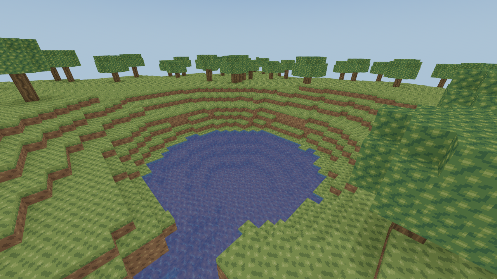
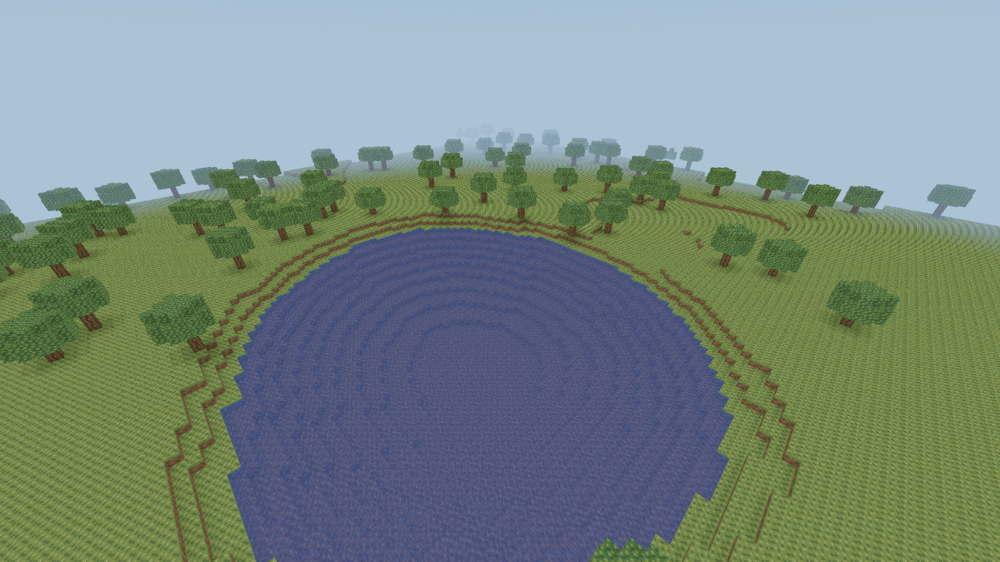
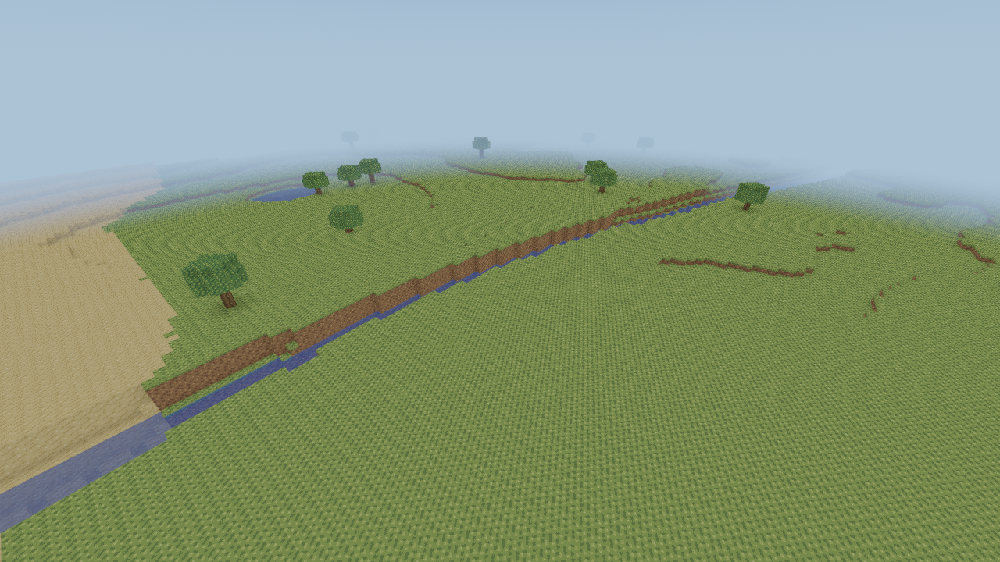
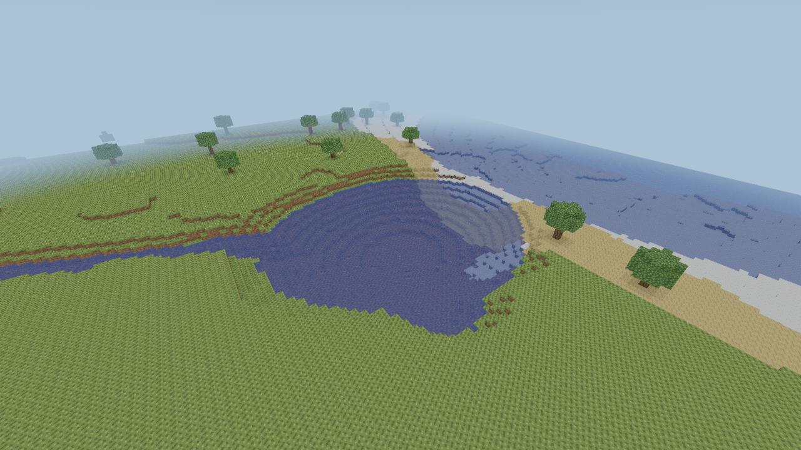
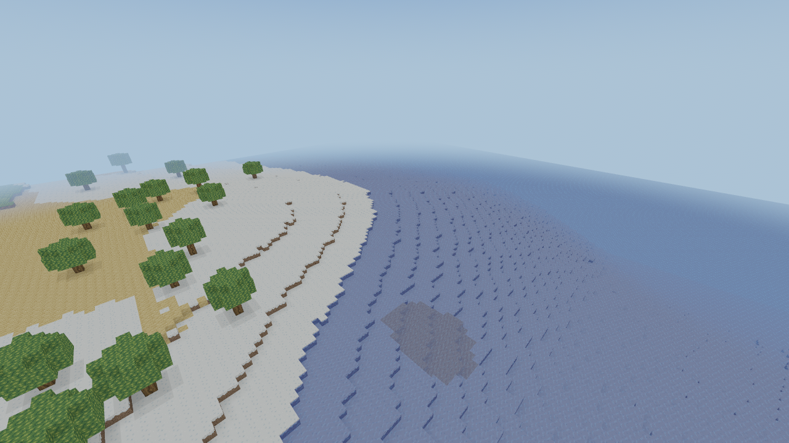
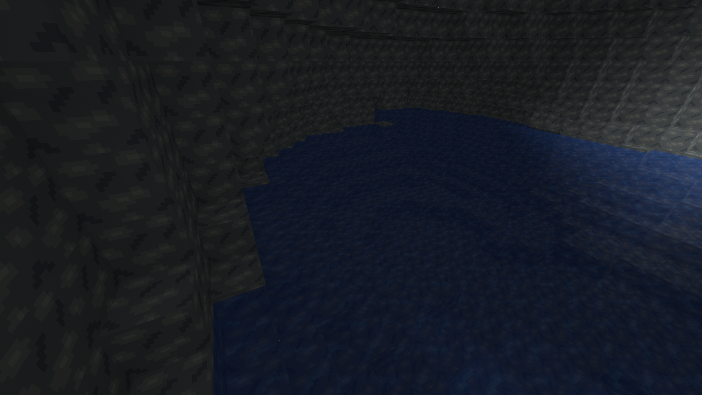
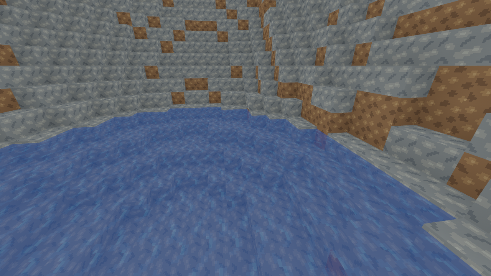

# Slice28 — Natural Water Generation

The implementation selects generator8 only for new worlds. Historical1–7 output,
manifest identities, existing state IDs and edit/journal contracts remain frozen.
[Hydrology architecture](../../WORLDGEN.md), [source/collection semantics](../../WATER.md).

## Reproduction

```sh
cargo run --release --locked -p voxel_core --example hydrology_survey -- 1024
cargo run --release --locked -p voxel_core --example hydrology_survey -- --pools
cargo run --release --locked -p voxel_core --example hydrology_survey -- --probe 2026 -208 -670
cargo run --release --locked -p voxel_core --example hydrology_bench -- 8
cargo build --locked -p rustcraft --example terrain_gallery
python3 tools/capture_hydrology.py --output work/hydrology-captures
```

The survey/probe/gallery are read-only tools with no save access. No sources, solid
terrain or water meshes were painted for the images. The cave image adds only
supported existing torches, explicitly described below. All geometry is actual
version8 output. CLI paths are OS-neutral; a working native desktop/driver is
needed for captures. CI does not substitute for native GUI acceptance.

## Surface and underground survey

Four seeds, three widely separated1,024-square windows per seed: centers(0,0),
(8192,-8192),(-16000,16000), totaling **12,582,912 surface columns**. Window origins
are center minus512. Signed chunks and64-block regions are crossed throughout.
The20x20 runtime water neighborhood and16x16 survey evaluator share geography;
point/chunk, reverse/parallel, extremes and independent golden tests guard it.

| Seed | Mean surface water % | Mean ocean % | Accepted cave-pool plans / 256 cells | Pool volume / largest pool cells |
|---|---:|---:|---:|---:|
| 0 | 25.90 | 23.73 | 34 | 15882 / 2526 |
| 42 | 47.88 | 46.88 | 17 | 8328 / 1867 |
| 2026 | 28.59 | 26.47 | 30 | 14716 / 3914 |
| 18446744073709551615 | 24.36 | 22.66 | 21 | 12644 / 2651 |


Across these windows: **411** four-connected surface water components, including
280 below256 cells,109 of256–4095 cells and22 at least4096 cells. Components at
window edges are clipped; these are sampled connected bodies, not a world-wide
lake census. The evaluator classified17,925 Pond,151,398 Lake and50,664 River
columns; ocean columns are counted separately. There were77,510 wet/dry shore
edges and1,190 River-to-Lake/Ocean adjacency edges. Some such adjacency is a class
change inside connected water, not a distinct river mouth.

Depths span1–30 source layers. Per-window P50 is3–30, P95 is7–30 in the final
1,024-square survey (see raw rows for exact local variation). Broad ocean windows
are intentionally very wet; other windows are mostly dry. Aggregating the three
separated windows gives24–48% surface water per tested seed, with ordinary land
remaining connected at this scale. This is a sample, not a proof of universal
seed proportions or realistic continental hydrology.

The cave survey tests256 ownership cells per seed across X/Z[-768,768), retaining
only validated closed basins. Accepted candidate plans range6.6–13.3% of tested
cells. Intersecting candidates can describe the same connected pool; this count
is **accepted plans**, not a deduplicated global lake count. Across four seeds,
102 plans contain51,570 source cells with22,370 top-plane cells. The largest has
3,914 cells,826 on its top plane, inside bounds X[-231,-184],Y[-59,-52],
Z[-690,-651]. Many tested cave systems remain entirely dry.

[Raw surface rows and sites](surface-survey.txt), [cave pool bounds/counts](cave-pools.txt).
The surface tool also samples a fixed southwest128-square cave subwindow at each
center; its wet-column frequency is a separate, smaller sample, not the plan
admission percentage above.

## CPU, fluid, memory and persistence measurements

Release CPU measurements in a shared cloud environment, Rust1.99.1. Raw generation
is a complete16-chunk column, including its local plan. There are64 raw samples;
worker measurements use32 warm samples after4 warmup/cold calls. P50/P95/P99 use
the lower sorted sample index. The CSV retains the cold first job separately,
thread CPU time, full payloads, memory, installation, save/reload and fluid counts.

Baseline: **unmodified Slice27 main `b0a5bbff7f38bc224c8fe5a4359e7af67f30e31f`**,
in a detached checkout with the same benchmark harness and coordinates. Only the
unavailable v8 water-cache diagnostic is zero in the copied baseline harness.
This compares different generated content at the same coordinates; it does not
pretend that water-rich v8 meshes equal dry v7 meshes.

| Scene | v7 raw P50 ms | v8 raw P50/P95/P99 ms | v7 job P50 ms | v8 job P50/P95/P99 ms | v8 install ms |
|---|---:|---:|---:|---:|---:|
| dry | 0.218 | 0.287/0.547/0.647 | 0.892 | 1.000/1.245/1.385 | 0.004 |
| pond | 0.259 | 0.363/0.491/0.863 | 1.431 | 1.539/1.705/1.705 | 0.074 |
| lake | 0.324 | 0.904/1.112/1.667 | 1.255 | 1.592/1.746/1.805 | 0.210 |
| ocean | 0.238 | 0.318/0.387/1.830 | 1.282 | 1.804/2.026/2.036 | 0.621 |
| river | 0.282 | 0.388/0.455/0.721 | 1.398 | 1.564/1.752/1.923 | 0.089 |
| coast | 0.252 | 0.334/0.417/0.464 | 1.167 | 1.673/2.114/2.370 | 0.519 |
| underground | 0.317 | 0.414/0.449/0.642 | 1.435 | 1.780/1.909/2.014 | 0.079 |


The added geography increases raw generation, particularly the lake planning
case, and water-rich installation costs more than dry installation. Core install
here is the publication of one column into an empty authoritative resident cache;
it **excludes Bevy GPU uploads/entities**. The production renderer's frame intervals
are recorded separately below. Shared-cloud tail latency includes cold feature planning, scheduling and
concurrent compilation/rendering noise; native results must be measured separately.

All seven initial scenes have **queue0, processed0** through120 untouched fluid
ticks, with no baseline edit records. An edited bed pocket peaks at76–169 pending
cells in wet scenes, processes83–176 updates, makes one fluid change and settles
in two256-budget fluid ticks. The client runs fluid at5Hz, so this is at most
about0.4 logical seconds after activation. The dry comparison has no fluid work.
After convergence, unchanged water again has no recurring work. One edited cell
and its new state occupy one overlay record; naturally generated sources do not.

Maximum-radius regression installs784 fully source-filled uniform chunks
(3,211,264 water cells), allocating **zero voxel arrays** and enqueuing **zero**
updates. Actual uniform ocean slabs use the same allocation-free representation.

At radius1 the benchmark keeps144 resident descriptors:24–35 mixed chunks in wet
scenes and the rest uniform Air/Stone/Water. Resident voxel arrays use98–143kB,
terrain caches about the same for the measured one-column9-column source halo,
and measured pool-planning cells use0–46KiB. Complete retained solid+water mesh
payloads range0.5–315kB. Requested incremental worker peak heap is0.46–1.00MB,
measured by the delegating System allocator; it is not total RSS/VRAM or GPU
memory. Route-cache memory is not included in the pool-planning byte counter.

Forward/back travel along river and coast performs75 new-column jobs per route,
keeps residency at144 chunks and the terrain cache at25 columns, with queue peak0
and edits0. The final caches are340/319kB, with7.0/5.5kB of pool cell storage.
Job P50/P95/P99 is2.04/4.55/34.42ms for river travel and2.59/3.98/34.69ms for coast
travel. Baseline tails are also noisy; all raw values remain in the CSV.

Coordinated save latency in the microbench is27–49us, and manifest/player plus
one-column reload is0.36–5.71ms (the cave case rebuilds a cold pool plan). These
cloud filesystem/cache measurements are not physical-disk promises. Separate
regressions recover source collection, explicit Air, construction and bucket
ownership at all three existing journal boundaries. There is no save-format or
record-budget expansion.

[All v8 metrics](generator8.csv), [unmodified Slice27 baseline](slice27-baseline.csv).

## Genuine production-renderer images

X11/Xvfb,1280x720, vertical FOV78°, **llvmpipe LLVM19 / Mesa25.0.7 software Vulkan**,
using the existing original terrain/water shaders and atlas. The gallery has
no gameplay HUD. It uses a larger bounded context and a documented **survey fog
uniform of96–160 blocks**, to show whole features; ordinary gameplay fog and
render-distance limits are unchanged. The outer gallery context is finite and can
be visible beyond a feature. Those frame edges are not generated coastlines.

All scenes use generator8 and noon(time6000). View vectors below are unnormalized;
`Transform::looking_at` normalizes them. Center/eye/direction are exact in
`tools/capture_hydrology.py`; per-image capture text files retain actual cameras and fixture
counts (for example [the cave capture](images/underground.txt)). Surrounding biome transitions can differ from the center classification. Cave
classification refers to the surface climate above; no cave biome was added.

| Image | Seed | Camera X/Y/Z | View direction X/Y/Z | Biome at scene center | Radius |
|---|---:|---|---|---|---:|
| [pond](images/pond.png) | 0 | 8513,14,-8653 | -15,-11,-15 | Forest | 3 |
| [lake](images/lake.png) | 42 | -402,32,63 | -32,-29,-32 | Forest | 4 |
| [river](images/river.png) | 2026 | 150,30,-211 | 35,-27,-28 | Plains | 7 |
| [connection](images/connection.png) | 2026 | 305,33,-146 | 27,-30,-37 | Plains | 5 |
| [coast](images/coast.png) | 2026 | 359,32,65 | 40,-29,-40 | SnowyPlains | 6 |
| [underground](images/underground.png) | 2026 | -204,-47,-662 | 4,-5,-8 | RockyHighlands | 3 |
| [rocky-shore](images/rocky-shore.png) | 2026 | -90,6,-465 | -7,-3,-1 | RockyHighlands | 3 |


The cave scene adds **39 supported floor torches** on the existing six-block
X/Z grid within36 blocks of(-208,-670), sampling real Air above solid ground.
It does not change cave/water geometry. All other scenes have no placed blocks.
The cave image demonstrates a portion of the3,914-cell connected pool, including
its ceiling, walls, darker interior and ordinary torch falloff on the right.

### Small pond



### Medium lake and irregular grassy banks



### River across multiple chunks



### River entering a larger lake beside the coastline



### Large ocean region, coastal shelf and snow/sand material transition



### Existing cave chamber with natural water



### Rocky shoreline at a rare highland pond



Software debug-renderer frame intervals (90 samples after initial30 frames):

| Scene | Samples | P50/P95/P99 frame interval ms |
|---|---:|---:|
| pond | 90 | 267.61/378.70/401.66 |
| lake | 90 | 253.61/299.71/895.50 |
| river | 90 | 207.94/422.66/463.87 |
| connection | 90 | 136.93/174.54/388.48 |
| coast | 90 | 149.78/183.35/459.85 |
| underground | 90 | 212.78/270.93/903.29 |
| rocky-shore | 90 | 182.40/261.90/446.90 |


These intervals include CPU meshing, driver/pipeline scheduling and software
rasterization; they are not GPU timestamps, native RX9060 XT performance or a
frame-budget regression comparison. No Windows GUI, Void Wayland/X11 native GPU,
underwater UI overlay or physical-GPU endurance claim follows from this gallery.
Core swimming/underwater detection, water mesh seams and historical rendering
regressions are automated; native visual acceptance remains below.

## Verification

The required final commands and Linux/Windows CI status are recorded in
[validation](VALIDATION.md). Old1–7 golden expectations were retained; only tests
of the current default/future-version rejection were updated for8/9. The client
resource-residency test now includes both existing solid and water mesh maps and
checks their exact payload/material ownership.

An extra optimized-release test run exposed pre-existing exact-f32 AO assertions
(~8e-9 difference), also reproduced on unmodified Slice27. That optional mode is
separate from the required debug workspace suite; no lighting behavior was altered
to hide it. The failed optional baseline command is recorded in validation.

## Known limitations and following work

- All surface water shares one datum. Rivers are finite, gently meandering local
  basin connectors, without global catchments, currents, erosion or varied
  elevations. Some regions remain sparse, and some highland basins/cuts are steep.
- Lake footprints start from warped ellipses; stronger lobes, more diverse
  shoreline profiles, continental macrostructure and varied river gradients fit
  the later world-generation review. Ocean floors have a30-layer depth cap.
- Cave water uses one deep level and conservative closed-basin admission. It does
  not implement aquifers, surface-to-cave waterfalls or flood all connected caves.
- Source-filled lakes do not drain from collecting one bucket. Flow from an
  excavated body is bounded by normal chunk residency, queue and save capacities.
- Transparent per-chunk sorting and direct light transmission through water retain
  existing limits; no new shader, depth absorption or global transparency system.
- Native GPU, input, underwater tint, Wayland and Windows GUI acceptance is still
  required. Cloud screenshots and CI cannot establish those results.

## Void Linux glibc / Fish acceptance

Use the owner's i3-13100 / RX9060 XT16GB /32GB RAM at1920x1080 with normal drivers.
Repeat X11 and Wayland. Keep an isolated data path for restart; back up whole
closed world bundles. No renderer override is required.

```fish
git fetch origin
git switch feat/slice-28-natural-water-generation
git pull --ff-only
set hydro_dir (mktemp -d /tmp/rustcraft-slice28.XXXXXX)
echo $hydro_dir
env RUSTCRAFT_DATA_DIR="$hydro_dir" RUSTCRAFT_WORLD_SEED=2026 RUSTCRAFT_LOAD_RADIUS=2 cargo run --release --locked -p rustcraft
# Create a NEW world; existing worlds retain their saved generator.
# After normal close, same world at the measured river:
env RUSTCRAFT_DATA_DIR="$hydro_dir" RUSTCRAFT_START_CHUNK="6,-16" RUSTCRAFT_LOAD_RADIUS=2 cargo run --release --locked -p rustcraft
# Coastline / snowy material transition:
env RUSTCRAFT_DATA_DIR="$hydro_dir" RUSTCRAFT_START_CHUNK="23,2" RUSTCRAFT_LOAD_RADIUS=2 cargo run --release --locked -p rustcraft
```

1. Confirm generator8/F3 coordinates. Walk along the river near(107,2,-243), its
   large endpoint lake near(332,2,-183), and the coast near(380,2,35). Inspect
   banks, water heights, signed16-block seams,64-block region seams, snow/grass/
   sand transitions, collision and supported trees. Gallery coordinates above
   locate the forest pond/lake in separate seed0/42 worlds.
2. Swim and hold Jump, exit banks, crouch and inspect the underwater camera/tint.
   Test empty/water buckets, full inventory, flow-only rejection and placing
   solids in a river. Collect a natural source: nearby flow may refill it, but
   it must not recreate an independently collectible source.
3. Dig a one-cell and then wider bed/bank opening, place floor/wall torches nearby,
   verify water reaches the opening, washes torches once and drops their items.
   Close the opening and observe downstream recession. No runaway queue or
   permanently repeated processing should remain after convergence.
4. Inspect the real cave pool near(-200,-52,-670), reached by normal exploration/
   digging, or use the read-only gallery for the exact camera. Preserve its actual
   walls; check torch illumination, water depth, dry adjoining routes and dark
   ceilings. The gallery's torches are fixtures, not generated vegetation/detail.
5. F5/save while water changes, wait SAVED, close/restart. Source removals, explicit
   Air, constructions, inventory/buckets and new player sources must persist.
   Leave multiple radii and return; natural baseline remains while edits override
   it. Exercise recovery only on disposable full-directory copies.
6. Explore repeatedly across river/coast and negative/region/vertical boundaries
   at radii1/2/3. Record raw/worker/install, queue/processed/changes, settle time,
   mesh/cache memory, frame P50/P95/P99, save/reload and resource plateaus. Untouched
   large water must not continuously consume fluid CPU or add save edits.
7. Repeat day/night, focus/pause/inventory gates, cursor capture, resize and world
   switching. Test a copied old generator7 world for unchanged terrain/no new
   water. Repeat on Windows10/11 with equivalent isolated paths and normal backend.

Following slices:29 vegetation/details;30 terrain/biome/cave/hydrology refinement.
