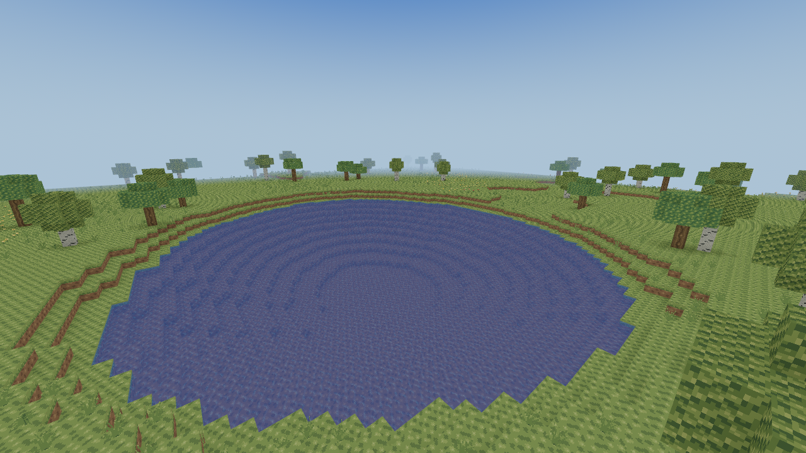

# Slice 34 — Render distance expansion

Exact baseline: merged Slice33 `29db8c4548f7c5116fef35482bbb8c7fc4a8d037`.
Rust1.99.1, Bevy0.20.0, edition2024. Generator9 and historical generators1–8,
world/save formats, original shaders/materials/atlas and the single terrain worker
remain unchanged. This closes the current performance/streaming/rendering phase;
the world-generation overhaul and survival mechanics are separate work.

## Residency, readiness and ownership

Render distance is a **horizontal chunk radius**, default2, maximum4. A complete
interior view grows from49 to81 full-height columns (65.3% more). Desired visual
residency does not authorize physics, edits or water to read pending data as Air.
`Player::cache_ready` checks the actual body footprint; the fixed player adapter
freezes pending teleports and recovers clearance after installation. Collision
uses authoritative voxels, never mesh visibility, GPU completion or distant queue
convergence. Existing world boundaries still clip residency; historical finite
snapshots remain finite and do not begin streaming.

The existing Slice32 policy remains: collision-envelope loads first, nearest
rings and motion within a ring, bounded load/dirty fairness (at most two
consecutive dispatches from either class when both are eligible), and explicit
fourth-service aging. A running distant job may delay the next service until a
safe completion/stop boundary; this is not preemptive real-time scheduling.
Connected geometry/light/water invalidations publish as one validated unit.
Splitting those units to meet an arbitrary upload deadline would break seams.

Only one job owns the pristine cache, immutable snapshot and captured overlays.
Radius decreases, teleports and local revision changes cancel obsolete work;
late results validate every target and cannot resurrect evicted chunks. A stopped
job cannot revive when the player returns. Session shutdown saves, stops, joins,
reclaims entities/assets and releases the world lock before another world opens.

Per-chunk culling, independent eviction and Bevy's proven missing-Aabb lifecycle
are retained. The rejected Slice33 retained-Aabb experiment is not restored.
No LOD, geometry/material changes, extra worker, giant mesh or new simulation
radius is introduced. Water remains event driven with its unchanged fixed budget;
installing additional procedural water does not tick an entire distant volume.

Settings version1 and its existing radius1/2/3 files remain readable, with no
rewrite/migration. Live Apply, the environment override and distance fog share
the validated maximum. At radius4, fog starts35.2 blocks out and ends64 blocks
out; the interaction reach and cave-protection factor stay unchanged. F3 keeps
previous-world-view surface counts, resident triangles and streaming outcomes,
and distinguishes desired/resident view columns from body-terrain readiness.

## Measurement contract

The first reproduction runs the exact merged Slice33 at radii1/2/3 before the
production cap changes. The expanded comparison exports that exact baseline and
the working source into disposable directories, injects identical probes, builds
both executables before timing, verifies source fingerprints and compares all
common final authority/resource signatures. Radius4 exists only in the candidate;
its scaling reference is candidate radius3, not a fabricated baseline radius4.
Source/executable hashes and every raw sample accompany percentile tables.

The expanded scripted client covers true seed0 plains/forest, seed42 coast/caves,
walking/sprinting/diagonals/reversals, teleport/return, a held obsolete worker,
continuous edit pressure, water edits,1→4→1 transitions, a signed distant origin,
dense checkerboard construction and an edited-water patch across a chunk seam.
Fixed-radius scenes use the same inputs in both source copies. The explicit
`radius` stress visits each build's supported maximum (3 versus4); its common
final states match, but its CPU rows are labelled `transition`, not matched-workload
regression evidence. The row radius is the initial setting for that stress. The original fifteen-scene reproduction
and the expanded eighteen-scene fixture have different seeds/probes and are not
pooled. The latter uses real Bevy asset, bounds, transform, rebase and visibility
systems, with FOV78 and16:9, a fixed north/downward view, and no RenderApp/GPU.

Generation, lighting, whole meshing and water/plant sub-stages are worker wall
intervals; water/plant are included in whole meshing and must not be added twice.
Worker thread CPU and wall are separate. First dispatch, ready and CPU-publication
latencies include queueing/retries as documented in Slice32. Installation excludes
GPU extraction/preparation/upload. Whole headless ECS update and the retained
publication fixture additionally measure CPU command/bounds/visibility work.
The fixture's1/9/49/81 changed chunks are synthetic atomic publication sizes,
not a claim that every view update replaces that many meshes.

Successful-install latency distributions omit requests evicted without publication;
stopped/stale outcomes are counted separately, never assigned zero latency. Cold
preparation and convergence use the existing1ms drain polling;240Hz pacing applies
to the120-update movement loop. Neither interval is a display-presentation measure.

Scripted240Hz deadlines pace CPU tests; **they are not rendered frames or FPS**.
Process RSS/HWM include allocator, harness and prior workload history; requested
heap during a worker window excludes preexisting cache, stack and allocator/GPU
overhead. Logical voxels, lights and mesh payloads have separate counters. Visible
mesh counts are CPU culling results, not draw submissions. Percentiles use
`floor((N-1)*p/100)` and keep all outliers; tiny-count percentiles are not stable
native tail estimates. The managed host has two CPU equivalents and8GiB RAM,
with no physical `/dev/dri` device; it is not the target PC.

## Pre-change baseline and review budgets

The unmodified baseline and source-identical A/A control each ran all15 original
terrain scenes at radii1/2/3,120 scripted updates/scene,12 session switches/radius
and128 retained publication samples/case. All48 final signatures match. This is
one reproduction per build, not a native endurance test. The control's worst
ordinary ECS P99 was6.394ms versus6.052ms in the first run, illustrating host/order
variation without a code change. Complete events and provenance: [baseline](raw/baseline/).

Stationary baseline, request→CPU-publication milliseconds and logical resources:

| Radius | P50 / P95 / P99 / max ms | Descriptors | Mesh assets | Mesh bytes | Cache columns / bytes | RSS KiB |
| --- | --- | ---: | ---: | ---: | ---: | ---: |
|1|18.101 /25.775 /25.775 /29.563|144|41|1,130,936|25 /278,528|29,820|
|2|28.759 /58.636 /61.005 /63.703|400|119|3,622,208|49 /524,288|39,116|
|3|62.548 /116.841 /120.672 /122.049|784|231|6,737,848|81 /847,872|43,324|

Across original scenes the first run reaches worker wall P99/max14.891/44.022ms,
installation2.745/4.705ms, ECS6.052/19.608ms, load latency277.156/285.503ms,
and59,468KiB process RSS. The49-chunk synthetic publication P99/max is
1.598/2.870ms. Unfavorable tails are retained; stationary medians alone would
understate the observed envelope.

[Budgets](raw/budgets.json) were recorded **after this baseline and before changing
the production cap**. They are review thresholds for the ordinary measured scene
matrix, not runtime byte-allocation limits or native frame-time guarantees:
worker CPU/wall P99≤30ms, main installation P99≤8ms, ECS P99≤10ms, load
request→CPU-publication P99≤1s, observed RSS≤128MiB, mesh payload≤32MiB,
and synthetic retained publication P99≤12ms. These provide explicit headroom over
the observed tails for the65% residency increase and additional visibility probes.
Any breach must be retained and investigated, rather than trimmed or relabelled
as FPS. Full-domain light and saturated event-queue stress are separate cases.
Arbitrary densely edited worlds are not guaranteed to meet these content budgets.

Conservative logical payload bounds (container/allocator/driver costs additional):

| Owner / bound | Radius3 | Radius4 |
| --- | ---: | ---: |
| Resident full-height descriptors |784|1296|
| Fully materialized resident voxel bytes |3,211,264|5,308,416|
| Pristine halo cache columns |81|121|
| Dense halo cache or source voxel bytes, each |5,308,416|7,929,856|
| Applied exact light bytes |4,572,288|7,558,272|
| Maximum light cells/channel |5,161,984|7,750,656|
| Maximum deduplicated fluid events |3,211,264|5,308,416|
| Maximum terrain surface slots (three/chunk) |2352|3888|

Cache and source/snapshot are separate owners; these figures must not be mistaken
for total process RSS. Source scratch can coexist with the worker-owned cache and
resident data. A cancelled obsolete worker can transiently retain its old cache
plus its bounded source footprint until join; returned cache retention immediately
prunes to the new desired halo before another job starts. Clean region retention
still covers at most16 desired-footprint maps plus16 running-footprint maps plus
eight pinned dirty maps; record/backpressure limits are unchanged. Fluid queue,
dedup and route allocations can retain their bounded capacity after eviction for
reuse; session teardown releases their owners. Mesh bytes depend on geometry,
and CPU payload is not GPU allocation or a universal hard32MiB cap.

## Matched results and interpretation

Three repetitions per scene/radius/build in each order,120 scripted updates each. All **171 common final signatures/order** match exactly (342 across both orders); candidate4 adds57 signatures/order. Of the common groups,162/order have matched fixed-radius/session workloads (324 across orders);9/order are the deliberately different peak-radius transition stress. Exact same source-verified client binaries are reused in reverse order. Radius4 is an increased workload, not a speedup. Complete [forward](raw/client-forward/comparison.csv) and [reverse](raw/client-reverse/comparison.csv) tables retain every scene, metric, count and tail.

Existing-radius controls: worker CPU **P50 /P99 ms**, exact Slice33→candidate. All remaining controls, P95/max and counts are in the linked comparison CSVs. These do not establish a uniform processing speedup or slowdown.

| Scene / radius | Forward33→34 | Reverse33→34 |
| --- | ---: | ---: |
|stationary /1|1.880 /6.052→1.755 /5.338|1.834 /4.951→1.846 /5.006|
|stationary /2|1.688 /5.071→1.318 /4.264|1.412 /4.596→1.524 /4.287|
|stationary /3|1.401 /5.340→1.130 /3.972|1.396 /4.710→1.244 /4.828|
|forest /3|1.297 /6.248→1.359 /6.601|1.432 /7.115→1.383 /6.951|
|coast /3|1.587 /4.828→1.482 /3.994|1.579 /4.855→1.542 /4.509|
|cavern /3|1.617 /7.178→1.585 /5.978|1.695 /6.844→1.846 /7.732|
|dense-construction /3|1.574 /9.806→1.163 /6.639|1.544 /8.844→1.441 /9.683|
|edited-water /3|1.280 /6.790→1.303 /6.817|1.384 /7.217→1.246 /5.011|

Request→CPU-publication **milliseconds**, P50 /P95 /P99 /max (successful requests only):

| Scene / order | Candidate radius3 | Candidate radius4 |
| --- | ---: | ---: |
|stationary /forward|48.976 /99.387 /112.321 /115.188|72.697 /157.722 /176.424 /180.602|
|stationary /reverse|48.179 /128.655 /156.635 /160.754|82.205 /181.296 /209.553 /215.123|
|forest /forward|53.557 /118.466 /139.274 /143.289|83.374 /174.104 /187.266 /194.329|
|forest /reverse|53.793 /134.098 /158.025 /165.392|86.397 /180.876 /202.457 /211.020|
|coast /forward|53.946 /144.397 /168.807 /175.308|100.199 /230.808 /245.662 /251.547|
|coast /reverse|61.415 /151.347 /163.975 /173.422|99.264 /248.951 /291.664 /305.412|
|cavern /forward|57.576 /154.750 /175.613 /179.783|99.339 /219.047 /232.030 /240.557|
|cavern /reverse|70.557 /192.243 /212.238 /220.635|123.431 /301.510 /353.006 /366.472|
|dense-construction /forward|48.924 /92.774 /96.707 /99.287|78.600 /159.140 /168.869 /171.822|
|dense-construction /reverse|51.172 /129.926 /151.912 /155.525|100.938 /189.199 /200.030 /203.125|
|edited-water /forward|49.060 /104.523 /114.556 /118.969|80.954 /149.187 /164.215 /168.599|
|edited-water /reverse|55.862 /106.105 /116.808 /119.759|92.836 /184.121 /207.580 /214.626|

Radius4 coast, worker stages and publication **milliseconds**, P50 /P95 /P99 /max. Counts differ because worker stages include every returned outcome, request latency includes successful loads, and ECS samples cover the paced loop. Generation measures newly generated pristine columns; cache hits retain zero generation samples. Water/plant times are included in whole meshing.

| Metric | Forward (n) | Reverse (n) |
| --- | ---: | ---: |
|generation|0.386 /1.350 /3.001 /3.657 (297)|0.397 /1.426 /3.138 /3.954 (297)|
|lighting|0.367 /0.598 /0.907 /2.281 (297)|0.386 /0.918 /1.712 /2.593 (297)|
|meshing|0.409 /0.701 /1.830 /2.252 (297)|0.430 /1.105 /1.675 /2.297 (297)|
|water_mesh|0.177 /0.295 /0.393 /0.689 (297)|0.183 /0.355 /0.483 /0.598 (297)|
|plant_mesh|0.000 /0.002 /0.006 /0.007 (297)|0.000 /0.002 /0.006 /0.008 (297)|
|worker_cpu|1.391 /2.652 /4.176 /4.939 (297)|1.456 /3.179 /5.066 /5.655 (297)|
|worker_wall|1.391 /2.656 /4.181 /4.939 (297)|1.469 /3.179 /5.066 /5.664 (297)|
|prepare|0.088 /0.149 /0.187 /0.354 (297)|0.055 /0.133 /0.172 /0.324 (297)|
|queue_wait|71.547 /225.486 /241.247 /249.126 (342)|73.874 /238.051 /278.571 /301.554 (342)|
|main_install|0.581 /0.907 /1.059 /1.135 (297)|0.584 /0.983 /1.204 /2.597 (297)|
|ecs_update|0.176 /0.717 /0.985 /3.228 (360)|0.296 /0.967 /3.290 /4.621 (360)|
|request_cpu_visible|100.199 /230.808 /245.662 /251.547 (294)|99.264 /248.951 /291.664 /305.412 (294)|
|dirty_cpu_visible|7.705 /9.761 /9.761 /9.761 (48)|7.757 /9.330 /9.330 /9.330 (48)|

Final logical resources (identical geometry/counts across orders), radius3→4. Visible is the actual CPU world-camera frustum result, summed opaque/water/cutout surfaces. RSS is the forward maximum of three process observations, not GPU memory.

| Scene | Resident meshes | Visible meshes | Mesh bytes | RSS KiB |
| --- | ---: | ---: | ---: | ---: |
|stationary|208→353|54→96|5,088,000→8,985,160|40,824→47,340|
|forest|207→348|47→88|4,912,720→8,758,312|42,148→48,132|
|coast|194→325|45→92|7,665,608→12,950,232|43,884→51,840|
|cavern|218→359|53→97|10,787,560→16,192,408|48,236→56,336|
|dense-construction|212→357|4→4|5,483,560→9,380,720|43,860→56,284|
|edited-water|212→357|4→4|5,123,864→9,021,024|43,832→50,624|

Additional final resident/cache payloads, radius3→4 (bytes; compact uniform descriptors allocate no voxel array):

| Scene | Resident voxel bytes | Exact light bytes | Pristine cache columns / bytes |
| --- | ---: | ---: | ---: |
|stationary|487,424→831,488|1,428,840→2,373,624|81 /831,488→121 /1,306,624|
|forest|425,984→720,896|1,335,528→2,216,160|81 /720,896→121 /1,179,648|
|coast|606,208→999,424|1,399,680→2,315,304|81 /999,424→121 /1,519,616|
|cavern|692,224→1,126,400|1,428,840→2,356,128|81 /1,126,400→120 /1,675,264|
|dense-construction|503,808→847,872|1,452,168→2,396,952|81 /831,488→121 /1,306,624|
|edited-water|503,808→847,872|1,452,168→2,396,952|81 /831,488→121 /1,306,624|

Retained atomic publication with real Bevy bounds/visibility: **milliseconds**, P50 /P95 /P99 /max;384 retained publications/build/case/order. These fixtures publish1/9/49/81 chunks, with three surfaces each. Baseline81 is unavailable.

| Changed chunks / order | Slice33 | Slice34 |
| --- | ---: | ---: |
|1 /forward|0.145 /0.222 /0.284 /0.385|0.155 /0.196 /0.232 /0.414|
|1 /reverse|0.143 /0.193 /0.282 /0.446|0.156 /0.242 /0.360 /1.593|
|9 /forward|0.259 /0.351 /0.491 /0.610|0.274 /0.312 /0.342 /0.573|
|9 /reverse|0.272 /0.326 /0.466 /0.551|0.287 /0.781 /1.461 /16.401|
|49 /forward|0.893 /1.535 /4.609 /49.048|0.964 /1.405 /2.439 /3.182|
|49 /reverse|0.934 /1.230 /1.739 /3.820|0.952 /1.266 /1.670 /4.877|
|81 /forward|—|1.625 /2.869 /4.629 /7.912|
|81 /reverse|—|1.646 /2.161 /2.900 /6.510|

Core16-scene comparison:128 samples +8 warmups/scene/build/order, **4096 matched pairs** across both orders. All block/light/geometry CRCs, vertices/indices/surfaces, logical memory, allocation calls, requested bytes and peak requested heap match exactly; [equality record](raw/core-equivalence.json). Core executable SHA256s also match across the independent rebuild/order. The unchanged-processing CPU medians vary −12.5..+3.2% forward and −6.9..+9.5% reverse; no compute optimization or general speedup is claimed. Dense construction retains the Slice33 cost/geometry tradeoff. Full stage P50/P95/P99/**max** tables are computed from every retained raw sample: [forward](raw/core-forward/full-percentiles.csv), [reverse](raw/core-reverse/full-percentiles.csv). The24-sample bucket/32-fluid-tick/save/reload and vegetation-lifecycle probes remain alongside them.

All ordinary-scene review thresholds pass in **both orders**; [machine-readable
evaluation](raw/budget-evaluation.json). Across candidate radii1–4, worst worker
CPU P99 is12.311ms forward /13.701ms reverse, installation P99 is2.209/2.735ms,
ECS P99 is7.465/6.020ms, and successful request P99 is360.648/362.330ms.
Maximum observed process RSS is57,240KiB; largest mesh payload16,192,408 bytes.
Resident descriptors and retained cache stay within1296 and121 columns, and all
post-drain queues/first-dispatch trackers clear. No failed terrain jobs are recorded.

The larger view has real costs: these scenes have roughly50–79% more mesh payload,
and cold/expansion request tails increase. There is **no native FPS or GPU speedup
claim**. Adverse maxima remain: candidate ECS84.647ms (teleport/radius3, forward),
worker wall30.447ms (dense construction/radius4, reverse), installation13.841ms
(cavern/radius4, reverse), and9-chunk retained publication16.401ms (reverse).
The exact baseline also records a49-chunk publication49.048ms maximum (forward).
The teleport case has a74.050ms maximum inside streaming Update; stage maxima
are unpaired and this profile does not isolate the root cause of that tail.
Passing a P99 review envelope does not bound every update or establish a native
frame deadline. These unfavorable results require attention during native testing.

The evidence supports a bounded radius step, not an additional renderer change.
Queue/convergence latency exceeds ordinary single-job computation, and larger
residency increases asset/visibility work. No GPU draw/upload/fill bottleneck has
been measured here. Retained-Aabb, speculative LOD, hierarchical culling and
splitting atomic publication units therefore remain out of scope.

The final post-measurement code change gates the F3 column/radius line for finite
snapshots; other source differences are test assertions/diagnostic output. The
terrain benchmark has no F3 plugin and session measurements keep it disabled.
Every timed worker/scheduler/generation/light/mesh/fluid/publication/render asset
source is byte-identical to the measured snapshot. [Exact scope and file hashes](raw/measured-source-scope.json)
distinguish this from claiming a final executable was measured after every UI edit.
Final-source debug/release checks below include that diagnostic fix. A tooling-only
compatibility adjustment also preserves compilation of the original Slice31
benchmark path; it does not alter the measured Slice33/current probe bodies.

## Correctness and local validation

`cargo test --locked --workspace`: **547 passed** (220 client,324 core,
2 integration,1 meshing-audit example);7 optional probes ignored. Release core
324 and release client220 also pass; the latter includes all streaming, session,
lighting-adapter and actual Bevy renderer/bounds/visibility regressions. Explicit
optimized AO:11 passed. Formatting, locked workspace/all-target Clippy, the normal
locked release workspace build and original-texture verification all pass.
Complete commands, outputs and timings are retained under [validation](raw/validation/).
The final source includes the finite-snapshot F3 guard. A separate original-Slice31
benchmark compatibility compile also passes. Restoring the current dev check after
that source export reproduced the known shared-target Cargo artifact collision
(`JobControl` missing from stale Slice31 core metadata). Cleaning only dev
`voxel_core` artifacts restores the current all-target workspace check and locked
Clippy. Both failed/restored check logs are retained; this happened after timing
runs and does not affect their fingerprint-checked binaries or the separately
rebuilt production release.
Only unused gallery executable debug symbols were stripped to fit scratch disk;
ordinary test binaries, assertions, compiler optimization and game sources were
not weakened. The production release build explicitly rebuilds core after the
disposable instrumented builds, so benchmark probes cannot enter the normal game.

New tests cover1→4→1 with held outer work and monotonic cancellation, exact full
desired convergence, signed reversals/teleports/world edges, actual render-origin
transform rebasing, tighter cache shrink bounds, pending-body freeze and next-load
collision priority, near-edit service with81 pending loads, cross-seam torch/water
and saved Air, reload and repeated independent generator9 A/B sessions. Full-width
connected diagonal edits exercise the9-column light domain as a single publication
unit. A complete9×9 sky/torch solve matches the independent frozen collector;
only that oracle's input-size guard is extended. A full81-column uniform natural
water volume remains allocation-free and enqueues no fluid work.

The optional saturated fluid test was run explicitly in release: **5,308,416**
unique events, queue capacity8,388,608 and dedup capacity7,340,032. Enqueue took
1.417s; complete81-column eviction finished at2.761s (about1.343s of eviction).
RSS after enqueue was171,920KiB, process HWM205,780KiB (about201MiB). All pending
entries and routes were removed. This artificial all-cell storm is an unfavorable
main-thread eviction case, not ordinary event-driven water or a frame-time result;
its retained container capacities are bounded and released with their owner.
It is deliberately outside the ordinary128MiB review envelope. No silent event
drop, higher tick rate or increased per-tick work hides that worst case.

The final repeat reaches205,524KiB HWM, with1.260s enqueue and2.638s total;
the first run's less favorable values above remain retained. A separate final
connected diagonal-edit probe spans the full174-block light width: maximum worker
wall20.280ms, computation20.278ms, CPU install1.335ms and streaming Update2.863ms,
with2,350,296 light bytes and14,218,384 mesh bytes. These are one controlled
case's maxima, not a worst-world upper bound or a native percentile estimate.

An actual **debug Xvfb/llvmpipe Vulkan gallery** rendered radius4 at1280×720 with
production textures, sky, fog, opaque terrain, blended water and masked plants.
Seed42, center(-434,31) blocks, eye(-397,16,62), direction(-32,-12,-26), time6000,
FOV78. This is a read-only gallery, not the streaming client or native acceptance.
Its software-rendered frame intervals are not target-PC performance evidence.



## Reproduction

Run all builds/tests first and benchmark without concurrent compilation/tests or
rendering. Keep forward and reverse directories separately:

```sh
python3 tools/benchmark_streaming.py --baseline 29db8c4 --labels slice33 slice34 --distance-expansion --rendering-install --repeats 3 --frames 120 --output work/s34-forward
cp -a work/s34-forward work/s34-reverse
python3 tools/benchmark_streaming.py --baseline 29db8c4 --labels slice33 slice34 --distance-expansion --rendering-install --repeats 3 --frames 120 --reverse --reuse --output work/s34-reverse
python3 tools/benchmark_stabilization.py --baseline 29db8c4 --labels slice33 slice34 --rendering-scenarios --samples 128 --warmups 8 --output work/s34-core-forward
python3 tools/benchmark_stabilization.py --baseline 29db8c4 --labels slice33 slice34 --rendering-scenarios --samples 128 --warmups 8 --reverse --output work/s34-core-reverse
```

The client harness retains matched radii1–3 separately from candidate4. Its
`comparison.csv` uses the candidate's radius3 as the radius4 scaling reference.
The core harness checks exact block/light/full-geometry signatures, allocation
counts and payloads for16 scenes including the adverse dense-construction case.
Neither harness opens the owner's save directory.

Disposable streaming builds share the release target to reuse Bevy dependencies;
each export explicitly rebuilds core and each executable asserts its fingerprint.
After benchmarking, restore an ordinary game build before playing:

```sh
cargo clean --release -p voxel_core
cargo build --release --locked --workspace
```

Use isolated target directories for unrelated dev/check source exports. The core
harness already isolates its per-source targets. Copying the complete client
output directory before reverse reuse preserves the original samples and binary
hashes independently of later Cargo cleanup.

## Native Gentoo / Void Linux and Radeon acceptance

Target: i3-13100, RX9060 XT16GB,32GB DDR5,1920×1080/240Hz. Use the installed
supported Radeon/Mesa driver and normal Bevy backend discovery. Record distro,
kernel, Mesa/driver, backend, monitor mode and compositor. Gentoo needs the same
C/C++/pkg-config, X11, Wayland/xkbcommon and Vulkan development libraries as
`docs/PLATFORMS.md`; verify Mesa's Radeon/Vulkan and selected X/Wayland support
in the local USE configuration. Void uses the package list in that document.
Build both revisions with the pinned toolchain and identical Cargo release flags.

Fish (Gentoo or Void; repository root):

```fish
git fetch origin
set native_root (mktemp -d /tmp/rustcraft-s34.XXXXXX)
git worktree add --detach "$native_root/base" 29db8c4
git worktree add --detach "$native_root/new" origin/feat/slice-34-render-distance-expansion
for version in base new
    cargo build --release --locked -p rustcraft --manifest-path "$native_root/$version/Cargo.toml" --target-dir "$native_root/target-$version"
end
# Create seed0 and seed42 generator9 worlds in this disposable template.
env RUSTCRAFT_DATA_DIR="$native_root/template" "$native_root/target-base/release/rustcraft"
# Save, return to title and close normally before copying complete directories.
cp -a "$native_root/template" "$native_root/run-base"
cp -a "$native_root/template" "$native_root/run-new"
env RUSTCRAFT_DATA_DIR="$native_root/run-base" RUSTCRAFT_LOAD_RADIUS=3 RUSTCRAFT_START_CHUNK="-160,-256" "$native_root/target-base/release/rustcraft"
env RUSTCRAFT_DATA_DIR="$native_root/run-new" RUSTCRAFT_LOAD_RADIUS=3 RUSTCRAFT_START_CHUNK="-160,-256" "$native_root/target-new/release/rustcraft"
# Separate fresh run copy, candidate only:
cp -a "$native_root/template" "$native_root/run-four"
env RUSTCRAFT_DATA_DIR="$native_root/run-four" RUSTCRAFT_LOAD_RADIUS=4 RUSTCRAFT_START_CHUNK="-160,-256" "$native_root/target-new/release/rustcraft"
```

Restore fresh complete copies between trials. Match seed/generator, closed saved
edits/inventory, camera pose/yaw/pitch, FOV78, world clock/daylight,1080p,
VSync/present mode, driver/backend, warmup and route duration. Repeat1/2/3 for
both builds, then3/4 for the candidate, in both orders at least three times.
Warm30 seconds, record60 seconds, then run a ten-minute traversal/return loop.
For live1→4→1 UI tests omit `RUSTCRAFT_LOAD_RADIUS`, which intentionally overrides
saved preferences. Keep the same supported backend within each comparison.

MangoHud may capture raw **per-frame presentation intervals** on Linux; verify
the installed version exports individual frames and retain all samples. Compute
P50/P95/P99/max; its sampled FPS or F3 smoothing cannot supply those values.
Record process RSS separately (GNU time maximum includes startup/menu history).
Use amdgpu's driver-exposed VRAM-used counters or an installed Radeon monitoring
tool, distinguishing dedicated usage, shared memory and allocated/reserved bytes.
RenderDoc captures must use the exact binary, repository working directory and
disposable data root. Inspect indexed/indirect submissions and command counts,
opaque/water/cutout passes, resident resources, buffer creation and upload bytes.
An indirect API call can contain multiple draws. Obtain GPU execution timestamps
with a driver-supported profiler; presentation intervals and CPU uploads are not
GPU execution time. Keep instrumented/captured runs separate from normal timing.

## Native Windows10/11 acceptance

Use current Radeon drivers, Rustup1.99.1 and MSVC C++ Build Tools/Windows SDK.
PowerShell in the clone:

```powershell
git fetch origin
$benchRoot = Join-Path $env:TEMP ("rustcraft-s34-" + [guid]::NewGuid())
New-Item -ItemType Directory -Path $benchRoot | Out-Null
git worktree add --detach "$benchRoot/base" 29db8c4
git worktree add --detach "$benchRoot/new" origin/feat/slice-34-render-distance-expansion
foreach ($version in @("base", "new")) {
  cargo build --release --locked -p rustcraft --manifest-path "$benchRoot/$version/Cargo.toml" --target-dir "$benchRoot/target-$version"
}
$env:RUSTCRAFT_DATA_DIR = "$benchRoot/template"
& "$benchRoot/target-base/release/rustcraft.exe"
# Close normally before copying. Repeat with fresh copies for each build/radius.
Copy-Item -Recurse "$benchRoot/template" "$benchRoot/run-new"
$env:RUSTCRAFT_DATA_DIR = "$benchRoot/run-new"
$env:RUSTCRAFT_LOAD_RADIUS = "4"
$env:RUSTCRAFT_START_CHUNK = "-160,-256"
& "$benchRoot/target-new/release/rustcraft.exe"
Remove-Item Env:RUSTCRAFT_LOAD_RADIUS
```

Run the same1/2/3 matched and3/4 scaling matrix. Use PresentMon/OCAT raw frame
intervals for percentiles and process working-set/private-byte counters for
memory. Record supported Radeon GPU timing/VRAM metrics separately. RenderDoc
can inspect DX12/Vulkan submissions and uploads where the selected backend is
supported. Tool/backend support and profiling overhead must be recorded; absent
GPU timestamps stay unmeasured. Test100/150/200% DPI, windowed/borderless,
Alt-Tab, cursor capture/release and normal close independently of Windows CI.

Native checklist on Gentoo/Void X11, Wayland and Windows separately:

- [ ] Plains(seed0,-160,-256), forest(0,-136,-256), coast(42,6,6), cave(42,3,-4),
  copied dense construction and edited water; record exact eye pose/time.
- [ ] Rapid360° turns, reversals and steep pitch, near-plane intersection, water
  surfaces/underwater tint and cutout vegetation. No permanently missing/stale
  terrain after waiting for convergence; inspect original AO/light/UVs and fog.
- [ ] Walk/sprint diagonally across signed chunk/region seams; distant restart
  overrides around±1990, world edges, live1→4→1 while loading and during edits.
  Pending ground must remain a safe barrier; nearby edits must keep receiving work.
- [ ] Cross-seam mining/placing, roofs/torches, bucket placement/removal/falling
  flow, supported plants and drops. Verify coherent light/water/opaque publication.
- [ ] F5/autosave/close/reload, repeated A→B→A during active jobs; compare edits,
  inventory, identity, retained mesh/material/image/entity counts and memory plateaus.
- [ ] Raw CPU/frame P50/P95/P99/max, request/dirty latency, GPU execution if
  supported, draws/uploads, visible/resident meshes, mesh payload, RSS and VRAM.
  Keep adverse results. Native acceptance remains open until these are recorded.

## Beyond radius4

Interior square column counts at4/8/12/16 are81/289/625/1089. Relative to4 that
is1/3.57/7.72/13.44 times the resident work before content, visibility or caching
effects. A halo grows to121/361/729/1225 columns. Extrapolating one-column CPU
times or a software/headless update into native FPS is invalid.

Radius8 first requires native queue/handoff, full connected-light batches,
main-thread publication/upload tails and memory plateaus under long traversal.
Profile indexed/bulk fluid eviction before scaling an all-cell event capacity:
the retained saturated-queue test already demonstrates a substantial eviction
stall. Any replacement must preserve deferred boundary flow, edits and cleanup.
Radius12/16 additionally need evidence for visibility hierarchy, reduced distant
detail or simulation separation, with exact near-player meshes/light/collision,
independent eviction and bounded queues retained. Each candidate must justify its
complexity with measured GPU/submission/CPU bottlenecks and cross-platform tests.
Do not increase cache, worker or accepted radius limits from the target number
alone. No such speculative optimization or world-generation change ships here.
