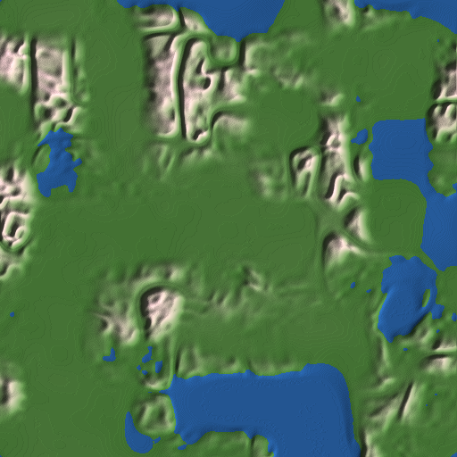
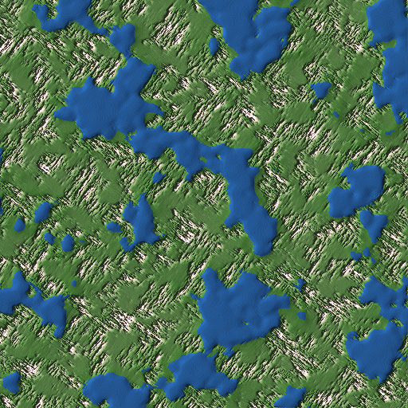
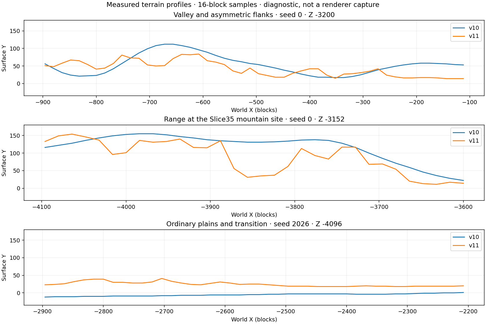

# Slice 36 — Minecraft-style terrain v4 (generator 11)

Baseline: **exact Slice35 `f527b75c21e8c40db4320a40b7630975fe1accb1`**, PR #53.
This slice is stacked on that complete implementation. Old worlds keep their
recorded generator, seed, bounds, nonce, inventory and authoritative edits.
Only newly created worlds select generator11. There is no migration or merging.

**[Actual v10/v11 comparison gallery and public Minecraft visual reference](comparison.md)**.

## Investigation and public references

V10 uses smoothstep-interpolated **value** noise: random scalar lattice values
produce broad lobes with similar rounded shoulders. Taking absolute values of
its ridge/valley fields folds both signs onto the same zero contours. Multiplying
rounded uplift masks by those folded fields repeatedly surrounds low regions
with raised bands. The valley width, ridge shape and regional relief have little
independent control over local slope character. More octaves or warp amplitude
would leave this construction intact. V10's height range alone was not the issue.

Research consulted on 2026-11-12, before choosing the replacement architecture:

- [World generation](https://minecraft.wiki/w/World_generation),
  [density functions](https://minecraft.wiki/w/Density_function),
  [noise router](https://minecraft.wiki/w/Noise_router),
  [terrain features](https://minecraft.wiki/w/Terrain_features).
- [Custom world generation: terrain density relationships](https://minecraft.wiki/w/Tutorial:Custom_world_generation).
- [Mojang's 1.18 Java release description](https://www.minecraft.net/en-us/article/caves---cliffs--part-ii-out-today-java).
- [Mojang developer Q&A and terrain photographs](https://www.minecraft.net/en-us/article/caves---cliffs-update--part-ii-dev-q-a).
- [Henrik Kniberg's terrain-generation presentation](https://www.youtube.com/watch?v=CSa5O6knuwI).

Some direct Wiki requests were robots/restricted; indexed public descriptions
provided the density/spline relationships. The presentation's public page was
reachable but its video/transcript was not available for frame measurements.
No Minecraft executable, matched seed captures or reference measurements were
available in this environment. Public illustrations are qualitative references;
**no pixel-level equivalence, numerical Minecraft comparison or exact parity is
claimed**. No proprietary source, noise tables, datapack constants, libraries,
textures or reference screenshots are copied into this repository.

The relevant architectural lesson is shared geography, not particular constants:
continentalness shapes ocean/inland offsets; erosion changes relief and slope
character; weirdness/peaks-and-valleys organizes highs and lows. Splines combine
these continuously into offset, stretching and jaggedness. A 3D density function
then gives solid/air geometry; surfaces and biome geography use related inputs.
Discrete biome IDs need not select unrelated height generators. Minecraft also
uses folded weirdness; the defect is not that *all* absolute-value functions are
invalid, but v10's particular folded value fields and nearly uniform masks.

## Independent v11 model

`worldgen/terrain_v4.rs` is separate from every frozen historical terrain module.
All generation decisions are integer Q12; signed cell division is Euclidean.

1. Coordinate-hashed gradient vectors, quintic lattice interpolation and seeded
   subcell phases replace v10's scalar value-noise fields. Three octaves each
   form continentalness, erosion and signed weirdness. Rotated coordinates and
   unequal octave wavelengths reduce aligned cell artifacts. No domain warp,
   radial mountain masks or absolute-value ridge/valley contours are used.
2. Shape-preserving cubic Hermite splines use shared harmonic tangents. Continental
   offset, erosion-controlled relief and a signed valley-to-peak profile combine
   before material assignment. Knots have nonzero shared tangents rather than
   flattening every segment boundary into a shelf. Coasts suppress inland relief.
3. Elongated weirdness wavelengths112×448 /48×144 /24×56 and a second,
   perpendicular112×448 family organize narrow linked ranges and saddles. An
   independent896-block structural-grain field blends the two continuously,
   avoiding a world-wide preferred ridge direction. Erosion cuts and varies them; the signed fields produce
   asymmetric flanks instead of a symmetric distance-to-zero ridge. Quiet plains
   reduce72-block rolling detail to one-third of a block, while hills retain more
   relief. Jagged detail is admitted only in appropriate high/low-erosion terrain.
4. Surface density is `offset - y*4096 + amplitude*noise/4096`. Amplitude smoothly
   reaches at most12 blocks in rugged regions and vanishes in quiet lowlands.
   Two independently hashed 3D gradient fields use32×28×32 and12×8×12 scales.
   They interpolate on an absolute4³ lattice shared by adjacent chunk plans.
   Noise is bounded to[-4096,4096] before applying the amplitude.
5. Each horizontal cell keeps a compact occupancy mask, a guaranteed-solid floor
   and its highest solid block. At most26 density cells are evaluated per column
   position, never the full256-block height. A bounded dense memo shares lattice
   vertices across the20² planning grid; it replaces an initial allocating map.
   The final18² profiles use5184 bytes (16 bytes each); temporary density memo is
   under12KiB at the theoretical altitude span. No persistent density cache grows.
6. Smooth asymptotic summit compression aboveY130 avoids a hard clipping plane.
   Offset stays below162; adding the12-block density bound leaves at least18
   blocks below the exclusive192 ceiling. The lower bound preserves foundation
   layers. Existing tree admission also enforces its full crown ceiling margin.

An early rendered candidate still had a broad dome and a circumferential cliff.
It was rejected. Narrower multiscale ranges, a steeper non-saturating peak spline
and smaller/finer 3D displacement replaced it before the final comparison.
A second broad survey exposed a preferred diagonal grain; continuously blended
perpendicular range fields removed that global directional pattern. The final
terrain has sharper alternating ridges, saddles and broken slopes;
it is not simply a taller v10 or a heightmap with cosmetic stone patches.

## Integration and compatibility

The same profile top serves point, column, water, vegetation and height queries.
`Generator::height` retains its established meaning: surface before cave openings
and decoration, after surface hydrology. Profile occupancy additionally decides
solid/air below that top. Stone-slab shortcuts use the guaranteed density floor,
not only `height-4`, so they cannot accidentally fill surface recesses.

Existing v8 ponds/rivers and closed cave pools remain, with v10's candidate-wide
admission/bank precision. V11 screens complete lowland candidates against its
conservative offset+amplitude envelope. Sea level is still source-cellY2.
Wet beds remain solid before cave composition; the existing four-block wet-bank
cap also overrides density recesses, avoiding new shoreline leaks. This is
compatibility integration, not watershed hydrology. Small inherited pond outlines
remain elliptical; they do not construct v11's mountain or valley geography.

V7 cave primitives, foundations and pool discovery are unchanged. Elevated rock
can bury old cave entrances. Ground materials use final height/slope and existing
climate: steep rock, altitude-cooled snow, grass/dirt and coastal/desert sand.
The five biome IDs/climate map stay fixed. They do **not** yet fully track the new
continental/erosion geography; a biome overhaul remains deferred. Supported v9
Oak/Birch/Spruce and plants use actual final roots and crown footprints. All three
mesh surfaces, lighting/AO, single-worker streaming, cancellation, cache budgets,
render radii1–4, floating origin and save envelopes remain intact.

Y[-64,192) gives190 blocks above the sea datum, enough for this slice's ordinary
ranges with building headroom. It gives much less ocean-to-foundation depth than
modern Minecraft. A future sea-level/height revision must be a **new generator
and explicit world identity/bounds contract**, with save-budget, fluid, lighting
and streaming measurements. Never reinterpret existing manifests or lift the
current sea level under old worlds.

## Reproducing geography and visual comparisons

```sh
cargo run --release --locked -p voxel_core --example terrain_quality -- --generator=11 --step=16 > work/quality11.csv
cargo run --release --locked -p voxel_core --example terrain_quality -- --generator=10 --step=16 > work/quality10.csv
cargo run --release --locked -p voxel_core --example terrain_quality -- --generator=11 --step=64 --final > work/quality11-final.csv
python3 tools/analyze_terrain_v4.py work/quality11.csv --version 11 --output work/diagnostics
python3 tools/analyze_terrain_v4.py work/quality10.csv --version 10 --output work/diagnostics
python3 tools/terrain_v4_reference.py --check
cargo build --locked -p rustcraft --example terrain_gallery
python3 tools/capture_terrain_v4.py --output work/captures36
```

Use a working native desktop/adapter for captures. Cloud images use Xvfb and Mesa
llvmpipe Vulkan; these are real Bevy renders of production meshes/materials/light,
not generated illustrations. Supported-radius gallery views reproduce ground-eye
poses and normal fog; they are read-only fixtures, not interactive play recordings.
Development panoramas explicitly use gallery-only radius10 and fog160–320. No game
render-distance setting or limit changes. FOV78°,1280×720, day6000. Exact commands,
seed/coordinates, absolute eye/direction and image SHA256 are in the capture manifest.

The same coordinates are rendered for each version. Ground camera yaw is
selected reproducibly toward an open view using the independent height reference,
so close stone walls do not obscure the landscape; yaw can differ by version. Their geography,
height, water and resulting ground-eyeY can differ substantially: a v11 plain
can be submerged in v10. Do not misread such a pair as a matched biome or camera
height experiment. Panoramas use the same explicit absolute pose for both.
Compare the terrain categories as well as these coordinate-matched examples.
Public Minecraft reference images remain external and are not redistributed.

## Survey definitions and limits

Each version samples seeds0/42/2026/u64::MAX over8192² centered on zero and2048²
windows at(-24000,20000) and(28000,-30000):1,179,648 raw16-grid observations.
Final hydrology surveys use64 spacing and73,728 observations. Every point also
samples actual cardinal one-block slopes and16-block neighbor heights.

Elevation/slope quantiles, height differences at16/64/256/1024 blocks and X-axis
height autocorrelation are descriptive measurements. Flat32 means nine samples
on a32² square span at most one block, conditional on land atY≥4. It is stricter
than normal buildability and is not a cave-foundation proof. Mountain masks use
Y≥70; four-connected components provide sampled widths/depths/isolated components.
Zhang-Suen mask skeletons provide ridge-length, branch-pixel and orientation
proxies, not surveyed geological crest lines. Their resolution is16 blocks.
A valley compares a point with opposite shoulders256 blocks away, reporting
relief across512 blocks, not claiming a watershed or a constant valley width.

Two radial tests count candidate extrema with similar heights around several
rings. Quantized plateaus and narrow ridge lines bias these detectors; zero is
not proof of no rings, and more candidates can mean more local peaks. The broad
64/128/256-ring detector and relief images supplement direct visual review.
Neither metric is a trained perceptual circular-feature classifier. The before/
after renders, including the rejected early candidate, inform the visual verdict.

## Performance reproduction

```sh
python3 tools/benchmark_terrain_v4.py --build-only --output work/s36-core
python3 tools/benchmark_terrain_v4.py --reuse --output work/s36-core --samples 128 --warmups 8
python3 tools/benchmark_terrain_v4.py --reuse --reverse --output work/s36-core-reverse --samples 128 --warmups 8
python3 tools/benchmark_streaming.py --baseline f527b75c21e8c40db4320a40b7630975fe1accb1 --labels slice35 slice36 --terrain-v4 --distance-expansion --rendering-install --build-only --output work/s36-stream
python3 tools/benchmark_streaming.py --baseline f527b75c21e8c40db4320a40b7630975fe1accb1 --labels slice35 slice36 --terrain-v4 --distance-expansion --rendering-install --reuse --repeats 2 --frames 60 --output work/s36-stream
```

Build both exports first; run timings with no concurrent builds/tests/renderers.
The reverse run reuses the same binaries/manifests (copy the build output directory
before changing order). Disposable instrumentation stays in work/. Source and
executable hashes, raw observations and P50/P95/P99/**max** are retained.
`density_plan_us` times the complete v11 initial terrain/profile/material stage;
it is not a pure isolated noise microbenchmark. Column planning includes all
remaining admission/root work. Raw generation has separate allocation-call,
requested-byte and peak-live-heap counters, including density planning. WorkerCPU/wall, raw column generation, lighting,
meshing, allocations, requested heap, compact slabs, caches and install costs are
separate. CPU Bevy publication/update/visibility is not GPU submission or FPS.
The current build also runs v10 and checks block/light/full-geometry signatures
against the exact baseline at every matched benchmark location.

No Core i3-13100, RX9060 XT, physical GPU, 1080p/240Hz or native FPS claim is made.

## Native acceptance: Gentoo / Void / Windows

Use an isolated **new** directory, keep its printed absolute path for reload, and
keep closed-directory copies of old saves for compatibility checks. Existing
worlds will deliberately keep their recorded generator. For Void/Fish:

```fish
git fetch origin
git switch feat/slice-36-minecraft-style-terrain
git pull --ff-only
set test_dir (mktemp -d /tmp/rustcraft-slice36.XXXXXX)
echo $test_dir
env RUSTCRAFT_DATA_DIR="$test_dir" RUSTCRAFT_WORLD_SEED=42 RUSTCRAFT_LOAD_RADIUS=4 cargo run --release --locked -p rustcraft
# Same path after normal close: saved world, Air edits and inventory must reload.
env RUSTCRAFT_DATA_DIR="$test_dir" RUSTCRAFT_LOAD_RADIUS=4 cargo run --release --locked -p rustcraft
```

Gentoo Bash/Zsh: use `test_dir=$(mktemp -d /tmp/rustcraft-slice36.XXXXXX)` and the
same `env` invocations. Use the platform's normal X11/Wayland and Mesa/driver setup.
Windows10/11 PowerShell (native MSVC tools and supported graphics driver):

```powershell
$env:RUSTCRAFT_DATA_DIR = Join-Path $env:TEMP ("rustcraft-slice36-" + [guid]::NewGuid())
$env:RUSTCRAFT_WORLD_SEED = "42"
$env:RUSTCRAFT_LOAD_RADIUS = "4"
cargo run --release --locked -p rustcraft
# Restart with the same environment/path after normal close.
```

Create several named worlds with the four survey seeds; inspect plains, forest,
foothills, ranges, coast and valley sites from the capture manifest. Compare v10
in a copied historical world or read-only gallery, not by changing a manifest.
Walk/sprint/jump along cliffs and chunk seams, enter caves and water, mine/build
across signed region boundaries, remove vegetation, place torches/buckets and
explicit Air, save/restart, evict/return, switch A→B→A and close during streaming.
Test radii2/3/4, rapid exploration, fog/F3, X11/Wayland capture/focus and Windows
resize/close. Record GPU/backend, RAM, frame tails and the intended1080p mode.
Native GUI, physical Radeon and owner visual acceptance remain manual gates;
Linux/Windows CI is compilation/headless validation, not those measurements.

## Measured geography

Raw16-block survey, identical windows and elevation scale. Quantiles are Y values.

| Seed | v10 P50/P95/P99/max | v11 P50/P95/P99/max | v11 area Y≥70 | v11 land32 span≤1 /≤2 /≤4 |
| --- | --- | --- | ---: | --- |
| 0 | 10/85/124/155 | 21/83/131/160 | 7.75% | 5.50% / 12.13% / 21.73% |
| 42 | 10/97/129/151 | 21/85/131/159 | 8.05% | 5.10% / 11.94% / 21.93% |
| 2026 | 8/67/110/151 | 21/81/127/158 | 7.22% | 6.06% / 13.03% / 22.88% |
| 18446744073709551615 | 7/76/123/154 | 20/78/125/158 | 6.55% | 5.11% / 11.73% / 21.68% |

V11's largest Y≥70 sampled components span416–1008 blocks along their longest
bounding dimension, with280–548 samples, compared with2534–4418 broad v10 samples.
The narrower ranges have less contiguous high plateau area, with connected
foothills and intervening saddles. This threshold is not a claim that every crest
remains above70. Sampled512-block valleys reach120–129 blocks of shoulder relief.

The ridge skeleton orientation counts (E/SE/S/SW) are2520/1871/2593/2127 for
seed0; the rejected one-direction model was2216/804/3129/3466. Other final seeds
have similarly distributed counts. Skeleton length grows from23–43km to146–181km
over these large windows, reflecting narrow branching features rather than a
claim of real drainage/ridge surveying. Full branches, isolated components,
multi-scale differences, slopes and correlations are in the JSON reports.

The broad radial detector reports31–45 v11 candidates among758–838 broad extrema,
versus0–3 among312–399 in v10. **This proxy does not numerically establish ring
elimination.** V10's flat centers and large contour walls often escape a64–256
block local-maximum test; v11 has more distinct rounded peaks as well as narrow
ridges. The actual matched panorama is the stronger evidence of the removed
large ring pattern. Naturally rounded hills remain intentional. No zero-circle
or worldwide visual guarantee is claimed.

Final hydrology64-grid maxima are154–156 for v11; raw16-grid maxima are158–160.
Final one-block slope P95 is2–3, P99 is5–6, and max is13–16 versus v10 P95/P99=1
and max4. These genuine steep steps include 3D cliff edges; v11 intentionally
does not smooth every slope into a uniform ramp. Their collision/water/point/mesh
composition is covered by the integration regressions.

[Raw measured datasets and hashes](raw/survey-files.json),
[v10 analysis](diagnostics/quality-v10.json), [v11 analysis](diagnostics/quality-v11.json).
All compressed CSVs use deterministic gzip metadata and can be independently
recreated with the commands above.

Diagnostic maps use the same fixed altitude and relief color scale:

| v10, seed0, central8192² | v11, same region/seed |
| --- | --- |
|  |  |



The profile plot uses optional development-only Matplotlib:
`python3 tools/plot_terrain_v4.py work/quality10.csv work/quality11.csv --output work/terrain-profiles.png`.

## Validation

Rust1.99.1 / Bevy0.20.0 / edition2024; lockfile, dependencies and original texture
artifacts are unchanged. Required formatting, locked workspace/all-target Clippy,
asset verification and normal release builds pass. **562 workspace tests pass**
(220 client,328 core unit,14 integration; seven existing optional tests ignored).
The optimized core suite also passes; optimized client streaming46 and session12
tests pass separately. The complete debug run and the CI workspace job use `--test-threads=1` to avoid
wall-clock lifecycle deadlines competing with each other in the two-vCPU cloud
quota. An earlier concurrent run timed out in the radius4 lifecycle test while
compilers and software renderers were also active; its isolated rerun and the
complete serial run pass. No production timeout, worker limit or test deadline
was enlarged to hide this result.

The64 independent Python fixtures pin continentalness, erosion, weirdness, offset,
amplitude, surface top, guaranteed floor and every density occupancy bit. The36
full-column CRCs freeze final Rust v11 block output (they are not independently
derived Python block fixtures). V1–v10 historical goldens remain intact. Full
density-band point/raster checks prevent the old height-minus-four slab shortcut
from masking recessed geometry. The audit exercises foundations, materials,
plants/trees, water quietness, caves, signed/distant/world edges, reverse order,
halos and parallel generation. Existing journal interruption, explicit Air,
builds/inventory, cancellation/eviction, session A→B→A and shutdown checks include
v11 as appropriate.
