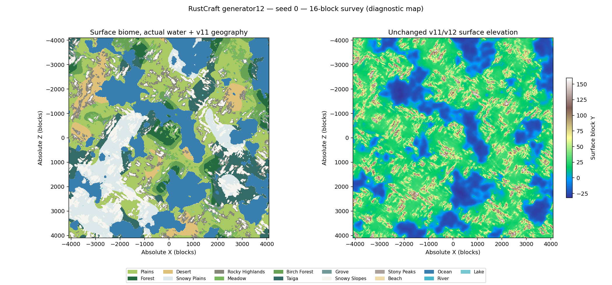
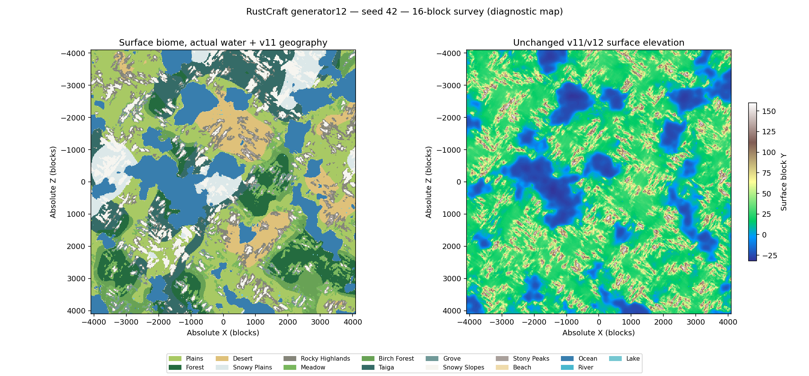
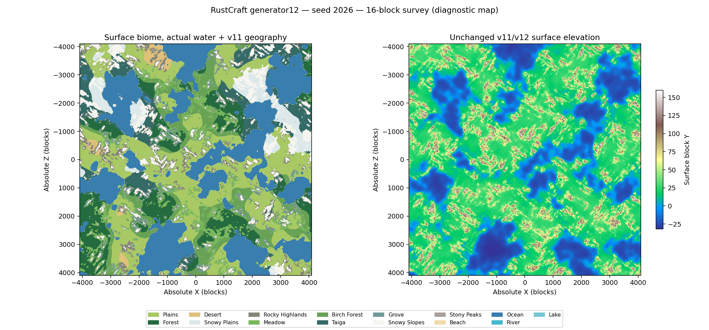
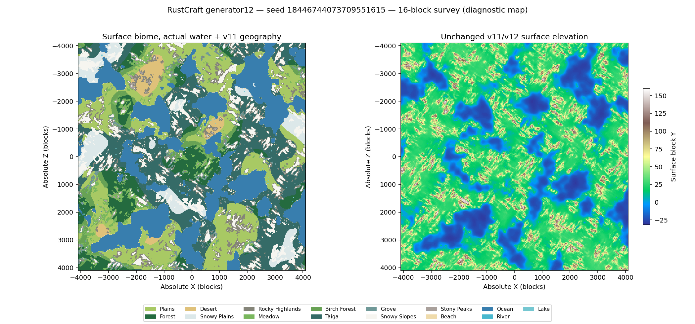

# Slice37 — geographical and ecosystem survey

The actual generator was sampled at1,179,648 locations: four seeds, an8192²-block
central square and two2048² distant squares per seed. Step16 gives a
301,989,888-block² center-sample area estimate. Regions include negative positions
and origins(-24000,20000)/(28000,-30000). No equal-frequency target was used.

[Lossless per-seed source CSVs and SHA256](raw/survey-provenance.json),
[all region statistics](maps/regions.csv), [frequencies/altitudes/slopes](maps/frequency.csv),
[every component with edge flags](maps/components.csv.gz), and
[all adjacent families](maps/adjacency.csv) retain adverse results.
Four-neighbor components are estimates on a16-block center lattice. Boundary
length is a grid-edge estimate. Edge-touching component areas are lower bounds.
A one-sample island is a one-chunk center-sample proxy, not proof that every block
of a chunk has that biome.

## Central area frequency

Percent of each seed's central area; MAX means u64::MAX. All15 identities occur
across the survey; rare Rivers reflect existing v11 hydrology rather than adding
water for labels. A lack of one biome in a particular region is retained.

| Biome |0 %|42 %|2026 %|MAX %|Pooled %|
| --- | ---: | ---: | ---: | ---: | ---: |
|Plains|22.942|23.128|23.005|18.756|21.958|
|Forest|3.544|8.263|10.256|8.129|7.548|
|Desert|4.264|6.926|1.028|1.973|3.548|
|Snowy Plains|9.603|4.731|4.019|4.600|5.738|
|Rocky Highlands|6.686|7.904|4.419|6.094|6.276|
|Meadow|3.524|5.144|6.403|3.187|4.565|
|Birch Forest|3.896|4.971|7.751|2.839|4.864|
|Taiga|8.345|9.085|6.580|19.172|10.795|
|Grove|1.343|1.873|2.314|2.094|1.906|
|Snowy Slopes|10.432|8.149|7.256|8.665|8.625|
|Stony Peaks|0.467|1.060|0.471|0.393|0.598|
|Beach|0.636|0.530|0.608|0.644|0.605|
|Ocean|24.214|18.151|25.829|23.361|22.889|
|River|0.019|0.005|0.005|0.007|0.009|
|Lake|0.085|0.079|0.056|0.085|0.076|

## Connected regions, elevation and fragmentation

The area-weighted median describes the component containing a typical sampled
location. The ordinary component median is often small because sparse shore and
altitude islands count equally with a whole continent. Both statistics, plus P95,
maximum and censored edge components, remain in the CSV rather than concealing
fragmentation. Ranges below span the four central seeds and use block² for area.

| Biome | Typical visited component area, min–max | Component median area, min–max | Median surface Y, min–max | Median slope, min–max |
| --- | ---: | ---: | ---: | ---: |
|Plains|1,333,504–1,761,792|512–512|21–22|0–1|
|Forest|225,792–849,408|256–3,072|21–21|0–0|
|Desert|419,072–1,228,544|512–1,280|19–22|0–0|
|Snowy Plains|459,264–1,726,720|512–768|20–22|0–1|
|Rocky Highlands|4,096–16,384|256–256|49–53|1–1|
|Meadow|18,432–61,696|256–256|48–50|1–1|
|Birch Forest|96,768–276,736|768–2,048|19–22|0–1|
|Taiga|379,904–3,147,008|512–1,024|20–22|0–1|
|Grove|2,048–2,816|256–256|45–52|1–1|
|Snowy Slopes|33,792–53,504|768–1,280|73–82|2–2|
|Stony Peaks|768–2,304|256–256|92–104|2–2|
|Beach|256–256|256–256|3–3|1–1|
|Ocean|1,096,448–3,569,920|512–768|-17–-16|0–0|
|River|256–512|256–256|-2–-2|1–2|
|Lake|512–1,280|256–512|-1–-1|1–1|

| Seed/region | Boundary per1024 block² | Interior one-sample islands | Island fraction of samples |
| --- | ---: | ---: | ---: |
|0/central|17.59|4,837|1.85%|
|0/distant-west|16.99|189|1.15%|
|0/distant-east|17.09|211|1.29%|
|42/central|19.08|5,159|1.97%|
|42/distant-west|14.52|289|1.76%|
|42/distant-east|18.89|320|1.95%|
|2026/central|17.51|5,084|1.94%|
|2026/distant-west|20.92|343|2.09%|
|2026/distant-east|21.13|367|2.24%|
|18446744073709551615/central|17.94|5,120|1.95%|
|18446744073709551615/distant-west|21.55|348|2.12%|
|18446744073709551615/distant-east|11.39|177|1.08%|

Initial ecology used the full density-displaced top. The final32-block elevation
proxy reduces central one-sample islands from6450/7119/6890/6935 to
4837/5159/5084/5120 (seeds0/42/2026/MAX), about25–28%. Boundary length decreases
about11%. [Before tuning](raw/fragmentation-before.csv) is retained. Small alpine
ledge and shoreline components remain; this is an explicit limitation, not a
claim that fragmentation is solved everywhere.

The sampled adjacency graph has zero Desert–Snowy Plains and Desert–Snowy Slopes
edges. Desert transitions through Plains or exposed warm highlands. Grove/Meadow
adjoin lower woodland and upper snow/rock. Shortcuts across several altitude
bands can occur on cliffs or between16-block sample centers. Snow and treeline
are parameter-based ecological bands, not a global fixed Y. Full-cell tests check
crown clearance, rooted support and material/slope rules separately.

## Actual ecosystem patches

Sixteen fixed49-column patches cover200,704 actual surface cells. Counts below
are restricted to the named biome inside each patch, not the entire scene.
[All cells/species/plant counts](ecosystems.csv) retain neighboring biomes,
including the sparse steep Grove. No invalid roots or supported plants were found.

| Scene/biome | Actual biome cells | Oak/Birch/Spruce roots | Grass/Ferns | Red/Yellow flowers | Dead Bush |
| --- | ---: | --- | --- | --- | ---: |
|plains|12544|8/0/0|899/53|6/46|0|
|forest|12544|94/23/0|1063/734|31/68|0|
|desert|12544|0/0/0|0/0|0/0|105|
|snowy-plains|11616|0/0/4|0/36|0/0|0|
|rocky-highlands|10660|0/0/0|0/0|0/0|0|
|meadow|11878|0/2/0|1008/37|117/450|0|
|birch-forest|12432|5/36/0|758/204|47/37|0|
|taiga|12461|0/0/64|293/1516|19/3|0|
|grove-steep|3638|0/0/4|17/183|0/0|0|
|grove|5829|0/0/34|58/710|2/0|0|
|snowy-slopes|12299|0/0/0|0/0|0/0|0|
|stony-peaks|6196|0/0/0|0/0|0/0|0|
|beach|902|0/0/0|0/0|0/0|0|
|ocean|12544|0/0/0|0/0|0/0|0|
|river|785|0/0/0|0/0|0/0|0|
|lake|2400|0/0/0|0/0|0/0|0|

Forest is Oak-dominated (94/23); Birch Forest is Birch-dominated (5/36); Taiga and
both Groves have exclusively Spruce among roots in their classified cells.
Meadow has567 flowers in11878 cells versus52 in12544 Plains cells. Steep Grove
has only4 trees, while the gentler Grove has34; physical crown/support clearance
properly limits steep faces. Snowy Slopes, Stony Peaks, Beach and wet biomes have
no rooted trees in these samples. Existing planted vegetation behavior uses the
unchanged simulation paths.

Marine/river/lake classification uses actual water depth/body. Tests additionally
compare actual basin/channel/coast samples, sea-level Water Source cells, dry
shore constraints and optimized marine probes against full hydrology at signed,
distant and world-edge positions. The survey does not infer a hydrological
precision percentage from labels generated by the same classifier.

## Measured snowline, treeline and material consistency

[Consistency counters](ecology-consistency.json) cover1,179,648 sampled surfaces:
104,116 Snowy Slopes samples have no ecological-snowline violations; all75,633
non-steep Snowy Slopes samples have Snowy Ground. All6,800 Stony Peaks samples
use Stone. No sampled cliff has Grass and no highland has Sand.

The full-resolution200,704-cell ecosystem survey finds4 tree roots inside the
continuous treeline fade and none at/above its upper limit. It finds no invalid
roots/plants, steep Grass, highland Sand or mismatch between a wet biome label
and an actual sea-level Water Source voxel. These checks measure the specified
rules; they do not replace visual assessment or claim exhaustive world coverage.
Reproduce with `python tools/check_biome_v2.py SURVEY.csv ECOSYSTEMS.csv OUTPUT.json`.

## Diagnostic biome/elevation maps

These maps are not rendered landscapes. Compare them with the
[actual Bevy gallery](comparison.md) to distinguish broad climate geography from
local ledge materials. All four central seeds and distant-region statistics are
retained; no single seed is presented as representative of every world.

### Seed 0

### Seed 42

### Seed 2026

### Seed 18446744073709551615

