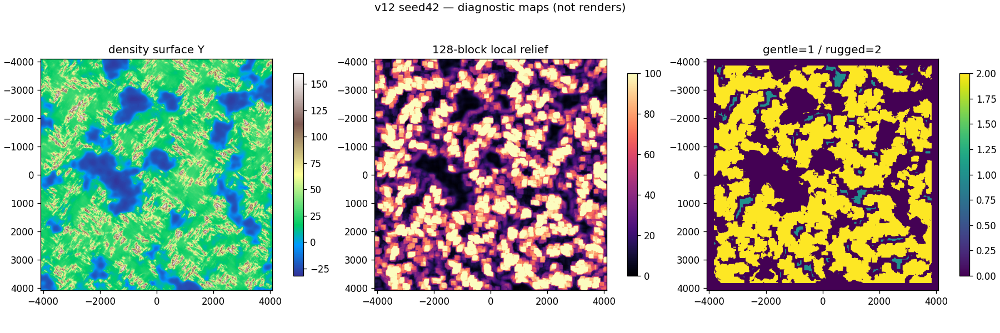
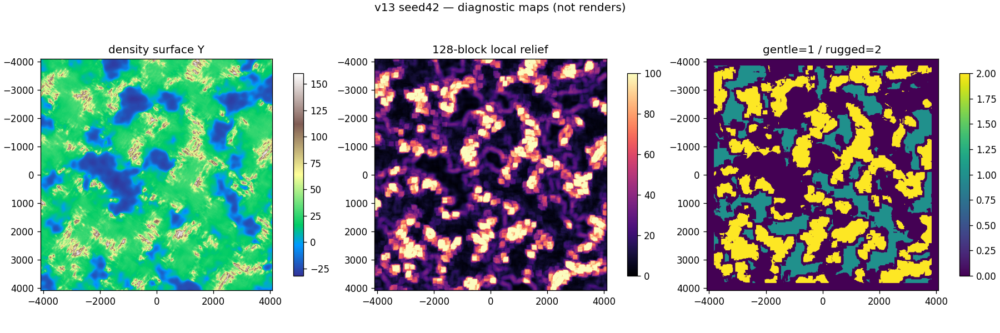
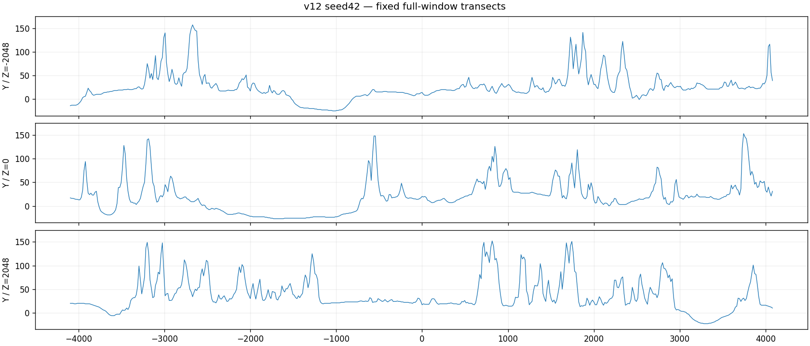
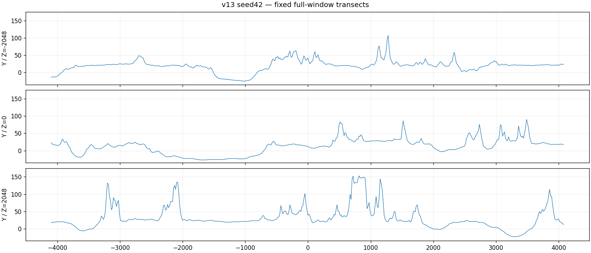

# Slice 38 — terrain balance (generator13)

Base: merged Slice37 `cec8f593d20c012725ed17308bb9c7d44b470e08`.

## Investigation before changing terrain

The unchanged v12 `terrain_v4.rs` maps erosion -900 to 105 blocks of relief,
-100 to 54, and 650 to 12. The signed gradient field is concentrated near zero:
the independent four-seed 8192² survey at spacing64 finds 49–51% negative erosion
and 70–71% below650. Thus strong relief is not restricted to exceptional regions.
At weirdness zero the peak spline already returns approximately27% of that relief;
at450 it returns40%, at1300 75%. The short24/48/56-block ridge octaves modulate
this substantial height budget even in ordinary inland terrain. Inland admission
is complete at continentalness -250, so it does not restrict mountains to deep
continental interiors. Rolling noise is at most3⅓ blocks; it is not the main cause.

The density displacement is admitted by erosion-derived relief alone, independently
of peak/valley position: up to12 blocks, even on low parts of a rugged region.
[Independent field observations](v12-fields.json) show30–35% of central samples
have a displacement envelope exceeding6 blocks. This can sharpen narrow valleys
and foothills on top of the ridge height gradient. Summit compression above130
only affects0.8–1.2% of these samples and cannot cure ordinary slopes. The principal
causes are broad erosion admission and ridge contrast, with density a local
amplifier; continental datum and rolling variation are secondary.

This diagnosis was recorded before v13 implementation. The original terrain
arithmetic, v12 climate fixtures and separately captured full-column v1–v12 CRCs
provide the compatibility baseline. Measurements are RustCraft observations,
not Minecraft target percentages.

## Public reference and limits

Consulted2026-11-13: [World generation](https://minecraft.wiki/w/World_generation),
[Density function](https://minecraft.wiki/w/Density_function),
[Noise router](https://minecraft.wiki/w/Noise_router),
[Terrain features](https://minecraft.wiki/w/Terrain_features), and
[Mojang's Java1.18 release](https://www.minecraft.net/en-us/article/caves---cliffs--part-ii-out-today-java).
Wiki direct access is restricted; public indexed descriptions explain C/E/PV
spline interactions. Erosion distinguishes gentle and rugged terrain; continentalness
organizes ocean/interior elevation; peaks/valleys shape terrain within that regional
context. Mojang's release photographs show both dramatic peaks and broad wooded
approaches/meadows. These are qualitative references for normal Overworld,
not Amplified. No reliable executable Minecraft world dataset is available in
this environment; exact Minecraft relief distributions are unavailable. No
proprietary code, data tables, constants, artwork or assets are copied.

## Selected mapping and controls

V13 keeps continentalness/datum, anisotropic ridge octaves, slowly rotating grain,
72-block rolling noise and asymptotic summit compression. It changes erosion
wavelengths512/224/96→768/320/128 and weights4:2:1→5:2:1. The original Hermite
interpolation remains. Relief knots are now (-4096,138),(-2400,128),(-1600,108),
(-1000,58),(-400,18),(200,7),(900,3),(4096,2). Strong relief requires the low-erosion
tail; broad intermediate bands supply hills and foothills. Weirdness peak-percent
knots are (-4096,12),(-2300,14),(-1300,20),(-450,29),(450,49),(1300,82),
(2300,124),(4096,180): basin floors rise while the upper silhouette survives.

Density amplitude is `inland * smooth(-erosion,600,1900) *
smooth(weirdness,-900,1100) * 12 blocks`. Detail jaggedness uses that low-erosion
weight and the existing positive-weirdness ramp. The full26-cell band, sparse
absolute4³ density lattice and original high ridges remain. Ordinary basins do
not inherit upper-slope density. No radial mask, rings, biome-driven height,
renderer rewrite or runtime tuning switch is introduced.

[Independent controls](alternatives.json) compare v12, a65% global-relief control,
v13 with original short erosion scales, and selected v13 on4096 points/seed.
For seed42, global relief scaling lowers offset P99 from132.0 to93.1, yet leaves
35.2% of samples with a >6-block density envelope. It sacrifices summits without
addressing the independent slope deformation. Selected v13 keeps offset P99 at
122.9 with only4.7% >6 density envelopes. Short-region v13 has6.89-block median
128-step differences versus6.02 for broader regions; the latter retains more
coherent ordinary land. These offset-only controls are not rendered-world
measurements, target quotas or substitutes for the final full-density survey.

## Survey method and classifications

`terrain_balance_survey` samples seeds0/42/2026/u64::MAX, central8192² and two
2048² distant signed windows at(-24000,20000) and(28000,-30000). Spacing16 gives
1,179,648 samples/version across301,989,888 blocks². One-block slope is the largest
actual cardinal height difference. Maps use identical fixed color scales. Heights
include sparse surface density; a separate73,728-point/version `--final --step=64`
survey includes hydrology-adjusted beds and the fifteen-biome classifier.
Here “final” means the planned surface after hydrology, before cave openings and
decoration; full-height block audits separately verify those intersections/support.

Centered square local relief is max−min, with inclusive endpoints at16/32/64/128/
256/512-block spans. Height-difference distributions measure both cardinal axes
at the same distances. Land context excludes Y≤2 water/ocean samples and a256-block
outer rim. **Gentle** means128-span relief≤12,256-span≤24 and slope≤1. **Rugged**
means128-span≥40 or both256-span≥64 and64-span≥20. Other contextual land is hills.
These are transparent descriptive RustCraft classes, not Minecraft targets;
elevation alone never defines a class. Four-neighbor components measure connected
sample areas, not exact traversable polygons. Rugged masks include surrounding
approaches, so they overstate the area occupied by actual peak faces.

Valleys use opposing shoulders within128 blocks along fixed cardinal transects,
sampled every fourth grid row, minima at least12 blocks deep, and width at half
depth. Narrow/deep means depth≥24 and half-depth width≤48. Plateaus can produce
multiple minima; off-axis valleys and features narrower than16 blocks can be
missed. Counts compare identical stencils, not unique watershed populations.
NumPy percentiles interpolate; benchmark percentiles use the documented floor
rank. Every raw unfavorable maximum remains in the retained summaries.

[Raw-density geographical summaries and maps](diagnostics/geography-v13.json),
[unchanged v12 comparison](diagnostics/geography-v12.json), and
[final-bed/biome survey](final-survey/geography-v13.json) are reproducible with:

```sh
cargo run --release --locked -p voxel_core --example terrain_balance_survey -- --generator=12 > work/raw12.csv
cargo run --release --locked -p voxel_core --example terrain_balance_survey -- --generator=13 > work/raw13.csv
python tools/analyze_terrain_balance.py work/raw12.csv --generator 12 --output work/maps
python tools/analyze_terrain_balance.py work/raw13.csv --generator 13 --output work/maps
# Repeat each survey with --final --step=64 and analyzer --step 64.
python tools/evaluate_terrain_balance_alternatives.py --output work/alternatives.json
```

Central results (fractions of contextual land):

| Seed | Gentle v12→v13 | Hills v12→v13 | Rugged v12→v13 | Cliff slope≥3 v12→v13 | Narrow/deep minima v12→v13 |
| --- | --- | --- | --- | --- | --- |
|0|2.21%→24.21%|26.34%→39.21%|71.45%→36.58%|7.38%→2.07%|523→129|
|42|2.78%→24.11%|26.35%→37.47%|70.87%→38.42%|7.53%→2.26%|639→156|
|2026|2.91%→22.14%|28.44%→38.78%|68.65%→39.08%|6.83%→2.37%|488→153|
|u64::MAX|2.66%→23.22%|27.87%→39.98%|69.47%→36.80%|6.37%→2.07%|452→165|

Median128-span local relief falls59–65→22–24 blocks; median valley half-depth
width rises96→112. Largest gentle components grow0.067–0.195→1.53–2.28 million
blocks². Largest rugged components shrink10.998–17.070→1.368–3.037 million blocks².
Maximum sampled central summits stay158–160→159–161. This changes regional
frequency/connectivity without turning surviving ranges into small hills.
Distant windows retain less favorable cases: seedu64::MAX's east window still
has52.79% rugged contextual land and5.16% slope≥3. No per-window quota hides this.






## Integration and compatibility

Historical v1–v12 full-column/biome CRCs were captured from the exact base before
editing generator code (256 cases, all four seeds, signed/distant/edge columns).
The independent historical v10 height, v11 full density bits and v12 climate
fixtures remain. V13 adds68 independent Q12 fields/occupancy fixtures, shared
profile/point parity, signed halo/reverse/parallel comparisons, all fifteen actual
ecosystems, supported gravity-stable spawn, watertight sources and full-height
root/crown/plant/cave audits. Existing saved-Air/construction/journal/regeneration,
stream cancellation and world-switch/shutdown tests are extended to13.

V13 consistently supplies its final terrain to inherited hydrology admission,
coast proximity proofs, ecological elevation interpolation and root support.
Temperature/humidity, biome intervals, snowline/treeline formulas, vegetation
species/crowns and support rules are unchanged. All fifteen biomes occur in the
final survey, including Grove, Snowy Slopes and Stony Peaks. More lowland land
naturally changes their proportions. Cave geometry and the source-water solver
are not redesigned. Known inherited water limitations (flat sea-level channels,
sparse candidate screening and small basins) remain.

The continuity check deliberately distinguishes quiet land from exceptional
cliffs. Independent Python and Rust both show seed0(-960,2688) has a6.113-block
geographical step on a high rugged face; it is not a lattice/chunk discontinuity.
Quiet nonnegative-erosion offsets are bounded more tightly in the survey regression;
full rugged slopes retain the original sharp-ridge character. The stochastic
field is spatially continuous, while discrete block steps and occasional cliffs
are intentional.

## Evidence index

- [36 genuine matched Bevy captures and visual review](comparison.md).
- [Matched CPU, memory, streaming and adverse observations](performance.md).
- [Final-bed biome counts for all fifteen IDs](biomes.md).
- [Local checks, deterministic fixtures and platform status](validation.md).

Native GPU/Windows GUI acceptance remains separate.

## Native Gentoo/Void Linux and Windows acceptance

Cloud checks use Debian userland and Mesa software Vulkan, not the owner's native
GPU. CI provides Linux/Windows compilation and identical deterministic fixtures;
it does not establish graphical, input, compositor or native FPS acceptance.
Keep owner acceptance unchecked until actual results are supplied.

Use fresh separate data directories for base `cec8f59` and this branch; never copy
v13 worlds into an older client. Create each world from the menu with the same
numeric seed. Existing worlds remain their saved version even after an upgrade.
The normal client render-radius range stays1–4 (default2). Set FOV78, fixed window
size, matching VSync/time and the same route in both clients.

Gentoo uses the existing Bevy system prerequisites in `docs/PLATFORMS.md`;
Void glibc uses the listed `xbps-install` development/graphics packages. In Fish:

```fish
set -lx RUSTCRAFT_DATA_DIR (mktemp -d /tmp/rustcraft-s38-native.XXXXXX)
set -lx RUSTCRAFT_LOAD_RADIUS 4
set -lx RUSTCRAFT_START_CHUNK '-224,-244'
cargo run --release --locked -p rustcraft
```

Create seed0 and compare the broad-plains site at X/Z(-3584,-3904), the former70-block ridge now nearY21 at(-2032,-3872), Forest at
(1984,-3904), uplands at(-3008,-640) and coast at(-2688,-2304). Also try seed42
at(-768,-640) and(-992,-3488), seed2026 at(-1536,-3904) and distant(-23296,20896),
and u64::MAX signed/distant exploration. `RUSTCRAFT_START_CHUNK` takes block X/Z
**divided by16**; restart with the desired column using a disposable world.
Walk several hundred blocks; inspect approaches, basins, snowy/rocky summits and
ordinary terrain from multiple directions, not only attractive peaks.

On Windows10/11 x86-64 with MSVC tools/SDK and the pinned rustup toolchain:

```powershell
$env:RUSTCRAFT_DATA_DIR = Join-Path $env:TEMP ('RustCraft-S38-' + [guid]::NewGuid())
$env:RUSTCRAFT_LOAD_RADIUS = '4'
$env:RUSTCRAFT_START_CHUNK = '-224,-244'
cargo run --release --locked -p rustcraft
```

Record OS, GPU, driver/backend, FOV, radius, seed, route and window size. Repeat
Linux X11 and native Wayland; on Windows use supported D3D12/Vulkan as available.
Check mouse capture/release, alt-tab, resize/DPI, movement/collision, root/crown
support and natural sources. Mine an explicit Air opening, build over a signed
chunk/region seam, save, travel far enough to evict, return, restart, switch worlds
and close normally; edits and saved generator identities must remain unchanged.
At radii2/3/4 retain frame/update and streaming P50/P95/P99/max, process memory,
mesh resources and unfavorable observations after convergence. Do not infer these
native frame/GPU results from the cloud CPU benchmarks or software screenshots.
