# Genuine Bevy v12/v13 comparison

All36 images are actual1280×720 RustCraft Bevy0.20 captures of generated blocks,
original materials/atlas, normal lighting/AO and vegetation. No concept art,
reference-game assets, terrain proxies or image-generation tool is involved.
Lossless PPM→PNG conversion preserves rendered RGB pixels.

The same seeds/requested coordinates and shared yaw are used in each ground pair;
the safe grounded eye follows each actual surface. Panorama eye/direction are
identical between versions. Full poses, commands, renderer identity and SHA256
fingerprints for every image/executable are retained in [captures.json](captures/captures.json).
The first range panorama pair uses the debug gallery; all other pairs use the
optimized gallery with the same production terrain/material code.

Captured on X11/Xvfb with Mesa25.0.7 llvmpipe (LLVM19.1.7), software Vulkan.
These images establish actual rendering, not native FPS/GPU/VRAM acceptance.

## Ordinary gameplay-distance views

**Radius4, production fog,78° vertical FOV**, static shared gallery lighting.
Names identify surveyed sites; v13 may turn a formerly mountainous site into
ordinary woodland/lowlands. No runtime radius or fog setting is changed.

| Site | Seed | Requested X/Z | Planned surface Y v12→v13 | Actual pair |
| --- | --- | --- | --- | --- |
|broad-plains|0|-3584/-3904|18→19|[v12](captures/broad-plains-v12.png) / [v13](captures/broad-plains-v13.png)|
|rolling-hills|42|-2880/720|24→20|[v12](captures/rolling-hills-v12.png) / [v13](captures/rolling-hills-v13.png)|
|ordinary-forest|0|1984/-3904|19→19|[v12](captures/ordinary-forest-v12.png) / [v13](captures/ordinary-forest-v13.png)|
|moderate-uplands|0|-3008/-640|30→48|[v12](captures/moderate-uplands-v12.png) / [v13](captures/moderate-uplands-v13.png)|
|foothills|42|-992/-3488|56→20|[v12](captures/foothills-v12.png) / [v13](captures/foothills-v13.png)|
|snowy-peaks|42|-768/-640|104→104|[v12](captures/snowy-peaks-v12.png) / [v13](captures/snowy-peaks-v13.png)|
|mountain-valley|0|-512/-3200|44→26|[v12](captures/mountain-valley-v12.png) / [v13](captures/mountain-valley-v13.png)|
|coastal-lowlands|0|-2688/-2304|8→4|[v12](captures/coastal-lowlands-v12.png) / [v13](captures/coastal-lowlands-v13.png)|
|meadow-foothills|0|128/960|43→48|[v12](captures/meadow-foothills-v12.png) / [v13](captures/meadow-foothills-v13.png)|
|grove-foothills|18446744073709551615|-3392/640|27→50|[v12](captures/grove-foothills-v12.png) / [v13](captures/grove-foothills-v13.png)|

Broad plains preserve small terraces/depressions and scattered trees; the
rolling-hill view remains gradual. Mixed forest remains supported and walkable.
The former foothills site becomes lower Taiga woodland. Meadow shoulders keep
flowers and sparse trees. The u64::MAX Grove view is a real, partly leaf-occluded
under-canopy walking view; it is retained rather than disguised as an open vista.
Its limited visibility is not evidence for regional treeline continuity; the
full-height audits, final biome survey and mountain views provide that evidence.

| Ordinary broad plains v12 | Ordinary broad plains v13 |
| --- | --- |
|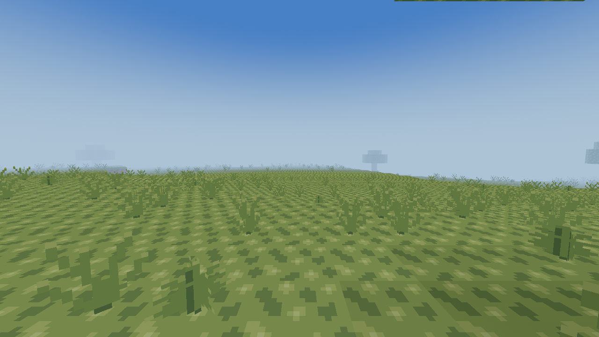|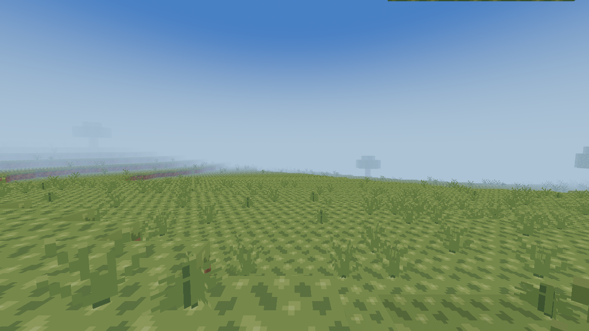|

| Ordinary mixed forest v12 | Ordinary mixed forest v13 |
| --- | --- |
|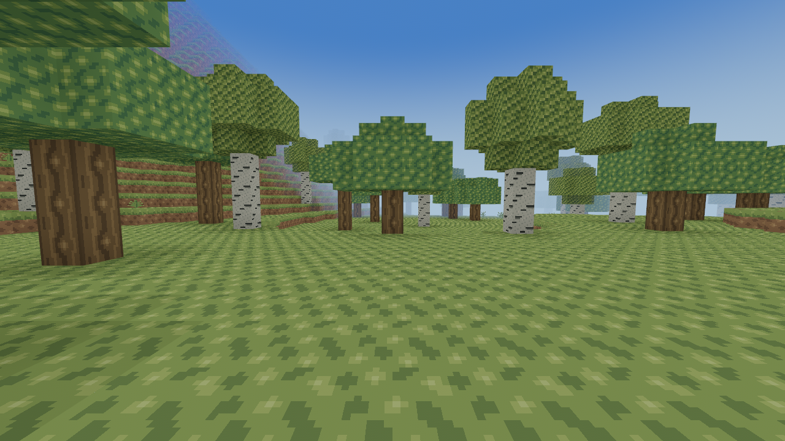|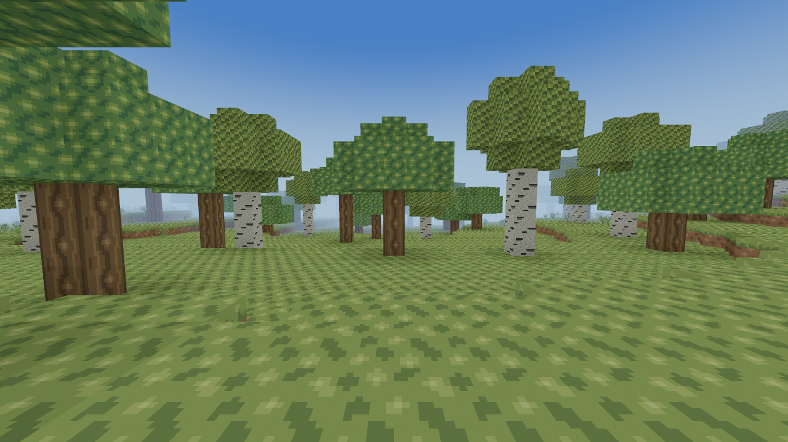|

## Development-only wide panoramas

**Every image below is DEVELOPMENT ONLY: gallery radius10 and explicit wide-survey
fog.** The playable client stays at radius1–4. Outer finite gallery footprint
edges/fog are capture limits, not generated world boundaries or terrain seams.

| Development panorama | Seed | Center X/Z | Shared world eye | Actual pair |
| --- | --- | --- | --- | --- |
|DEV ONLY plains-panorama|0|-3584/-3904|[-3694, 120, -3788]|[v12](captures/plains-panorama-v12.png) / [v13](captures/plains-panorama-v13.png)|
|DEV ONLY transition-panorama|42|-992/-3488|[-1102, 150, -3372]|[v12](captures/transition-panorama-v12.png) / [v13](captures/transition-panorama-v13.png)|
|DEV ONLY range-panorama|42|-768/-640|[-878, 185, -524]|[v12](captures/range-panorama-v12.png) / [v13](captures/range-panorama-v13.png)|
|DEV ONLY rocky-panorama|2026|-1536/-3904|[-1646, 180, -3788]|[v12](captures/rocky-panorama-v12.png) / [v13](captures/rocky-panorama-v13.png)|
|DEV ONLY valley-panorama|0|-512/-3200|[-622, 145, -3084]|[v12](captures/valley-panorama-v12.png) / [v13](captures/valley-panorama-v13.png)|
|DEV ONLY distant-panorama|2026|-23296/20896|[-23406, 185, 21012]|[v12](captures/distant-panorama-v12.png) / [v13](captures/distant-panorama-v13.png)|
|DEV ONLY new-lowlands-panorama|0|-2032/-3872|[-2142, 140, -3756]|[v12](captures/new-lowlands-panorama-v12.png) / [v13](captures/new-lowlands-panorama-v13.png)|
|DEV ONLY moderate-hills-panorama|0|1984/-4032|[1874, 105, -3916]|[v12](captures/moderate-hills-panorama-v12.png) / [v13](captures/moderate-hills-panorama-v13.png)|

### Development-only: a formerly excessive ridge system becomes gentle woodland

Seed0(-2032,-3872): the central planned density top falls70→21; the256-block nine-point offset stencil spans approximately13.5–21.4. Broad wooded, gently rolling terrain and inherited small basins replace repeated high obstacles. This is the clearest ordinary-land frequency example, not a claim that every location becomes flatter.

| v12 — DEV ONLY | v13 — DEV ONLY |
| --- | --- |
|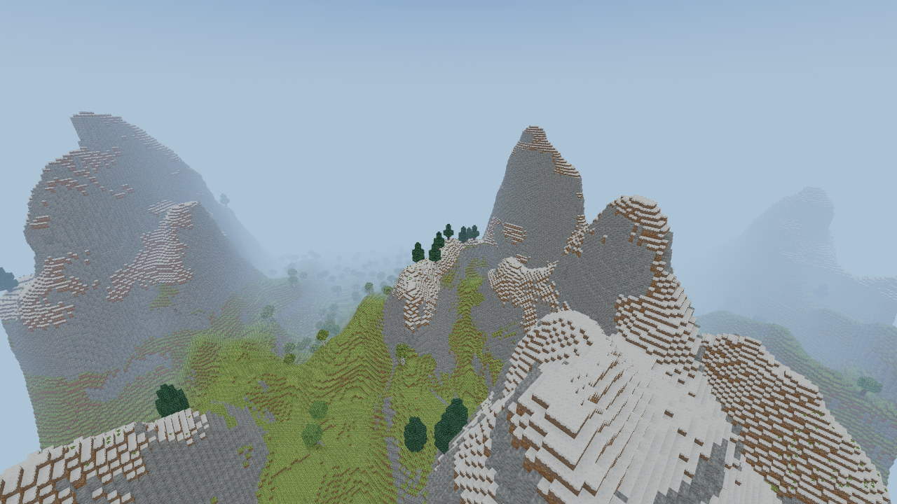|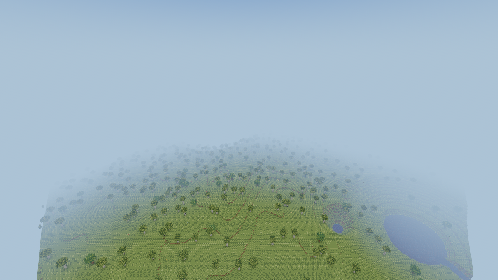|

### Development-only: broader mountain approach and valley

The same seed0(-512,-3200) camera retains a steep snow/rock face on the left, with a substantially more open rolling valley and fewer enclosing narrow peaks. Strong faces survive where appropriate; the entire region is not flattened.

| v12 — DEV ONLY | v13 — DEV ONLY |
| --- | --- |
|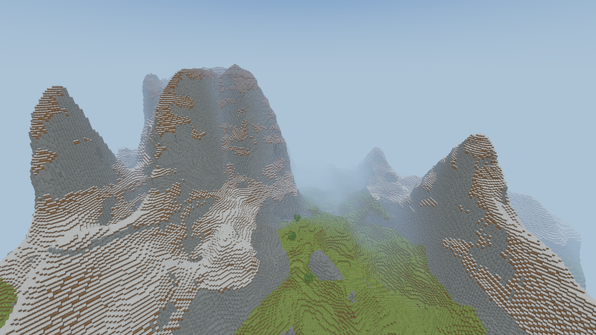|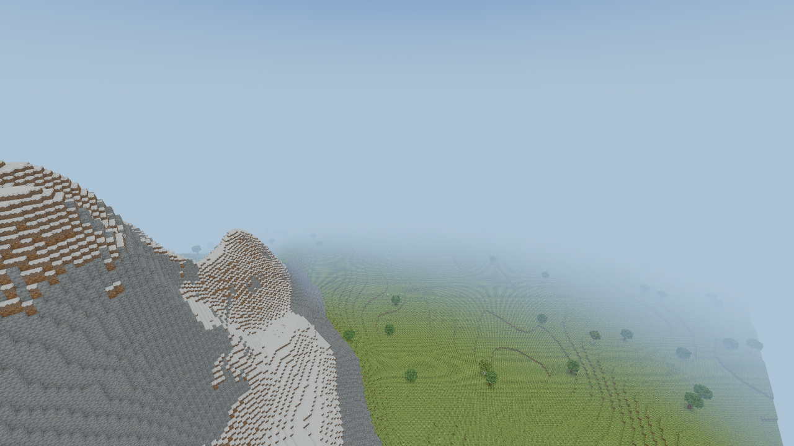|

### Development-only: exceptional snowy ranges remain impressive

At seed42(-768,-640), v13 is actually taller/larger locally. Irregular summits, saddles and steep faces survive; geographical balance does not mean reducing every mountain. This intentionally unfavorable rugged example accompanies the ordinary-land comparisons.

| v12 — DEV ONLY | v13 — DEV ONLY |
| --- | --- |
|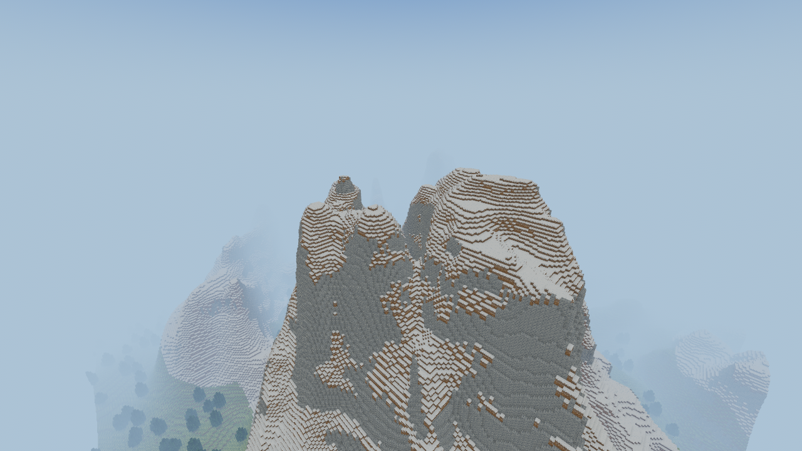|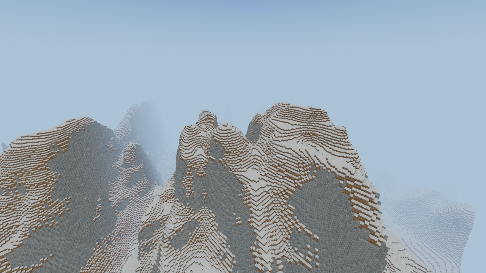|

### Development-only: rolling uplands and woodland approaches

Seed0(1984,-4032) was selected from an intermediate erosion band: a128-block offset stencil spans approximately23–53 blocks. Rolling wooded terrain shares the view with an adjacent higher rocky shoulder; it is not an exclusively gentle-plain scene.

| v12 — DEV ONLY | v13 — DEV ONLY |
| --- | --- |
|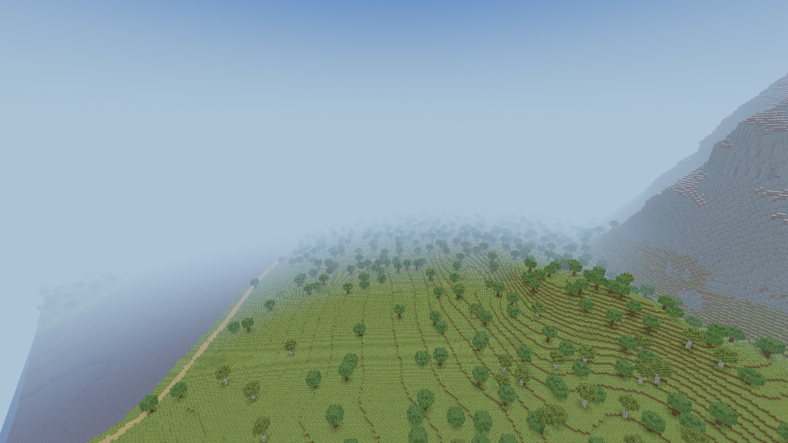|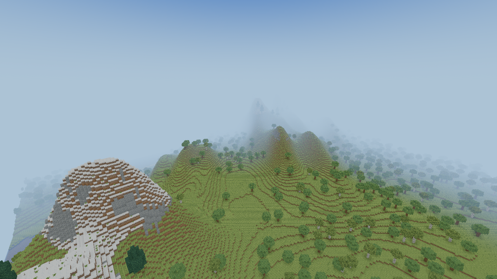|

## Review outcome and limits

The selected model increases coherent ordinary lowlands while keeping the
accepted signed-ridge silhouette language, snowy/rocky peaks, saddles and
occasional cliffs. Meadows, rooted forest, cold woodland and low sandy coasts
remain. The valley and converted-lowland pairs support the measured reduction
in narrow/deep cuts; the exceptional range pair shows why global amplitude
scaling was rejected. Moderate terrain still has geographical variation.

One early capture caught a clear-color frame while software pipelines were
compiling. It was rejected. The capture tool now retries the identical scene
with240 frames when its initial60-frame capture is empty; only nonempty frames
with verified hashes are retained. No failed image is presented as evidence.

This remains a qualitative comparison to normal modern Minecraft Overworld
geography using the linked public references; no executable Minecraft dataset
or exact Minecraft distribution statistics were available. Native owner walking
and visual acceptance across longer routes remains necessary.

## Capture reproduction

Use a working desktop/graphics backend; the cloud evidence used Xvfb and the
explicit llvmpipe Vulkan ICD. The ordinary game still chooses its supported
platform backends normally. No production renderer configuration changes.

```sh
cargo build --release --locked -p rustcraft --example terrain_gallery
RUST_LOG=info python tools/capture_terrain_balance.py --output work/s38-captures --resume
```

Each PNG is retained only after the gallery exits successfully and contains real
rendered variation; the script records the actual command and software/hardware
adapter text. Inspect the images as well as their hashes.
