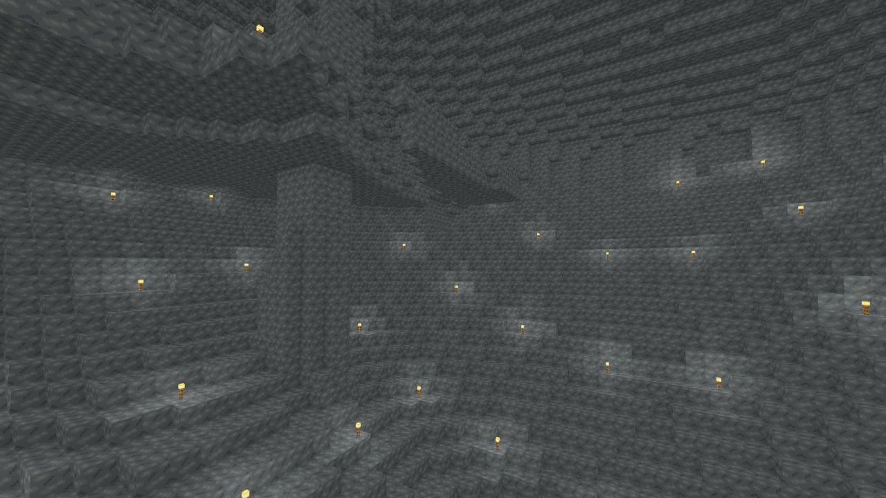
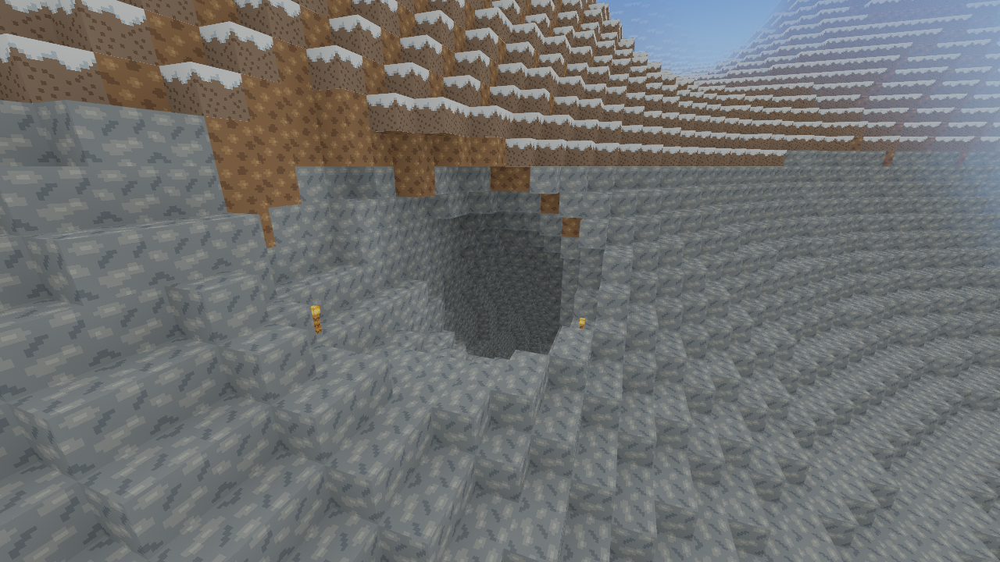
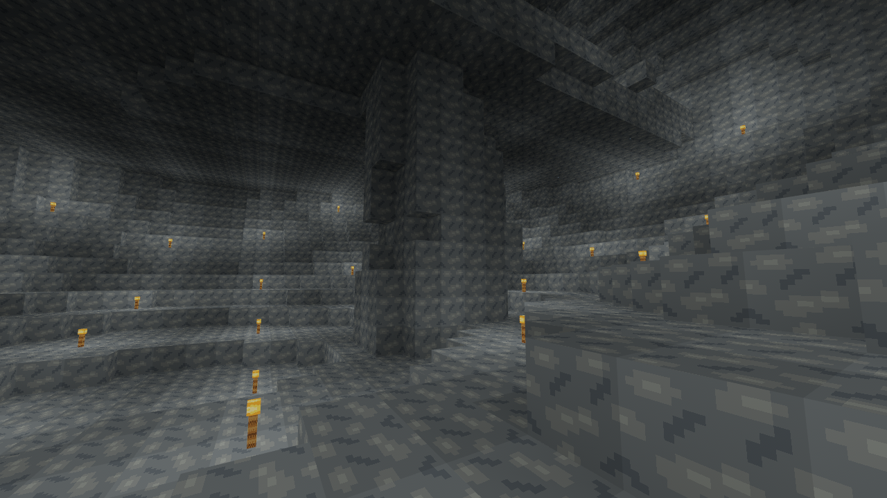
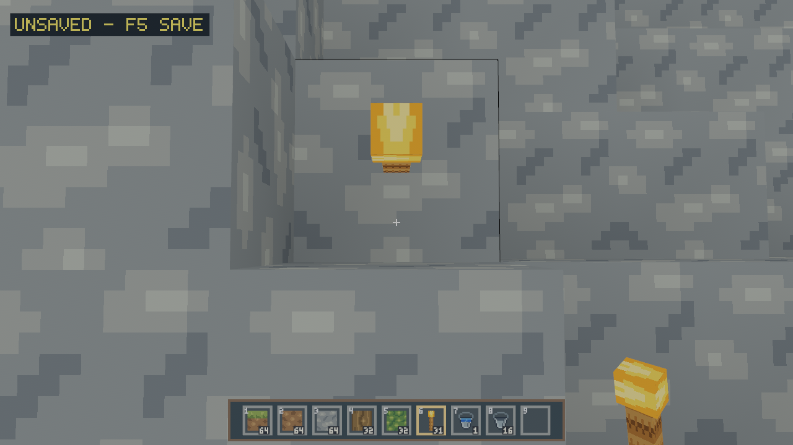

# Slice 39 — Cave Generation v3 (generator14)

Base: exact merged Slice38 `c6d36393c037e4295bf93c6a4efbc9fa12dd053c`.

## Investigation, before implementation

`caves.rs` owns the frozen v7 geometry inherited by v8–v13: 96-block
ownership cells, lobed ellipsoids, seven-leg swept branches, roots near -29
and a second chamber near -49. Branch elevations clamp to [-54,-8]. Only
entrance routes rise above this band. Their target is `biome::height` (v5),
so the newer v13 mountains can bury the entire route. Raising the chamber
radii or spawn probability cannot solve that geography or repeated room shape.

`local.rs` shares one 18² halo-column plan across all sixteen vertical chunks.
It builds v13 density profiles, hydrology, materials, caves and vegetation.
It carves after sparse surface occupancy, before underground pool fill and tree
application. Point queries also use this plan for v8+, so both integrations
must select the same versioned cavity predicate. Trees perform their own
terrain-root admission: that path must use v14 caves too.

`hydrology.rs` preserves a four-block sealed bed/bank cap. Pools are bounded
flood fills admitted against v7 geometry; applying those sources to a new
connected cavity would invalidate closure. V14 must skip their planning and
filling entirely. V1–v13 keep all pool admission/cache arithmetic unchanged.
The v13 geography dispatcher currently recognizes exactly version13; v14 must
explicitly reuse that mapping, including ecology/coast/water admission queries.

## Public reference study

Consulted 2026-11-13: [official Java1.18 release notes](https://www.minecraft.net/en-us/article/caves---cliffs--part-ii-out-today-java),
[official Java1.18 support changelog](https://feedback.minecraft.net/hc/en-us/articles/4415128577293-Minecraft-Java-Edition-1-18),
[official generation preview](https://www.minecraft.net/en-us/article/new-world-generation-java-available-testing).
These describe roomy cheese caves, winding spaghetti, narrower noodles and
traditional carvers combined into networks. The inspiration is combining
scales, residual rock and connections, not matching undisclosed distributions.
The requested Wiki Cave/World_generation/Density_function/Java_Edition_1.18
pages were attempted; direct access was blocked by robots.txt. Indexed excerpts
confirm density composition/interpolation but are not a quantitative oracle.
No proprietary code, tables, assets or reference-game output is imported.

## V14 architecture and integration contract

`caves_v3.rs` owns v14. `Versioned` selects frozen `caves.rs` for v7–v13.
The new model combines an independently designed implicit 3D cavern field with
bounded anisotropic swept carvers on a feature graph:

- 128-block ownership cells contain jittered anchors. A smooth 512-block regional
  field modulates admission continuously. Empty ownership cells do not clip
  neighboring features or impose voxel-grid walls.
- Deep anchors vary through Y[-43,-24]. Separate upper anchors use the actual
  v13 hydrological terrain bed minus22–39 blocks, bounded to[-16,136]. Upper
  systems are present only when there is enough vertical separation. This is
  not a vertical stretch of the old model.
- Two signed Q10 3D fields, wavelengths32×20×28 and14×12×16, sculpt chamber
  walls, floors and ceilings, with positional warp, residual tapered pillars and
  partial wall shelves. A globally aligned4³ interpolation lattice is shared
  across all intersecting rooms in a column. Only room bounds allocate samples;
  tube-only and empty plans allocate no lattice. Density classification stays
  integer-only. Conservative envelopes include the maximum deformation.
- Cubic curves sampled into24 overlapping anisotropic chords produce long,
  smoothly changing passages. Widths vary along routes. Smaller secondary
  routes have greater than two-block minimum nominal diameter and extra height.
  Independent floor/ceiling voxelization can still introduce tight ledges.
- An owner alone emits +X/+Z connections to active neighbors. Major deep links,
  occasional upper links, returning branches and optional steep connectors make
  local loops and multi-level networks without a globally connected cave map.
  Major routes compose as Air after chamber residual rock, so a pillar cannot
  close a planned passage inside a chamber. Final terrain caps can truncate
  routes near low ground/water; measurements report the resulting components.
- Dry surface probes choose actual occupied v13 profile tops and final water
  beds, with bounded four-direction slope candidates. Mouths need bed>sea+6,
  dry ownership and distance from spawn. Only entrance routes bypass the normal
  eight-block roof guard. The ordinary spawn rectangle retains20 blocks of rock.
- Discovery uses two owner rings, independent of chunk traversal. Unit tests
  check every emitted feature against its owner envelope. Q4 world-coordinate
  curves use i64 cubic intermediates, preventing distant signed-coordinate
  overflow. No neighbors, resident-state checks, random stream or world map
  enter generation. Plans die with the existing column sampler.

The v13 terrain dispatcher explicitly accepts13 and14; all climate, density,
coast and water admission queries share this mapping. Base height/profile/biome
samples are exactly identical. Bounds, biome/block/item IDs, worker topology,
radii1–4, save identities/envelopes, journal behavior and authoritative edits
remain unchanged. Unknown generator15+ fails closed. New worlds alone use14.

### Water and future Slice40

Surface basins and source semantics remain v13. Their existing four-block
bed/bank seal is applied before any new cavity. Historical underground pools
are **not admitted, allocated or filled in v14**: their closure proof belongs to
the v7 cavity field. V1–v13 still evaluate their exact historical pool output.
There are no new procedural underground sources, aquifers or flooded systems.
Ordinary player-placed Water Sources and fluid edits continue to work.

For Slice40: cavity geometry is a dry predicate independent of water. A future
local water owner must prove final-cavity closure against the composed density,
carvers, foundation and protected surface caps; it must supply the same block
result to point, column, chunk and halo queries. Do not reuse `pool_center`
metadata as a v14 ownership proof. Any procedural change needs a new generator
version; preserve14's dry cavities and saved explicit Air.

### Determinism and regression evidence

`history-v1-v13.csv` was captured from exact merged Slice38 **before** modifying
production generation. It hashes full-height column blocks as little-endian u16
IDs plus biome identity, across four seeds and signed/distant/edge sites.
Existing independent v1–v13 fixtures remain untouched. The independent Python
`cave_v3_reference.py` provides signed3D noise and interpolated-lattice fixtures,
checked on both CI platforms. The new suite covers full-height sampler/chunk/
point/halo parity, foundations, water stability, ecology support, actual cave
physics/mining/placing/torch light, spawn, saved Air, journal recovery,
eviction, cancellation and repeated radius4 world switching.

## Reproducible quality analysis

```sh
cargo run --release --locked -p voxel_core --example cave_quality > quality.csv
cargo run --release --locked -p voxel_core --example cave_sites > sites.csv
python tools/cave_v3_reference.py --check
```

The fixed survey uses seeds0/42/2026/u64::MAX and central, negative, distant,
and mountainous128×128×256 windows. Mountains are found reproducibly by the
highest actual v13 profile on an8192² grid at spacing128; the output records the
exact window. Windows clip components: component extents are lower bounds,
not full-world network lengths. Absolute air bins start Y=-64, stride32, with
the last bin combiningY≥96. Surface-relative bins are depth0–15,16–31,…,80+.
Width/headroom bins are≤2,3–4,5–8,9–16,17–32,33+ blocks. Width is the smaller
of the two cardinal horizontal open runs at foot level, sampled on supported
floor cells, not a fitted tunnel radius or an unbiased chamber-size estimate.

Six-face components measure actual underground Air, not a heightmap.
A separate conservative floor graph requires solid support, two clear Air
voxels, level movement or a one-block step with swept headroom. A0.6×1.8 player
fits centered in those cells; diagonal shortcuts, climbing, long jumps and falls
are not counted. This remains a static navigation approximation; real controller
and transactional mining/placing are tested separately. A component's horizontal
span is reported, not an invented shortest-path length. Sparse surface-density
recesses remain included in both versions and explain some tiny high components.
No reliable quantitative Minecraft distribution was available; targets and
reference comparison are qualitative.

## Genuine rendered inspection and reproduction

```sh
cargo build --release --locked -p rustcraft --example terrain_gallery
python tools/capture_cave_v3.py --output /absolute/new/capture-directory
# Same production materials, only supported ordinary floor torches:
python tools/capture_cave_v3.py --output /absolute/new/torch-directory \
  --scene large-cavern --torch-only
```

All cameras/seeds/directions are in `tools/capture_cave_v3.py` and each capture's
JSON. Geometry and texture/shader assets are unmodified. `--cave-torches` installs
supported ordinary torches on a six-block development grid. The default capture
also uses **development-only diagnostic illumination**: mesh block-light is
floored to level10 while preserving face orientation/AO through the existing
production shader. It is not normal gameplay lighting and does not exist in the
playable client's rendering path. Torch-only captures omit that floor. Gallery
radius4 is within supported gameplay radii; the example loads a source halo and
never accesses saves. Linux cloud Mesa llvmpipe/Xvfb images establish actual
rendered geometry, not native Radeon FPS, VRAM or Windows GUI behavior.

## Performance reproduction

```sh
# Build first, then measure on an otherwise idle machine:
python tools/benchmark_cave_v3.py --output work/cave-cost --build-only
python tools/benchmark_cave_v3.py --output work/cave-cost --reuse --samples 128 --warmups 8
# Copy the first raw results before repeating in reverse order:
python tools/benchmark_cave_v3.py --output work/cave-cost --reuse --reverse --samples 128 --warmups 8
python tools/benchmark_streaming.py --baseline c6d36393c037e4295bf93c6a4efbc9fa12dd053c \
  --labels slice38 slice39 --caves-v3 --distance-expansion --rendering-install \
  --output work/cave-stream --build-only
python tools/benchmark_streaming.py --baseline c6d36393c037e4295bf93c6a4efbc9fa12dd053c \
  --labels slice38 slice39 --caves-v3 --distance-expansion --rendering-install \
  --output work/cave-stream --reuse --repeats 3 --frames 120
```

Both tools export the exact merged baseline and build instrumented disposable
copies, preserving production sources. CPU/wall, raw planning and vertical chunk
latency, cave planning/carving, light/mesh work, vertex/index payload, requested
heap allocations, compact chunks, caches, install and lifecycle costs retain raw
samples and P50/P95/P99/max. Clock instrumentation is included. Thread CPU uses
Linux CLOCK_THREAD_CPUTIME_ID; other platforms report unavailable instead of
inventing CPU time. Requested heap excludes allocator metadata, stacks and GPU.
Streaming is real headless worker/Bevy install behavior with scripted deadlines,
not presented frame timing. Existing ecosystem labels are retained in that
harness: forest=cavern, birch=intersection, taiga=narrow, meadow=deep,
grove=entrance, desert=the rich u64::MAX complex; mountain is the upper-cave site. The raw logs retain exact states.

## Native acceptance: Gentoo/Void Linux and Windows

Use the pinned Rust1.99.1, existing native build dependencies and platform-selected
wgpu backend. Gentoo/Void X11 and Wayland need separate acceptance; Windows10/11
uses the native MSVC toolchain. No dependency, asset or graphics-feature changes
are required. The owner's approximately400FPS/330MB/radius4 report is context,
not an instrumented baseline from this cloud machine.

Fish on Gentoo/Void (after installing the packages in `docs/PLATFORMS.md`):

```fish
git fetch origin
git switch feat/slice-39-cave-generation-v3
git pull --ff-only
cargo build --release --locked --workspace
set test_dir (mktemp -d /tmp/rustcraft-slice39.XXXXXX)
env RUSTCRAFT_DATA_DIR="$test_dir" RUSTCRAFT_WORLD_SEED=42 RUSTCRAFT_LOAD_RADIUS=4 cargo run --release --locked -p rustcraft
# After normal close, verify that the same world and edits reload:
env RUSTCRAFT_DATA_DIR="$test_dir" RUSTCRAFT_LOAD_RADIUS=4 cargo run --release --locked -p rustcraft
# Interior gallery; development torches are explicit, no cave geometry edits:
cargo run --release --locked -p rustcraft --example terrain_gallery -- 42 42 70 0 --generator=14 --eye=42.5,-25.38,70.5 --direction=0.85,0.1,0.5 --cave-torches
```

PowerShell on Windows:

```powershell
cargo build --release --locked --workspace
$env:RUSTCRAFT_DATA_DIR = Join-Path $env:TEMP ("rustcraft-slice39-" + [guid]::NewGuid())
$env:RUSTCRAFT_WORLD_SEED = "42"
$env:RUSTCRAFT_LOAD_RADIUS = "4"
cargo run --release --locked -p rustcraft
# After normal close, run again with the same directory.
```

1. Create v14 worlds with all four survey seeds. Follow dry hill entrances into
   winding tunnels; place ordinary torches and explore lower and upper systems.
2. Check the recorded mountain and deep sites using the no-save gallery and
   compare with ordinary gameplay lighting. Record backend/driver, camera/seed,
   frame percentiles, CPU/RAM and queue/install metrics at radii2/3/4.
3. Walk, sprint, crouch and jump through narrow links/ledges; test real collision,
   drops, targeting, mining/placing, support removal and torch light at seams.
4. Place/collect water, open and seal a local basin, watch recession and reload.
   Existing natural surface basins must remain quiet and sealed.
5. Edit to explicit Air and build in caves; save, travel to evict, return, close
   and reload. Switch repeatedly between worlds and close with work in flight.
6. Open **complete copies** of older v1–v13 saves, inspect their original caves,
   pools and constructions. Verify identity and unchanged geometry.

Native physical-GPU/VRAM/FPS, Wayland input and Windows GUI remain owner checks.

## Known limits

This is an original Minecraft-inspired cave model, not distributional or visual
parity with Java1.18+. Some networks remain isolated; solid regions are deliberate.
Steep connections can require jumping, building or a drop. The standing graph
underestimates routes requiring longer jumps and excludes swimming. Density can
leave short voxel pinches and uneven room floors; no automatic path smoothing
changes the authoritative blocks. There are no aquifers, new ores, underground
biomes, structures or new art. Surface hydrology still uses its established fixed
datum and bounded sealing; its redesign belongs to Slice40. Large-window metrics
are analysis scratch only, never allocated during normal column generation.

The final quality CSV also reports a two-sweep shortest-path lower bound on the
largest clipped Air component and on the largest standing-floor component.
This measures graph distance in block steps; it is not a tunnel centerline length
or an exact diameter for cyclic networks. The static floor graph and actual
controller tests deliberately remain separate.

## Measured cave quality

Raw results: [quality.csv](raw/quality.csv),32 fixed windows (16 per version).
All windows have128×128×256 blocks; underground counts exclude the protected
four foundation layers and above-surface sky. Values are bounded observations,
not whole-world frequencies or a claim of Minecraft distribution parity.

| Generator | Underground Air | Windows with <64 Air | Longest Air geodesic lower bound | Longest standing geodesic lower bound | Invalid water faces |
| --- | ---: | ---: | ---: | ---: | ---: |
| 13 | 2.470% | 0/16 | 328 blocks | 226 blocks | 0 |
| 14 | 1.482% | 4/16 | 324 blocks | 204 blocks | 0 |

The new survey is sparser overall, with stronger regional contrast. The richest
v14 negative window (u64::MAX) contains143,467 Air cells (10.875% underground),
143,465 in its largest Air component,65 blocks of vertical extent and a largest
standing component of2,930 floor cells. This is a connected multi-chunk discovery,
not evidence that every adjacent Air cell is walkable. Four windows remain
almost entirely solid. The mountain windows retain much larger rock volumes
while admitting upper caves and steep multi-level links.

| Seed / mountain window X,Z | v13 highest occupied Air band counts Y≥0 | v14 counts Y≥0 | v14 maximum component vertical extent |
| --- | ---: | ---: | ---: |
| 0 / 2112,-1472 | 332 | 2,373 | 68 blocks |
| 42 / 3776,-832 | 59 | 10,889 | 170 blocks |
| 2026 / -1472,-3776 | 38 | 355 | 47 blocks |
| 18446744073709551615 / -3520,-448 | 17 | 3,555 | 133 blocks |

Width/headroom histograms, absolute/surface-relative depth distributions,
component counts including tiny recesses, entrance components, retained compact
slabs and actual surface-water counts remain in the raw CSV. Water-source counts
can decrease where historical underground pools were present; surface beds and
source columns retain their v13 identity. No invalid water face was observed.

The CSV additionally records dry-Air/solid interface area below the ordinary
eight-block roof guard, in unit block², excluding clipped window boundaries.
Water and non-colliding decorations are distinguished from solid support in
the standing graph; a player is never counted as standing on a pool surface.


The post-design [32 v14 column snapshots](../../../crates/voxel_core/tests/fixtures/columns-v14.csv)
pin the final geometry across all four seeds, signed/distant/world-edge sites,
and dense/mountain columns. They are explicitly post-design Rust snapshots,
not the independent Python mathematical oracle. Reproduce with
`cargo run --release --locked -p voxel_core --example terrain_history -- 14`.

The first measured implementation had avoidable remote-curve subdivision and
room-envelope density work. V14 now rejects routes outside their Bezier control
hull expanded by96 Q4 units (max horizontal tube radius79), and rejects room
points using a lower distance bound before density interpolation (max warps
64/48/64 Q4, max threshold1753). These conservative rejects preserve every v14
column snapshot and all historical fixtures. Original adverse measurements are
retained in `raw/preoptimization/`; final measurements use the optimized code.

### Interactive production-client capture

`tools/capture_biome_gameplay.py --cave-v3 --output /new/capture/path --data-root /new/isolated/catalog`
creates a disposable v14 world using the real catalog and plays the actual
production client, with seed2026, radius4 and start chunk(5,-11). Keyboard
walking moved the grounded player from(88.5,55,-167.5) to(88.5,42,-178.1).
Both normal and F3 views are recorded, followed by ordinary Save/Quit(exit0).
There is no gallery camera or diagnostic light in these two images. The
captures show an approach to the slope entrance, not a claim of fully walking
the whole underground network. Mesa software FPS in the overlay is not native
GPU performance. Exact titles, inputs, executable SHA256 and exit code are in
`docs/images/slice39/gameplay-captures.json`.

The interactive capture additionally selects the existing Torch hotbar slot,
looks down and places a supported floor torch through the ordinary right-click
transaction. The screenshot shows the torch in the world and the inventory
count decreasing32→31, followed by normal Save/Quit(exit0). This third image
uses normal production lighting, with no diagnostic illumination.

The first room rejection pass helped sparse columns but added divisions inside
dense rooms. The final rejection bound uses downward-rounded Q16 reciprocals;
this can only weaken the reject and does not change the exact cavity predicate.
Both earlier measurement sets are retained (`raw/preoptimization/` and
`raw/first-reject/`), including their outliers and the dense-case regression.

## Rendered evidence index

All gallery views use the existing production atlas, meshes, shaders and atmosphere,
FOV78°, radius4. Diagnostic illumination is explicitly recorded in each JSON;
the torch-only view has no diagnostic floor. Cameras are in actual generated Air.

| Scene | Seed | Eye X,Y,Z | Direction X,Y,Z | Image |
| --- | --- | --- | --- | --- |
| connected-levels | 42 | `[-192.5, -26.38, 89.5]` | `[0.4, 0.2, -1]` | [PNG](../../images/slice39/connected-levels.png) |
| deep-foundation | 42 | `[-613.5, -50.38, -595.5]` | `[1, 0.08, 0.1]` | [PNG](../../images/slice39/deep-foundation.png) |
| historical-v13-cavern | 42 | `[58, -34, -53]` | `[-0.3, 0.08, -1]` | [PNG](../../images/slice39/historical-v13-cavern.png) |
| large-cavern-torches | 42 | `[42.5, -25.38, 70.5]` | `[0.85, 0.1, 0.5]` | [PNG](../../images/slice39/large-cavern-torches.png) |
| large-cavern | 42 | `[42.5, -25.38, 70.5]` | `[0.85, 0.1, 0.5]` | [PNG](../../images/slice39/large-cavern.png) |
| large-intersection | 42 | `[-180.5, -12.38, 72.5]` | `[-0.5, 0.05, 0.8660254]` | [PNG](../../images/slice39/large-intersection.png) |
| mountain-cave | 42 | `[-719.5, 67.62, -564.5]` | `[0.5, 0.05, 0.8]` | [PNG](../../images/slice39/mountain-cave.png) |
| narrow-passage | 0 | `[-110.5, -21.38, 202.5]` | `[0.8, 0.05, -0.6]` | [PNG](../../images/slice39/narrow-passage.png) |
| ordinary-chamber | 42 | `[-36.5, -47.38, 76.5]` | `[1, 0.06, 0.2]` | [PNG](../../images/slice39/ordinary-chamber.png) |
| rich-complex | 18446744073709551615 | `[-181.5, -12.38, -180.5]` | `[0.5, 0.05, 0.8660254]` | [PNG](../../images/slice39/rich-complex.png) |
| surface-entrance | 2026 | `[94.5, 47, -180.5]` | `[-1, -0.35, 0.35]` | [PNG](../../images/slice39/surface-entrance.png) |
| vertical-shaft | 2026 | `[-175.5, -12.38, -83.5]` | `[0.45, 0.65, -0.5]` | [PNG](../../images/slice39/vertical-shaft.png) |
| winding-tunnel | 42 | `[-250.5, -38.38, 199.5]` | `[1, 0.05, -0.15]` | [PNG](../../images/slice39/winding-tunnel.png) |









## Final CPU, memory and streaming measurements

The final binaries match the recorded production-source SHA256 values. The core
harness now refuses `--reuse` if current source bytes differ. Baseline is exact
merged Slice38; both execution orders have128 warm samples per scene after8
warmups. No builds, tests or renderers ran during final measurements. The cloud
executor has a two-CPU quota and approximately9.7GiB RAM; these are CPU/requested
heap observations, not the owner’s native Radeon measurements.

Representative forward-order values below are in milliseconds. Every P50/P95/
P99/max, individual sample and reverse-order observation is retained in raw data.

| Scene | v13 full-column CPU P50 | v14 full-column CPU P50 | v14 full-column CPU P99 | v14 plan P50 | v14 room-field P50 | v14 carve P50 |
| --- | ---: | ---: | ---: | ---: | ---: | ---: |
| quiet-plain | 0.875 | 2.094 | 4.663 | 1.062 | 0.238 | 0.073 |
| cavern | 0.615 | 2.503 | 5.208 | 0.926 | 0.199 | 0.857 |
| rich-complex | 0.809 | 2.764 | 6.200 | 0.624 | 0.253 | 1.264 |
| intersection | 0.582 | 2.588 | 15.484 | 0.888 | 0.190 | 1.029 |
| narrow | 0.658 | 1.645 | 4.058 | 0.535 | 0.221 | 0.365 |
| deep | 0.799 | 2.829 | 5.513 | 0.979 | 0.241 | 1.077 |
| mountain | 1.423 | 3.393 | 5.580 | 1.053 | 0.386 | 0.859 |
| entrance | 0.880 | 2.580 | 4.967 | 1.034 | 0.253 | 0.681 |
| distant | 0.978 | 1.230 | 3.851 | 0.353 | 0.000 | 0.002 |

V14 raw column generation remains more expensive than the historical model.
New geography queries, density and connected carvers account for the increase;
this is not a claim of an overall generation speedup. Chamber bounding rejects
reduce unnecessary density evaluation, while the exact classification and all
post-design snapshots remain identical. New geometry can also increase an
individual column’s mesh payload considerably.

| Scene | v13/v14 mesh payload bytes | v13/v14 raw temporary requested-heap peak | v13/v14 warmed worker CPU P50 ms |
| --- | ---: | ---: | ---: |
| quiet-plain | 170,376 / 149,544 | 39,892 / 63,268 | 1.453 / 1.260 |
| cavern | 74,896 / 283,464 | 41,076 / 72,788 | 0.801 / 1.338 |
| rich-complex | 58,280 / 332,072 | 40,436 / 73,076 | 0.775 / 1.534 |
| mountain | 120,528 / 630,168 | 41,108 / 93,588 | 1.635 / 2.674 |
| distant | 225,680 / 97,960 | 49,012 / 40,260 | 1.195 / 0.573 |

Streaming uses one scripted repetition per scenario/radius,40 deadline frames,
with many actual worker/queue/install samples. Small per-session counts should
not be treated as robust tail estimates. The table reports cold request-to-ready
latency and actual headless Bevy main-thread CPU installation. It excludes GPU
upload and presentation. Higher cold queue tails are an observed regression;
no renderer/worker-count rewrite is hidden in this slice.

| Scenario | Radius | v13 request P50/P99 ms | v14 request P50/P99 ms | v14 main install P99/max ms |
| --- | ---: | ---: | ---: | ---: |
| cavern | 2 | 31.57 / 227.73 | 69.48 / 168.06 | 0.212 / 0.220 |
| cavern | 3 | 72.20 / 182.29 | 153.30 / 304.59 | 0.189 / 0.198 |
| cavern | 4 | 109.39 / 288.42 | 214.37 / 408.41 | 0.668 / 0.962 |
| rich complex | 2 | 44.61 / 123.40 | 99.27 / 216.39 | 0.294 / 0.639 |
| rich complex | 3 | 96.14 / 239.43 | 206.67 / 356.95 | 0.172 / 1.088 |
| rich complex | 4 | 166.54 / 314.96 | 298.04 / 433.23 | 0.204 / 0.424 |
| mountain | 2 | 156.21 / 351.38 | 109.43 / 220.38 | 0.282 / 0.354 |
| mountain | 3 | 500.41 / 652.36 | 195.32 / 348.07 | 0.260 / 0.295 |
| mountain | 4 | 244.81 / 520.91 | 408.59 / 855.85 | 1.130 / 2.373 |

Resource observations are per final converged state, not percentile populations.
For radius4 the requested pristine voxel-cache bytes below remain bounded; light
caches and mesh/triangle payloads are also retained in the CSV/state records.
No native total RAM, VRAM or FPS equivalence is inferred from requested heap.

| Radius4 scenario | v13/v14 pristine voxel cache bytes | v13/v14 applied-light cache bytes | v13/v14 resident triangles |
| --- | ---: | ---: | ---: |
| cavern | 1,458,176 / 1,175,552 | 2,536,920 / 2,350,296 | 53,224 / 45,874 |
| rich complex | 1,421,312 / 1,236,992 | 2,647,728 / 2,356,128 | 117,282 / 115,378 |
| mountain | 2,093,056 / 1,507,328 | 3,843,288 / 2,863,512 | 163,304 / 116,544 |

Raw directories: [core forward](raw/core-forward/percentiles.csv),
[core reverse](raw/core-reverse/percentiles.csv),
[stream forward](raw/stream-forward/percentiles.csv),
[stream reverse](raw/stream-reverse/percentiles.csv). Source/binary fingerprints,
method JSON, all individual samples and exact final authority/resource states
are retained beside them. Large CSV/text files are gzip-compressed losslessly;
Python’s standard `gzip` module can read them on Linux and Windows. Earlier
measurements, including regressions, are retained separately.

## Validation outcome

- `cargo fmt --all -- --check`: passed.
- `cargo clippy --locked --workspace --all-targets -- -D warnings`: passed.
- `cargo test --locked --workspace -- --test-threads=1`:595 passed,7 existing ignored measurement tests,0 failures.
- Optimized core suite: passed; final7 v14 integration/snapshot regressions passed after the CPU rejects.
- `cargo build --release --locked --workspace`: passed, with the pinned toolchain/lockfile.
- Original asset verification and independent v10/v11/v12/v13/v14 Python fixtures: passed.
- Genuine gallery captures, normal torch-only interior and production-client walking/torch/save/quit: completed.
- Linux/Windows [implementation CI](https://github.com/ArturTrumpfheller/rustcraft/actions/runs/43475644152): passed on `49cbc70`; final evidence-commit results are linked on the PR. Native Gentoo/Void X11/Wayland and Windows physical-GPU acceptance remains pending.

The initial local unoptimized workspace run timed out in the existing30-second
session wait while release compilation and software capture competed for CPU.
The final isolated run passed with that deadline unchanged. This adverse test
observation is retained rather than increasing timeouts or skipping the session
case. Native FPS/GPU/VRAM/endurance remain outside what this cloud run proves.
