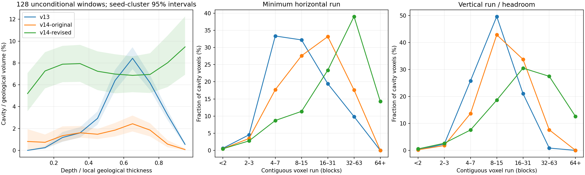
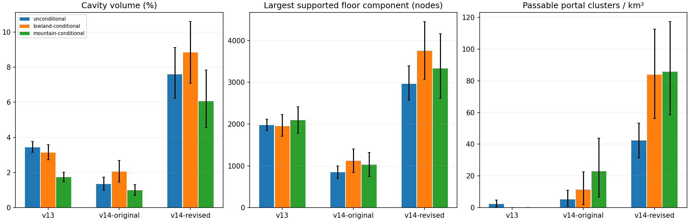
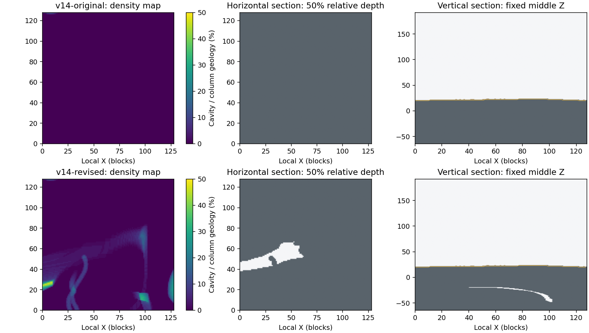

> Archived candidate measurements. The current unmerged v14 implementation
> and executed Horizon comparison are in [the Horizon follow-up](../horizon/README.md).

# Slice39 follow-up — continuous v14 caves and ordinary entrances

This is the revised, still-unmerged generator14 in PR #57. The original candidate
is pinned to `ce690b004d8711ddb944838f2f5619be9233d5d0`; the historical v13 baseline
is exact merged Slice38 `c6d36393c037e4295bf93c6a4efbc9fa12dd053c`.

## Reference and what remains unverified

The primary requested release is [Java26.3 stable](https://www.minecraft.net/en-us/article/minecraft-java-edition-26-3).
Its official release page links server object SHA1
`33680f5f2ac32864d6d7cf5e56a705fdb3e05f4c`. The environment's enforced network
policy rejects `piston-meta.mojang.com` with HTTP403; `piston-data.mojang.com`
is also outside its allowed hosts. Access was requested, but no authorized local
26.3 installation/world dataset or official server download became available.
No alternate relay was used to circumvent that policy.

**There are no genuine Minecraft volume/frequency measurements in this report.**
The revised RustCraft values are observations, not Minecraft percentages or proof
of parity. Matching encounter rates, chamber frequencies, regional density and
depth statistics to vanilla26.3 remains an explicit acceptance gap.

Research consulted the official [noise-cave introduction](https://feedback.minecraft.net/hc/en-us/articles/360056479612-Minecraft-Java-Edition-Snapshot-21w06a),
[noodle introduction](https://www.minecraft.net/en-us/article/minecraft-snapshot-21w17a),
[1.18 release](https://feedback.minecraft.net/hc/en-us/articles/4415128577293-Minecraft-Java-Edition-1-18),
[experimental terrain notes](https://www.minecraft.net/en-us/article/new-world-generation-java-available-testing)
and [developer Q&A](https://www.minecraft.net/en-us/article/caves---cliffs-update--part-ii-dev-q-a).
These establish the combination of large irregular cavities, long variable-width
routes, thin winding caves, older carvers and surface intersections. They do not
provide population percentages. Early snapshot frequencies are not assumed to
equal the stable release.

Public extracted26.3 registry structure was also inspected read-only at
[`misode/mcmeta`26.3-data](https://github.com/misode/mcmeta/tree/538b2b167248c648b2198f2c0d56eced10dfc0cf/data/minecraft/worldgen).
The final-density composition references broad cave/layer fields, entrance and
spaghetti functions, residual pillars and a separately gated noodle function.
The entrance function uses separate3D route fields, rarity and thickness; the
noodle function uses two ridge fields and a thickness field. The actual release
also retains local carvers. This supports a mixed global/local architecture,
not a claim that chamber-owner admission reproduces vanilla statistics.
Registry snapshots were not independently checked against a downloaded26.3 jar.
No registry JSON, source, constants/tables, game binaries or Minecraft assets
are copied into RustCraft. The implementation below is independently designed.

## Changes and bounded integration

The original graph remains: warped local chambers, pillars/shelves, long curved
connections, loops, narrow returns, deep anchors and terrain-relative upper
systems. Its regional owner admission is unchanged. The follow-up supplements it:

- Two continuous signed3D fields intersect near zero to form winding passages
  between owners. Local thickness modulation produces narrow and wider sections.
- A separate lower-frequency3D field, modulated regionally and sculpted by the
  passage field, admits larger irregular cavities. Cavities are no longer
  restricted to admitted chamber envelopes or two anchor levels.
- All fields share absolute4³ integer lattice coordinates. Signed division,
  interpolation and classification have an independent Python oracle, including
  negative/distant/edge coordinates. Conservative corner intervals reject whole
  cells; tests compare the rejected result with the unculled predicate.
- Field samples are lazy per16-block height band. Surface-only root queries and
  empty sky chunks allocate no density field; higher bands are not built merely
  because the world has a tall ceiling. Scratch dies with the existing column
  sampler. There is no resident global cave map, neighboring-chunk requirement,
  new worker, render-distance change or renderer rewrite.
- The density-only trial improved underground components but hardly changed
  discoveries on supported surface paths. Independent64-block owners therefore
  emit occasional ordinary entrance carvers, separately from chamber admission.
  Jittered positions, curved horizontal controls and two graded legs give small
  mouths with a roughly80-block continuation and a32-block descent where terrain
  permits it. The nominal horizontal diameter is about4–6 blocks. A convex-hull
  reject precedes terrain probes; dry mouths use actual v13 profile/hydrological
  beds. Carvers can meet density caves, owned networks or terminate naturally.

All paths retain foundation/spawn protection, the ordinary eight-block roof,
water-bed/bank permission gates, vegetation support and authoritative edits.
Only entrance legs bypass the ordinary roof. Historical v1–v13 dispatch,
fixtures, pools, saves and journals remain frozen. The v13 surface/biome profile
and materials are unchanged. V14 remains dry except established surface/player
water; complete aquifers and the hydrology redesign remain Slice40.

V14 is still an unmerged development candidate. Its32 post-design column CRCs
were intentionally refreshed; old v14 candidate worlds can regenerate different
unedited caves. Recorded edits, including explicit Air, remain authoritative.
This does not change any v1–v13 generator or save identity.

## Survey design and limits

The fixed [sample plan](raw/plan.csv) contains256 windows across32 seeds,
including0,42,2026,u64::MAX and28 deterministic additional seeds. Every window
is128×128×256 blocks. Coordinates were selected without looking at caves:

-128 unconditional windows: two nearby and two distant positions per seed.
-64 terrain-only lowland windows and64 terrain-only mountain windows. Bounded
  searches select the first qualifying v13 height/relief candidate, not the
  most impressive caves. Attempts and thresholds are reproducible in
  `cave_volume --plan`; these strata are reported separately, not weighted as
  a whole-world biome distribution.

The common analyzer uses final natural-ground height, excludes trees/liquids from
that surface, omits four foundation layers and eight roof blocks, and records
both absolute and normalized surface-relative depth. Geological thickness is
`surface-(min_y+4)+1`. It separates dry Air from water/lava occupying a cavity.
Thus a future Minecraft comparison can use its384-block height, sea63 and fluid
occupancy without equating them to RustCraft's256-block height and sea2.
Conditional Minecraft sites must be selected independently using terrain and
matched normalized elevation/relief; RustCraft's mountain coordinates do not
automatically describe Minecraft mountains.

Metrics include6-connected cavity components, component sizes/censoring,
normalized and fixed-depth volumes, horizontal/vertical voxel-run distributions,
broad-room cores, geodesic lower bounds and a separate supported floor graph.
Voxel runs and broad cores are shape proxies, not counts of unique physical
tunnels or chambers. Components are clipped to windows; two-sweep graph distances
are lower bounds, not exact cyclic-network diameters.

The floor graph requires actual solid support and two dry Air blocks, level or
one-block moves, and extra head clearance during jumps/drops. Water is never a
floor. Other decorations/partial obstacles are treated conservatively; swimming,
longer jumps, crouching and player construction are not assumed. Actual controller,
mining/placing, torch, lighting and persistence tests remain separate.

Four predetermined pairs of surface waypoints per window are joined by shortest
supported surface paths, allowing detours. Disconnected endpoints are counted,
not turned into invented walked distance. A mouth counts only when it leads to
at least32 deep floor nodes and reaches24 blocks below its local surface.
Encounter counts require a path to pass within three voxels of its portal.
These conservative near-encounters are not visual detection from a distance or
recorded gameplay-controller trajectories. Window clipping and conservative
obstacle handling can block otherwise possible routes.

Uncertainty uses4096 bootstrap resamples of whole seed clusters, not independent
voxels/windows. The fixed cohort informed tuning; it is not held-out validation
of Minecraft similarity. All-zero bootstrap intervals are degenerate observed
samples, not upper population bounds on rare events.

## Current quality evidence

The generated tables below summarize the common method. They should not be
compared directly with the original16-window1.482%/2.470% survey, which used
different windows, surface masking and roof inclusion.

Primary128 unconditional windows; brackets are descriptive95% seed-cluster
bootstrap intervals. The terrain-conditioned results remain separate in
[summary.json](summary.json).

| Measure | v13 | Original v14 | Revised v14 |
| --- | ---: | ---: | ---: |
| Cavity / geological volume | 3.43% [3.15,3.76] | 1.34% [0.98,1.74] | 7.58% [6.22,9.11] |
| Nearly-solid windows (<64 cavity voxels) | 0/128 | 39/128 | 0/128 |
| Mean largest supported floor component | 1,976 [1,839,2,121] | 846 [699,993] | 2,962 [2,574,3,395] |
| Passable portal clusters / km² | 2.38 [0.48,4.77] | 5.25 [0.95,10.97] | 42.44 [31.47,53.41] |
| Close portal encounters on supported surface paths | 1 / 42,542 blocks | 0 / 42,548 blocks | 5 / 42,624 blocks |

Across all256 diagnostic windows, the revised model yields267 eligible portal
clusters and13 close encounters on86,218 actually traversable surface-path
steps. This is a stricter proximity measure than seeing a mouth across a field.
Some planned routes are unreachable in the clipped conservative graph. These
counts demonstrate a change in this RustCraft cohort; they do not establish a
Minecraft encounter frequency. The entrance-owner admission and field thresholds
are authored prototype choices, not measured vanilla parameters.







Additional fixed [lowland](sections-s01-4.png) and [mountain](sections-s01-6.png)
sections retain the original/revised comparison. Gray is solid, white is Air,
blue is water, orange would be lava; the gold line is final natural surface.

The first broad-field trial had11.785% pooled cavity across all256 diagnostic
windows and a51.63% maximum window. Its passages were excessively broad. Reducing
passage thickness specifically retained broad cavern discoveries while improving
the narrow/wide mix; no blanket multiplier was applied to the owner probabilities.
Both that adverse trial and the density-only revision before ordinary entrances
remain in raw data. Zero nearly-solid128-block windows in the revision does not
mean zero solid rock: most geological volume remains rock, with strong regional
variation. It also does not establish Minecraft-like prevalence.

## Actual Bevy views

All follow-up gallery captures use the same original atlas, meshes, production
shader, atmosphere, FOV78° and radius4. Temporary supported floor torches and the
explicit development diagnostic-light floor are labeled in each JSON. The
torch-only image uses normal lighting. Source/binary fingerprints accompany the
data. No Stone/Air was edited for a camera.

The ordinary survey interior and small entrance use seed0 in the first
unconditional sample window, not an exceptional-seed search. Camera coordinates
and directions are in `tools/capture_cave_v3.py` and each capture's JSON.
Paired images for the older controlled sites use identical poses. Sky-colored
gaps in long interior views can be the supported radius4 render boundary; they
must not be interpreted as measured natural surface mouths.

| View | Original v14 | Revised v14 |
| --- | --- | --- |
| Large cavern | [original](../../../images/slice39/large-cavern.png) | [revised](../../../images/slice39/followup/large-cavern.png) |
| Narrow passage | [original](../../../images/slice39/narrow-passage.png) | [revised](../../../images/slice39/followup/narrow-passage.png) |
| Mountain cave | [original](../../../images/slice39/mountain-cave.png) | [revised](../../../images/slice39/followup/mountain-cave.png) |
| Existing slope entrance | [original](../../../images/slice39/surface-entrance.png) | [revised](../../../images/slice39/followup/surface-entrance.png) |

[Ordinary surveyed interior](../../../images/slice39/followup/survey-ordinary.png),
[ordinary entrance](../../../images/slice39/followup/survey-entrance.png) and
[normal torch-only cavern](../../../images/slice39/followup/large-cavern-torches.png)
supplement the controlled comparisons.

The revised production-client capture creates a seed2026/radius4 world through
the real catalog, walks to the existing slope entrance, places an ordinary torch
(inventory32→31), saves and quits normally (exit0). Its
[normal](../../../images/slice39/followup/gameplay-cave-entrance-r4.png),
[F3](../../../images/slice39/followup/gameplay-cave-entrance-r4-f3.png) and
[torch](../../../images/slice39/followup/gameplay-cave-entrance-r4-torch.png) images
have no diagnostic illumination. Exact titles and executable hashes are in
[gameplay-captures.json](../../../images/slice39/followup/gameplay-captures.json).

## Reproduction

Analysis-only Python dependencies are NumPy, SciPy and Matplotlib; they are not
game dependencies. Tested versions and licenses are recorded in THIRD_PARTY.
The RCV1 protocol and conservative graph rules are documented in the tools.

```sh
cargo build --release --locked -p voxel_core --example cave_volume
cargo run --release --locked -p voxel_core --example cave_volume -- --plan > plan.csv
cargo run --release --locked -p voxel_core --example cave_volume -- 14 plan.csv /new/volumes
python tools/test_cave_analysis.py
python tools/test_vanilla_export.py
python tools/analyze_cave_volumes.py /new/volumes --plan plan.csv --output /new/analysis.jsonl
```

For an authorized, closed, unmodified Java26.3 overworld, separately generate
all planned chunks with structures disabled and preserve the server/version/seed
provenance. The importer neither downloads software nor accepts a EULA:

```sh
python tools/export_vanilla_caves.py --world /authorized/world --plan mc-plan.csv --output /new/mc-volumes
python tools/analyze_cave_volumes.py /new/mc-volumes --plan mc-plan.csv --output /new/mc-analysis.jsonl
```

It checks26.3 metadata, chunk coordinates/full status, palettes and compression;
missing chunks fail closed. It supports the26.3 compact/id palette form. Handcrafted
NBT/Anvil tests establish parser mechanics; actual26.3 world import remains
unverified here. Metadata and hashes alone cannot prove a save was never edited.
The fallback solid-cube classification is conservative and needs validation
against genuine release collision data before claiming exact Minecraft walkability.

Gallery/production-client commands and native Gentoo/Void X11/Wayland/Windows
acceptance remain in the [main evidence document](../README.md). Native GPU/FPS,
VRAM, GUI input and endurance results are still pending.

## Performance method and validation

The core harness has three arms: exact v13, original v14 and revised v14.
Streaming compares each baseline with the identical revised source at radii2/3/4,
in both execution orders. Source/runtime identities and executable hashes are
checked before reuse. Full samples, tails, adverse observations, resource states
and methods are retained. No runtime/source simplification is hidden in a
measurement. CPU is thread CPU; instrumented sub-stages use elapsed wall clocks
and overlap, so their values must not be added as independent costs.

The cloud has a two-CPU quota. Requested heap excludes allocator metadata,
stacks and GPU; headless CPU installation excludes GPU upload/presentation.
Small state/session sample counts are not robust tail populations. None of these
measurements establishes native FPS or VRAM parity with the owner's machine.

```sh
python tools/benchmark_cave_v3.py --include-original --output /new/core --build-only
python tools/benchmark_cave_v3.py --include-original --output /new/core --reuse --samples 128 --warmups 8
# Preserve raw outputs, then repeat with --reverse.
python tools/benchmark_streaming.py --baseline c6d36393c037e4295bf93c6a4efbc9fa12dd053c --labels slice38 slice39 --caves-v3 --distance-expansion --rendering-install --output /new/stream --build-only
python tools/benchmark_streaming.py --baseline c6d36393c037e4295bf93c6a4efbc9fa12dd053c --labels slice38 slice39 --caves-v3 --distance-expansion --rendering-install --output /new/stream --reuse --repeats 1 --frames 40
# Repeat the streaming pair with baseline ce690b0, --baseline-generator 14,
# labels v14-original slice39, and a separate output directory; reverse both pairs.
```

Optimized core/worldgen/integration checks passed376 tests with one existing
ignored measurement case. Locked workspace Clippy, release build, original
textures and both independent cave-field fixtures passed. Analysis checks include
independent tiny-grid flood fills, step head clearance, fluid support, actual
surface route obstacles and handcrafted NBT/Anvil decoding. The PR checks record
the final full workspace and optimized streaming/session/rendering results on
Linux and Windows. Native physical-GPU acceptance and quantitative vanilla
distribution matching remain open; neither is inferred from cloud CI.

<!-- FOLLOWUP_PERFORMANCE -->
## Measured three-version costs

Final measurements ran without concurrent compilers, tests or renderers. Every
core scene has128 samples after8 warmups per arm and order. Values below are
thread CPU milliseconds for a complete16×16×256 chunk column, not a single X/Z
voxel column. New density work adds cost; no overall generation speedup is claimed.

| Scene | v13 P50 | Original v14 P50 | Revised v14 P50 | Revised P95 | Revised P99 | Revised max |
| --- | ---: | ---: | ---: | ---: | ---: | ---: |
| quiet-plain | 0.781 | 1.744 | 2.239 | 4.854 | 5.918 | 6.636 |
| cavern | 0.562 | 2.181 | 2.593 | 3.658 | 5.062 | 5.890 |
| rich-complex | 0.702 | 2.481 | 2.871 | 3.661 | 4.165 | 5.549 |
| intersection | 0.541 | 2.333 | 2.664 | 3.438 | 3.616 | 4.205 |
| narrow | 0.614 | 1.374 | 1.682 | 2.763 | 3.015 | 6.174 |
| deep | 0.687 | 2.413 | 2.940 | 3.774 | 5.050 | 5.152 |
| mountain | 1.291 | 3.303 | 3.809 | 5.160 | 6.867 | 10.400 |
| entrance | 0.752 | 2.426 | 2.828 | 4.058 | 4.881 | 5.713 |
| distant | 0.833 | 1.168 | 1.368 | 1.818 | 2.073 | 2.727 |

Reverse-order original/revised P50 pairs (ms) are retained as a separate run:
quiet-plain 1.668/2.149; cavern 2.098/2.506; rich-complex 2.395/2.693; mountain 3.101/3.539.
The quiet-column forward P99 and mountain reverse P99 regress even where some
other tails improve. All outliers remain; these are not native frame-time results.
Lazy vertical bands, conservative field-cell intervals and pre-probe carver hulls
limit the additional work without removing cave geometry.

| Scene | v13/original/revised mesh payload bytes | v13/original/revised raw temporary requested-heap peak |
| --- | ---: | ---: |
| quiet-plain | 170,376 / 149,544 / 151,528 | 39,892 / 63,268 / 63,268 |
| cavern | 74,896 / 283,464 / 337,280 | 41,076 / 72,788 / 72,788 |
| rich-complex | 58,280 / 332,072 / 332,072 | 40,436 / 73,076 / 73,076 |
| mountain | 120,528 / 630,168 / 653,728 | 41,108 / 93,588 / 93,588 |

### Paired streaming: v13 versus revised v14

Milliseconds; request-to-ready includes cold queue/worker delay. Main install
is actual headless Bevy CPU publication and excludes GPU upload/presentation.
One scripted repetition visits40 deadline frames per scenario/radius.

| Scenario | Radius | Baseline request P50/P99 | Revised request P50/P99 | Revised main install P99/max |
| --- | ---: | ---: | ---: | ---: |
| cavern | 2 | 31.43/78.98 | 70.70/201.94 | 0.163/0.568 |
| cavern | 3 | 61.32/150.90 | 118.57/271.14 | 0.134/0.173 |
| cavern | 4 | 119.49/262.49 | 210.06/395.18 | 0.292/0.368 |
| rich complex | 2 | 47.06/112.06 | 89.11/182.57 | 0.151/0.313 |
| rich complex | 3 | 90.30/184.27 | 164.88/296.02 | 0.130/0.156 |
| rich complex | 4 | 214.27/365.62 | 273.03/440.14 | 0.207/0.388 |
| mountain | 2 | 74.07/165.76 | 115.93/233.40 | 0.117/0.148 |
| mountain | 3 | 111.69/230.80 | 232.18/414.10 | 0.145/0.219 |
| mountain | 4 | 196.30/389.89 | 323.54/533.12 | 0.152/0.154 |

### Paired streaming: original versus revised v14

Milliseconds; request-to-ready includes cold queue/worker delay. Main install
is actual headless Bevy CPU publication and excludes GPU upload/presentation.
One scripted repetition visits40 deadline frames per scenario/radius.

| Scenario | Radius | Baseline request P50/P99 | Revised request P50/P99 | Revised main install P99/max |
| --- | ---: | ---: | ---: | ---: |
| cavern | 2 | 57.95/133.71 | 77.62/162.08 | 0.108/0.113 |
| cavern | 3 | 114.51/234.10 | 127.86/267.86 | 0.175/0.559 |
| cavern | 4 | 192.13/361.37 | 198.16/377.24 | 0.139/0.269 |
| rich complex | 2 | 78.86/156.96 | 85.81/166.97 | 0.165/0.219 |
| rich complex | 3 | 138.76/234.32 | 165.66/289.88 | 0.178/0.187 |
| rich complex | 4 | 214.52/369.84 | 220.12/384.26 | 0.263/0.295 |
| mountain | 2 | 145.63/238.14 | 102.41/213.78 | 0.133/0.274 |
| mountain | 3 | 159.70/280.24 | 197.66/371.67 | 0.120/0.127 |
| mountain | 4 | 280.21/515.94 | 319.31/515.49 | 0.292/0.484 |

Both pairs use the **identical revised executable** (SHA256 checked), with
separate baseline execution orders. Cold request latency regresses in several
scenarios and must not be hidden by small main-thread installation times.
Reverse-order data, complete P50/P95/P99/max and individual observations remain
in raw directories. Source/runtime fingerprints were asserted by the harnesses.

| Radius4 scenario | Original/revised voxel-cache bytes | Original/revised light-cache bytes | Original/revised resident triangles | Original/revised worker-window requested-heap peak |
| --- | ---: | ---: | ---: | ---: |
| cavern | 1,175,552 / 1,413,120 | 2,350,296 / 2,618,568 | 45,874 / 64,618 | 1,065,324 / 1,114,484 |
| rich complex | 1,236,992 / 1,589,248 | 2,356,128 / 2,676,888 | 115,378 / 142,748 | 1,276,372 / 1,271,780 |
| mountain | 1,507,328 / 2,035,712 | 2,863,512 / 3,633,336 | 116,544 / 161,788 | 1,831,740 / 2,034,652 |

These retained-state/resource observations are not percentile populations. More
continuous cavities increase mesh/voxel/light resources relative to the original
v14 at these sites; the existing view/cache bounds remain. Do not infer total
RAM, VRAM or native FPS from requested heap or triangle counts. Full states also
retain compact/materialized chunks, queue/cancellation, session and resource data.

Raw comparisons: [core forward](raw/core-forward/percentiles.csv),
[core reverse](raw/core-reverse/percentiles.csv),
[v13 streaming forward](raw/stream-v13-forward/percentiles.csv),
[v13 streaming reverse](raw/stream-v13-reverse/percentiles.csv),
[original-v14 streaming forward](raw/stream-original-forward/percentiles.csv),
[original-v14 streaming reverse](raw/stream-original-reverse/percentiles.csv).
Large individual-sample CSV and text logs are losslessly gzip-compressed.
The [manifest](raw/manifest.json) records raw byte counts and hashes.

The first attempt to reuse the original-v14 streaming pair was rejected before
execution because the harness omitted its explicit baseline-generator metadata.
The tool now records it. Re-preparing the manifest preserved both executable
hashes; both orders then passed all embedded source/runtime-identity checks.
The rejected attempts are retained separately and contribute no measurements.
