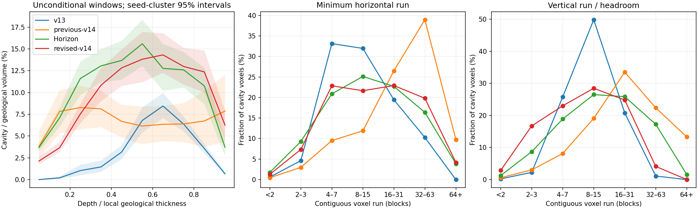
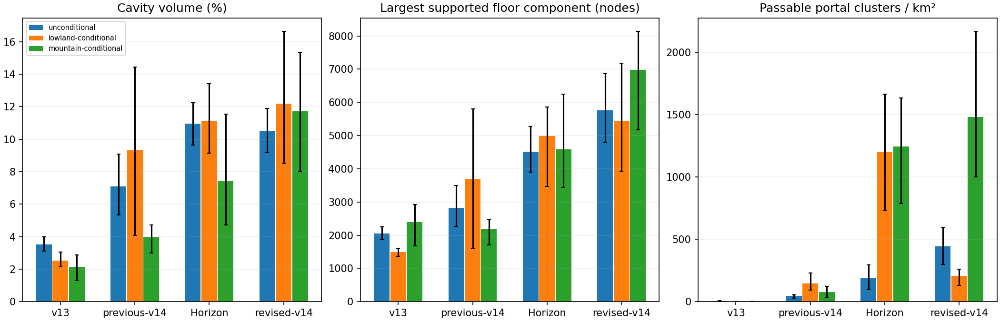
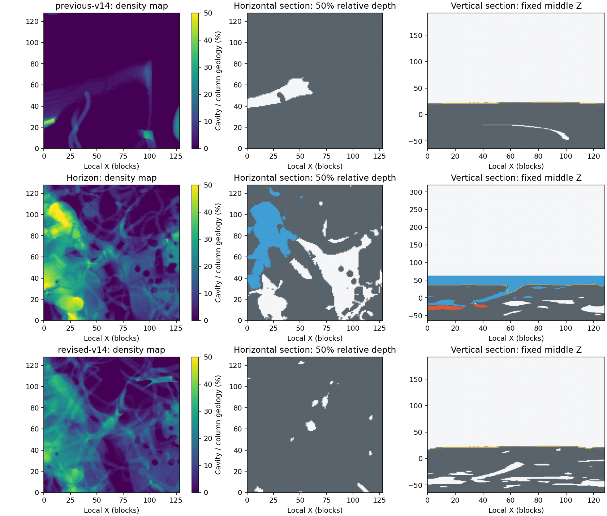
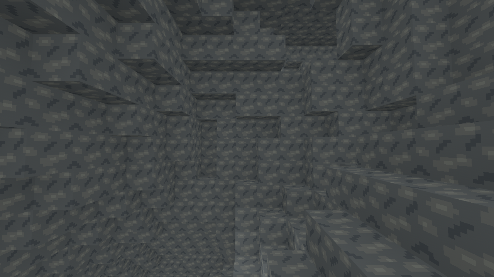
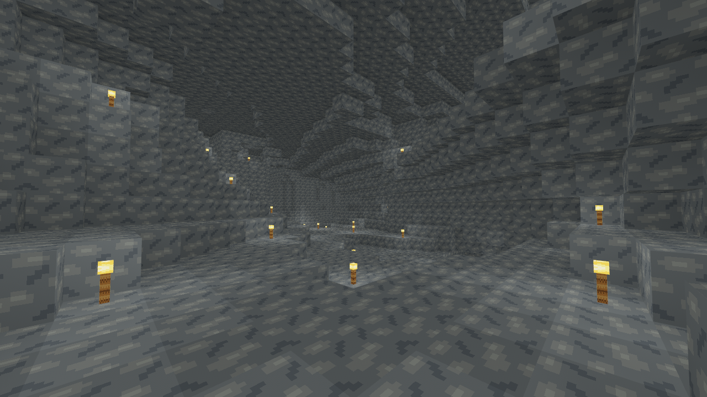
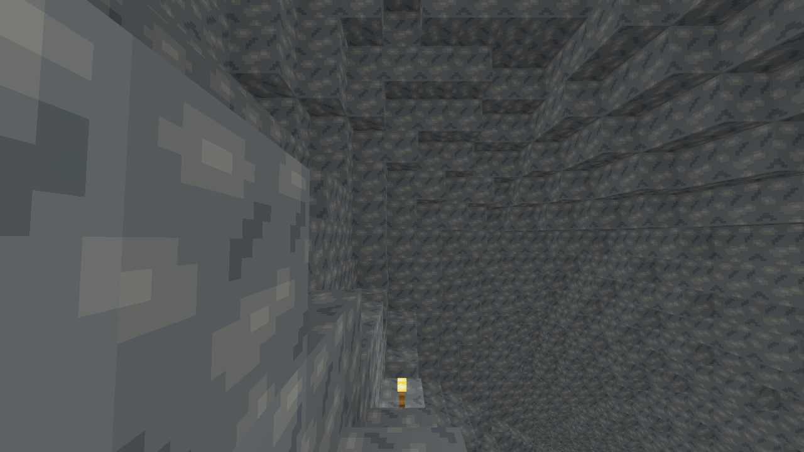

# Slice39: executable Horizon reference and replacement v14 cave model

PR #57 remains unmerged. The previous v14 candidate is frozen at
`5c5673bc15b3f8a11fc0981db0cd90413bc58897`; the merged v13 baseline is
`c6d36393c037e4295bf93c6a4efbc9fa12dd053c`. Earlier Slice39 reports describe
archived candidates. The previous 7.58% result was **not** a tuning target.

The replacement is measurably closer to executed Horizon in horizontal passage
sizes and relative depth distribution. It still does **not** establish vanilla
parity: dry floor connectivity, surface openings, mountain distributions,
compressed vertical scale and missing aquifers remain substantial differences.

## What was inspected and executed

[Horizon](https://github.com/horizon-rust/horizon) is pinned to
`0de893227f0dc4ad7bbbedee37744e007df04151`. Its actual implementation separates:

- `crates/horizon-world/src/worldgen/router.rs`: compilation of temperature,
  vegetation, continents, erosion, depth, ridges, surface level and final density.
- `worldgen/terrain.rs`: bulk density interpolation, positive-density rock and
  non-positive-density aquifer decisions; not a complete generated world alone.
- `worldgen/carver.rs`, `carver/generation.rs`, `carver/canyon.rs`: ordered
  chunk-owned legacy cave/canyon starts, branching random walks, ellipsoids and
  floor cuts. Generation discovers a17×17 source-chunk neighborhood.
- `worldgen/aquifer/`: noise-based fluid levels/pressure and cavity substance.
- `crates/horizon-core/src/density/`: compiled scalar/bulk graph, interpolation,
  caches, intervals, splines and composition. `src/noise/` and `src/random/`
  implement gradient Perlin, paired octave stacks and named positional seeds.

There are no named hardcoded Rust functions implementing the complete Overworld
cheese/spaghetti/noodle graph. Those names are composed by external functional
26.3 registry definitions. Read-only inputs were obtained at immutable
[`misode/mcmeta`26.3-data](https://github.com/misode/mcmeta/tree/538b2b167248c648b2198f2c0d56eced10dfc0cf/data/minecraft/worldgen).
The real registry directory is `worldgen/carver`, not `configured_carver`.
External JSON is not vendored, represented as MIT code, or needed by the game.
No game JAR, asset or proprietary source was imported.

A temporary minimal workspace compiled the original `horizon-core`,
`horizon-world` and `horizon-threads` sources. Source hashes were checked against
the pinned checkout. The original density graph, interpolation, noise-based
aquifer and three ordered Overworld carvers actually executed for80 regions.
All56 land biomes in these inputs select cave, cave-extra-underground and canyon
in the same order. Four logical states classify Stone/Air/Water/Lava; carver mask
application proceeds downwards. Input/source/binary hashes and exact measurement
adapters are in [raw/reference](raw/reference); the reusable adapters and isolated
checkout procedure are in [tools/horizon_reference](../../../../tools/horizon_reference/README.md).

This is **Horizon cave-stage geometry**, before material rules, bedrock placement,
structures and decoration. Fresh-world blending defaults and zero beardifier
apply. It is not a complete playable Horizon world, an exported vanilla world,
or a rerun of Horizon's JVM differential oracle. Foundation/roof exclusions
reduce material-stage effects; they cannot prove those stages are irrelevant.

### What Horizon's published parity tests establish

At this pinned commit, `docs/world-generation.md` reports whole-chunk block-state,
quart-biome, canonical block-entity NBT, scheduled block/fluid tick and
postprocessing comparisons, with explicit format/default-state normalizations.
Its reported Overworld seed12345 corpus covers42 sites/372 chunks: structure
stage comparisons at35 sites have no differences; full generation retains four
chunks differing by three blocks and one block entity. Other documented corpora
include decorated regions and Nether/End. These are **upstream-reported results**,
not experiments rerun here or a proof about every seed/region.

`tools/test_chunk_generation_parity.py` invokes a Java26.3 oracle with pinned
official libraries and Horizon's `world_probe chunk_dump`. Its default terrain
corpus uses three seeds and six sites/seed with radius1, plus structure-specific
selection/regressions. Noise parity tools additionally compare scalar/volume
Perlin, octave and RNG behavior, including signed/boundary inputs. They validate
sampled block/biome/state agreement and arithmetic, not population cave encounter
rates, universal navigability or all possible cave shapes. The official library
hosts remain unavailable under this environment's network policy, so that oracle
was not executed locally. The direct Horizon execution above did succeed.

## Why the architecture changed

The previous candidate combined128-cell admitted rooms, deep/upper anchors,
Bezier connections, three single-octave value fields, selected residual pillars
and independent80-block graded entrance templates. Its shape and density had
little mathematical relationship to Horizon, despite more caves than the first
candidate. Two preferred levels, broad smooth voids and recurring entrances
followed from that design.

Horizon combines signed functions before block classification:

1. Multi-octave gradient noise gives cheese irregularity; a rapidly varying
   vertical layer term adds shelves and separates floors. Terrain-density
   gating suppresses broad cheese near the surface.
2. Independent ridges intersect through `max(abs(A),abs(B))` for3D spaghetti.
   Rarity changes spatial scale; thickness and roughness change local walls.
3. A separate2D spaghetti function follows a noisy elevation, with a cubed
   vertical distance term. It is not another copy of the3D tunnel field.
4. `min` unions those cavities; `max` with positive pillar density leaves rock
   inside broad cavities. Pillars are residual density, not placed cylinders.
5. Gated noodles intersect two separately interpolated high-frequency ridges.
   They can connect systems or remain thin, disconnected and unwalkable.
6. Traditional branching carvers intersect this field and terrain naturally.
   Aquifers subsequently distinguish rock pressure barriers, dry Air and fluid.

V14 now follows these principles. The owner-room graph, value fields and entrance
templates were removed. A small attributed MIT scalar subset adapts Horizon's
named xoroshiro seeds, MD5 identifier transform, gradient permutation construction,
quintic Perlin and paired octave stacks. All20 named cave samplers retain the
reference functional octave/amplitude inputs;720 measured signed/distant samples
match Horizon within2e-6. An independent standard-library Python evaluator checks
the same measured fixture in both CI platforms. This tolerance concerns numeric
primitives, **not block-identical world generation**.

Original RustCraft integration expresses cheese/layer, entrances, distinct2D/3D
spaghetti, roughness, pillars and gated noodle composition. Cave/cave-extra/canyon
source probabilities use reference inputs0.15/0.07/0.01. Independently authored
carvers use bounded branching yaw/pitch walks, sinusoidal width, occasional rooms
and ellipsoid floor cuts. They intentionally use RustCraft's deterministic
integer path arithmetic and96-step bound, rather than claiming legacy RNG/path
parity. There is no imposed entrance length, descent or guaranteed walkability.

### Vertical and terrain adaptation

RustCraft keeps boundsY[-64,192), sea2, existing v13 terrain and fifteen biomes.
The reference usesY[-64,320), sea63. Below sea, the coordinate used for cave noise
is `reference_y = -64 + (rust_y+64)*127/66`; above sea it is `rust_y+61`.
Horizontal wavelengths remain unchanged. The v13 local terrain depth replaces
Horizon's terrain sloped-cheese input. It is therefore a cave adaptation over
RustCraft terrain, not a copied terrain router. Deep vertical cave dimensions
compress by about0.52; the larger mountain rock volume also changes relative
cavity distribution. Absolute Y coordinates must not be treated as equivalent.

A separate, explicitly transformed reference sensitivity resamples actual Horizon
occupancy through that mapping. It helps assess vertical-domain effects without
representing transformed geometry as native Horizon output. The separate
[remapped sensitivity calculation](comparison-remapped.json) retains its results;
the primary tables below always use native, untransformed Horizon geometry.

Noise corners quantize toQ20, followed by integer4³ interpolation and classification.
Horizon uses4×8 interpolation; the shorter deep domain motivates RustCraft's
4-block vertical grid. Conservative cell intervals skip provably solid cells.
A lazy immutable noise cache belongs to each Generator;16 lazily allocated bands
belong to each column plan. Carvers discover eight source-chunk rings. The nominal96-step budget can
repeat a split-point advance once, so a root-to-tip route has at most97 one-block
advances; together with source-chunk offset and bounded radius it stays within125
blocks of the source chunk. There is no
resident world cave map, additional worker, neighbor-generation dependency or
change to radius1–4 publication/cancellation.

Historical1–13 dispatch/fixtures, exact v13 surface/biome inputs, foundation,
spawn, water-bed/bank guards, supported vegetation and authoritative saved edits
remain. Density/carvers may intersect dry surfaces naturally, replacing the old
blanket eight-block carving roof and explicit entrance exceptions. Analysis still
omits eight roof blocks consistently across arms. V14 keeps its existing dry-cave
contract and excludes historical underground pools; full aquifers remain Slice40.
Surface/player water, formats and bounds are unchanged. Unknown15+ fails closed.
Old **unmerged v14** procedural terrain changes; existing saved edits, including
explicit Air, remain authoritative. No historical world is migrated.

## Cohort and measured comparison

Primary cohort:64 unconditional128×128 windows over16 seeds, four near/distant
positions per seed, selected before the Horizon experiment without cave queries.
Every primary arm uses identical seed/X/Z/window IDs. Existing v13/previous-v14
final occupancy is reused with its recorded hashes; the new v14 and Horizon
volumes were generated independently. Primary rows are not reweighted by terrain.

An additional16 windows per arm cover four seeds with two plains and two mountain
regions each. Horizon uses its terrain-only `chunk_surface_level` root and a
bounded first-qualifying-candidate search: mean82–104/relief≤28 for plains and
mean≥139/relief≥12 for mountains. RustCraft retains its previously defined
v13 terrain-only thresholds20–42/≤28 and≥78/≥12. These **separate conditional
coordinates** are not presented as matched columns or population weights.
All attempts, coordinates and criteria are recorded in the plans/adapters.

The common analyzer reads actual final occupancy at each engine's bounds,
excludes four foundation layers/eight roof blocks, and normalizes depth by local
geological thickness. Cavity includes Air, water and lava; dry traversal requires
solid support, two Air blocks, level/one-block moves and jump head clearance.
Six-connected void graphs are separate from supported floor graphs. Runs/broad
cores are shape proxies, not unique cave counts. Window boundaries censor
components; two-sweep geodesics are lower bounds. Four fixed surface waypoint
paths count nearby eligible deep portals and unreachable pairs. Neither seeing
a distant opening nor swimming/construction is assumed.

Descriptive95% intervals resample whole seed clusters4096 times; windows and
voxels are not independent samples. This is an evaluation cohort, not held-out
validation of distributional parity. No scalar frequency was tuned to these
measurements. Full aggregate results are in [summary.json](summary.json).

| Primary64-window measure | Merged v13 | Previous v14 | Horizon cave stages | New v14 |
| --- | ---: | ---: | ---: | ---: |
| Cavity / geology | 3.53% | 7.09% | 10.95% [9.64,12.24] | 10.48% [9.18,11.88] |
| Dry Air / geology | 3.52% | 7.09% | 8.57% | 10.48% |
| Mean largest supported floor component | 2,054 | 2,822 | 4,520 [3,903,5,280] | 5,761 [4,789,6,877] |
| Geometry route lower bound, mean blocks | 215 | 232 | 447 | 403 |
| Supported route lower bound, mean blocks | 158 | 142 | 232 | 253 |
| Eligible portal clusters/km² | 3.8 | 41.0 | 188.8 [97.3,294.7] | 442.5 [296.6,591.3] |

Narrow runs below4 blocks occupy11.04% of Horizon cavity voxels, compared with
3.44% previously and8.61% now. Very broad horizontal runs≥32 blocks fall from
48.69% to23.98%, versus Horizon20.24%. Broad-core component counts rise from213
to1549, versus2630 in the reference; these are clipped geometric cores, not unique
physical caverns. Mean largest-component vertical extent is53.1/90.9/59.7 blocks
(previous/reference/new), which still reflects RustCraft's compressed depth.
None of the64 primary windows in these arms is nearly solid; this says nothing
about solid-rock frequency at smaller or unobserved locations.

The distribution comparison is more informative than volume alone:

| Error against actual Horizon | Previous v14 | New v14 | Error reduction, paired seed95% interval |
| --- | ---: | ---: | ---: |
| Horizontal-run histogram total variation | 0.322 | 0.059 | 0.263 [0.168,0.385] |
| Vertical-run histogram total variation | 0.245 | 0.157 | 0.088 [-0.026,0.187] |
| Relative-depth-bin mean absolute error | 4.64pp | 2.00pp | 2.64pp [1.27,4.08] |

Total variation is half the absolute difference between normalized seven-bin
histograms. Depth error equally weights ten relative-depth bins. The vertical-run
improvement is **not robust across these seed resamples**; its interval crosses
zero. [comparison.json](comparison.json) and `tools/compare_horizon_caves.py`
retain the calculations. Width and depth gains are supported beyond the point
estimates; they do not prove universal visual or experiential similarity.

Conditional cavity percentages (eight windows/four seeds in each stratum) are
Horizon11.12% plains/7.44% mountains versus new v1412.18%/11.72%; previous v14
was9.32%/3.96%. New v14 therefore over-carves the sampled mountain geology.
Conditional portal densities also differ strongly and should not be hidden by
the pooled result. The raw component, broad-core, width, height, regional,
vertical-extent and path records are retained for every window.

[Second fixed region](sections-s01-0.png) and
[highest mean reference terrain in the unconditional cohort](sections-s08-1.png)
show additional distributions. Fixed slices use each engine's real Y extent;
they are not vertically stretched into a supposed block correspondence. Gray is
rock, white Air, blue water, orange lava; gold is natural ground.

## Actual Bevy captures

The gallery uses actual v14 geometry, original RustCraft materials and the
production Bevy mesh/shader pipeline. Cameras were selected near the middle and
half geological depth of fixed ordinary windows, requiring supported clearance
and at least eight visible Air blocks in a horizontal direction. A separately
terrain-selected mountain supplements the ordinary sites; it is not the primary
comparison. Camera metadata accompanies each image. Geometry is never cleared
for a screenshot.

These three inspection images use the recorded development diagnostic light
floor10 plus supported floor torches. The separate
[ordinary torch-only view](../../../images/slice39/horizon/horizon-ordinary-0-torches.png)
uses normal lighting. Neither mode changes cave shape. The saved uninstrumented
executables captured geometry before CPU-only caching/sampling optimizations;
all80 region exports are subsequently checked byte-for-byte for unchanged output. Captures use software
Vulkan/llvmpipe under Xvfb; they do not establish native GPU FPS or VRAM behavior.

The [production-client surface view](../../../images/slice39/horizon/gameplay-fixed-site.png)
and [normal torch input](../../../images/slice39/horizon/gameplay-fixed-site-torch.png)
use an isolated new seed2026 world created through the actual menus. The client
loaded all1296 radius4 chunks, walked from[88.5,55,-167.5] to[88.5,42,-175.2],
placed a Torch with ordinary right-click (32→31), and completed normal save/quit
with exit0. This fixed historical location is a surface gameplay smoke test,
not a new cave-interior showcase. The keyboard-only initial capture attempt
misnavigated the menu because pointer hover changed selection; the repeated
flow used the visible buttons and is recorded in `manual-record.json`.

## Performance, compatibility and validation

Performance measurements and complete checks are recorded below after the final
source/binary fingerprints are verified. Raw samples retain outliers and both
execution orders; v13 and the exact previous5c5673b candidate are distinct arms.

## Remaining assessment

The replacement now shares the reference's actual noise primitives and cave
composition principles, rather than approximating them through isolated rooms
and arbitrary value-field thresholds. Horizontal size distribution, depth
profile and route lengths provide meaningful measured progress toward the
modern Minecraft underground. Ordinary screenshots expose the result without
requiring a showcase cavern.

There is still no basis to call the experience convincingly equivalent to
vanilla. Surface portal frequency is too high in the primary cohort; dry
navigation differs because RustCraft lacks reference fluids/pressure barriers;
mountain cavity volume is excessive in the conditional cohort; vertical
compression changes scale; the terrain router and carver RNG/paths are adapted,
not byte-equivalent. Material/structure/decoration stages and native Void/Windows
GPU acceptance remain outside these measurements. These are explicit remaining
limits, not completed roadmap items. PR #57 must remain available for review.
