# Slice 42: Cave Generation Final Refinement

**Follow-up:** new worlds now select **v16**. See the [entrance-frequency refinement](entrances/README.md) for the current implementation, paired v15/v16 captures and new measurements. The v15 report and raw evidence below are preserved as historical results.

This is a refinement of Slice39 commit `0818031a5d2a9dab248098ea5a45a4338748cd4b`,
not a replacement architecture. PR #57 was open/unmerged when inspected; Slice42
is stacked on `feat/slice-39-cave-generation-v3`. Main was `c6d3639`. No other
open implementation PR or Slice42 issue superseded the supplied request. Neither
PR is merged automatically.

At the original v15 checkpoint, new worlds selected **generator15**. Recorded generators1–14 and all existing edits
keep their original behavior. Bounds remain Y[-64,192), sea2; terrain, fifteen
biomes, materials, assets, save envelopes, water mechanics, renderer and supported
radii1–4 are unchanged.

## Audit and technical causes

The audit followed `Versioned` through point sampling, full-column rasterization,
vegetation support, water-bed/bank permission, compact chunk descriptors and
regional save identity validation. It inspected the signed cheese/layer/pillar,
2D and 3D spaghetti, gated noodles, and source-chunk cave/canyon walks separately.
The old room-graph/entrance-template reports are archived designs, not the v14
starting point.

Three adaptation problems matter:

1. V14 remaps the reference's127-block foundation/sea span into66 physical blocks.
   Its deep noise Y derivative is127/66, changing abruptly to1 at sea2. This
   compresses layer spacing, ridges and passage heights together. It is an
   integration choice, not a defect in the pinned Horizon Perlin implementation.
2. V14's sloped-cheese substitute is simply `(height-y)/8`. Its near-surface branch
   and cheese penalty saturate at shallow vertical cover regardless of local
   surface orientation or mountain overburden. Broad entrance noise loses its
   low-altitude bias at high elevations. That combination offers high mountain
   rock the same broad-cavity admission as ordinary underground rock. The earlier
   conditional mountain excess therefore cannot be explained away only by there
   being more mountain rock: the reported fraction already divides by geology.
3. Thin 3D ridges and noodles can independently intersect the surface. Noodles
   bypass the main density's terrain branch entirely. On uneven interpolated
   terrain this can produce small breaches and several supported portal patches
   around one larger system. These are different from the traditional carvers'
   larger ellipsoid intersections. A single frequency multiplier cannot fix
   excessive unconditional/mountain portals and scarce conditional plains portals
   in opposite directions.

The existing carvers remain bounded, deterministic, independently authored walks:
0.15/0.07/0.01 source admission, up to97 root-to-tip advances, radius≤12 and eight
source-chunk discovery rings. Their adapted RNG/path and vertical start conversion
are not byte-equivalent to Horizon. They already provide small/medium openings
and intersections without a room graph; no new path template or guaranteed route
was justified. Water seals, dry-cave behavior, different terrain and world bounds
also explain real reference differences that this slice deliberately retains.

## Changes and their limits

V15 composition is isolated in `caves_v3/density/refinement.rs`; the v14 `values`
function is retained. Both share the exact named Horizon primitives, Q20 corner
quantization, globally aligned4³ interpolation, conservative active-cell proof,
carvers and final protection/classification paths.

- **Physical vertical grain:** noise Y is physical Y+32 throughout the world. The
  offset puts the reference2D elevation band within the existing underground;
  physical wavelengths no longer change at the sea plane. The bottom density
  fade uses RustCraft cover above the protected foundation. This samples a
  different reference interval rather than stretching every vertical formation
  to force a sea/foundation correspondence. No world dimensions change.
- **Terrain coupling:** one additional padded height-lattice ring supplies
  coordinate-stable central slope estimates. A bounded exposure term changes
  broad entrance bias continuously between lowlands, plateaus and exposed slopes.
  The near-surface cover transition responds to that exposure. Only high-altitude
  cheese receives an extra mountain bias; deep mountain systems and narrow
  families remain available. There is no biome admission table or global cave
  frequency adjustment.
- **Surface perforations:** thin3D spaghetti needs graded geological cover on
  elevated flat ground; that fade shortens on slopes and grades away in ordinary
  lowlands. Noodle thickness fades near the surface, leaving broad entrance noise and traditional walks available there.
  These are signed-density transitions, not a hard roof, placed doorway or fixed
  entrance descent.
- **Intersections:** a bounded smooth minimum joins the broad/3D branch and2D
  spaghetti only near coincident density boundaries. Its maximum density change
  is0.015; distant rock and cavern interiors retain their classification. This
  can open short necks between existing spaces without increasing every tunnel's
  thickness. Pillars still leave residual rock after this composition.

A first candidate with physical grain/terrain coupling/noodle fading was evaluated
before the final thin3D surface fade and bounded intersection blend. Its aggregate
entrance reduction was small; it improved supported vertical reach but did not
establish better routes. The first candidate's analyses are retained separately.
The first uniform thin3D cover rule suppressed too many plains entrances in the
additional regions. Its cover influence is therefore graded by upland exposure,
leaving ordinary lowlands'3D entrance geometry available. The uniform-cover
candidate's analyses are retained too. This fixes a terrain-policy error rather
than rejecting unfavorable seeds. The final changes were evaluated together:
individual causal effect is **not** claimed from a parameter sweep.

Slopes/height vertices are cached once per column plan, not evaluated for every
voxel/band. The noise cache remains lazy and immutable. No world-sized cave map,
neighbor generation dependency, extra worker or larger streaming budget is added.
The extra height ring and changed geometry can still cost CPU/memory; measured
costs below determine that assessment.

## Executed reference and evaluation method

Horizon remains pinned to `0de893227f0dc4ad7bbbedee37744e007df04151`; functional
registry inputs remain at `538b2b167248c648b2198f2c0d56eced10dfc0cf`. Original
`horizon-core`, `horizon-world` and `horizon-threads` ran in the existing isolated
minimal reference workspace. The density graph/interpolation, noise-based aquifer
and three ordered Overworld carvers execute. No Minecraft JAR, source or asset is
needed or added. The small game-side scalar subset retains its original MIT-only
license/copyright; application code remains MIT OR Apache-2.0.

This is **Horizon cave-stage occupancy before material rules, structures and
features**, not a complete Horizon/Minecraft world or a locally rerun vanilla JVM
oracle. Fluids remain obstacles to reference dry traversal. RustCraft remains dry
underground and keeps its different terrain/bounds. No exact Minecraft parity is
claimed.

The existing80-window comparison is regenerated:64 unconditional128² windows over
16 seeds, plus8 plains/8 mountain windows over four seeds. Regenerated v14 and
Horizon volumes each match **all80 original Slice39 SHA256 hashes exactly**.
The common analyzer operates on final occupancy, excludes four foundation/eight
roof cells and normalizes geological depth by each column's remaining rock height.
Horizontal coordinates/seeds match in the unconditional arms. Conditional reference
and RustCraft coordinates are selected independently from terrain alone using the
established per-engine thresholds; they are not matched terrain or population
weights.

An additional40 windows cover independent seeds7/19/31415/8675309, including16
unconditional and8 each plains/mountain/hill windows. Another20 stress windows use
seeds104729/271828, including8 unconditional and4 per terrain stratum. These were
selected without cave queries but inspected during refinement; they are additional
evaluation, not untouched holdouts. A final20-window **confirmation** cohort uses
seeds65537/99991 after the regional cover rule was frozen:8 unconditional and4 per
terrain stratum. No parameters were changed using that cohort. Its two-seed sample
is a sensitivity check, not a population claim. All plans and first-qualifying
terrain-search attempts are retained. The Horizon confirmation terrain search
uses a bounded16384 candidates because the original4096 exhausted the first
seed's mountain stratum; thresholds and cave-stage code remain unchanged. No
cave-based seed rejection or reference revision update occurred.

Six-connected cavity graphs remain separate from supported standing-player floor
graphs. Floor edges require two Air blocks, full solid support, level/one-block
moves and jump head clearance; fluids/non-cube obstacles never become support.
The analyzer also records the vertical extent/16-block levels of the largest
supported component. Cavity runs/broad cores are dimension proxies, not unique
cave counts. Window edges censor components/routes; two-sweep geodesics are lower
bounds. Portal clusters require a supported component continuing24 blocks below
local ground, not merely a visible hole. Multiple portal patches can belong to
one cave. Four fixed surface waypoint paths count nearby portals and blocked
routes; they do not simulate swimming, building or an actual controller session.

Whole-seed4096-resample intervals describe the cohort; voxels/windows are not
independent trials. Two/four-seed conditional/confirmation intervals are especially
weak. Figures use actual engine Y ranges, not a vertically stretched claim of
block correspondence.

## Geometry results

| Primary64 unconditional windows | v14 | Horizon cave stages | v15 |
| --- | ---: | ---: | ---: |
| Cavity / geology (%) | 10.48 | 10.95 | 12.05 |
| Mean largest supported floor component | 5761 | 4520 | 5992 |
| Supported route lower bound (blocks) | 253.1 | 231.7 | 263.5 |
| Supported vertical extent (blocks) | 28.1 | 35.8 | 34.3 |
| Geometry route lower bound (blocks) | 403.4 | 447.2 | 387.7 |
| Eligible deep portal clusters/km² | 442.5 | 188.8 | 444.4 |

Vertical shape improves independently of horizontal widening: vertical-run histogram
error drops from0.1572 to0.0778 total variation. The paired seed95% error-reduction
interval is[0.0398,0.1220]. Horizontal-run error remains0.0590/0.0591; its difference
is not distinguishable here. Relative-depth error is2.00→1.76 percentage points,
but its reduction interval crosses zero[-0.44,0.83]pp. That depth gain is not robust.

The pooled portal excess remains essentially unchanged versus v14 and still exceeds
the reference. This is **not a universal entrance-frequency fix**. Regional results
are more informative than forcing a global frequency change:

| Existing terrain-conditioned stratum | Metric | v14 | Horizon | v15 |
| --- | --- | ---: | ---: | ---: |
| Plains | Cavity / geology (%) | 12.18 | 11.12 | 13.05 |
| Plains | Deep portal clusters/km² | 206.0 | 1197.8 | 419.6 |
| Mountains | Cavity / geology (%) | 11.72 | 7.44 | 10.42 |
| Mountains | Deep portal clusters/km² | 1480.1 | 1243.6 | 915.5 |

Mountain cavity fraction falls while sizeable cave systems remain. Plains entrance
density increases in this cohort, but mountain/plain differences are not eliminated.
The higher pooled cavity volume is not itself a success criterion. Geometry routes
shorten despite longer primary supported routes; no blanket connectivity gain is claimed.

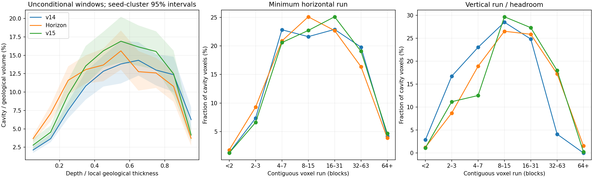

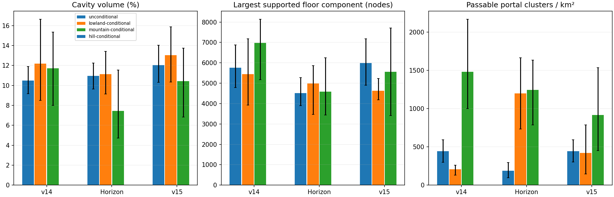

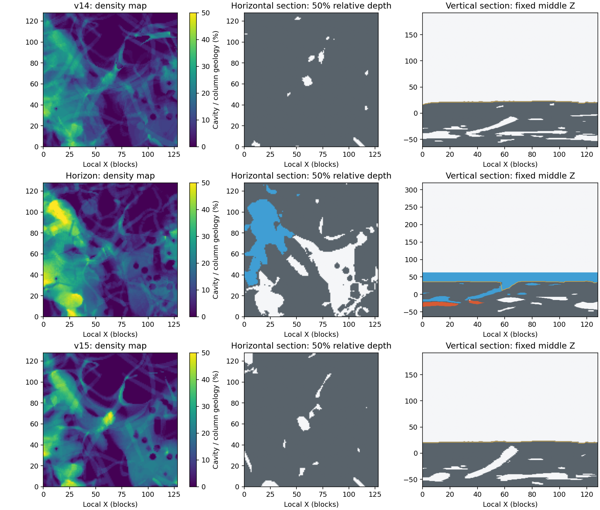

[Another ordinary window](sections-s01-0.png) and [terrain-selected mountain](sections-s01-6.png)
retain native engine Y extents. White is Air, gray rock, blue/orange reference fluids.

| Independent cohort / stratum | Measure | v14 | Horizon | v15 |
| --- | --- | ---: | ---: | ---: |
| Additional4 seeds / unconditional | cavity % | 8.04 | 8.57 | 9.77 |
| Additional4 seeds / unconditional | portal clusters/km² | 320.4 | 209.8 | 351.0 |
| Additional4 seeds / unconditional | supported route blocks | 247.4 | 201.1 | 242.8 |
| Additional4 seeds / plains | cavity % | 8.64 | 12.43 | 8.89 |
| Additional4 seeds / plains | portal clusters/km² | 473.0 | 839.2 | 587.5 |
| Additional4 seeds / plains | supported route blocks | 247.0 | 317.6 | 226.2 |
| Additional4 seeds / mountains | cavity % | 8.60 | 7.18 | 8.21 |
| Additional4 seeds / mountains | portal clusters/km² | 1319.9 | 1022.3 | 885.0 |
| Additional4 seeds / mountains | supported route blocks | 274.6 | 256.6 | 270.5 |
| Additional4 seeds / hills | cavity % | 12.25 | 8.27 | 12.21 |
| Additional4 seeds / hills | portal clusters/km² | 717.2 | 930.8 | 755.3 |
| Additional4 seeds / hills | supported route blocks | 311.9 | 227.5 | 247.8 |
| Stress2 seeds / unconditional | cavity % | 10.62 | 10.81 | 11.47 |
| Stress2 seeds / unconditional | portal clusters/km² | 389.1 | 15.3 | 228.9 |
| Stress2 seeds / unconditional | supported route blocks | 274.1 | 228.5 | 275.4 |
| Stress2 seeds / plains | cavity % | 6.51 | 14.86 | 7.96 |
| Stress2 seeds / plains | portal clusters/km² | 503.5 | 869.8 | 167.8 |
| Stress2 seeds / plains | supported route blocks | 281.5 | 270.2 | 202.0 |
| Stress2 seeds / mountains | cavity % | 9.24 | 7.75 | 7.08 |
| Stress2 seeds / mountains | portal clusters/km² | 1281.7 | 885.0 | 946.0 |
| Stress2 seeds / mountains | supported route blocks | 280.5 | 215.5 | 257.0 |
| Stress2 seeds / hills | cavity % | 7.79 | 7.61 | 7.33 |
| Stress2 seeds / hills | portal clusters/km² | 1251.2 | 1205.4 | 762.9 |
| Stress2 seeds / hills | supported route blocks | 287.0 | 288.2 | 185.0 |
| Final confirmation2 seeds / unconditional | cavity % | 10.44 | 10.64 | 11.80 |
| Final confirmation2 seeds / unconditional | portal clusters/km² | 602.7 | 465.4 | 473.0 |
| Final confirmation2 seeds / unconditional | supported route blocks | 249.9 | 200.9 | 222.9 |
| Final confirmation2 seeds / plains | cavity % | 7.55 | 4.82 | 7.63 |
| Final confirmation2 seeds / plains | portal clusters/km² | 671.4 | 1007.1 | 228.9 |
| Final confirmation2 seeds / plains | supported route blocks | 342.8 | 232.8 | 315.0 |
| Final confirmation2 seeds / mountains | cavity % | 8.01 | 6.82 | 6.89 |
| Final confirmation2 seeds / mountains | portal clusters/km² | 1266.5 | 1388.5 | 412.0 |
| Final confirmation2 seeds / mountains | supported route blocks | 220.2 | 237.5 | 289.5 |
| Final confirmation2 seeds / hills | cavity % | 6.84 | 7.00 | 7.64 |
| Final confirmation2 seeds / hills | portal clusters/km² | 671.4 | 885.0 | 778.2 |
| Final confirmation2 seeds / hills | supported route blocks | 234.2 | 197.0 | 242.8 |

These data expose real limits: some plains lose entrances, some hill/floor networks
and supported routes shrink, and the confirmation mountain entrance rate is low.
The final rule was not changed to repair individual confirmation sites. Variability,
isolated cavities and dead ends remain; these small strata do not establish regional
Minecraft parity. Full component/broad-core bins, width/height/depth histograms,
supported vertical levels, surface routes, all raw windows and seed intervals are in
[primary](summary.json), [additional](additional/summary.json), [stress](stress/summary.json)
and [confirmation](confirmation/summary.json) summaries.

## Performance

128 samples after8 warmups per nine core scenes, then reversed execution order,
measure full-column thread CPU separately from meshing/lighting/install. Streaming
uses identical frozen v14/v15 executables in both orders, one cold trace per
scene/radius2–4 and40 simulated frames at240Hz. The two-CPU cloud quota, clock/probe
overhead and short trace lengths limit interpretation. No renderer/GPU runs overlap.

| Full-column thread CPU P50 ms | v14 forward (reverse) | v15 forward (reverse) |
| --- | ---: | ---: |
| quiet-plain | 4.678 (5.041) | 5.048 (4.929) |
| cavern | 3.560 (3.670) | 3.391 (3.417) |
| rich-complex | 4.506 (4.381) | 4.835 (4.820) |
| mountain | 6.936 (6.859) | 6.870 (6.868) |
| entrance | 4.666 (4.452) | 4.616 (4.594) |
| distant | 4.864 (4.646) | 5.057 (4.910) |

Cost changes are mixed: the rich-complex core scene regresses about7–10%; other
scenes/orderings improve or regress. The extra terrain ring is not free. Streaming
tails also vary; no general speed improvement or speed-neutral claim is made.

| Radius4 request-ready P99 ms | v14 forward (reverse) | v15 forward (reverse) |
| --- | ---: | ---: |
| Cavern | 589.6 (574.4) | 571.9 (650.7) |
| Rich complex | 697.7 (727.8) | 684.4 (727.7) |
| Mountain | 1041.3 (1036.0) | 1037.9 (1212.2) |

The reversed mountain tail is about17% slower; the forward pair is nearly level.
The reversed cavern also regresses. These short observed tails are not population
guarantees. Main-thread installation and ECS update tails remain separate from
worker latency: reversed mountain install P99 is105→249µs and ECS update P99 is
197→595µs. These are headless CPU frames, not physical-GPU presentation times.

| Deterministic radius4 resource state | v14 | v15 |
| --- | ---: | ---: |
| Cavern: resident triangles | 111,428 | 92,322 |
| Cavern: voxel-cache bytes | 2,260,992 | 2,166,784 |
| Cavern: light-cache bytes | 2,787,696 | 2,787,696 |
| Cavern: mesh payload bytes | 13,814,512 | 11,445,368 |
| Rich complex: resident triangles | 162,880 | 170,572 |
| Rich complex: voxel-cache bytes | 2,301,952 | 2,248,704 |
| Rich complex: light-cache bytes | 2,822,688 | 2,816,856 |
| Rich complex: mesh payload bytes | 20,197,120 | 21,150,928 |
| Mountain: resident triangles | 326,206 | 292,320 |
| Mountain: voxel-cache bytes | 3,837,952 | 3,825,664 |
| Mountain: light-cache bytes | 4,916,376 | 4,893,048 |
| Mountain: mesh payload bytes | 40,449,544 | 36,247,680 |

Cavern/mountain mesh complexity falls; the rich complex rises. Cache payload,
installed voxel bytes, worker requested-heap windows, RSS observations and CPU mesh
payload are distinct retained measures. The mountain worker-window heap P99 is
about2.32→2.25MB forward; these windows exclude allocator metadata/stacks/driver
memory and are not total process peaks. RSS is order/history-sensitive. No VRAM,
Radeon FPS or native Windows/Void performance claim follows. Cancellation, peak
queues, failed/discarded jobs, session/radius transitions and per-stage samples
are retained in [both-order raw performance](raw/performance).


## Actual production-pipeline captures

Ten final-release Bevy images use the production voxel mesh, original atlas,
lighting and terrain shader, under Xvfb/llvmpipe. Camera selection reads final
voxels in predetermined bounded windows: supported two-block clearance, ordinary
central positions and explicit width/headroom/depth criteria. Surface cameras are
supported exterior floors with a clear Air ray to actual portal edges whose floor
component reaches24 blocks underground.
No Stone is removed, terrain reshaped or doorway constructed for a camera.

Diagnostic interiors use the recorded visibility floor10 **without torches**.
The ordinary medium/entrance views use normal lighting and at most three supported
floor torches placed by the inspection fixture; they are not recorded player input.
The cavern comparison uses the same eye/direction in v14 and v15, admitting the
old pose only when its eye is also actual Air. See [per-image metadata/logs](raw/captures)
for commands, selection, seed, eye, lighting and executable/image hashes.

The existing gallery-only context is radius6 to keep nearby unrendered cave edges
out of these inspection images. Earlier radius3 drafts visibly exposed the edge of
the drawn meshes to the sky and are excluded. This uses the existing inspection
helper's larger-context facility; **gameplay still supports radii1–4**, and its
streaming performance was measured separately. No artificial end caps were added.

| Tight small section / seed0 — diagnostic | Medium section / seed42 — diagnostic |
| --- | --- |
| 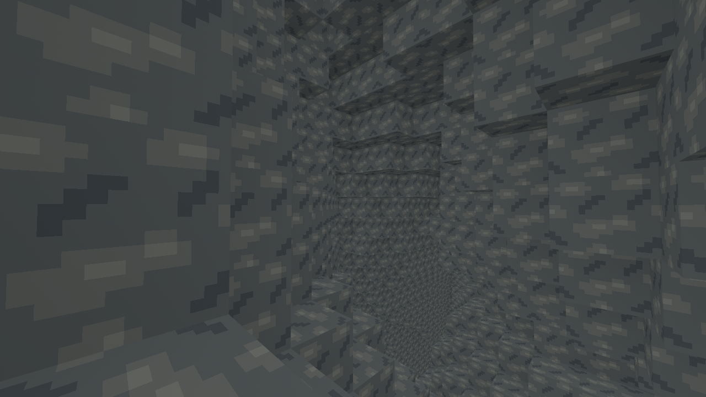 | 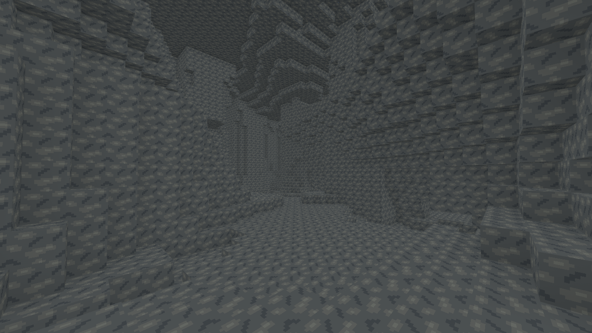 |

| Large cavern / seed42 — diagnostic | Tall formation / seed2026 — diagnostic |
| --- | --- |
| 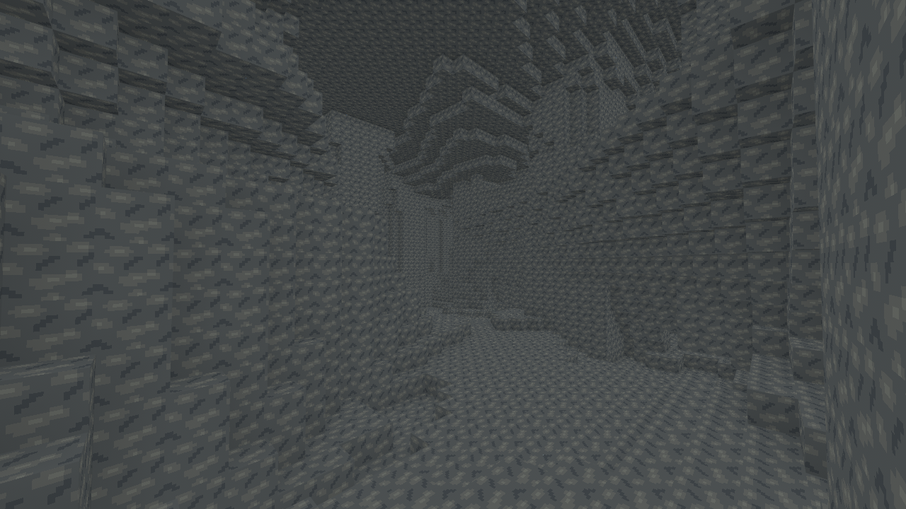 | 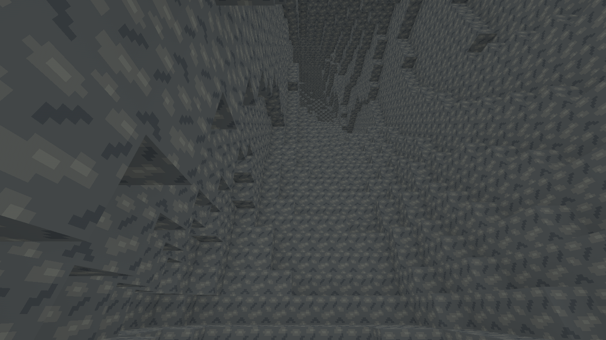 |

| Long network passage / u64::MAX — diagnostic | Deep passage / seed31415 — diagnostic |
| --- | --- |
| 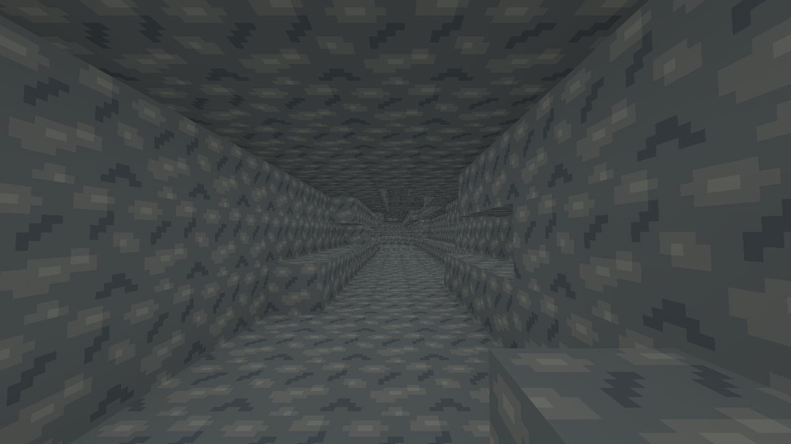 | 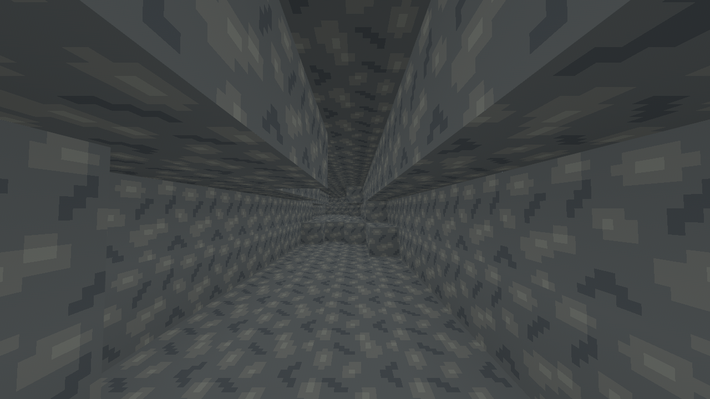 |

| Plains entrance / seed7 — normal lighting | Mountain entrance / seed7 — normal lighting |
| --- | --- |
| 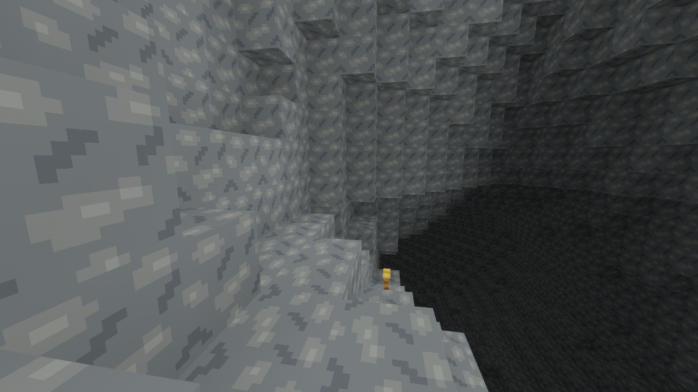 | 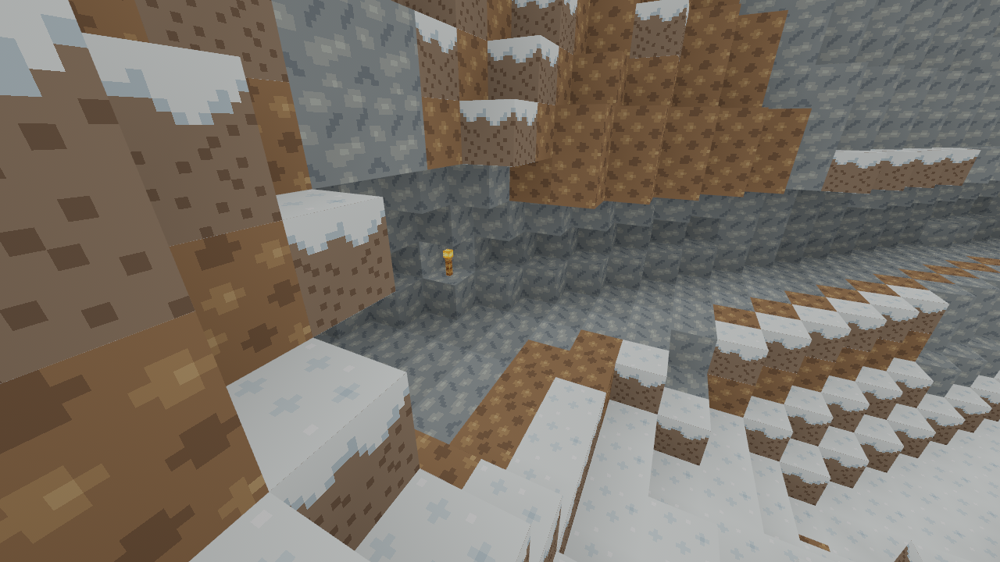 |

[Medium section with normal three-torch lighting](../../images/slice42/medium-v15-ordinary.png)
and [matched v14 cavern](../../images/slice42/cavern-v14-diagnostic.png) expose normal
darkness and the previous geometry. These are geometry inspection images, not a
native-GPU/frame-rate or full gameplay-session acceptance claim.

## Reproduction

Use the repository's pinned Rust1.99.1/Bevy0.20.0 toolchain and native dependencies.
Python analysis additionally needs NumPy/SciPy/Matplotlib. All scratch paths below
are disposable and separate from real saves.

```sh
mkdir -p work
cargo build --release --locked -p voxel_core --example cave_volume --example cave_snapshots
cargo run --release --locked -p voxel_core --example cave_volume -- --validation-plan > work/validation.csv
cargo run --release --locked -p voxel_core --example cave_volume -- --confirmation-plan > work/confirmation.csv
# The exact original cohort and per-engine conditional reference plans are in raw/.
target/release/examples/cave_volume 14 docs/performance/slice42/raw/cohort.csv work/v14
target/release/examples/cave_volume 15 docs/performance/slice42/raw/cohort.csv work/v15
python tools/analyze_cave_volumes.py work/v14 --plan docs/performance/slice42/raw/cohort.csv --output work/v14.jsonl
python tools/analyze_cave_volumes.py work/v15 --plan docs/performance/slice42/raw/cohort.csv --output work/v15.jsonl
python tools/horizon_reference/prepare.py "$PWD/work/reference42"
cargo build --release --manifest-path work/reference42/run/Cargo.toml -p horizon-world --example rustcraft_cave_reference --example rustcraft_terrain_reference
# Subsequent reference builds use --locked after the minimal-workspace lock prune.
work/reference42/run/target/release/examples/rustcraft_cave_reference work/reference42/metadata/data/minecraft/worldgen docs/performance/slice42/raw/reference-cohort.csv work/reference-volumes
python tools/analyze_cave_volumes.py work/reference-volumes --plan docs/performance/slice42/raw/reference-cohort.csv --output work/reference.jsonl
python tools/compare_horizon_caves.py --previous work/v14.jsonl --reference work/reference.jsonl --revised work/v15.jsonl --output work/comparison.json
# rustcraft_terrain_reference additionally accepts --validation / --confirmation.
```

Repeat the exports/analyses for `raw/validation-plan.csv`, `raw/stress-plan.csv`
and `raw/confirmation-plan.csv`; use their reference counterparts for Horizon.
Exporters/analyzers refuse existing output files. Render the inspection views after
exporting the additional v15 windows to `work/validation-v15`:

```sh
cargo build --release --locked -p rustcraft --example terrain_gallery
python tools/cave_refinement_views.py --cohort work/v15 --validation work/validation-v15 --output work/cave-images --executable target/release/examples/terrain_gallery
```

Use an available desktop/graphics driver; the cloud evidence uses the recorded
Xvfb/llvmpipe environment. The helper leaves procedural Stone unchanged.
 Exact scripts, inputs, source/
binary hashes and checks are indexed in `raw/manifest.json` and provenance files.

```sh
python tools/benchmark_cave_v3.py --output work/core-perf --include-original --original-ref 0818031a5d2a9dab248098ea5a45a4338748cd4b --current-generator 15 --build-only
python tools/benchmark_cave_v3.py --output work/core-perf --include-original --original-ref 0818031a5d2a9dab248098ea5a45a4338748cd4b --current-generator 15 --reuse
# Preserve that directory, repeat --reuse --reverse and retain both raw outputs.
python tools/benchmark_streaming.py --output work/stream-perf --baseline 0818031a5d2a9dab248098ea5a45a4338748cd4b --baseline-generator 14 --current-generator 15 --labels v14 v15 --caves-v3 --distance-expansion --rendering-install --frames 40 --repeats 1 --build-only
# Repeat the identical command with --reuse instead of --build-only; then
# preserve its raw outputs and repeat --reuse --reverse with the same binaries.
```

The core helper's historical output aliases are `slice38`=v13,
`v14-original`=exact0818031 v14 and `slice39`=current **v15** when selected with
`--current-generator 15`. Do not interpret the old helper label as another v14 arm.
Provenance rejects mismatched generator selections, binaries or current sources.
No performance run overlaps compilation, tests, analysis or rendered captures.

## Compatibility and regression verification

All required final local commands passed:

| Check | Result |
| --- | --- |
| `cargo fmt --all -- --check` | passed |
| `cargo clippy --locked --workspace --all-targets -- -D warnings` | passed |
| `cargo test --locked --workspace -- --test-threads=1` | **601 passed,7 existing ignored,0 failures** |
| `cargo test --release --locked -p voxel_core` | **379 passed,1 existing ignored,0 failures** |
| `cargo build --release --locked --workspace` | passed |
| Texture and independent v10/v11/v12/v13/noise reference checks | passed;720 Horizon noise samples |
| Cave analysis / authorized-export format tests |5 /2 passed |

[Full logs and machine-readable verification](raw/checks) accompany
[validation.json](raw/validation.json). The full workspace ran serially without
competing builds/renderers. No timeout budget was increased.

Coverage includes exact historical1–13 and v14 column fixtures,32 new v15 CRCs,
multiseed/signed/finite-edge point/sampler/chunk/halo/reverse/parallel consistency,
conservative lattice rejection, actual cavity/floor graphs and passage variation,
actual cave collision/mining/placement/Torch/light, water beds/banks/foundation,
supported vegetation, spawn, authoritative underground Air/construction/Torch edits
through save/eviction/reopen, strict old/new/future manifests, cancelled work,
radius4 lighting/seams/travel and repeated regional world/session switches.
Historical v14 occupancy also matches80 original full-volume hashes. The existing
Ubuntu/Windows CI matrix executes the expanded tests on the PR; native GUI/GPU
acceptance remains separate.


## Remaining limitations and native acceptance

The adaptation still uses RustCraft's terrain depth/height in place of the full
Horizon terrain-density router. Carver RNG/path/start adaptation,4³ rather than
4×8 interpolation, dry caves and the missing aquifer/material/feature stages remain.
Physical noise grain trades the former full-reference vertical remap for a selected
reference interval. Some cavities are isolated, dead ends and tight/unwalkable
noodles remain, and some larger systems have several surface portals. No universal
route, encounter-rate or Minecraft parity guarantee follows from these samples.

Native Void glibc X11/Wayland and Windows10/11 physical-GPU/controller/VRAM/endurance
acceptance remains owner testing. Cloud Xvfb/llvmpipe captures and headless CPU
traces establish neither Radeon FPS nor compositor/input behavior on those systems.
Use a fresh isolated `RUSTCRAFT_DATA_DIR` with `cargo run --release --locked -p rustcraft`:
create a seeded v15 world, inspect small/deep/mountain passages, mine/place/torch
across signed seams, vary radii2–4, travel/return, save/quit/reopen, and verify an
existing v14 world's recorded generator remains14. No forced migration or automatic
merge is performed.
