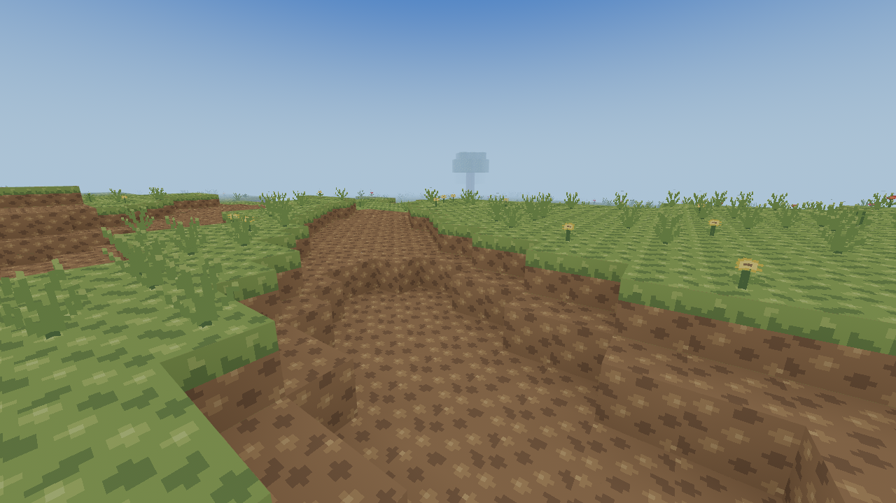
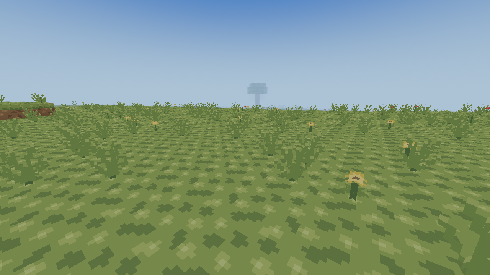
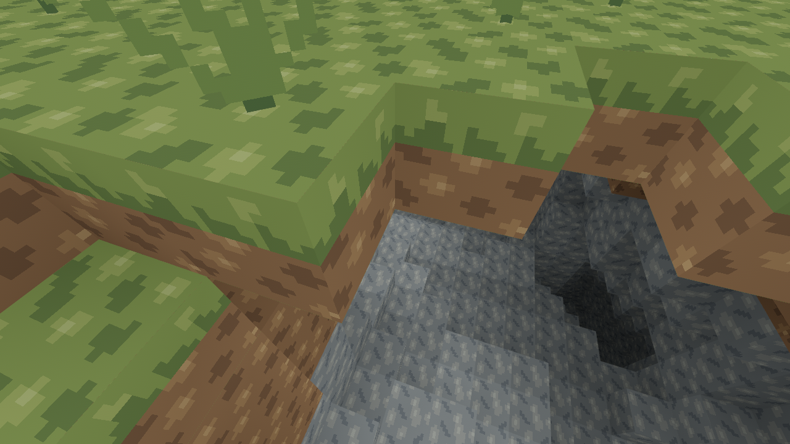
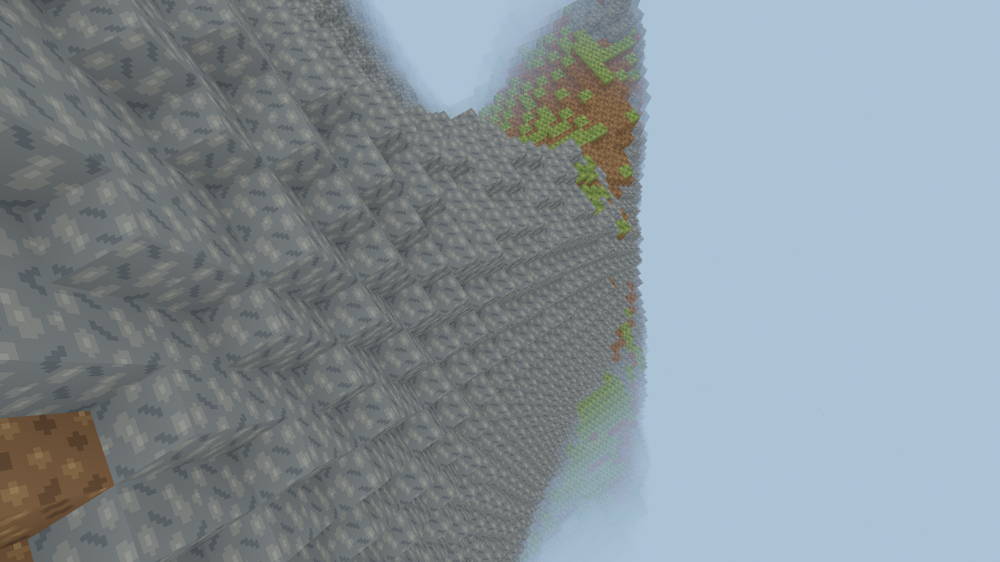
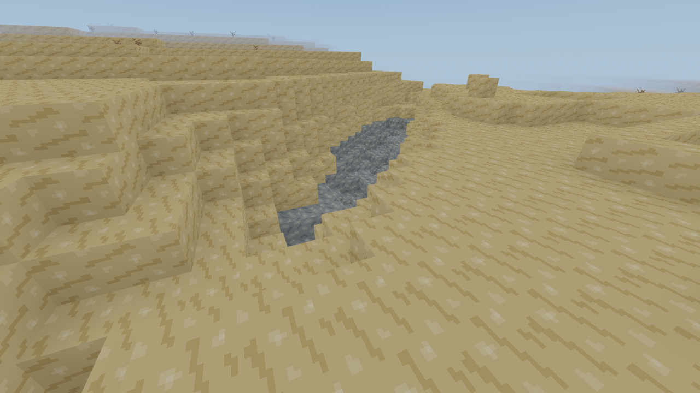
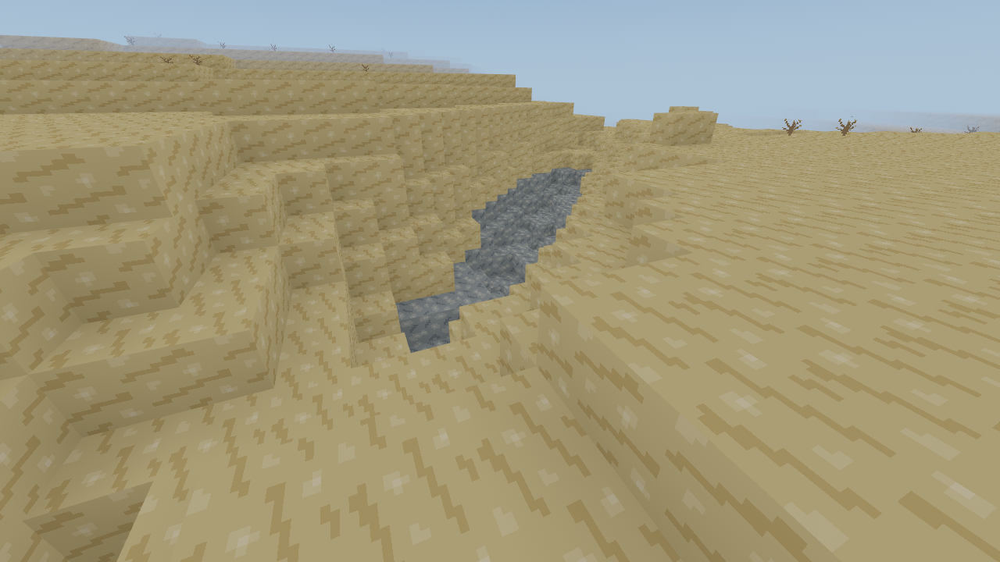
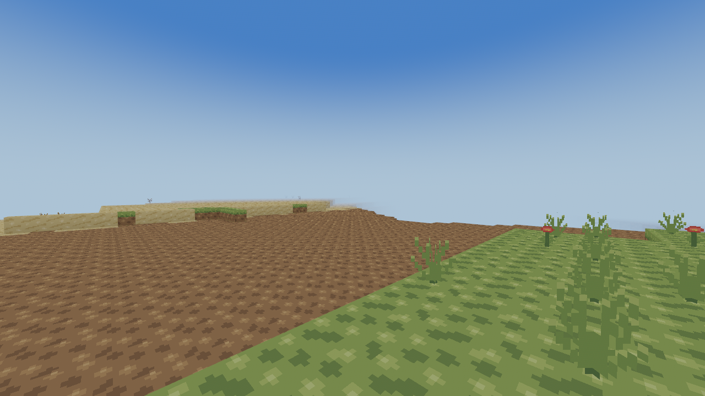
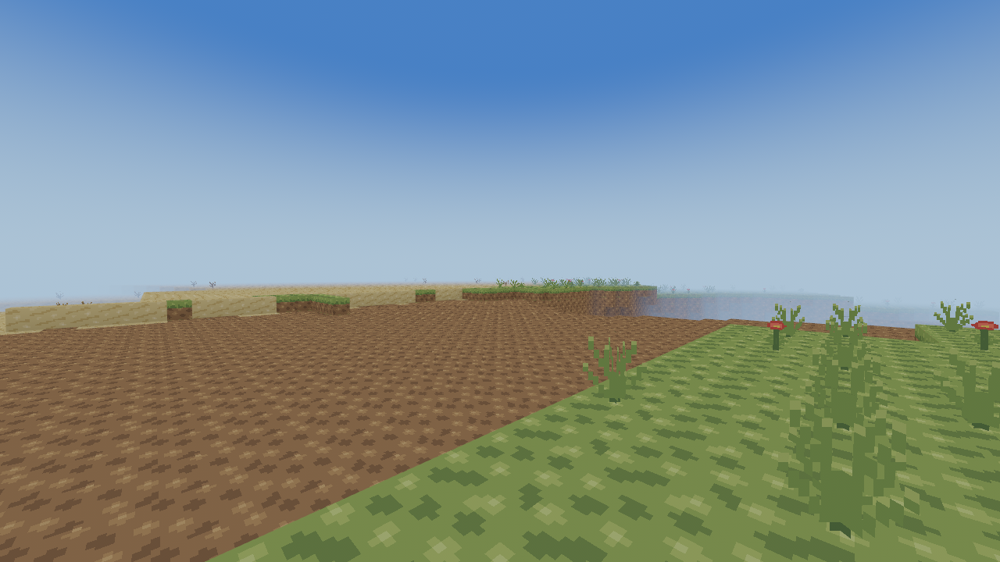
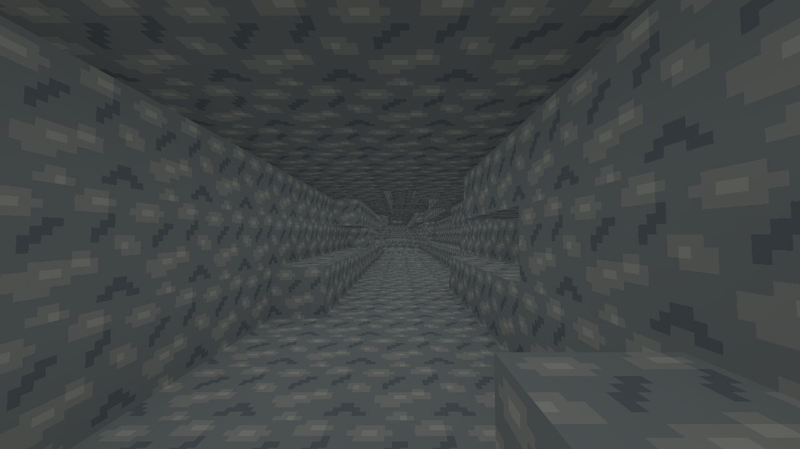
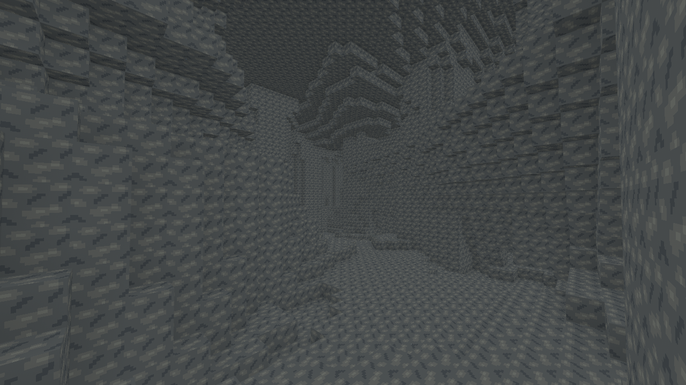

# Slice42 follow-up: controlled surface exposure (generator16)

V16 reduces the excessive surface cuts left by v15 while retaining its underground
composition. New worlds default to16; existing generators1–15, saved identities
and edits remain authoritative. This updates the same PR #58, stacked on unmerged
PR #57. No world dimensions, IDs, save formats, terrain router, biomes, fluids,
materials, assets, render distances, cache budgets or scheduling policy change.

The headline reduction concerns **visible, human-sized holes plus penetrating
pits**, including shallow depressions. It is not a claim of40–50% fewer mouths
connected to deep caves. Those mouths are largely retained. The executable
Horizon reference already has substantially more genuine deep mouths than this
RustCraft sample; suppressing every family globally would worsen that gap.

## Fixed comparison and independent confirmation

The four established cohorts retain all160 original windows: primary80,
additional40, stress20 and confirmation20. A final independent40-window cohort
uses seeds123,777,4099,900001:16 unconditional sites,8 lowlands,8 mountains and8
hills. The configuration was frozen before measuring those new seeds. Site
selection is bounded and uses terrain height/relief only, never cave frequency.
Unconditional X/Z match Horizon. Conditional sites are independently selected in
each terrain, using the established61-block sea-level offset for height strata.

Frozen v15 is commit`577b199f23a0995f765bdf81fe62f5a9f8414fe7`. All160 new v15
exports are byte-identical to the archived original volumes. The final v16
export also matches all80 first-pilot volume hashes. Historical v1–v14 fixtures
remain in place; v15 snapshots are not refreshed. V16 gets its own32 column CRCs.

Horizon remains pinned at`0de893227f0dc4ad7bbbedee37744e007df04151`; external
functional registry inputs remain`538b2b167248c648b2198f2c0d56eced10dfc0cf`.
The normal reference adapter still reproduces the original8 verification volumes
byte-for-byte. Normal reference results cover the old160 plus new40 windows.
Detailed geometric-mouth/standing-visibility analysis covers primary80 and
independent40 per reference arm. The existing complete cave-stage reference
includes its carvers/fluid handling, not full vanilla terrain/ecology/gameplay.

## What counts as an opening

A frozen v15 scratch build disables **all** cave queries, including ecological
admission queries. Stone/Dirt/Grass/Sand/SnowyGround define its geological solid;
wood, leaves and decorations remain obstacles. The native Horizon counterfactual
removes cave graph branches and carvers while preserving its terrain slides,
interpolation, squeeze and fluid pipeline. This optional control is an analysis
adapter, not an unmodified vanilla world. Normal reference execution is unchanged.

An aperture is formerly solid geology removed by caves and touching the pre-cave
exterior on a six-neighbor face. Exterior is flood-connected pre-cave dry Air.
Physical patches use26-connectivity, with window-edge patches censored and an
8-block inner centroid margin. Effective sampled area is112² blocks per window.
These are apertures against actual voxels, not noise-threshold crossings.

- All exposed patches include tiny skin scars and are reported separately.
- A qualifying opening either touches a supported two-block-high space whose
  foot/head were both geological solid, or penetrates at least3 blocks into
  geology within8 cavity steps. The latter includes nonwalkable shafts. Two- and
  four-block penetration sensitivities are also retained. A two-block depression
  can qualify without reaching a deep cave; the deep category explicitly separates it.
- Visibility tests up to16 deterministic supported exterior poses within24 blocks
  and3 targets per mouth using conservative supercover voxel rays. Failure is
  bounded local visibility, not proof of invisibility from every possible pose.
- A deep mouth touches a six-connected removed-geology component with at least128
  cells reaching24 blocks of cover. Supported access additionally requires a
  real two-Air-plus-support floor graph connecting exterior and deep floor nodes,
  at least32 nodes under8 blocks of cover, and a geological floor adjacent to
  that mouth. Walking across the surface to a different entrance does not make a
  shallow hole a deep entrance. Allowed steps/jumps/drops are at most one block;
  swimming, climbing and long falls are not counted as supported walking.
- Multiple mouths can share one geological component. Physical patches can also
  touch several six-connected components. These bounded, many-to-many groups are
  not whole-world cave-system identities. Raw mouth IDs/boxes/component IDs remain
  available, so the count is not collapsed to one entrance per underground system.

The terrain labels are geometric diagnostics, not new biomes: coastal proximity
first, then slope≥1.5, mountain height≥78, local valley depression>6, hill
height≥43 or33-block relief≥12, otherwise plain. Horizon category heights subtract
61; native geometry/Y and slopes remain untouched. A steep micro-slope can be
labelled cliff. Counts by these labels do not estimate category area or biome rates.

## Measured surface behavior

| Cohort | Windows | Visible v15 → v16 | Reduction | Qualifying v15 → v16 |
| --- | --- | --- | --- | --- |
| primary | 80 | 400 → 239 | 40.2% | 435 → 268 |
| additional | 40 | 406 → 222 | 45.3% | 455 → 257 |
| stress | 20 | 224 → 164 | 26.8% | 251 → 182 |
| confirmation | 20 | 268 → 209 | 22.0% | 287 → 230 |
| independent | 40 | 315 → 165 | 47.6% | 328 → 186 |

Primary unconditional64 windows show **177→95 visible openings (−46.3%)**; the
independent unconditional16 show **44→25 (−43.2%)**. Mixed-terrain independent
confirmation is **315→165 (−47.6%)**. The two small stress/confirmation cohorts
reduce less; the mechanism does not enforce a uniform per-region target.

| Primary metric | v15 | v16 | Horizon |
| --- | --- | --- | --- |
| All exposed patches | 7904 | 4400 | 2407 |
| Qualifying physical openings | 435 | 268 | 418 |
| Locally visible qualifying openings | 400 | 239 | 406 |
| Penetration≥3, independent of human-size criterion | 52 | 50 | 266 |
| Qualifying mouths connected to deep geometry | 27 | 27 | 156 |
| Visible deep mouths | 27 | 23 | 149 |
| Supported exterior-to-deep access | 15 | 13 | 80 |
| Deep mouths with≥64 exposed faces | 16 | 13 | 51 |

The primary unconditional visible rates are **220.5/km²** (v15), **118.3/km²** (v16), **247.9/km²** (horizon).
These use the inset area and differ from the old full-window portal statistic.
The old portal definition is retained for continuity:

| Unconditional portal clusters/km² | v15 | v16 | Horizon |
| --- | --- | --- | --- |
| primary | 444.4 | 277.5 | 188.8 |
| additional | 351.0 | 141.1 | 209.8 |
| stress | 228.9 | 99.2 | 15.3 |
| confirmation | 473.0 | 183.1 | 465.4 |
| independent | 366.2 | 217.4 | 526.4 |

The primary old portal count falls444.4→277.5/km² (−37.6%). It uses post-carve
surface heights and supported-floor transitions, so it must not substitute for
visible or physically deep mouths. Restoring a surface can even increase the old
"underground cavity" denominator: authoritative preservation measurements below
use the **same pre-cave geology** for both versions.

Seed-cluster bootstrap (4096 resamples, RNG42) puts primary unconditional visible
reduction at21.8–61.3%; mixed independent reduction at32.1–58.8%. The four-seed
independent unconditional interval crosses zero widely. These are finite,
window-clipped samples, not universal rates or a proof of Minecraft distribution
parity. Deep/penetrating mouth counts are intentionally shown even when unchanged
or higher. Shrinking/splitting a patch, changing its centroid category or bringing
it inside the censoring margin can increase a cluster count without creating Air.
The paired occupancy check finds **zero new geological Air cells**.

| Primary terrain label | v15 | v16 | Horizon |
| --- | --- | --- | --- |
| plain | 33 | 22 | 75 |
| hill | 14 | 17 | 105 |
| mountain | 23 | 20 | 48 |
| cliff | 357 | 207 | 122 |
| valley | 3 | 1 | 1 |
| coast | 5 | 1 | 67 |

Primary aperture horizontal spans have median7→7 blocks, P95 34.3→35.0; vertical
spans have median5→5, P95 21.3→23.7. These are patch bounding boxes, not clear
passage widths. Median exposed face area is40→45 m²: surviving mouths are not
uniformly reduced to tiny circular holes. Components shared by multiple qualifying
patches are7→6 (Horizon52). Local nearest-centroid spacing has median5.72→6.97
blocks (Horizon14.59), and P95 34.1→46.1. It remains substantially more clustered
than Horizon; boundary clipping and small holes affect this diagnostic.

## Cause and focused control

V15 separately interpolates its adapted terrain-depth term over terrain already
classified by the three-dimensional router. At slopes, negative lattice corners
above their own column height can remove neighboring surface material even when
the independent cave fields do not demand a mouth. Horizon combines the terrain
and cave graph once before final classification. The difference produces many
small skin cuts, as well as some genuine openings; it is not simply too much deep
cheese noise.

Scratch-only source tags preserve the first five v15 lattice values exactly.
Eight normal diagnostic exports match original v15 bytes. Main-field tags record
negative contributing corner families, not exclusive winners or causal shares.
Exact noodle/carver predicates are also tested. Primary qualifying-opening tags:

| Family | Tagged qualifying openings v15 |
| --- | --- |
| terrain_adapter | 427 |
| cheese | 10 |
| spaghetti2 | 0 |
| spaghetti3 | 13 |
| noodle | 0 |
| broad_entrance | 2 |
| junction_blend | 0 |
| traditional_cave | 38 |
| canyon | 1 |

These tags overlap. No retained primary aperture voxel is unclassified. Absence
of noodle/2D tags at these mouths does not mean the underground families are
absent. An eight-window counterfactual replacing only the near-surface
`min(sloped,5*entrance)` intersection removes exposed patches939→38 and qualifying
holes60→33. It is evidence of the terrain interaction, not a proposed global
replacement or an alternative benchmark configuration.

V16 evaluates the frozen v15 composition and adds a dedicated exposure control:

1. Two independent global gradient fields at144/56-block scales, sampled on the
   existing4-block lattice, create coherent quiet/exposed regions without a
   periodic entrance grid, templates or per-chunk randomness.
2. Height and slope grade closure continuously. Flat uplands close more readily;
   quiet lowlands and steep faces retain more exposure. Steeper faces use a
   shorter12–16-block vertical transition.
3. A cubic cover weight adds up to2 Q20 units to main density and a separate
   approximately0.15 offset to noodle thickness at lattice corners. It becomes
   exactly zero below each corner's transition. Deep field arithmetic is unchanged.
4. The same column control gradually shrinks traditional ellipsoids **before
   carving**, including their floor/radius predicate. At zero weight it delegates
   to the exact historical predicate. Deep carver paths/radii are unchanged.

Positive density relief and ellipsoid contraction can only suppress carving.
There is no pass placing blocks over completed mouths, no new materials, no
rerouting of deep tunnels, and no global cave-family threshold change. Heights,
slopes and exposure vertices are shared across lazy vertical bands. Deep queries
skip the extra carver control. Point, column, halo and chunk paths use globally
aligned coordinates; signed/plan-size/thread-order checks cover the new path.

Interpolation across a steep height change can influence cells beyond16 blocks
of **local vertical** cover. It is therefore incorrect to promise unchanged
output everywhere below a single horizontal Y/cover cutoff. The geometric
preservation check also uses distance from actual uncaved solid to outside.

## Underground preservation against fixed geology

Across200 paired windows, **0 of85,613,002 deep geological cells change**.
This mask requires vertical cover≥24, distance from the uncaved exterior>24,
a24-block horizontal window margin and foundation exclusion. Its10,220,882
cavity cells and their restricted components/routes/width distributions are
bit-identical. This is a measured occupancy statement in the stated domain,
not a whole-world or complete-block-palette hash claim.

All1,396,680 changed geological cells are within24 blocks of the
uncaved exterior;2,890 are in the16–24 distance bin and none beyond24.
Some have vertical cover≥24 on cliffs (974 cells), which the
Euclidean-distance check correctly distinguishes from deep underground loss.

| Fixed geological cover≥8 | v15 | v16 | Change |
| --- | --- | --- | --- |
| Cavity cells | 31565043 | 31341795 | -0.71% |
| Largest component per window, median | 104817.0 | 103054.5 | -1.68% |
| Components≥32768 cells | 194 | 194 | same |
| Supported floor cells | 3534545 | 3508126 | -0.75% |
| Largest floor component, median | 4485.0 | 4485.0 | same |
| Supported route lower bound, median / P95 | 240.0 / 409.35 | 240.0 / 409.35 | same quantiles |

Seven of200 per-window supported route lower bounds change;29 largest floor
component sizes change, so equal pooled quantiles are not a claim of identical
near-surface navigation. Total small-component count falls12535→12050 rather
than fragmenting into many new tiny caves. Width/height histograms, component bins
and per-window route results are preserved in the paired raw records. Widths use
actual runs in the fixed cavity domain, not mouth bounding boxes. Domain/window
cuts truncate systems and routes. Geodesics are double-sweep lower bounds.

Primary supported deep entrances15→13 and independent18→11 expose the real access
tradeoff. The latter loses seven bounded supported connections while preserving
all deep occupancy. These results do not establish a universal guarantee of
unchanged access from every surface point. The positive result is a large
reduction in shallow perforation with very small cover≥8 volume loss and exact
measured deep occupancy, without retuning deep cave shape to hit a percentage.

## Actual production-pipeline Bevy comparisons

Each pair uses the same seed, camera, direction, radius6 inspection context and
untouched generated geometry. Gameplay radii remain1–4. Surface pairs use normal
lighting without placed lights. Interior pairs use the existing diagnostic light
floor10; this reveals geometry and does not demonstrate normal cave brightness.
All14 PNGs have commands, executable/image hashes and per-image metadata. The
software Vulkan/Xvfb captures do not establish physical GPU/input acceptance.
Selection is a bounded inspection set, not another frequency sample. Plain and
mountain shallow cuts are labelled accordingly; the large mouth is a separate
actual deep-connected opening. The ordinary control has no qualifying surface
mouth in its selected lowland window. Two interior networks use different seeds.

### Plain: shallow surface perforation

| v15 | v16 |
| --- | --- |
|  |  |

### Hilly terrain: penetrating opening

| v15 | v16 |
| --- | --- |
|  |  |

### Mountain slope: shallow cuts and cliff context

| v15 | v16 |
| --- | --- |
|  |  |

### Large deep-connected mouth in flat lowland terrain

| v15 | v16 |
| --- | --- |
|  |  |

### Ordinary lowland terrain without a qualifying surface entrance

| v15 | v16 |
| --- | --- |
|  |  |

### Narrow underground network, seed u64::MAX (diagnostic light)

| v15 | v16 |
| --- | --- |
|  |  |

### Broad underground space, seed42 (diagnostic light)

| v15 | v16 |
| --- | --- |
|  |  |

## CPU, streaming and memory

Both-order core runs use128 measured samples plus8 warmups at nine established
sites. The frozen previous arm is v15 `577b199`; the current arm is v16. Raw helper
labels are historical: `v14-original` means **v15**, `slice39` means **v16**, and
`slice38` is the unchanged extra v13 context arm. Source/executable SHA256 guards
prevent reusing binaries from different production sources. Timing probes exist
only in disposable workspaces. Benchmark builds and rendering finish before the
performance runs; the complete workspace suite runs afterward.

Raw generation median changes span−4.42% to+2.32% across both orders. Incremental
raw requested heap rises196–324 bytes per tested column (about0.21–0.47%). Worker
meshing/light costs remain mixed: quiet-plain median +8.8/+12.9%; the deep-scene
mesh/light worker requested peak rises734212→808904 bytes (+10.2%), although deep
voxels are identical. Surface geometry and the worker halo affect those products.
This is not a claim of a general speedup or zero additional memory.

Matched headless radius2–4 streaming runs retain40 frames/scene, one repeat per
order, cancellation/session lifecycle checks and actual CPU Bevy mesh publication.
Median of matched request-ready P99 ratios is+1.63/+1.89%. Worst forward P99 is
birch(radius2)208.1→247.2 ms (+18.8%); worst reverse is coast(radius3)382.0→431.9 ms
(+13.1%). These short traces are noisy, not physical frame-time distributions.
No worker failures occur. Cache-column limits stay unchanged (observed worker
cache121 columns); maximum worker cached voxels rise4128768→4136960 bytes.
Requested worker-window peak maxima remain about2.90 MB; session outliers and all
raw resource/timing samples are retained. Allocator bookkeeping/stacks/GPU memory
are excluded. No native FPS or VRAM claim is made.

## Validation and reproduction

All locked checks pass: `cargo fmt --all -- --check`, workspace/all-target Clippy
with `-D warnings`, serial workspace tests (**608 passed,7 existing ignored**),
optimized voxel-core/integration tests (**386 passed,1 existing ignored**) and
`cargo build --release --locked --workspace`. Fourteen Python tests pass, along
with the independent terrain/climate and720 executed Horizon-noise fixture checks.
[Exact commands, logs and counts](raw/validation.json).

The new tests cover relief bounds/monotonic cover, exact deep values, negative
lattice seams, conservative rejection/subset behavior, historical fixtures,
foundations/water/ecology, point/halo/thread parity, spawn, collision, mining,
placement, torch light, save/evict/reopen with recorded v15/v16 identity, cancelled
streaming and radius4 sessions. Unknown17+ fails closed. Independent Python
fixtures cover corner-only ray rejection, superficial scars, two mouths sharing
one cavern, real stairs, false access via a different entrance, deep isolated
changes and native-reference category normalization.

Native Void X11/Wayland and Windows physical GPU/input/VRAM acceptance remains
pending; Linux/Windows CI is linked on the PR. The previous v15 report and raw
results remain at[the parent report](../README.md).

Key commands (paths use a disposable work directory):

```sh
cargo run --release --locked -p voxel_core --example cave_volume -- --exposure-plan > work/independent-plan.csv
cargo run --release --locked -p voxel_core --example cave_volume -- 16 docs/performance/slice42/raw/cohort.csv work/v16
python tools/cave_surface_sources.py --workspace work/exposure-diagnostic
# Build cave_volume/surface_sources in that scratch workspace; normal is frozen v15.
CAVE_ANALYSIS_NO_CAVES=1 work/exposure-diagnostic/target/release/examples/cave_volume 15 docs/performance/slice42/raw/cohort.csv work/uncaved
work/exposure-diagnostic/target/release/examples/surface_sources docs/performance/slice42/raw/cohort.csv work/uncaved work/v15 work/sources
python tools/analyze_cave_exposure.py work/v16 --base work/uncaved --plan docs/performance/slice42/raw/cohort.csv --previous work/v15 --sources work/sources --legacy --output work/v16-exposure.jsonl
python tools/compare_cave_exposure.py --plan docs/performance/slice42/raw/cohort.csv --base work/uncaved --v15 work/v15 --v16 work/v16 --output work/paired.jsonl
# Reference preparation/build follows tools/horizon_reference/README.md.
# Native reference surface categories require --surface-offset=61.
# rustcraft_cave_reference DATA PLAN OUT --uncaved creates its optional control.
# rustcraft_terrain_reference DATA --exposure creates conditional new-seed sites.
# Combine those with the16 unconditional rows in independent-plan.csv.
python -m unittest discover -s tools -p 'test_*.py'
```

`cave_exposure_views.py` uses archived `selected.json` when present, so exact
stored camera poses can be recaptured with the final release gallery executable.
Its `--work` input expects the documented follow-up folder layout; the final
`summary.json` is regenerated by `summarize_cave_exposure.py --work ... --output ...`.
Use `--surface-offset=61` only for the native reference category labels, never to
shift its exported geometry. All per-window evidence is under[raw/](raw/), with
plans, uncaved/source/export hashes, paired occupancy, source/ablation records,
source fingerprints, complete benchmark outputs and final validation metadata.

Remaining gaps: genuine deep-mouth frequency is not reduced by40–50%; the strongest
benefit is removal of shallow cuts. Local spacing remains more clustered than
Horizon, some regional counts rise through splitting/censoring, and bounded
supported access can be lost near the surface. Independent unconditional samples
are small. No universal distribution, whole-world connectivity, zero-barrier or
modern-Minecraft experience parity is claimed. Native owner inspection remains
necessary; deeper shape, terrain and hydrology redesign stay outside this slice.
