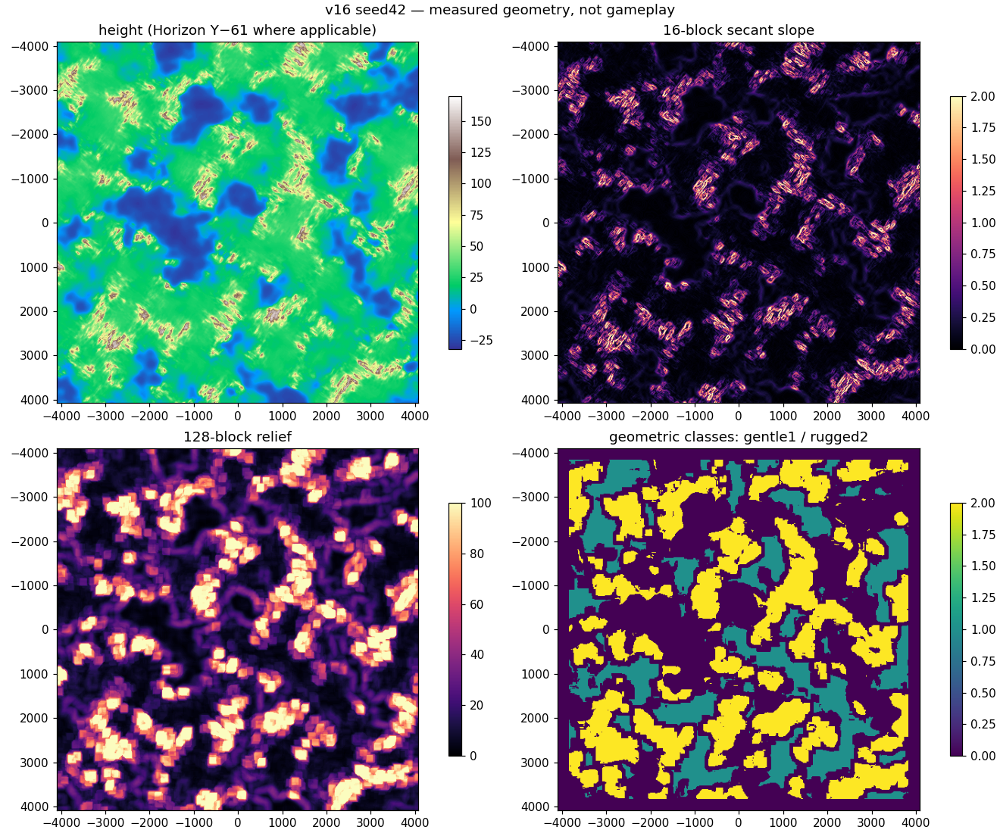
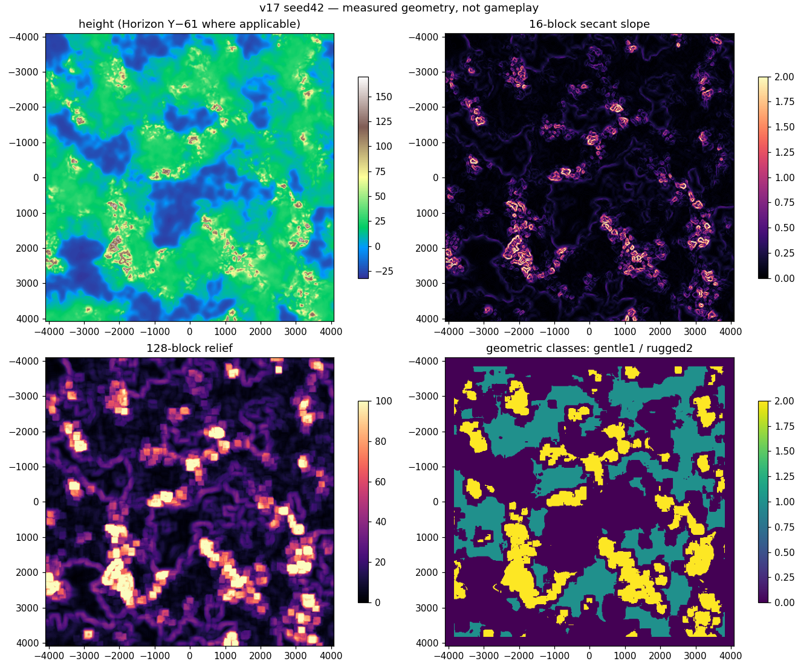
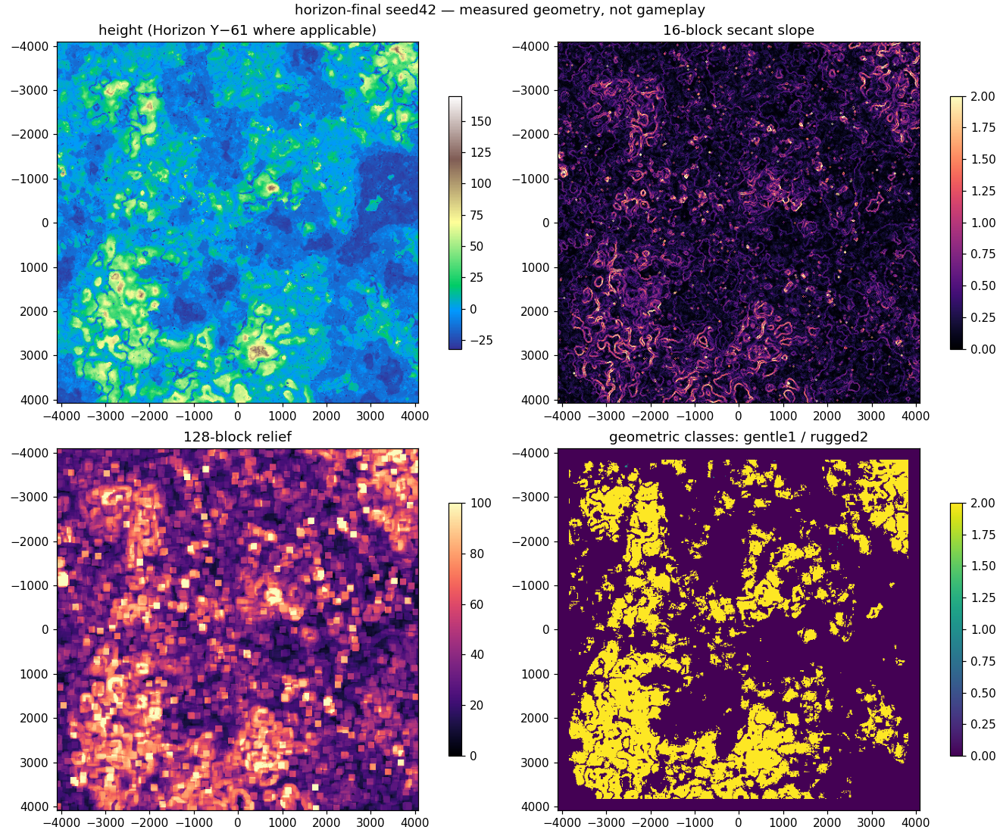

# Slice 43: Horizon-Informed Terrain Generation Rework

Base: latest merged main `1f60f01` (Slices 39/42, generator16).

## Architecture audit, recorded before implementation

Generators13–16 share `terrain_v5.rs`; v16 changes cave exposure, not terrain.
The continental field mixes1536/640/256-block gradients and a seven-knot height
datum. Erosion at768/320/128 gates a scalar relief budget. Two anisotropic
112/48/24 and448/144/56 ridge stacks blend with a regional grain field. A single
monotone weirdness curve multiplies that budget. Thus erosion controls essentially
one family of scaled silhouettes, rather than different geographic responses to
continentalness, erosion and peaks/valleys. The short ridge octaves carry much
of the macro height; large mountain regions can fragment into closely spaced
summits and sharp valleys. Raised negative-weirdness floors in v13 ameliorate
this but do not change the underlying separable composition. The Slice38 survey
still labels37–39% of central contextual land rugged versus22–24% gentle, with
129–165 narrow/deep transect minima per seed. These are descriptive RustCraft
classes, not Minecraft landscape statistics.

The datum/inland gate gives similar coastal/interior relief responses once
continentalness exceeds−250. A small72-block rolling field does not independently
organize broad hills. Positive-weirdness18-block detail and up to12-block3D
displacement can reinforce short ridges. The latter is bounded and memoized on
an absolute4³ lattice; it preserves overhangs efficiently, but is not a density
factor coupled to nested terrain shape. Summit compression above130 protects
the192 ceiling but cannot cure frequent steep slopes below that height.

Strengths to retain: signed continuous fields, harmonic Hermite tangents,
integer classification, globally aligned density lattice, bounded surface band,
regional grain, safe origin, and complete separation of historic generators.

Integration: `biome_v2::columns` builds20² density profiles/fields, derives18²
materials and low-pass32-grid elevation, and passes the original rim to Hydrology
v1. Water candidate admission must use the same versioned offset/envelope as
point queries. Hydrology only lowers admitted beds, protects wet banks from cave
carving and reuses the rim for exact slopes. Ecology selects fifteen existing
IDs after water, then vegetation checks actual terrain/root support. No biome ID
sets terrain height. The local plan shares these products across all16 vertical
chunks and halos.

Cave v16 still explicitly reads v13 heights in `density::Heights::new`; merely
extending its version range would feed old heights/slopes into v17 caves. V17
must route those inputs through its own terrain while retaining refined cave
fields, carvers and v16 exposure arithmetic. Deep cave noise, scales and family
thresholds must remain unchanged. The cave sloped-terrain adapter and independent
surface density can produce shallow cuts; the v16 cover control must remain.

Persistence validates versions independently in Generator, world bounds and
regional identities. New-world defaults use CURRENT_LOCAL_GENERATOR; manifest
versions and authoritative Air/build edits must remain unchanged. Historical
fixtures will be retained, with separate v17 fixtures. Unknown18+ must fail closed.

## Reference and evidence

Horizon revision: `0de893227f0dc4ad7bbbedee37744e007df04151`.
External functional registry: `538b2b167248c648b2198f2c0d56eced10dfc0cf`.
The isolated runner is prepared with `tools/horizon_reference/prepare.py`.
Reference source/data stay in ignored scratch storage; existing MIT notices
remain. Measurements below distinguish executed reference roots, actual final
density, adapted RustCraft and production-renderer images. Upstream parity
claims are not locally executed Minecraft parity.

Horizon bounds are Y[-64,320), sea63; RustCraft remains Y[-64,192), sea2.
Compare sea-relative height and height/(ceiling−sea), plus horizontal multi-scale
relief; absolute Y equality is not a meaningful objective.

## V17 terrain architecture

The new `terrain_v6` module is separate from all historical terrain arithmetic.
A shared56-block smooth domain shift curves rotated continental/erosion/weirdness
fields. Continental octaves are1536/640/256, erosion1024/384/160, and signed
structural weirdness384/160/72. In contrast to v13, short24-block detail does not
carry the mountain height budget. Folded peaks/valleys organize passes and
ridgelines; signed weirdness varies the smooth/rugged summit response.

Value-valued Q12 Hermite knots allow nested curves. Erosion selects distinct
plain, hill and mountain responses to peaks/valleys. Continentalness evaluates
another nested curve from coastal shoulders to inland ranges. The curves use
harmonic tangents rather than zeroing the derivative at every contour. They are
independently authored and sized for RustCraft, not copies of registry tables.
Separate96/224-block rolling fields retain lowland detail. The stronger mountain
branch requires the low-erosion tail; intermediate curves supply foothills.

A positive factor grades14→3. The sign of `factor*(offset−Y)+noise` has an algebraically equivalent bounded offset/amplitude form, quantized in Q12
for the shared4³ surface evaluator.
The maximum12-block3D envelope remains selective; quiet land has no3D density
cost. Fine24-block jaggedness is independently restricted to rugged upper slopes.
A soft summit cap above138 leaves world headroom. The protected origin remains
supported. No radial mountain-placement grid, biome-height lookup, completed
surface repair pass, full-height per-voxel graph or additional worker is added.

The macro configuration was fixed on the four development seeds before held-out
seeds. A regression subsequently required restoring rare overhang capacity; final
statistics were rerun. This bounded density change was driven by the required
surface-feature test, not tuning to held-out geographic percentages.

## Executed Horizon methodology

Inspected upstream `worldgen/router.rs`, the registry compiler, nested spline
evaluator, world fields, surface search, blended3D terrain noise, final density,
interpolation and context caches. A single compiler gives related roots a shared
cache namespace; contexts are reset between sampled locations. The router probe
executes continentalness, erosion, ridges/folded ridges, offset, factor,
jaggedness, depth, sloped cheese, base3D noise and final density at216 signed/distant/vertical
locations. These are native reference values, retained in the raw evidence.

The geography adapter has three distinct modes: the original quantized
`chunk_surface_level` search; highest positive **actual final-density** Y over all
384 integer layers; and a declared cave-disabled final-graph control. The latter
retains terrain slides/interpolation/squeeze and is appropriate for comparing
pre-cave RustCraft geography, but is an ablation, not an unmodified vanilla world.
The normal mode still includes the graph's cave branches. Neither density export
applies later carvers, aquifers, surface materials, bedrock or decoration. Full
cave-stage reference evidence remains in Slice42.

Normal reference volume and scalar evaluation agree on122,708 checked surface
heights; exported720 noise fixtures match the archived reference byte-for-byte.
The focused upstream density suite passes49 tests. Upstream-reported Minecraft
parity is separate from this local execution; no JVM oracle or Minecraft terrain
parity is claimed. All reference source/input hashes are retained.

For plots, reference Y subtracts61 so that sea63 aligns with sea2. Separate
normalized statistics multiply sea-relative height by190/257, using each
exclusive ceiling minus sea datum. This does not move sampled reference geometry.
Native and normalized results remain available, including cave-induced surface
pits. Do not read the descriptive gentle/hill/rugged classes as exact Minecraft
landscape or biome frequencies.

## Geographic results

[Full multi-scale distributions, continuity, connectivity, valleys and shape
screens](geography.md), with per-region/seed JSON and matching maps under
[diagnostics/](diagnostics/). Development grids use spacing16 across a central
8192² and two2048² distant signed windows; held-out seeds123/777/4099/900001 use
spacing32. Each development arm covers1,179,648 samples over301,989,888 blocks².
The reference and both RustCraft versions use identical X/Z grids.

Across the four development seeds, contextual gentle land changes22.1–24.2%→
36.4–40.5%, hills37.5–40.0%→37.6–41.3%, and rugged land36.6–39.1%→20.3–23.9%.
Narrow/deep transect minima fall129–165→22–35 per seed, with median half-depth
width112→128 blocks. These are geometric diagnostics with explicit thresholds;
no per-seed quota or single variance score drives generation. All distant adverse
regions and independent validation results are retained in the detailed report.

## Genuine visual comparisons

[Matched production-pipeline Bevy views and metadata](comparison.md).
Normal views use supported radius4 and production fog. Development-only wide
panoramas use the existing gallery's radius10/inspection fog, with identical seed,
X/Z and explicit camera poses per pair. The game still supports radii1–4. Terrain
is generated normally without placed blocks/lights or geometry edits. PPM captures
are encoded as PNG without compositing. Image/executable hashes and camera logs
are recorded. Software Vulkan images do not establish native Radeon performance.

## Cave, ecology and water integration

V17 reuses the exact v16 refined cave composition, named noises, carvers,
foundation/spawn guards and exposure-control arithmetic. Only its terrain
height/slope inputs change. One versioned initializer now serves both carver
point queries and bulk density bands, including whichever path runs first.
A regression checks that order explicitly, plus signed point/chunk/halo parity.
No underground family threshold, wavelength, branching rule or carver path is
retuned. Different terrain cover can change cave intersections and some covered
occupancy; deep equality to v16 is not promised for new v17 worlds.

The same Slice42 primary80 and independent40 sites are exported with a separate
cave-disabled geological control per version. All120 v16 normal exports and all
120 controls reproduce the archived hashes;29 freshly reanalyzed baseline windows
also reproduce headline exposure metrics. Archived v16 metrics are therefore
reused, with that provenance recorded. V17's120 windows are evaluated afresh with
the same physical-mouth, visibility, penetration and supported-access definitions.
[Exposure and deep-cave integration results](integration.md).

All fifteen biomes occur in the final73,728-point water/ecology survey. Existing
climate intervals, temperature/humidity, snowline/treeline, vegetation species,
root admission and surface materials remain. The versioned terrain facade feeds
point and cached ecology, low-pass elevation, coast probes and water admission.
Tests audit actual block geometry at fixed sites in all fifteen ecosystems.

Hydrology v1 still owns oceans, lake/river admission, common sea2, lowered beds,
shorelines and wet-bank cave seals. It receives the new profiles/envelopes/rim;
no water algorithm or fluid solver is rewritten. Existing architectural limits
remain: sea-level channels, bounded footprint admission and no watershed network.
The terrain router and versioned facade remain independent of future Hydrology v2.

## Compatibility and verification

New worlds default to17. Existing manifests retain generators1–16 and saved Air /
construction edits remain authoritative. There is no migration, new block ID,
format change, different bounds, radius increase or extra world-generation worker.
Generator/bounds/region/manifest validation accepts17 and rejects18+ safely.
Historical fixtures are not regenerated. V17 adds102 independent integer
router/factor/density-bit fixtures and24 full-height column/biome CRCs.

[Commands, complete logs, counts and remaining platform acceptance](validation.md).
Coverage includes deterministic signed profiles/halos, generation order/threads,
foundations/bounds, cave access, water containment, supported vegetation, spawn,
collision/mining/placement/torch light, saved edits/eviction/reopen, interrupted
journals, streaming cancellation and session/world switching.

## Costs and remaining limits

[Matched CPU, full-column, heap, mesh, publication and radius2–4 streaming
measurements in both execution orders](performance.md). Measurements are cloud
CPU/headless Bevy or software Vulkan as explicitly labeled; physical RX9060 XT
FPS/VRAM and native Gentoo/Void X11/Wayland/Windows input remain owner acceptance.

The new curves are an adaptation, not a port of the full Horizon terrain graph.
Local fields/density, sea/height proportions and water ecology differ. Numeric
shape screens cannot prove that every possible ring, dome or repeated silhouette
is absent; sampled maps and actual renders complement them. Small-window cave
routes/components are censored by their boundaries. More lowlands change ecology
and entrances naturally. Hydrology v2, new biomes, whole-world cave connectivity,
structures and exact Minecraft geography remain outside this slice.
